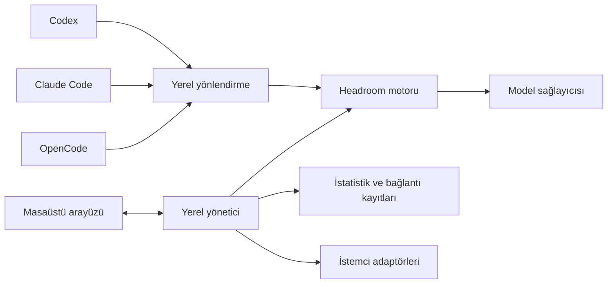

# Headroom Desktop — Ürün ve Özellik Spesifikasyonu

**Tarih:** 11 Kasım 2026\
**Belge sürümü:** 0.6\
**Durum:** Geliştirme kapsamı; uygulanmış özelliklerin kanıtlı durumu `TASKS.md` içindedir.  
**Proje kökü:** `D:\Projeler\Headroom`  
**Çalışma adı:** Headroom Desktop. Bu, Headroom motorunu kullanan bağımsız masaüstü yönetici projesinin geçici adıdır.

## 1. Ürün fikri

Codex, Claude Code ve OpenCode kullanan bir kişi, terminal komutları ve yapılandırma dosyalarıyla uğraşmadan Headroom üzerinden bağlantı kurabilmeli, sıkıştırmayı başlatıp duraklatabilmeli ve elde edilen girdi token azalmasını tek bir masaüstü panelinden görebilmeli.

Ürünün verdiği temel söz: **“Kullandığın kodlama asistanını bağla, mevcut modelinle çalışmaya devam et, tasarrufu gör.”**

Masaüstü uygulaması bağlantıyı, Headroom motorunun yaşam döngüsünü, geri alınabilir istemci ayarlarını ve ölçümleri yönetir. Sıkıştırma algoritmalarını yeniden geliştirmek başlangıç kapsamına dahil değildir. Headroom zaten bağımsız proxy ve yerel izleme yüzeyleri sunar. [Headroom proxy belgesi](https://docs.headroomlabs.ai/docs/proxy).

Başarı, ekranda büyük bir tasarruf yüzdesi göstermekten önce; kolay kurulum, çalışan streaming ve araç çağrıları, gerektiğinde özgün içeriğe erişim ve kullanıcının seçtiği model davranışının korunmasıdır.

## 2. İlk ürün kararları ve varsayımlar

| Konu | Başlangıç kararı |
| --- | --- |
| Platform | Windows 10 22H2 x64 ve Windows 11 x64 birlikte ilk sürüm kapsamındadır; macOS ve Linux sonraki dağıtım aşamalarında. |
| Kullanıcı | Bir veya daha fazla AI kodlama istemcisi kullanan geliştirici. |
| Dil | Türkçe ve İngilizce; metinler baştan çeviri anahtarlarıyla tutulur. |
| İşleyiş | Yerel masaüstü arayüzü + yerel yönetim katmanı + Headroom motoru. |
| Hesap | Uygulamanın kullanımı için yeni hesap açmak gerekmez. Mevcut istemci girişi kullanılır. |
| İlk istemciler | Codex, Claude Code ve OpenCode; arayüz varyantları ayrı doğrulanır. |
| Bağlantı | Desteklenen istemci ayarları veya süreç kapsamındaki başlatma seçenekleri. |
| Varsayılan optimizasyon | `coding` yaklaşımı, cache kararlılığı, retrieval erişimi ve dosya okuma korumaları. |
| Model ve efor | Kullanıcının seçimini koru; otomatik model veya reasoning effort düşürme. |
| Gizlilik | İstatistikler yerelde; ham konuşmalar ve kod içerikleri varsayılan olarak kaydedilmez. |
| İsim ve marka | Çalışma adı kullanılabilir; upstream proje ile resmî ortaklık iddia edilmez. |

“Herkes için kolay” hedefi, desteklenen sürüm ve giriş yöntemlerinde çalışır bir kurulum akışı anlamına gelir. Her istemcinin her sürümü, eklentisi ve hesap türü için aynı davranış vaat edilmez.

Windows 10 desteği sonraki sürüme ertelenmez. Windows 10 22H2 ilk doğrulama tabanıdır; daha eski Windows 10 sürümleri ve ARM/32-bit desteği ayrıca doğrulanmadan desteklenmiş sayılmaz. İstemcilerin kendi işletim sistemi gereksinimleri, masaüstü yöneticisinin gereksinimlerinden ayrı izlenir.

## 3. Kullanıcı açısından temel akış

1. **Aç:** Uygulama desteklenen istemcileri, sürümlerini ve önceki bağlantı tercihlerini otomatik bulur.
2. **Bir kez bağla ve başlat:** Bulunan uygulamalar sade bir listede gösterilir. Kullanıcı bağlanacak uygulamaları ve kısa etki özetini görüp **Bağla ve başlat** eylemini seçer; gerekli hazırlık, motor başlatma, ayar ve geri alma kaydı aynı akışta yapılır. Gereken istemci yeniden açılışı açıkça belirtilir; uygulamaların kısmi başarısı ayrı gösterilir.
3. **Sonraki kullanımlarda Başlat:** Önceki bağlantılar korunur; kullanıcı **Başlat** ile çalışmasına devam eder. Kurulum, CLI/Desktop veya model seçimini yeniden yapmaz; isteğe bağlı otomatik başlatma ayrıca sunulur. Henüz bağlanmamış bir istemciyi motoru başlatmak tek başına yönlendirmez.
4. **İzle:** Yeni gerçek istekler üzerinden bağlantı arka planda doğrulanır ve tasarruf gösterilir. Önceden bağlanmış bir istemci için her açılışta kurulum veya ücretli doğrulama isteği tekrarlanmaz.

Otomatik tarama, bilinen kurulum/yapılandırma konumları ve erişilebilen istemci sürüm bilgileriyle sınırlıdır. Bulunan bütün istemciler kendiliğinden bağlanmaz. Kullanıcının bir defalık seçimi, hangi programların ayarlarının değişebileceğini belirler. Sonradan kurulan yeni bir istemci de kullanıcı seçmeden bağlanmaz.

Kullanıcıdan terminal komutu, manuel port ayarı, config düzenleme veya sırf bu ürün için yeni API anahtarı oluşturması beklenmez. Desteklenen mevcut giriş yöntemi korunur. Otomatik algılama başarısızsa **Uygulamayı seç** alternatifi sunulur. Mevcut giriş yöntemi adaptörce desteklenmiyorsa farklı ve ücretli bir sağlayıcıya sessiz geçiş yapılmaz.

**Tek mantıksal bağlantı:** Aynı etkin ayar kapsamını ve desteklenen yönlendirmeyi kullandığı doğrulanan CLI/Desktop kurulumları normal akışta tek uygulama bağlantısı olarak gösterilir; ikili dosya ve sürüm ayrıntıları Gelişmiş'tedir. Farklı profil/proje/rota, eski veya kayıp kurulum ve ayar çatışmasında anlamlı seçim/kurtarma korunur; yalnız sürüme bakarak otomatik ikili seçilmez. Bir yüzeyin trafik doğrulaması diğer yüzeyin kanıtı sayılmaz. [3 Kasım UI/UX değerlendirmesi](docs/reviews/UX-2026-11-03.md) bu hedefin mevcut uygulamadan farkını ve ilgili görevleri açıklar; hedef akış henüz tamamlanmış sayılmaz.

**Bağlantıyı doğrula** ayrıca sorun giderme eylemi olarak bulunur. Kullanıcı hemen test etmek isterse küçük bir gerçek doğrulama isteği başlatabilir; bunun hesap kullanımına dahil olabileceği eylemde belirtilir. Normal çalışmada zaten geçen isteklerin kullanılması tercih edilir.

**İlk kurulum ile günlük kullanım ayrılır.** İlk kurulumda istemciyi yeniden açmak gerekebilir. Bir defa bağlanan ve arka plan motoru hazır olan istemcilerde günlük kullanım açma, duraklatma ve izleme düzeyinde kalır. Açık bir sürecin önceden kurulmuş bağlantılarını otomatik yakaladığımız varsayılmaz.

## 4. Çekirdek özellikler — ilk kullanılabilir sürüm

| Kimlik | Özellik | Kullanıcıya sağladığı sonuç |
| --- | --- | --- |
| F01 | Otomatik istemci algılama | Kurulu program, sürüm ve bağlantı uygunluğu görülür; bulunamazsa dosya seçimi sunulur. |
| F02 | Yönlendirmeli kurulum | Kullanıcı komut yazmadan desteklenen bağlantıyı kurar. |
| F03 | Geri alınabilir bağlantı | Uygulamanın yaptığı değişiklikler, sonraki kullanıcı ayarları korunarak kaldırılır. |
| F04 | Headroom motor yönetimi | Başlatma, sağlık kontrolü, port seçimi ve kontrollü toparlama tek yerden yürür. |
| F05 | Başlat / Duraklat | Sıkıştırma kontrolü model bağlantısını gereksiz yere kesmez. |
| F06 | Tasarruf görünümü | Girdi azalması, dönem toplamları, veri kaynağı ve son güncelleme zamanı görülür. |
| F07 | Özgün içeriğe erişim | CCR ile sıkıştırılan verinin gerektiğinde geri alınabilmesi doğrulanır. |
| F08 | Sistem tepsisi | Pencere kapatıldığında bağlantı sürer; durum ve temel eylemler tepsiden erişilir. |
| F09 | Uyum ve bağlantı doğrulaması | “Bulundu”, “yapılandırıldı” ve “gerçek trafik doğrulandı” farklı durumlar olarak gösterilir. |
| F10 | Model ayarlarını koruma | Ana model, alt ajan modeli, reasoning, izinler ve mevcut giriş yöntemi sessizce değiştirilmez. |
| F11 | Sorun giderme | Kullanıcıya ham stack trace yerine hata nedeni ve uygulanabilir sonraki adım gösterilir. |
| F12 | Dışa aktarma | İçeriksiz istatistik özeti JSON/CSV olarak alınabilir; tanı raporu kişisel yolları ve sırları ayıklar. |

Headroom'un `compress`, retrieval ve istatistik araçları mevcut motor yetenekleridir. Bunların eklenmesi tek başına bütün model trafiğinin otomatik sıkıştırıldığını kanıtlamaz. [MCP araçları](https://docs.headroomlabs.ai/docs/mcp).

## 5. İstemci entegrasyonları ve destek politikası

| İstemci / yüzey | Ürün hedefi | Doğrulamada özellikle bakılacak konu |
| --- | --- | --- |
| Codex CLI | İlk sürüm adaptörü | Süreç/kullanıcı yönlendirmesi, Responses streaming, WebSocket, araç çağrıları ve mevcut auth. |
| Codex masaüstü uygulaması | Birinci öncelikli gerçek kullanım hedefi | Ayarın gerçekten uygulandığı yer, ilk yeniden başlatma, ana ajan ve alt ajan trafiği. |
| Claude Code CLI | İlk sürüm adaptörü | Anthropic protokolü, streaming, retrieval ve giriş yönteminin korunması. |
| OpenCode CLI / TUI | İlk sürüm adaptörü | Etkin sağlayıcı/model, JSON/JSONC ayarları ve OpenAI/Anthropic yolları. |
| VS Code / JetBrains eklentileri ve diğer masaüstü varyantları | Her biri ayrı uyumluluk girişi | CLI desteği bu yüzeylere otomatik taşınmış sayılmaz. |
| Cursor, Copilot ve diğer uyumlu araçlar | Sonraki adaptörler | Sürüm ve protokol bazında eklenir; ilk sürümde evrensel destek rozeti verilmez. |

Her adaptör; istemci sürümü, işletim sistemi, arayüz türü, giriş yöntemi, protokol ve son başarılı doğrulama tarihinden oluşan bir uyumluluk kaydı tutar. Durumlar **Doğrulandı**, **Deneysel**, **Desteklenmiyor** şeklindedir. Bir dosya yolunun mevcut olması destek kanıtı değildir.

Doğrulanmış yayıncı imzası veya güvenilir kaynaktan sabitlenen hash dosyanın kökenini; gerçek config/protokol/özellik deneyi davranış uyumluluğunu doğrular. Salt sürüm numarası değişimi genel uyumsuzluk iddiası üretmez; bilinen kırılmalar ve güvenlik sınırları korunur; güncelleme sonrası önceki davranış kanıtı stale olur ve kontrollü yeniden doğrulama gerekebilir. Normal akışta binary seçimi kullanıcıya yüklenmez.

### Alt ajan kapsamı

**Kullanıcı kararı — varsayılan kapsam:** Kullanıcı istemciyi bağladığında o bağlantının desteklenen bütün modelleri, ana ajanı ve bütün alt ajanları birlikte kapsanır. Model veya alt ajan başına ayrı seçim/kurulum gerekmez. Bu bir ürün kabul koşuludur; henüz bütün istemci/auth/ajan kombinasyonlarının doğrulandığı anlamına gelmez.

Hedef, bağlı istemcinin ana ajanı ile aynı yönlendirmeyi kullanan alt ajanlarını birlikte kapsamaktır. Her alt ajan için kullanıcıya ayrı bir **Bağlan** işlemi yaptırılmaz. Alt ajan hangi modeli kullanırsa kullansın, desteklenen aynı sağlayıcı/proxy yolundan geçen uygun istekler optimizasyona dahil edilir.

Ayrı süreç, ayrı sağlayıcı veya bulut ortamında çalışan bir alt ajanın kapsandığı varsayılmaz. Bu yol ayrıca bağlanıp doğrulanmadıkça arayüz tam kapsama iddiası taşımaz. Ana/alt ajan kimliği ölçülemiyorsa yalnız doğrulanmış toplam trafik gösterilir; model adından ajan kimliği uydurulmaz. Uygulama alt ajan oluşturmaz, çalışan sayısını veya model/efor ayarını değiştirmez.

Bağlantı planı bilinen alt ajan/sağlayıcı rota farklarını hesaba katar; mümkün olan desteklenmiş yollar aynı tek kurulum planında hazırlanır. Proxy'yi atlayan yerel veya bulut yolu kendiliğinden kapsanmış sayılmaz; arayüz ana/alt ajan kapsamını doğrulandı, kısmi veya bilinmiyor olarak gösterir. Yeni açılan alt ajan aynı doğrulanmış rotayı kullanıyorsa ayrı bağlantı gerektirmez. Bütün trafik için ajan ataması yoksa “tüm alt ajanlar doğrulandı” yazılmaz.

### Model kapsamı

Ürün belirli birkaç model adına sabitlenmez. Bağlı istemci ve desteklenen sağlayıcı protokolü üzerinden geçen modelleri kapsaması hedeflenir. Kullanıcının istemci içinde model değiştirmesi tek başına yeniden bağlantı kurulmasını gerektirmez; değişen upstream veya giriş yolu ise yeni doğrulama gerektirebilir.

Kullanıcının temel seçimi **hangi istemci/bağlantı kapsamının bağlanacağıdır**. Modeli kendi Codex/Claude Code/OpenCode arayüzünde seçmeye devam eder; Headroom'da her modeli ayrıca açması gerekmez. Bağlı yoldaki aynı model veya farklı modellerle çalışan alt ajanlar varsayılan dışlama listesine alınmaz. Yeni model adı tek başına mevcut protokol desteğini bozmuş veya o modelin bütün yeni özellikleri doğrulanmış sayılmaz.

Kapsam ölçütü model markası değil; istek protokolü, giriş yöntemi ve motorun ilgili içerikte güvenle uygulayabildiği dönüşümlerdir. Her modelin her özelliğinin sıkıştırılabildiği söylenmez. Şifreli reasoning veya motorun desteklemediği bloklar değiştirilmeden korunur; bu bloklarda tasarruf gösterilmez. Yeni/bilinmeyen model yeterince desteklenmiyorsa model değiştirmek yerine desteklenen ham iletim yolu kullanılır ve optimizasyon sınırı gösterilir. Ham iletim de doğrulanamıyorsa uyumsuzluk açıkça bildirilir.

Sabit model listesi, zorunlu düşük efor veya otomatik ucuz model seçimi bağlantının koşulu değildir. Model adı, reasoning düzeyi ve alt ajan seçimi kullanıcıya aittir. Her modelde aynı tasarruf oranı beklenmez.

### Codex için bağlayıcı karar

Codex'in güncel belgeleri, proje `.codex/config.toml` dosyasındaki sağlayıcı ve base URL ayarlarının yok sayıldığını söylüyor. Bu nedenle Codex adaptörü böyle bir proje ayarını çalışan bağlantı olarak sunamaz; desteklenen kullanıcı veya süreç kapsamını açıkça kullanır. [Resmî Codex yapılandırması](https://learn.chatgpt.com/docs/config-file/config-advanced#project-config-files-codexconfigtoml).

Kullanıcı ana ajanına ve her alt ajanına istediği farklı modeli ve reasoning düzeyini atayabilir; başka sohbetlerde bunları değiştirebilir. Uygulama ajan sayısı veya modeli belirlemez ve model/ajan başına yeniden bağlantı istemez. Bu projeyi geliştiren çalışanın model tercihi ürünün destek koşulu değildir. Ana ve alt ajan isteklerinin aynı yolu kullandığı ayrı doğrulanır; yalnız model adından ajan kimliği çıkarılmaz.

Model kapsamı kabulünde farklı ana/alt ajan modelleri, bağlı istemcide model değişimi ve aynı protokolde yeni model adının korunması sınanır. Model adına dayanan sabit izin listesi bağlantı koşulu olamaz. Protokol veya özellik uyumsuzluğu model değiştirilerek gizlenmez; ölçülen kapsam gösterilir. Temsili testler bütün modellerin bütün özelliklerinin doğrulandığı şeklinde sunulmaz.

### Claude Code için bağlayıcı karar

Claude Code kullanıcı, proje ve yerel proje ayarlarını farklı kapsamlarda okur. Adaptör etkin ayar kaynağını bulmalı ve mümkün olan en dar desteklenen kapsamı sunmalıdır. [Resmî ayar kapsamları](https://code.claude.com/docs/en/settings).

Eklenti ve masaüstü varyantlarında tool-search içeriklerinin görüntülenmesi gibi ayrı sorunlar bulunabilir. Bu yüzeyler CLI ile aynı destek satırına konulmaz. [Headroom'un eklenti uyumluluk notu](https://docs.headroomlabs.ai/docs/persistent-installs#claude-code-vscode-extension-caveat).

### OpenCode için bağlayıcı karar

Headroom'un OpenCode belgesi, oluşturulan sağlayıcıda varsayılan bir model seçimi tanımlıyor. Ürün adaptörü wrapper'ı körlemesine çalıştırıp kullanıcının modelini değiştiremez. Kurulumdan önce ve sonra etkin upstream model eşitliği doğrulanır; gerekli sağlayıcı takma adı değişikliği ayrıca kaydedilir. [Headroom OpenCode entegrasyonu](https://docs.headroomlabs.ai/docs/opencode).

OpenCode'un JSON ve JSONC biçimleri desteklenir. Yorumlar ve kullanıcıya ait alanlar korunur; tüm dosyayı eski bir yedekle ezmek normal kaldırma yöntemi olamaz. [Resmî OpenCode yapılandırması](https://opencode.ai/docs/config/).

## 6. Başlatma, duraklatma ve kapanış davranışı

Kullanıcının gördüğü eylemler:

- **Başlat:** Proxy hazırsa yeni istekler için desteklenen sıkıştırmayı etkinleştirir.
- **Duraklat:** Devam eden istekleri bölmeden yeni sıkıştırmayı durdurur; bağlantı ve retrieval hizmeti korunur.
- **Bağlantıyı kaldır:** Uygulamanın yönlendirmesini geri alır; mevcut süreç için yeniden başlatma gerekiyorsa açıklar.
- **Pencereyi kapat:** Sistem tepsisine küçültür; motoru sonlandırmaz.
- **Tamamen çık:** Bağlı istemci ve etkin istek varsa etkisini gösterir; çalışan süreci sessizce kesmez.

Duraklatma uygulaması, doğrudan `--no-optimize` açıp kapatmakla tamamlanmış sayılmaz. Önceden gönderilmiş sıkıştırılmış geçmişin prefix'i, CCR kayıtları ve devam eden stream'ler korunmalıdır. Motorun buna uygun davranışı teknik prototipte kanıtlanır.

Kalıcı olarak proxy'ye yönlendirilmiş bir istemci, motor kapalıyken bağlantı kuramayabilir. Arka planda çalışma ve isteğe bağlı Windows başlangıcı bu nedenle ayrı, anlaşılır ayarlardır. Yeni kurulum bu tercihi açıkça gösterir. Beklenmeyen motor çökmesinde sınırlı yeniden başlatma denenir; başarısızlık gizlenmez. Kesintisiz otomatik doğrudan bağlantıya dönüş, ayrıca kanıtlanmadan ürün sözü değildir.

Headroom'un kalıcı çalışma seçenekleri vardır; masaüstü ürünün bunları nasıl sahiplenip geri alacağı ayrı yönetilir. [Kalıcı çalışma seçenekleri](https://docs.headroomlabs.ai/docs/persistent-installs).

## 7. Bağlantı durumları

Bağlantı, motor ve sıkıştırma durumları ayrı tutulur. Arayüzde tek “aktif” etiketiyle hepsi temsil edilmez.

| Görünen durum | Anlamı | Ana eylem |
| --- | --- | --- |
| Bulunamadı | İstemci otomatik bulunamadı. | Uygulamayı seç |
| Bağlı değil | İstemci bulundu; yönlendirme kurulmadı. | Bağlan |
| Hazırlanıyor | Motor veya istemci ayarı hazırlanıyor. | İlerlemeyi gör |
| Yeniden başlatma gerekiyor | Ayar yazıldı; açık süreç henüz yenilenmedi. | Nasıl devam edeceğini gör |
| Doğrulama bekleniyor | Yapılandırma hazır; gerçek istek kanıtı yok. | Bağlantıyı doğrula |
| Sıkıştırma açık | Doğrulanmış yol üzerinde yeni sıkıştırma etkin. | Duraklat |
| Duraklatıldı | Bağlantı sürüyor; yeni sıkıştırma kapalı. | Başlat |
| Sorun var | Motor, kimlik doğrulama veya protokol hatası var. | Sorunu çöz |
| Veri bekleniyor | Bağlantı sağlıklı; seçili dönemde ölçülebilir trafik yok. | Normal çalışmaya devam et |

“Son doğrulama” ve “son istek” zamanları gösterilir. Yapılandırma veya sürüm değişirse eski doğrulama güncelmiş gibi kullanılmaz. Sessiz bir oturum hata sayılmaz.

## 8. Modern ve minimal arayüz yönü

**Tasarım karakteri:** Sakin, teknik ama erişilebilir bir geliştirici masaüstü aracı. Geniş boşluk, güçlü tipografik hiyerarşi, az sayıda renk ve anlaşılır durumlar.

Üç karşılaştırılabilir görsel yön ve etkileşimli önizlemeler [UI_CONCEPTS.md](UI_CONCEPTS.md) dosyasındadır. Kullanıcı **Graphite** yönünü seçti; aynı düzenin açık/koyu temaları geliştirilir. Karar: [001 — UI yönü](docs/decisions/001-ui-direction.md).

### Görsel temel

- Koyu ve açık tema; varsayılan sistem temasını izler.
- Koyu tema: grafit zemin `#111315`, panel `#1A1D21`, ana metin `#F0F2F4`, ikincil metin `#A2AAB6`, vurgu `#47C7A5`.
- Açık tema: zemin `#F7F8FA`, panel `#FFFFFF`, ana metin `#1C2027`, vurgu `#147D68`.
- Windows'ta Segoe UI Variable / Segoe UI; metriklerde tabular rakamlar. Font lisansı veya indirmesi gerektiren seçim başlangıç şartı değildir.
- Windows 11'e özgü pencere efektleri temel işlevler için zorunlu olmaz. Windows 10'da aynı düzen, okunabilirlik ve eylemler desteklenen görsel alternatiflerle korunur.
- İnce ayırıcılar, ölçülü 8–12 px köşe yarıçapı; yoğun gölge veya sürekli parlayan dekorasyon kullanılmaz.
- 120–180 ms işlevsel geçişler; azaltılmış hareket tercihine uyum.
- Klavye erişimi, görünür odak, en az WCAG AA metin kontrastı hedefi; durumlar yalnız renkle anlatılmaz.

### Dört ana ekran

1. **Genel bakış:** Bağlantı durumu, tek ana Başlat/Duraklat eylemi, seçili dönemin girdi azalması, tek zaman grafiği ve kısa uygulama listesi.
2. **Uygulamalar:** Codex, Claude Code, OpenCode bağlantıları; sürüm, kapsam, son doğrulama ve bağlan/kaldır eylemleri.
3. **Etkinlik:** İçerik göstermeyen istek listesi; model, istemci, süre, sıkıştırma sonucu ve hata. Filtreler ve ayrıntı paneli.
4. **Ayarlar:** Tema, dil, arka planda çalışma, veri saklama ve sade sıkıştırma tercihleri. Gelişmiş ayrıntılar isteğe bağlı açılır.

### 24 Ekim kullanıcı yönü — sade kullanım ve oturumlar

Bu bölüm hedef davranıştır; uygulanmış durum TASKS.md ile sınırlıdır. Ana deneyim iki soruyu cevaplar: **Hangi platform/modelde ne kadar kullandım ve tasarruf ettim? Hangi hesaplarım bağlı ve hangi sohbetlerim açık/çalışıyor?** Graphite görsel yönü korunur.

- Genel bakış, platform → model kırılımında kullanılan token, tasarruf edilen token ve aynı temelden tasarruf yüzdesini gösterir. Maliyet resmî kullanım/fatura verisine dayanıyorsa ölçülen, sürümlü fiyat hesabına dayanıyorsa tahmini olarak etiketlenir; abonelik kotası token maliyetine çevrilmez. Veri yokluğu sıfır sayılmaz.
- Bağlantının normal görünümü kapsam, kısa etki özeti ve Bağlan/Geri al eylemidir. Ayar katmanları, protokol/sahiplik metadata ve tanı bilgisi Gelişmiş altında isteğe bağlı açılır; değişecek hedef ve kritik çatışmalar işlemden önce anlaşılır kalır.
- Oturumlar iki ayrı grup içerir: hesap bağlantıları/giriş durumu ve açık sohbetler/çalışan görevler. Birinin açık olması diğerinin açık olduğu anlamına gelmez. Giriş, desteklenen istemcinin resmî akışıyla açılır; Headroom şifre/kod istemez, mevcut auth sırlarını kopyalamaz. Yeni hesap/abonelik zorunluluğu yoktur.
- Sohbet listesi yalnız gereken metadata ile çalışır. Açık, çalışıyor, son trafik gözlendi, sona erdi ve bilinmiyor durumları birbirine dönüştürülmez. Süreç bulunması, dosyanın varlığı veya uzun süre trafik olmaması tek başına etkin sohbet kanıtı değildir. Desteklenen resmî aç/resume yolu varsa kullanıcı eylemiyle kullanılır; içerik toplama veya gizli provider/model değişimi yapılmaz.
- Ayrı model ve alt ajanlar rota/kimlik kanıtı varsa aynı platform altında görünür; model başına kurulum/seçim zorunluluğu yoktur. Atanamayan kullanım görünür kalır. Proxy'den geçmeyen trafik bütün kullanım olarak sunulmaz.

Uygulama sırası: H022 sade bağlantı, H023–H026 gerçek ölçümler/kırılımlar, H050 hesap bağlantıları ve H051 sohbet metadata/açma akışı. Mevcut H020 teknik kabul ekranı son kullanıcı deneyiminin tamamlanmış hâli değildir.

Genel bakış yerleşimi:

```text
┌──────────────────────────────────────────────────────────┐
│ Headroom Desktop                 Durum     [Başlat]      │
├───────────────┬──────────────────────────────────────────┤
│ Genel bakış   │ Girdi token azalması       [Bugün ▾]     │
│ Uygulamalar   │ değer / veri bekleniyor    ölçüm zamanı  │
│ Etkinlik      │                                          │
│ Ayarlar       │ Tek zaman grafiği                        │
│               │                                          │
│               │ Bağlı uygulamalar ve son trafik          │
│               │                                          │
│ Motor durumu  │ Gerektiğinde tek, açıklayıcı durum mesajı│
└───────────────┴──────────────────────────────────────────┘
```

İlk açılışta sahte grafik veya örnek tasarruf gerçek veri gibi gösterilmez. “Henüz istek geçmedi” boş durumu kullanılır. İlk kullanım, yükleme, duraklatma, hata ve bağlantı kaldırma durumları tasarımın parçasıdır. Hedef çalışma alanı 1280×800; 1024×720 ve Windows %125/%150 ölçeklerinde temel kontroller erişilebilir kalır.

## 9. Tasarruf ve kullanım ölçümü

Ana metrik **Headroom'un hesapladığı girdi token azalmasıdır**. Gerçek sağlayıcı faturasındaki net kazanç veya abonelik kullanım hakkı ile eşitlenmez.

```text
B = aynı kapsamda sıkıştırma öncesi girdi tokenları
A = aynı kapsamda sıkıştırma sonrası girdi tokenları
S = B - A
Oran = 100 × S / B  (yalnız B > 0 ve iki değer de biliniyorsa)
```

**Kullanıcı talebi — yüzdelik görünüm:** Genel bakışta tasarruf edilen token sayısı ve yüzdesi birlikte görünür. Örnek gösterim `%37,5 · 45.000 token` için öncesi `120.000`, sonrası `75.000` olur; bu yalnız açıklayıcı örnektir. Seçilen dönem değiştiğinde iki değer aynı kapsamdan birlikte güncellenir. Öncesi/sonrası değerleri, veri kaynağı ve ölçülebilen kapsam ayrıntıda görülür; JSON/CSV de aynı yüzdeyi içerir. Veri yoksa `— / Veri bekleniyor`, ölçülebilir gerçek sıfırda `%0`, negatif farkta “token artışı” gösterilir. Yüzde TR/EN yerelleştirmesine uygun biçimlenir.

- Dönem yüzdeleri toplam B ve A üzerinden hesaplanır; istek yüzdelerinin ortalaması alınmaz.
- Token sayacının kaynağı ve hassasiyeti korunur: sağlayıcı tokenizer'ı, yerel tahmin veya bilinmiyor.
- Eksik veri sıfıra çevrilmez. Negatif fark varsa artış olarak gösterilir; sessizce silinmez.
- Tahmini dolar karşılığında model, fiyat kaynağı, fiyat tarihi ve cache varsayımı görünür olur. Bilinmeyen fiyat için uydurma tutar gösterilmez.
- Sağlayıcının bildirdiği input/output/cached tokenlar, varsa ayrı alanlardır. Bunlar yerel sıkıştırma sayaçlarına eklenmez.
- Retrieval ve tekrar denemelerinin ek kullanım oluşturabileceği gösterilir. Yalnız çıkarılan içerik üzerinden net maliyet iddiası kurulmaz.
- Oturum, bugün, 7 gün ve eldeki kayıt süresi kadar geçmiş görünür. Daha uzun dönem için uygulamanın kendi yerel saklama katmanı gerekir.

Headroom'un kalıcı event kaydı, anlık `/stats` ve MCP snapshot'ları farklı kaynaklardır. Uygulama kayıt türlerini normalize etmeli; proxy, MCP ve subagent toplamlarını körlemesine birleştirmemelidir. [Tasarruf kayıtlarının yapısı](https://docs.headroomlabs.ai/docs/savings), [izleme uçları](https://docs.headroomlabs.ai/docs/metrics).

İsteğe bağlı terminal filtresi/proxy gibi ek katmanlar Headroom motor ölçümüne eklenerek tek bir yüzde yapılmaz. Komut çıktısı baytları, RTK’nın bytes/4 tahmini, aynı temelde karşılaştırılabilen toplam girdi tokenları, sağlayıcı cache/output sayaçları ve fatura kullanımı ayrı tutulur. Katmanlar yalnız aynı istek/iş yükü bağı ve karşılaştırılabilir temel kanıtlanırsa yan yana kıyaslanır; kanıt yoksa bilinmiyor kalır.

İstemci/model kırılımı kanıt varsa gösterilir. Proje, sohbet, ana ajan ve subagent kırılımı yalnız güvenilir metadata veya uygulamanın yönettiği başlatma eşlemesi varsa gösterilir. Aksi halde “Atanamayan trafik” ya da “Proxy toplamı” kullanılır. Aynı model iki farklı ajan tarafından kullanılabilir.

Panel istatistikleri doğrudan yerel kayıtlardan okur; rapor hazırlamak için LLM çağrısı yapmaz. GPT'nin her son mesajına tasarruf satırı ekletmek ilk sürümün gereği değildir. Sonradan istenirse kısa, koşullu ve snapshot zamanını belirten bir entegrasyon olabilir.

## 10. Ürünü farklılaştıran özellikler

### İlk sürümde

- **Gerçek bağlantı durumu:** Ayar dosyası bulunduğu için “çalışıyor” demez; son gerçek isteği ve doğrulamayı gösterir.
- **Seçtiğin modelle devam:** Kurulum öncesi/sonrası model ve efor karşılaştırması; açık uyumsuzluk bildirimi.
- **Tek yerden geri dönüş:** Bağlantıyı kaldırma ve kullanıcı değişikliklerini koruma.
- **Cache görünümü:** Veri varsa cache kullanımını token azalmasıyla yan yana gösterir; veri yoksa oran uydurmaz.
- **Sessiz sistem tepsisi:** Sağlıklı çalışmada sürekli bildirim üretmez; yalnız anlamlı durum değişiklikleri bildirir.

### Sonraki küçük sürümlerde

- **İçerik türüne göre görünüm:** JSON, log, arama ve diğer türlerde nereden kazanç geldiği; metadata yeterliyse.
- **Yerel örnek deneyi:** Kullanıcı seçtiği bir dosyada sağlayıcıya istek göndermeden sıkıştırma önizlemesi yapar. Bu, cevap kalitesi veya fatura kazancı testi olarak sunulmaz.
- **Proje tercihleri:** İstemci ve doğrulanmış proje eşlemesine göre öneriler. Aynı proxy'nin global ayarlarını projeler arasında çakıştırmaz.
- **Dışa aktarılabilir tanı:** Sürüm, bağlantı testi ve ayar farklarının içeriksiz raporu.
- **Uyum denetimi:** İstemci güncellendikten sonra yeniden doğrulama ihtiyacını bildirir; çalışırken motoru zorla değiştirmez.
- **İsteğe bağlı terminal filtresi:** H043/H044 sınırları içinde, doğrulanmış istemci ve shell komutlarına ek bir katmandır. Bağlantıdaki model, reasoning, auth veya ajan ayarını değiştirmez; yerel/yerleşik araç çağrılarını otomatik yakaladığı varsayılmaz.

Claude Code, Codex ve diğer istemcilerde büyük geçmişin yeniden yazılması cache kazancını azaltabilir. Cache koruması ve yeni içerik üzerinde çalışma başlangıç stratejisidir; “daha agresif her zaman daha iyi” varsayılmaz. [Cache davranışı](https://docs.headroomlabs.ai/docs/cache-optimization).

## 11. Sıkıştırma ve özgün içerik politikası

- Başlangıç: `coding` profili ve `cache` modu; etkin ayarlar motor sürümünden doğrulanır.
- Düzenlenen kaynak dosyaları, tam kimlikler ve kesin sayısal karar verileri için koruma önceliklidir.
- Gelişmiş ayarlarda çıktısı korunacak araç adları seçilebilir. Etkin motorun desteklediği tool-result koruması kullanılır; seçilen adlar ve değişikliğin hangi bağlantı/motor grubunu etkilediği gösterilir. Sayısal verinin korunması doğrulanmış dosya okuma/araç politikasıyla sağlanır; bütün sayısal içerikleri otomatik tanıma garantisi verilmez. Deneydeki `numeric_report` yalnız sentetik araç adıdır, üretim varsayılanı değildir.
- CCR ile saklanan özgün içeriğin retrieval aracıyla erişilebilir olduğu test edilir; yalnız marker üretmek yeterli değildir.
- Başlangıç TTL hedefi 7200 saniyedir. Etkin değerin uygulandığı doğrulanır; dolan kayıtların geri getirilemeyeceği gizlenmez.
- Duraklatma ve pencereyi kapatma mevcut retrieval kayıtlarını kendiliğinden temizlemez.
- Output shaper, otomatik efor azaltma, model değiştirme, sürekli öğrenme ve otomatik talimat dosyası yazma başlangıçta kapalıdır.
- Kullanıcıya sade tercih sunulur: önerilen kodlama ayarı ve gelişmiş ayrıntılar. Ham env değişkenleri ana kullanıcı akışına taşınmaz.

CCR, saklanan özgün içeriğin sonradan alınmasını sağlar; sıkıştırılmış görünümün bütün ayrıntıları taşıdığı veya modelin her eksik ayrıntıyı mutlaka geri isteyeceği garantisi değildir. [CCR ve retention](https://docs.headroomlabs.ai/docs/ccr).

## 12. Teknik mimari önerisi

**Önerilen başlangıç:** Tauri 2 masaüstü kabuğu, Rust yönetim katmanı, React + TypeScript arayüz, sürümü sabitlenmiş Headroom yan motoru ve yerel SQLite metadata deposu. Bu bir öneridir; teknik doğrulama öncesinde kesinleştirilmiş bağımlılık listesi değildir.

Tauri, haricî yürütülebilir dosyaların sidecar olarak paketlenmesini destekler. Bu imkân, Headroom ve isteğe bağlı ML bağımlılıklarının Windows'ta gerçekten sorunsuz paketlendiğini tek başına kanıtlamaz; temiz makine deneyi gerekir. [Tauri sidecar belgesi](https://v2.tauri.app/develop/sidecar/).



### Bileşen sorumlulukları

- **Arayüz:** Durumu gösterir ve tanımlı eylemleri çağırır. Dosya yollarından serbest shell komutu üretmez.
- **Yerel yönetici:** Motor sahipliği, portlar, sağlık, kontrollü kapanış, config işlemleri ve metrik normalizasyonu.
- **İstemci adaptörleri:** Algılama → değişiklik planı → uygulama → gerçek doğrulama → geri alma. İstemciye özgü farkları saklamaz.
- **Headroom motoru:** Desteklenen protokol yönlendirmesi, sıkıştırma ve retrieval. Upstream sürümüne bağlı davranış kaydedilir.
- **Yerel kayıt:** Bağlantı manifesti, sürümler, metrik olayları ve son doğrulamalar. Ham prompt/response deposu değildir.

Çakışan upstream, profil veya giriş ayarı tek ortak proxy'ye son yazan kazanır biçiminde uygulanmaz. Başlangıçta aynı güvenilir ayarlar paylaşılır; ayrışma gerekiyorsa ayrı, uygulamaya ait motor grubu açılır. Aktif oturumun ayarı başka bir bağlantı yüzünden değiştirilmez.

### Dağıtım hedefi

Son kullanıcıya Python, Node.js, Rust veya terminal kurdurmayan bir Windows installer hedeflenir. WebView2/runtime gibi ön koşullar installer tarafından anlaşılır biçimde yönetilir. Geliştirme sırasında uv kullanılabilir; bu, son kullanıcı için kalıcı bir zorunluluk olarak bırakılmaz.

Installer Windows 11'i zorunlu alt sınır yapmaz. Windows 10 22H2 ve Windows 11'de WebView2 varlığı denetlenir; eksik runtime için desteklenen kurulum akışı sunulur. Uygulama kabuğunun desteği yeterli kabul edilmez: Headroom, paketlenmiş Python/native bağımlılıklar, sistem tepsisi ve güncelleme yolu da iki işletim sisteminde ayrı sınanır. [Tauri sistem ön koşulları](https://v2.tauri.app/start/prerequisites/), [Windows installer ve WebView2 dağıtımı](https://v2.tauri.app/distribute/windows-installer/).

19 Ekim 2026 tarihinde PyPI üzerinden görülen Headroom sürümü `0.41.0`, Python alt sınırı `3.10` idi. Prototipte seçilen sürüm kilitlenir; yayın öncesi güncel uyumluluk ayrıca doğrulanır. [Paket kaydı](https://pypi.org/project/headroom-ai/0.41.0/).

## 13. Yapılandırma, veri ve uygulama sınırları

- Yerel bağlantılar loopback üzerinde tutulur. Yönetim eylemleri yalnız uygulamanın yetkili yerel kanalından kabul edilir.
- Giriş tokenları ve API anahtarları UI loglarına veya istatistik deposuna yazılmaz. Mevcut istemci auth dosyalarının kopyalanması normal kurulum yöntemi değildir.
- **11 Kasım kullanıcı kapsamı:** H052–H054 ile bize ait özel Cloudflare Workers/D1 rapor API'si ve yetkili panel, kullanıcının önizleyerek gönderdiği geri bildirim ve isteğe bağlı günlük tasarruf özetleri planlanır. İlk açılışta gösterilen veriye ilişkin açık seçimden sonra gönderim otomatikleşir; kapatma ve bekleyen raporu temizleme mümkündür. Yerel ölçüm paylaşım tercihiyle karıştırılmaz. Günlük kurulum özetleri 30 gün tutulur; daha eski istatistikler kurulum kimliği/günlük ayrıntıdan arındırılarak toplulaştırılır. Kod/konuşma, proje yolu, auth sırları ve hesap/sohbet kimliği uzak özete girmez. Katılım ve ölçüm temeli görünür tutulur; farklı temeller birleştirilmez. Ücretsiz kota, veri bölgesi, erişim, silme ve saklama gerçek dağıtımın kabulüdür. [Görevler](TASKS.md#geri-bildirim-ve-isteğe-bağlı-kullanım-paylaşımı--11-kasım-kullanıcı-kararı).
- Yerel istatistikler açık, upstream anonim kullanım beacon'u kapalı başlangıç tercihidir: desteklenen sürümde `HEADROOM_TELEMETRY=on` ve `HEADROOM_BEACON=off` birlikte doğrulanır. Bu iki özellik aynı şey değildir. [Headroom telemetry açıklaması](https://docs.headroomlabs.ai/docs/proxy#starting-the-proxy).
- Motor, seçili model sağlayıcısına istek gönderir; gerektiğinde paket/model indirmeleri ayrı gösterilir. “Uygulama hiçbir zaman internete çıkmaz” sözü verilmez.
- Kullanıcı verileri kurulum klasörüne yazılmaz. Önerilen kök `%LOCALAPPDATA%\HeadroomDesktop` altında config, state, engine ve diagnostics alt dizinleridir.
- Uygulamanın sahip olduğu süreçler ve dosyalar manifestle izlenir. Bilinmeyen port dinleyicileri sonlandırılmaz; başka Headroom kurulumları sahiplenilmez.
- Config düzenlemeleri atomik ve doğrulanmış olur. Uygulamanın değiştirdiği alanların öncesi/sonrası ve fingerprint'i kaydedilir.
- Geri alma, uygulamanın sahip olduğu alanları kaldırır. Kullanıcının arada yaptığı değişiklik çakışıyorsa sessizce ezmek yerine anlaşılır fark gösterilir.
- Motor ve uygulama güncellemeleri ayrı izlenir. Upstream lisans/NOTICE dosyaları dağıtım hazırlığında kontrol edilir; upstream dosyalar elle değiştirilmez.

Gizlilik ve yerel kontrol yüzeylerinin gerçek davranışı seçilen motor sürümünün güvenlik belgesiyle karşılaştırılır. [Headroom güvenlik modeli](https://docs.headroomlabs.ai/docs/security-model).

## 14. Önerilen proje yapısı ve kod sözleşmesi

Henüz oluşturulmamış uygulama için önerilen yapı:

```text
HEADROOM_DESKTOP_SPEC.md       Ürün kapsamı ve kabul ölçütleri
src/                          React + TypeScript arayüz
  features/                   overview, integrations, activity, settings
  components/                 Ortak erişilebilir UI parçaları
  i18n/                       Türkçe / İngilizce metinler
  lib/                        Tipler ve yerel API istemcisi
src-tauri/                    Rust masaüstü ve yönetim katmanı
  src/integrations/           Codex / Claude Code / OpenCode adaptörleri
  src/runtime/                Motor süreçleri ve sağlık
  src/metrics/                Sayaç normalizasyonu ve yerel kayıt
tests/fixtures/               Ayar dosyaları ve protokol örnekleri
tests/e2e/                    Kurulum, bağlantı ve UI akışları
scripts/                      Paketleme ve sürüm yardımcıları
docs/                         Teknik kararlar ve kısa kullanım rehberi
work/                         Geçici çalışma; kaynak veya kullanıcı kaydı değil
```

TypeScript strict mod; istemci/motor çıktıları güvenilmeyen dış veri olarak doğrulanır. Rust tarafında serbest komut metni yerine tipli eylemler kullanılır. UI metinleri kod içine dağıtılmaz. Sayaç belirsizliği veri tipinde korunur.

Örnek uygulama içi sözleşme; Headroom'un hazır response şeması olduğu iddia edilmez:

```ts
type SavingsSnapshot = {
  scopeId: string;
  observedAt: string;
  source: "proxy" | "mcp";
  counterBasis: "provider_tokenizer" | "local_estimate" | "unknown";
  inputTokensBefore: number | null;
  inputTokensAfter: number | null;
  tokensSaved: number | null;
  modelId: string | null;
  agentKind: "main" | "subagent" | "unknown";
};
```

Adaptör yalnız istek/yanıt biçimini değil, hata, auth, model kimliği ve ölçüm semantiğini de korur. Ham veri ile UI sözleşmesi arasındaki eşleme seçilen motor sürümüne göre test edilir.

## 15. Geliştirme komutları — planlanan sözleşme

**Bu komutlar mevcut çalışan proje komutları değildir.** Scaffold ve paket script'leri oluşturulduğunda sağlanması hedeflenen arayüzdür. Node/pnpm/Rust sürümleri o aşamada kilitlenir.

| Amaç | Planlanan komut |
| --- | --- |
| Bağımlılıkları yükle | `pnpm install --frozen-lockfile` — yalnız lockfile oluşturulduktan sonra |
| Arayüz geliştirme | `pnpm dev` |
| Masaüstü geliştirme | `pnpm tauri dev` |
| Statik kontrol | `pnpm lint` |
| TypeScript kontrolü | `pnpm typecheck` |
| Birim ve sözleşme testleri | `pnpm test -- --run` |
| Arayüz uçtan uca testleri | `pnpm test:e2e` |
| Rust testleri | `cargo test --manifest-path src-tauri/Cargo.toml` |
| Windows paketi | `pnpm tauri build` |

## 16. Doğrulama stratejisi ve kabul ölçütleri

Araç önerisi: frontend birimleri için Vitest, web arayüz akışları için Playwright, Rust için yerel testler. Web UI testi native installer/tray doğrulamasının yerine geçmez. Windows 10 22H2 x64 ve Windows 11 x64 için ayrı temiz kullanıcı/makine testleri gerekir.

### İlk teknik doğrulama

- [ ] Paketlenmiş Headroom motoru hem Windows 10 22H2 x64 hem Windows 11 x64 temiz ortamında başlar; bağımlılık ve indirme ihtiyaçları kayıtlıdır.
- [ ] Codex masaüstünden küçük gerçek bir isteğin yönlendirildiği gösterilir; model adı ve streaming korunur.
- [ ] Bir ana ajan ve bir alt ajan kullanılan örnekte her ikisinin yolu ayrı doğrulanır; alt ajanın modeli ve eforu korunur.
- [ ] Claude Code CLI ve OpenCode CLI için aynı küçük model/stream/araç doğrulaması yapılır.
- [ ] Kayıtlı bir örnekte sıkıştırma oluşur ve özgün içerik aynı kurulumdan geri alınır.
- [ ] Duraklatma mevcut geçmişi ve retrieval'ı bozmadan çalışır.

Gerçek model kontrolleri küçük ve ayrı yürütülür; otomatik test paketi her çalıştığında ücretli API çağrısı yapmaz. Doğrulanamayan kombinasyon kullanıcıya desteklenmiş gibi gösterilmez.

### İlk kullanılabilir sürüm

- [ ] Hem Windows 10 22H2 x64 hem Windows 11 x64 temiz ortamında kullanıcı terminal açmadan kurup bağlanabilir.
- [ ] Kullanıcı ayarlarını koruma, çakışma ve geri alma testleri Codex TOML, Claude JSON ve OpenCode JSONC fixture'larıyla geçer.
- [ ] Yanlış port/süreç, bozuk config, auth hatası, motor çökmesi ve güncelleme sonrası durumlar anlaşılırdır.
- [ ] Desteklenen istemciler otomatik bulunur; kullanıcı bir defa bağladıktan sonra sonraki açılışta aynı seçim hatırlanır. Yeni bulunan istemciler kendiliğinden değiştirilmez.
- [ ] Aynı yönlendirme kapsamındaki alt ajanlar için ayrı manuel kurulum gerekmez; ayrı sağlayıcı/bulut yolu kapsanmıyorsa durum doğru gösterilir.
- [ ] Desteklenen yol içinde model değişimi yeniden kurulum istemez; bilinmeyen model ve desteklenmeyen içerik model/efor değiştirilmeden doğru ele alınır.
- [ ] Boş, eksik ve negatif sayaç örnekleri doğru gösterilir; çift sayım ve bilinmeyeni sıfır sayma yoktur.
- [ ] Geçerli veri olmadığında sahte tasarruf/bağlantı rozeti gösterilmez.
- [ ] Streaming, araç çağrıları, hata yanıtı ve CCR retrieval protokol sözleşmeleri korunur.
- [ ] Koyu/açık tema, iki dil, klavye, odak, yüksek DPI ve azaltılmış hareket kontrol edilir.
- [ ] Pencere kapanışı ve sistem tepsisi motorun gereksiz sonlandırılmasına yol açmaz.
- [ ] Installer kaldırması, kullanıcıya ait yeni ayarları ve istemci kurulumlarını silmez.
- [ ] Windows 10 ve Windows 11'de kurulum, açılış, bağlantı, streaming, retrieval, duraklatma, tepsi, yüksek DPI ve kaldırma sonuçları ayrı kaydedilir; bir sistemdeki PASS diğeri için kanıt sayılmaz.

Performans hedefleri yayımlanmış benchmark değildir: referans Windows makinesinde görünür pencerenin sıcak açılışı ≤2 saniye; odaktaki panelde metrik güncelliği ≤2 saniye; boşta UI CPU ortalaması <%1. UI belleği ve motor belleği ayrı ölçülür; isteğe bağlı ML yüklemesi saklanmaz. Hedefler teknik prototipte referans donanımla netleştirilir.

Uygulama sırasında odaklı kontroller kullanılır. İnceleme ve düzeltmeler sonrasında son adayın tam yerel kalite kapısı bir kez çalıştırılır. Deterministik PASS ancak ilgili kaynak/config, ortam ve araç zinciri fingerprint'leri eşleşiyorsa tekrar kullanılabilir; canlı bağlantılar ilgili aşamada tazelenir.

## 17. Kapsam sınırları

**Her zaman:** Mevcut kullanıcı ayarlarını koru; doğru kapsamı göster; geri alma sağla; sırları ayıkla; ölçümün kaynağını belirt; model/efor değişimini algıla; gerçek bağlantıyı kanıtla.

**Yeni ürün kararı gerektirir:** Bulut hesabı veya bulut senkronizasyonu, otomatik model yönlendirme, istemci auth yönetimini devralma, gerçek trafikle kapsamlı ücretli A/B testi, kurumsal çok kullanıcılı yönetim, upstream motor fork'u. Bu kapsam değişiklikleri önce spesifikasyona işlenir.

**Yapılmayacak:** Sıkıştırma yüzdesini kredi tasarrufu diye sunmak; kullanıcının modelini sessizce değiştirmek; bir eklentiyi CLI kanıtıyla desteklenmiş saymak; bütün bilgisayarın trafiğini yakalama iddiası; istemci sertifika güvenini değiştirerek genel HTTPS interception kurmak; ham konuşmaları varsayılan kaydetmek; kullanıcının sonraki config değişikliklerini eski yedekle ezmek.

Ses, görüntü, bulut Codex oturumları, AI bellek senkronizasyonu ve otomatik talimat öğrenme ilk sürümün şartları değildir. Kullanıcı isterse yetenek matrisiyle sonraki sürümlere eklenir.

## 18. Ürün aşamaları

1. **Teknik uygulanabilirlik:** Codex masaüstü, Claude Code ve OpenCode yolları; auth, model, streaming, subagent, retrieval, duraklatma ve paketleme kanıtı.
2. **İlk günlük kullanım:** Kurulum sihirbazı, bağlantı adaptörleri, yerel motor yönetimi, sade dashboard, sistem tepsisi ve geri alma.
3. **Yayın kalitesi:** Ayrı Windows 10/11 temiz ortam testleri, installer, uyumluluk kataloğu, yerelleştirme, erişilebilirlik ve sürüm yönetimi.
4. **Ölçüme dayalı genişleme:** İçerik türleri, yerel önizleme, doğrulanabilir proje kırılımları ve yeni istemciler.

Bunlar ürün sıralamasıdır; henüz onaylanmış dosya bazlı uygulama görev listesi veya süre tahmini değildir.

Bu aşamaların bağımlılık, kabul ölçütü ve doğrulama içeren görev karşılığı [TASKS.md](TASKS.md) dosyasında tutulur. Uygulama görevlerinin tamamlanma durumu oradaki kanıtlara göre güncellenir.

## 19. Açık kararlar

- Kalıcı ürün adı ve görsel kimlik; başlangıç çalışma adı yeterlidir.
- Tauri + paketlenmiş motor seçiminin hem Windows 10 hem Windows 11 temiz ortam doğrulamasından sonra kesinleşmesi.
- Runtime boyutu, ilk indirmeler ve çevrimdışı başlangıç davranışı.
- Windows başlangıcında arka plan motorunun varsayılan tercihi; bağlantı sürekliliğiyle birlikte tasarlanmalı.
- Codex masaüstü/CLI ve her giriş yöntemi için doğrulanmış ilk sürüm kombinasyonları.
- İlk sürüm yerel geçmiş saklama süresi; token metrikleri ile ham içerik retention'ı farklı ele alınmalı.
- macOS/Linux ve ilave editör eklentilerinin yayın sırası.

Bu kararlar ilk özellik belgesinin hazırlanmasını engellemez. Sınanan varsayımlar ve değişen kararlar uygulama başlamadan ilgili bölüme işlenir.

## 20. Diğer masaüstü uygulamasından alınan ürün gereksinimleri

20 Ekim2026 tarihli [kaynak karşılaştırması](docs/research/desktop-comparison-2026-10-20.md), `gglucass/headroom-desktop` reposunun sabit `49a6161` commit'ini inceler. Kaynakta bulunan özellikler bizim uygulanmış kabiliyetimiz değildir. Mevcut39 görev korunarak H040–H045 eklendi; hiçbir yeni özellik bu belgeyle tamamlanmış sayılmaz.

İlk sürüme eklenen gereksinimler:

- **Kararlı bağlantı adresi:** Motor yeniden başlarken istemciyi eski geçici porta bırakmamak. H040; kalıcı giriş noktası ve alternatiflerinin sahiplik, performans ve kapanış kanıtını çıkarır, seçilen yaklaşımı uygular. Global6767 portu veya iki proxy mimarisi peşinen zorunlu değildir. H017 config planı bu kabulden sonra yapılır.
- **Doğrulanmış arıza yolu:** Düz iletim ancak aynı auth/model/reasoning/upstream ve protokol için kanıtlıysa sunulur. Upstream'e gönderilmiş isteğe kör retry veya stream ortasında ikinci POST yok. Bilinmeyen yol hata verir; başka sağlayıcıya yönlendirilmez. Pause, disconnect ve arıza durumlarının CCR/prefix etkisi ayrılır.
- **Fayda ve bütünlük testi:** H041; kaynak/sayısal içerik, araç kimlikleri, CCR, cache prefix'i, soğuk/sıcak oturum ve istek gecikmesini birlikte değerlendirir. Yanıt kalitesi garantisi, byte-exact retrieval testinden türetilmez. Kalite için gerçek model deneyi yoksa bu açık kalır; benchmark otomatik ücretli model çağrısı başlatmaz.
- **İmzalı güncelleme:** H042; app ve motor manifesti, kararlı/deneme kanalı, imza/hash kontrolü, stream sonrası uygulanma ve son çalışan sürüme dönüşü kapsar. İstemci güncellemeleri kullanıcı yerine yapılmaz; motor sürümü floating pip bağımlılığıyla sessizce değişmez.

İlk kullanılabilir sürümden sonraki isteğe bağlı kapsam:

- **RTK:** H043'te istemciye özel teknik kanıt, H044'te yönetilen kurulum ve açık etkinleştirme. Model/auth/reasoning veya ajan sayısı değişmez. Kaynak, kesin sayısal çıktı ve test/hata bilgisi korunur. RTK ile Headroom tasarrufu eşdeğer kapsam ve bağlantı kanıtı yoksa ayrı gösterilir. Otomatik global hook/shell değişikliği yapılmaz.
  RTK-OSS Apache-2.0 terminal filtreleri isteğe bağlı adaydır; RTK engine ve ayrı proxy BUSL-1.1 bu kapsamla otomatik dahil veya dağıtılmış sayılmaz. Belgelenen rtk claude kullanımı Codex/OpenCode, PowerShell veya yerel araç kapsamını kanıtlamaz. [Kaynak/hedef eşlemesi](docs/research/optimization-targets-2026-11-04.md).
- **Yerel öneriler** (H045), içeriksiz ölçüm verisinden sağlık ve optimizasyon önerileri üretir. Ek model çağrısı yapmaz ve öneri kendi başına profil, model veya config değiştirmez. Bilinmeyen trafik veya tasarruf tahmin edilmez.
- **Learn önizlemesi** Windows’ta Ayarlar’dan bir Codex veya Claude Code JSONL dosyası seçildiğinde çalışır. Tek bir dosyadan art arda başarısız çağrı örüntüleri, ilk örneğin satırı ve sonraki eşdeğer çağrının başarısı gösterilir. Analiz cihazda yapılır ve sonuç bu ekranın ömrüyle sınırlıdır. Motorun arka plan öğrenmesi ve bellek araçları varsayılan kapalıdır. [Karar](docs/decisions/027-optimization-regression.md#learn-önizlemesi).

- **Deneysel kurallar** (planlı, H041-e) Ayarlar → Learn altında ayrı, **varsayılan kapalı** bir özelliktir. Learn'i açmak veya motoru başlatmak bunu açmaz. Kullanıcı seçili dosya/kapsamda öneri → yerel deneme → kabul edilmiş kuralı açıkça etkinleştirme adımlarını izler. Önizleme ve yerel deneme canlı trafiği değiştirmez; model eğitimi, otomatik talimat yazımı ve dışarı veri gönderimi yoktur. Model/reasoning/auth/ajan sayısı ve kaynak/sayısal tam okuma korunur. Etkinleştirme kural sürümü ve desteklenen bağlantı/proje kapsamıyla yeni oturuma uygulanır; kapatma yeni dönüşümleri durdurur ve mevcut stream/özgün CCR erişimini korur. Gerçek görevde kalite ve toplam kullanım kabulü olmayan kural pasif kalır. [Kapsam, sıra ve kabul](docs/decisions/027-optimization-regression.md#h041-e-deneysel-kurallar).

Ürün ilkeleri:

- Codex'in mevcut sohbet veritabanı topluca yeniden etiketlenmez. Olası migration ayrı kapsam/önizleme/geri alma gerektirir; var olan oturumların bulunması izin değildir.
- Kaynakta görülen yaklaşık%50 tasarruf veya kota2x iddiası bizim ürün vaadimiz olarak alınmaz. Ana girdi token azalması, cache etkisi, output tahmini ve para karşılığı ayrı kalır; negatif fark ve bilinmeyen ölçüm korunur.
- Kurulum ekranı değiştirilecek bütün istemci/hook/shell alanlarını ve temel motor/isteğe bağlı bileşen boyutlarını gösterir. Ağır ML/MCP araçları temel kurulumda zorunlu değildir.
- Yerel çekirdeğe bu karşılaştırma nedeniyle hesap/abonelik veya uzak telemetry eklenmez. macOS/Linux/Grok ve diğer ek araçlar ilk Windows10/11 kapsamını genişletmez.
- Lisanslı kaynak aktarımı olursa sabit kaynak ve bildirimler bileşen/NOTICE kaydına girer; özel servis bağımlılığı eklenmez. İncelenen uygulamanın kendi testleri bizim test sonucumuz sayılmaz.

Yeni kimlikler önceki kayıtları korumak için sona eklenmiştir; iş sırası bağımlılıklardan okunur. Her ana görevin sonunda durup kullanıcının devam mesajını bekleme kuralı sürer.
