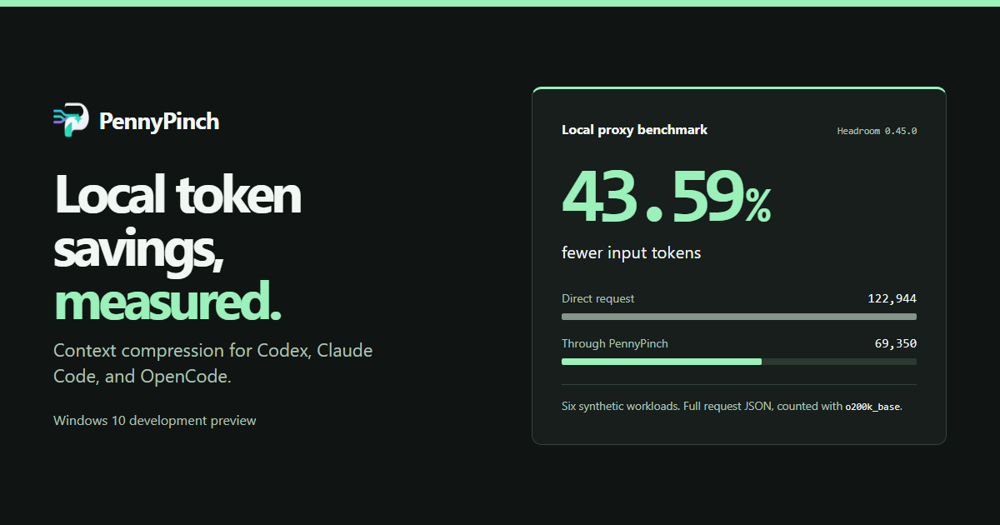

<h1 align="center">
  <picture>
    <source media="(prefers-color-scheme: dark)" srcset="docs/branding/pennypinch-horizontal-dark.png">
    
  </picture>
</h1>

<p align="center"><strong>Local context compression and token tracking for Codex, Claude Code, and OpenCode.</strong></p>

<p align="center">
  <a href="https://yukselbuilds.github.io/PennyPinch/"></a>
  <a href="#benchmarks"></a>
  <a href="https://yukselbuilds.github.io/PennyPinch/updates/"></a>
</p>

<p align="center">Windows 10 22H2 x64 development preview · Headroom 0.44.0 · Apache 2.0</p>

<p align="center">
  <a href="https://yukselbuilds.github.io/PennyPinch/#benchmarks"></a>
</p>

## Benchmarks

The measurements below came from Windows 10 tests. Each row uses the input scope and counter of its own test.

| Test | Input tokens | Change | Evidence |
| --- | ---: | ---: | --- |
| Six synthetic requests through the desktop proxy | 122,922 → 69,328 | **43.60% less** | [Full request counts](docs/proofs/upstream-benchmarks-044.json) |
| One live Codex CLI request through the installed app | 18,081 → 17,870 | **211 fewer (1.17%)** | [Local estimate](docs/proofs/pennypinch-windows10-activity-measurement.json) |
| Six Headroom SDK examples, rerun locally | 126,289 → 55,209 | **56.28% less** | [SDK counts](docs/validation/optimization-benefit.md#20-kas%C4%B1m--headroom-benchmark-tekrarlar%C4%B1) |
| One paired local model log task | 6,647 → 6,647 | **0%** | [Model server counts](docs/validation/optimization-benefit.md#19-kas%C4%B1m--ger%C3%A7ek-yerel-modelde-e%C5%9Flenmi%C5%9F-chat-completions-k%C4%B1yas%C4%B1) |

The proxy test counts full request JSON with `o200k_base`. The live Codex result uses a local estimate. Providers report usage and billing separately. [Workload charts](https://yukselbuilds.github.io/PennyPinch/#benchmarks) · [Pinned Headroom benchmark](https://github.com/headroomlabs-ai/headroom/blob/b21479e0fa84db5f3e46bb79f96c962de4d5fdc6/docs/content/docs/benchmarks.mdx)

## What PennyPinch does

- **Connect a coding tool.** PennyPinch detects supported installations and adds a route after you confirm. You can remove that route from the app.
- **Compare input before and after compression.** Overview shows the token difference and percentage when both counts are comparable. Activity shows details by client and model.
- **Pause compression.** New requests stop using compression while active responses and access to stored original content continue.

[User guide](docs/USER_GUIDE.md) · [Local data and retention](docs/SECURITY_BOUNDARIES.md)

## Compatibility and release

| Client | Recorded coverage |
| --- | --- |
| Codex CLI and Desktop | Live ChatGPT traffic on selected Windows 10 versions. The installed 0.44.0 preview measured a live CLI request. [CLI measurement](docs/proofs/pennypinch-windows10-activity-measurement.json) · [Desktop routing](docs/proofs/codex-desktop-live.md) |
| Claude Code | Windows 10 routing checks with synthetic credentials and a local provider. [Evidence](docs/proofs/claude-acceptance.md) |
| OpenCode | Selected CLI, TUI, and Desktop routes with synthetic credentials and local providers. [Evidence](docs/proofs/opencode-acceptance.md) |

The first public Windows installer is pending. Windows 11, macOS, and Linux release checks have separate acceptance. [Release list](https://github.com/yukselbuilds/PennyPinch/releases) · [Platform validation](docs/validation/desktop-platforms.md) · [Versioned client catalog](compatibility/clients.json)

<details>
<summary>Developer setup and verification history</summary>

### Current state

As of 17 November 2026, **45 of 54 main tasks** have recorded acceptance. The Windows 10 development app includes input-token measurements, activity history, scoped client connections, pause/resume, tray controls, preferences, exports and diagnostics. The next local H041 check is whether an authorized CLI session can recover the original tool output within its default output budget. [Tasks](TASKS.md) · [Current handoff](docs/IMPLEMENTATION_STATUS.md)

The Windows engine is pinned to **`headroom-ai` 0.44.0**, with CPython 3.13.13 and desktop app 0.1.0. The 16 November Windows 10 record covers the packaged engine, native window, local traffic and NSIS build. H048 covers macOS 15.8.2 on Apple Silicon with the earlier 0.41.0 engine. CircleCI later verified the macOS 0.44.0 engine and Apple Silicon package. Ubuntu opened the application window under Xvfb. Full native macOS coverage, Linux runtime acceptance, and clean Windows 10 and Windows 11 x64 acceptance remain open. [Current platform evidence](docs/validation/desktop-platforms.md) [Runtime manifest](runtime/manifest.json) · [Windows pin transition](docs/proofs/headroom-044-upgrade.json) · [macOS acceptance](docs/proofs/macos-acceptance.json)

Client evidence has its own engine, surface and auth scope. H008 recorded ChatGPT traffic through 0.41.0 for Codex CLI 0.166.0 and Desktop 26.1027.6604.0 (backend 0.166.0-alpha.5.1), including a separate CLI parent/child check. H019's earlier route check returned a completed response and two unclassified CLI errors, shown as an amber result. On 0.44.0, H041-d recorded usage for five completed Responses HTTP/SSE control requests on one ChatGPT test account. Real API-key verification remains open. [CLI](docs/proofs/codex-native-wait.md) · [Desktop](docs/proofs/codex-desktop-live.md) · [H019 result](docs/proofs/codex-product-verification.md) · [H041 usage record](docs/proofs/rules-json-live-pilot.json)

Windows 10 acceptance for Claude Code 2.1.158 and OpenCode V1 1.19.3 / V2 2.3.0 used 0.41.0, synthetic credentials and local providers. The V2 evidence records the CLI, TUI and packaged Desktop service with separate limits for each. [Claude acceptance](docs/proofs/claude-acceptance.md) · [OpenCode acceptance](docs/proofs/opencode-acceptance.md) · [Versioned compatibility records](compatibility/clients.json)

H035 is accepted for the recorded Windows 10 development scope: accessibility, local performance, real display scaling and the user-confirmed tray menu. H036 provides the collapsed Compatibility section. It separates historical evidence by exact version, client surface, auth method and OS. An installation match does not verify the current account, conversation, model or subagent. Changed installation/settings context requires renewed verification; unknown scope is not silently labelled unsupported. Models are not selected or restricted by this catalogue.

H050 and H051 are complete within their Windows 10 development scope. Accounts showed a stored Codex CLI ChatGPT record, synthetic OpenCode provider metadata and unknown Claude status. Users can explicitly start the official CLI sign-in flow. Completion of a new sign-in and other OS account adapters remain unverified. Sessions reads metadata from a supported Codex server. After confirmation it opens the official Codex chat center, where the user chooses the conversation. Per-chat traffic and savings remain unknown. [Account evidence](docs/proofs/accounts.md) · [Session evidence](docs/proofs/sessions.md)

H042's signed application update, rollback and recovery passed isolated Windows 10 tests. A real Headroom QA executable was used for local update preparation. GitHub Pages serves the update address. The production signing key and Windows 11 x64 acceptance remain open. [Update validation](docs/validation/windows-update.md) · [User guide](docs/USER_GUIDE.md)

### Build the frontend

The app uses Tauri 2, Rust, React, and TypeScript. The source-only frontend gate uses the checked-in package and lockfiles. Use Node.js 25.2.1 (recorded in `.node-version`) and pnpm 11.25.0:

```powershell
pnpm --store-dir work/caches/pnpm install --frozen-lockfile
pnpm test:app
pnpm build
```

`test:app` runs the contract tests explicitly listed in the package scripts. `build` checks TypeScript and builds the frontend. A fresh clone can run these source checks with the pinned JavaScript toolchain. Starting the Windows desktop runtime also requires the separately prepared engine. The development manifest resolves `../work/proofs/packaging/artifacts/headroom-engine-0.44.0/runtime` relative to its own directory. The payload and some historical protocol helper inputs live under the Git-ignored `work/` directory. [Package scripts](package.json) · [Source-check scope](docs/validation/source-checks.md) · [Development manifest](runtime/manifest.json)

### Windows development installer

With the pinned development toolchain and engine payload already prepared locally:

```powershell
pnpm.cmd build:windows
```

This verifies and stages the engine, then builds an unsigned x64, current-user NSIS preview under `work/caches/cargo-target/release/bundle/nsis/`. The installed app carries its Python engine and frontend; users do not install Python, Node or Rust to run it. WebView2 is required; the embedded bootstrapper needs Internet access if the runtime is missing. The installer checks the destination length before copying resources. This payload accepts an installation root of up to 100 UTF-16 units; a longer destination is rejected with an explicit error.

The Windows package uses bundled `runtime/payload` and stores mutable application state separately under LocalAppData. The **0.44.0 engine payload** contains **19,475 files / 505,117,034 bytes** before installer compression. H037 still requires clean Windows 10 and Windows 11 x64 tests, an environment without WebView2, and delivery checks at the release endpoint. [Payload inventory](runtime/windows-payload.json) · [Vendor notices](NOTICE.md) · [Installer validation](docs/validation/windows-install.md)

### GitHub and evidence

The project is maintained in the [yukselbuilds/PennyPinch](https://github.com/yukselbuilds/PennyPinch) repository. The first import was published through GitHub Desktop; [H046 evidence](docs/proofs/repository-import.md) records the scope. H047-a observed the GitHub Free plan and an account usage hard stop. The manual source-only [first CI run](https://github.com/yukselbuilds/PennyPinch/actions/runs/39759872053) passed 49 app tests and the frontend build on a standard Ubuntu runner. [H047 evidence](docs/proofs/free-ci.md) records the fresh-source check, account hard stop and observed $0 billable usage; native platform support remains separate. The free-only CI decision and gates are recorded in [decision 006](docs/decisions/006-free-ci.md), and the workflow's scope and dispatch requirements are documented in [source checks](docs/validation/source-checks.md).

Some proof documents link to files beneath `work/`. Those paths refer to local development evidence and are intentionally ignored; the evidence files themselves are not part of the initial source import. Generated builds, downloaded engine payloads, temporary runs, and visual outputs are excluded from Git.

</details>

## License

The original desktop application source is available under [Apache License 2.0](LICENSE). Bundled components carry their respective licenses and attribution in [NOTICE.md](NOTICE.md).

The desktop app uses the Headroom compression engine. Thanks to the Headroom contributors. [Upstream project](https://github.com/headroomlabs-ai/headroom)
