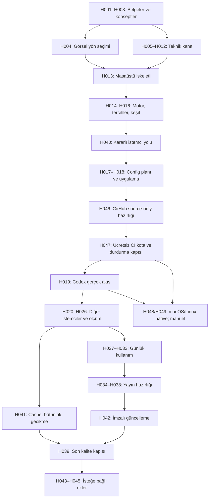

# Headroom Desktop — Görev Listesi

**Tarih:**6 Kasım2026

**Kaynak:** [Ürün spesifikasyonu 0.5](HEADROOM_DESKTOP_SPEC.md)\
**Hedef:** Windows 10 22H2 x64 ve Windows 11 x64; Codex, Claude Code, OpenCode.  
**Durum:** H001–H005, H007–H008, H011, H013–H028, H040, H046 ve **H047 tamamlandı:27/51.** H028 ile ortak H011 prefix/CCR güvenlik kabulü kapandı. Sıradaki H029 başlamadı; ana görev sonunda duruldu. Canlı kimlik kanıtı olmayan alanlar unknown kalır; API-key H041 yayın öncesi kabulünde açık. H048/H049 ve hesap/sohbet H050/H051 planlı. Henüz kurulabilir üretim uygulaması yok.

**Tarihsel işaretleme denetimi (21 Ekim, önceki 45 görev/12 kabul anlık görüntüsü):** O listedeki görev adedi ve tamamlanan görev listesi güncel değildir; H018 daha sonra kabul edildi ve H046–H049 eklendi. Güncel yetkili toplam yukarıdaki durum satırında tutulur. Tamamlanan alt dilimler kendi satırlarında `[x]` işaretlidir; ana görevin ilk kutusu bütün kabul koşulları karşılanana kadar açık kalır. [Kaynak karşılaştırması](docs/research/desktop-comparison-2026-10-20.md) sonrası H040–H045 eklendi; H040–H042 ilk sürüm kapıları, H043–H045 ilk kullanılabilir sürüm sonrası isteğe bağlı kapsam. H041–H045 başlamadı.

## Geliştirme araçları ve çalışma düzeni

**5–6 Kasım öncelik değişikliği:** Kullanıcının isteğiyle UX001 tasarım yenilemesi tamamlandı; H029 başlamadı. Bu iş mevcut özelliklerin sunumunu yeniler,27/51 işlevsel kabul sayısını değiştirmez.

### UX001 — Headroom görsel dilinin yenilenmesi
- [x] Projeye sabitlenmiş tasarım rehberi, ortak hiyerarşi ve dört native ekran yenilenmiş; gerçek kontrol/ölçüm/erişilebilirlik akışları korunmuş.
- **Kabul:** [DESIGN.md](DESIGN.md) içindeki boş/gerçek/örnek veri ayrımı, tema/dil/ölçek/klavye, native render ve son yerel kalite kapısı. Ana ajan art direction/uygulama/inceleme sahibi; H029 başlamaz. Sahte tasarruf veya hesap/sohbet işlevi eklenmez.
- **Durum:**6 Kasım tamamlandı. Emil design engineering yalnız projeye, immutable commit/MIT lisansıyla kuruldu; diğer üç kaynak incelendi.138 frontend/349 Rust PASS,6 opt-in ignored; aynı152 girdili derleme/test blokları ve gerçek native kontroller PASS. [Kanıt](docs/proofs/ui-taste.md), [inceleme](docs/reviews/UX001.md). Yerel Windows10; örnek veriler gerçek tasarruf değildir. Görev sonunda durulur.

Bu işler 51 ürün görevine eklenmez. DEV001/DEV002 ve H028 kabul edildi; ortak H011 güvenlik ön koşulu da kapandı. H029 başlamadı; kullanıcı devam mesajı bekleniyor.

### DEV001 — CodeGraph, Ponytail ve açık kabul sözleşmesi
- [x] CodeGraph'ın sabit runtime/MCP kaydı ve kapsamı kontrol edilmiş; yeni skill klasörü indeksten dışlanmış.
- [x] Ponytail kodlama/audit/review becerileri yalnız projeye, sabit kaynak ve lisans/hash kaydıyla kurulmuş.
- [x] Ana ajan/tek çalışan kullanımı, gerçek kontrol komutları ve görev bitiş kabulü belgelenmiş; kurulum ve belge incelemesi geçmiş.
- **Kabul:** [Ortak akış](docs/development/WORKFLOW.md) ile yerel araçlar tutarlı; global ayar yazımı yok; ürün görev sayımı değişmez. Kurulu talimat, otomatik skill keşfi ve gerçek davranış doğrulaması ayrı belirtilir.
- **Kanıt:** `work/proofs/dev-tools/`; kısa kalıcı özet `docs/proofs/dev-tools.md`. Yeni ürün gate'i gerektirmeyen araç/belge kapsamı.
- **Durum:** Tamamlandı; [kabul kanıtı](docs/proofs/dev-tools.md). DEV002 ayrı denetim görevi olarak tamamlandı.

### DEV002 — Mevcut kodun ilk Ponytail denetimi
- [x] Config/Apply/Undo ve sahiplik, runtime/proxy, UI bağlantı yolları önceliklendirilerek eski kod raporlanmış.
- **Kabul:** Her gerçek bulgu koşul, dosya/satır, kullanıcı etkisi, en küçük çözüm ve doğrulama önerisi içerir. Bulgular ilgili açık göreve veya gerekli küçük düzeltmeye bağlanır; kapsam dışı alanlar yazılır. Rapor üretmek düzeltmelerin yapıldığı anlamına gelmez.
- **Doğrulama:** CodeGraph ile keşfedilen yollar gerçek kaynakta okunur; mevcut kanıt fingerprint'leri değerlendirilir. Yeni koşul olmadan aynı başarılı ürün testleri tekrarlanmaz.
- **Dosyalar:** `docs/reviews/ponytail-baseline.md`, gerekirse ilgili görev notları.
- **Durum:** Tamamlandı; [denetim raporu](docs/reviews/ponytail-baseline.md). Bir düşük öncelikli belge bulgusu DEV002-D01, H022’ye bağlandı. İncelenen öncelikli akışlarda kesin yeni ürün hatası doğrulanmadı; kapsam dışı alanlar raporda. Ürün kodu değiştirilmedi.

## Çalışma kuralları

**Ortak bitiş kabulü:** Görevin kendi kabul maddeleri ile [WORKFLOW.md içindeki beş koşul](docs/development/WORKFLOW.md#bir-görevin-bitiş-kabulü) birlikte sağlanır. Davranış, ilgili hata/kapsam senaryoları, ana ajan incelemesi, geçerli son kanıt ve kayıt/durma adımı eksikse ana kutu açık kalır.

**25 Ekim geliştirme aracı notu:** Kullanıcı isteğiyle CodeGraph 1.6.2 yalnız bu projeye kuruldu; CLI ve proje MCP sorgusu doğrulandı. Telemetry kapalı, global ayarlar değişmedi; sorgu ve süreç kapanışı PASS. [Kullanım/kanıt sınırları](docs/development/codegraph.md). Bu geliştirme aracı ana görevlere eklenmez; **18/51** ve sıradaki **H022** değişmedi.

**20 Ekim geliştirme aracı notu:** Kullanıcı isteğiyle Open Computer Use ayrı Codex MCP/skill olarak kuruldu; Windows10'da Notepad ve Headroom gerçek screenshot/fare denemesi geçti. [Kurulum ve sınırlar](docs/research/computer-use-2026-10-20.md). Bu20 Ekim notu tarihseldir; araç kurulumu ürün kabulüne eklenmez. Güncel görev sayımı üstteki durum satırındadır.

- `[x]` yalnız belirtilen çıktısı tamamlanan işi gösterir. Tasarım önizlemesi gerçek motor veya istemci doğrulamasının kanıtı değildir.
- Görevler bağımlılık sırasıyla alınır. Her uygulama dilimi S/M boyutunda tek davranış ve birlikte doğrulanabilir kabul ölçütleriyle sınırlanır. Yaklaşık 1–5 dosya devir rehberidir; dosya sayısı zorunlu bölme eşiği değildir. Bağımsız amaçlar aynı ana görev altında sırayla ayrılır.
- Kullanıcı tercihi: etkin ana görev tamamlanmadan sonraki ana göreve geçilmez; bu dosya ilerledikçe güncellenir. Her ana görev tamamlanınca kullanıcıya bildirilir ve çalışma durur; sonraki ana görev için kullanıcının devam mesajı beklenir. Alt dilim kabulü ayrıca belirtilir.
- Her görevde kabul koşulu ve kanıt bulunur. Kanıtta komut, kaynak/config ve araç zinciri fingerprint'i ile sonuç birlikte kaydedilir; sırlar ve ham hata çıktıları kalıcı tutulmaz.
- Uygulama sırasında odaklı kontroller kullanılır. İnceleme/düzeltme bitince son adayın tam kalite kapısı bir kez çalıştırılır. Geçerli PASS gerekçesiz tekrarlanmaz.
- Gerçek model testleri normal otomatik test paketine karışmaz. Küçük ve ayrı yürütülür; mevcut doğal trafik mümkünse kullanılır.
- Model, reasoning seviyesi, ajan sayısı, izin ve giriş yöntemi sessizce değiştirilmez. Bu ürün çalışan ajanları yönetmez; uygun model trafiğini yönlendirir.
- Kullanıcı kararı: Bir istemci/bağlantı bağlanınca desteklenen bütün modeller, ana ajan ve aynı doğrulanmış yolları kullanan bütün alt ajanlar varsayılan kapsamdır; model/alt ajan başına tekrar seçim/kurulum yoktur. Ayrı provider/süreç/bulut yolunun kapsamı ayrıca kanıtlanır; arayüz tam kapsama uydurmaz.
- Kontrol noktaları kanıt incelemesidir. Açık ürün kararını, eldeki yetkiyle çözülebilen rutin uygulama kararından ayır.
- H013 scaffold'u ve kayıtlı `pnpm` scriptleri mevcut. Sonraki görevlerde anılan, henüz eklenmemiş scriptler planlanan sözleşmedir; başarılı çalışmış gibi raporlanmaz.
- Kimlikler geçmiş kanıtları korur; uygulama sırası numaralardan değil bağımlılıklardan okunur. Windows ürün yolu H016 → H040 → H017 → H018 → H019'dur; bu planın GitHub hazırlığı H018 → H046 → H047 → H019 bağımlılığını ekler. H048/H049, H019 Windows ilk çalışan dilimi ve H047 ücretsiz kota incelemesine bağlıdır; bu görevler başlamadı. H041 ölçüm temeli H023'ten sonra, H042 installer/kaldırmadan sonra ve H039'dan önce. Opsiyonel H043–H045 ilk kullanılabilir sürümü bekler.

## Aşamalar ve bağımlılık sırası

| Aşama | Görevler | Çıktı |
| --- | --- | --- |
| Hazırlık | H001–H004 | Kapsam, görev listesi, üç konsept, tasarım seçimi |
| Teknik kanıt | H005–H012 | Paketleme ve üç istemci için doğrulanmış uygulanabilirlik |
| İlk çalışan dilim | H013–H019 | Gerçek motor durumu ve Codex bağlantısı olan masaüstü uygulaması |
| Kararlı istemci yolu | H040; H016 sonrası/H017 öncesi | Kalıcı endpoint, sahiplik ve kanıtlı arıza yolu |
| İstemci ve ölçüm | H020–H026 | Claude/OpenCode, doğru metrikler ve gerçek dashboard |
| Ölçüm ve fayda kapısı | H041; H023 sonrası | Cache, bütünlük ve gecikme regresyonu |
| Günlük kullanım | H027–H033 | Etkinlik, güvenli duraklatma, tepsi, ayarlar ve dışa aktarma |
| Yayın adayı | H034–H039 ve H042 | Erişilebilirlik, Windows testleri, paket, imzalı güncelleme ve son kalite kapısı |
| Sonraki isteğe bağlı sürüm | H043–H045 | Kanıtlı RTK entegrasyonu ve içeriksiz yerel öneriler |
| Hesaplar ve sohbetler | H050–H051 | Resmî hesap bağlantısı ve güvenilir açık/çalışan sohbet metadata görünümü |
| Kaynak deposu ve ücretsiz CI hazırlığı | H046–H047 | Private, source-only GitHub importu; kota ve masraf durdurma kanıtı |
| Ek platformlar | H048–H049 | macOS/Linux native port ve kabul; Windows ilk dilimi ve H047 sonrasında |

## Hazırlık

### H001 — Ürün kapsamı
- [x] Spesifikasyon oluşturuldu; Windows 10/11, otomatik keşif, bir defalık bağlantı, subagent ve model kapsamı işlendi.
- **Kabul:** Uygulama davranışı ile motor kabiliyeti ayrılmış; ölçüm sınırları ve geri alma tanımlı.
- **Doğrulama:** `HEADROOM_DESKTOP_SPEC.md` içerik ve Markdown yapısı kontrolü.
- **Bağımlılık / boyut:** Yok / S.
- **Dosyalar:** `HEADROOM_DESKTOP_SPEC.md`.

### H002 — Uygulanabilir görev listesi
- [x] Bağımlılıkları, kabul koşulları ve kontrol noktaları olan bu liste hazırlandı.
- **Kabul:** Bütün H kimlikleri tekil; bağımlılıklar mevcut ve döngüsüz; üretim işleri tamamlanmış işaretlenmemiş.
- **Doğrulama:** Kimlik/bağımlılık denetimi ve spesifikasyon kapsamıyla karşılaştırma.
- **Bağımlılık / boyut:** H001 / S.
- **Dosyalar:** `TASKS.md`.

### H003 — Üç etkileşimli UI konsepti
- [x] Graphite, Ivory ve Signal; genel bakış, uygulamalar, etkinlik ve ayarlar önizlemeleri hazırlandı.
- **Kabul:** Üç farklı yerleşim; örnek veri etiketi; çalışan gezinme, durum seçimi, bağlantı diyaloğu ve başlat/duraklat gösterimi.
- **Doğrulama:** Yerel tarayıcıda üç konseptin etkileşim ve taşma kontrolleri; ekran görüntüleri. Kanıt: `work/ui-review/validation-summary.json`.
- **Bağımlılık / boyut:** H001 / M; yalnız tasarım çıktısı.
- **Dosyalar:** `UI_CONCEPTS.md`, `outputs/ui-concepts/`.

### H004 — Görsel yönün seçilmesi
- [x] Kullanıcı Graphite'ı seçti; aynı düzenin açık/koyu tema token yaklaşımı karar kaydına işlendi.
- **Kabul:** Seçilen düzen ve her iki tema için token yaklaşımı kayıtlı; örnek UI ile üretim kapsamı ayrımı korunmuş.
- **Doğrulama:** Konsept karşılaştırması üzerinden kullanıcı seçimi; tasarım karar kaydı.
- **Bağımlılık / boyut:** H003 / S.
- **Dosyalar:** `UI_CONCEPTS.md`, `docs/decisions/001-ui-direction.md`.

## Teknik kanıt — önce en riskli yollar

### H005 — İzole motor deneyi
- [x] `headroom-ai[proxy]==0.41.0`, proje içi Python 3.13.13 ve uygulamaya ait loopback portunda çalıştırıldı; readiness/sahiplik, meşgul/yanlış listener ve kontrollü kapanış kanıtlandı.
- **Kabul:** Readiness ve sahiplik doğrulanır; başka proxy sahiplenilmez; deney istemci ayarlarını kalıcı değiştirmez.
- **Doğrulama:** Boş/meşgul port, hatalı süreç ve kontrollü kapanış deneyi; küçük yapılandırma özeti.
- **Bağımlılık / boyut:** H001 / M.
- **Dosyalar:** `work/proofs/engine/`, `docs/proofs/engine.md`.
- **Sonuç / sınır:** 4 odaklı test ve gerçek runtime proof PASS; fingerprint'ler [kanıtta](docs/proofs/engine.md), koordinatör incelemesi [H005 incelemesinde](docs/reviews/H005.md). Windows 10 22H2 host/konsol bağlamına aittir; Windows 11, temiz paket ve konsolsuz GUI yaşam döngüsü henüz doğrulanmadı.

### H006 — Windows paketleme kanıtı
- [ ] Python/native bağımlılıklarıyla motorun taşınabilir çalışma biçimi iki hedef Windows'ta sınanır.
- [x] **Yerel alt dilim H006-a kabul:** Windows 10 hostunda konsolsuz üst süreç → gizli helper → motor zinciri, stdio stop ve graceful kapanış kanıtlandı. İki odaklı kontrol PASS; kaynak/paket fingerprint'leri incelendi. [Kanıt](docs/proofs/windows-engine.md), [inceleme](docs/reviews/H006-a.md).
- **Yerel çıktı / açık kapsam:** Taşınmış dizin paketi `22.225` payload dosyası / `523.394.231` bayt; geliştirici araçları PATH'te yokken readiness ve PID sahipliği doğru. Gerçek Tauri motor bağı mevcut hostta H014 ile doğrulandı. İki temiz OS sonucu ve Job Object ani çökme senaryosu henüz kanıtlanmadı; H006'nın tamamı işaretlenmez.
- **Kabul:** Geliştirme araçları bulunmayan Windows 10 22H2 ve 11 x64 ortamında motor başlar; indirme, runtime boyutu ve olası eksikler kayıtlıdır.
- **Doğrulama:** İki ayrı temiz ortamın readiness/kapanış kanıtı; başarısız ortam başarılı sayılmaz.
- **Bağımlılık / boyut:** H005 / M.
- **Dosyalar:** `scripts/package-engine.*`, `docs/proofs/windows-engine.md`.

### H007 — Streaming ve retrieval sözleşmesi
- [x] Kontrollü yerel HTTP örnekleriyle istek, SSE event bütünlüğü, hata ve CCR davranışı kanıtlandı.
- **Sonuç:** A: opaque bloklar/explicit cache marker, model/reasoning/auth, tool-fragment ve 429 aktarımı. B: gerçek sıkıştırma → aynı runtime public retrieval eşitliği, TTL7200. C: son gözlemdeki 60.900 bayt kaynak ve açık tool korumasıyla 59.219 bayt sayısal çıktı birebir. [Kanıt](docs/proofs/protocol.md), [inceleme](docs/reviews/H007.md).
- **Sınır:** Windows 10 hostunda, yerel fixture ve sentetik credential. Opaque düzeltmesi source guard içeren startup uyarlamasıdır; H014/H037 üretime taşıyacak. Sayısal koruma araç/şekil kapsamındadır; genel otomatik sayı tanıma değildir. 153.599 → 106 bayt sonucu token tasarrufu ölçümü değildir. Artımlı SSE/gerçek istemci döngüsü H008–H010'da; diğer OS/temiz ortam/native paket kanıtı H006/H037'de açık kalır.
- **Kabul:** Desteklenen Responses/Anthropic yollarında araç çağrısı yapısı korunur; sıkıştırılmış örneğin aslı aynı runtime'dan alınır; bilinmeyen bloklar korunur.
- **Doğrulama:** Yerel fixture sunucusu; sıkıştırma/retrieval eşitliği ve stream sırası kontrolleri. Ücretli çağrı şart değildir.
- **Bağımlılık / boyut:** H005 / M.
- **Dosyalar:** `work/proofs/protocol/`, `tests/fixtures/protocol/`, `docs/proofs/protocol.md`.

**Kontrol noktası K1 — H005–H007:** Runtime yaklaşımı ve protokol kanıtı incelenir. Paketleme veya retrieval engeli gizlenerek üretim UI'sına geçilmez.

### H008 — Codex masaüstü ve CLI kanıtı
- **4 Kasım ana görev kabulü:** Kullanıcı ChatGPT kanıtıyla kapanışı ve canlı API-key testinin H041 yayın öncesi kabulünde açık tutulmasını seçti. Windows10'da CLI0.166.0 ana/tek alt ajan, aynı/farklı model-efor ve native bekleme; Desktop26.1027.6604.0 gerçek hesap, aynı sohbet ve yeniden açılış rotası doğrulandı. Kontrollü MCP çağrısı istemcinin izin politikasıyla engellendi; genel araç sağlığı iddia edilmez. [Kapanış ve sınırlar](docs/proofs/codex-native-wait.md#h008-kapsam-kararı-ve-kapanış), [sürüm kataloğu](compatibility/clients.json).
- **4 Kasım native bekleme dilimi:** Yeni gerçek CLI koşusunda ana/alt ajan spawn ve wait tamamlandı; eşleşen JSON dönüşü timed_out=false, completed runtime olayı ve iki ayrı Responses giriş kimliği doğrulandı. Kontrollü MCP çağrısı `approval_policy=never` nedeniyle istemcide engellendi; kapı isteği 0 ve durum environment_blocked. İzin politikası değiştirilmedi, reddedilen çağrı tekrarlanmadı. QA relay resetlerinin yönü ve terminalle zaman ilişkisi bilinmiyor; sayaç TCP kapanışını ölçüyor. Ayrı model çağrısız app-server fixture kontrolü ve 3 odaklı test PASS. [Kanıt](docs/proofs/codex-native-wait.md).
- **4 Kasım gerçek Desktop dilimi tamamlandı:** Ayrı resmî ChatGPT profiliyle Desktop 26.1027.6604.0, Headroom üzerinden iki kısa yanıtı tamamladı. Sohbetten çıkıp aynı sohbeti açma ve aynı native kimlik doğrulandı. Motor 5 yerel istek/0 failure bildirdi; istek amaçları ayrı sayılmadı. Pencere/portlar kapandı, normal config korundu. Güncel kurulu dosyalarla 2 opt-in keşif/pin ve izole Apply/Undo PASS. Açık süreç yeni ayarı o turda kullanmadı; tam yeniden açılış sonrası aynı sohbetin Headroom rotası ayrıca geçti. Canlı API-key ve geniş auth/transport kapsamı açık. [Kanıt](docs/proofs/codex-desktop-live.md).
- **Güncel farklı model/efor kanıtı:** CLI 0.166.0 ve mevcut ChatGPT girişiyle ana Astra max ve test alt ajanı Sol medium tamamlandı. Headroom girişinde iki sohbet kimliği ayrı eşleşti. Bu tarihsel koşuda wait dispatch öncesi iptaldi; yeni 4 Kasım native bekleme kanıtı yukarıdadır. [Kanıt](docs/proofs/codex-current-diagnostics.md).
- **3 Kasım Desktop izole kabulü:** Kurulu Desktop uygulaması ayrı profildeki kayıtlı yerel uç noktayı kullandı. WebSocket isteği Headroom üzerinden sahte sağlayıcıya ulaştı ve tamamlanan yanıt arayüzde görüldü. Gerçek hesap ve mevcut sohbet yönlendirmesi açık. [Kanıt](docs/proofs/codex-current-diagnostics.md).
- **3 Kasım tanı ve güncel CLI rol kanıtı:** Eski `mcp` yapılandırma uyarısı model çağrısı olmadan üretildi. Sahipliği doğrulanan iki kapanış exit 0 verdi. Kota yenilenince CLI 0.166.0 ve mevcut ChatGPT hesabıyla ana ve tek varsayılan alt ajan tamamlandı. İki rolün aynı modeldeki kimlikleri Headroom girişinde ayrı eşleşti. Açık Desktop yönlendirmesi, farklı model/efor kombinasyonu ve diğer auth/transport kapsamı açık. [Kanıt](docs/proofs/codex-current-diagnostics.md).
- **3 Kasım yerel kullanım düzeltmesi kabulü (ana görev değil):** Geçerli OpenAI imzası + bounded sürüm sorgusu + dosya pin'i, yerel standalone junction çözümü, kayıtlı Windows paket API'si, gerçek GUI executable seçimi ve uzun PATH önceliği uygulandı. CLI0.166.0, backend0.166.0-alpha.5.1 ve Desktop26.1027.3384.0 tanınıyor. İki yüzey gerçek keşif→plan→atomik Apply/Undo testini izole config üzerinde geçti. Verifier workspace'i app-state'e taşındı; CodeGraph proje config'i kullanıcı ayarına dokunmadan testin dışında kalır. UI→native verifier→owned runtime→normal mevcut ChatGPT hesabı CLI yanıtı doğrulandı. Bu koşudaki iki bildirim sonraki tanıda kullanıcı ayarından gelen yapılandırma uyarıları olarak sınıflandırıldı. [Kanıt](docs/proofs/codex-current.md), [karar011](docs/decisions/011-current-codex.md), [inceleme](docs/reviews/H008-current.md).289 Rust/98 frontend PASS; fmt ve embedded build PASS. Bu ilk dilimde canlı Desktop, alt ajan ve genel auth kabulü ayrı bırakıldı.
- **H019 sonrası açık protokol takibi —23 Ekim:** Normal `.11.2` CLI gerçek yanıtı tamamlıyor, fakat2 ek JSONL error bildiriminin kaynağı bilinmiyor. Ürün yanıt rotası kanıtını bu hatalardan ayrı gösterir; genel protokol/araç sağlığı veya hataların çözümü kabul edilmez. İzole failing-MCP testi bu error olaylarını üretmedi; MCP/transport nedeni varsayılmaz. [Son kanıt](docs/proofs/codex-product-verification.md). Bu tarihsel adımda H008 ana kutusu açık tutuldu; güncel bildirim tanısı yukarıdadır.
- [x] Kurulu Codex yüzeylerinin gerçek yönlendirme yolu belirlenir; küçük gerçek trafikle doğrulanır. Kabul kapsamı Windows10'da yukarıdaki ChatGPT CLI/Desktop sürümleridir.
- **Yerel ara kanıt:** A2 mesaj-only turu/exit0 geçti; `update_plan` ilan edilmedi. A3 farklı salt okunur `get_goal` çağrısında doğru callback/call_id, iki POST, upstream terminalinden önce mesaj item'ı, son marker/turn.completed/exit0 görüldü; tool sonucu unclassified text olduğundan semantik başarı sayılmaz. [Kanıt](docs/proofs/codex.md), [inceleme](docs/reviews/H008.md).
- **Tarihsel kısıt:** PowerShell ile dosya okuma başlatılmasını otomatik review `blocked by policy` ile reddetti; aynı eylem tekrar denenmez. API-fixture gerçek model/ChatGPT auth/desktop/ana-alt ajan desteği yerine geçmez. H008'in ChatGPT kabulü sonraki gerçek trafik kanıtlarına dayanır; canlı API-key kabulü H041'de açık tutulur.
- **Kabul:** Giriş, upstream model ve reasoning korunur; ana ve tek subagent yolu ayrı kontrol edilir; proje config'inin yok sayılan anahtarlarına güvenilmez.
- **Karşılaştırma ek kabulü — 4 Kasım kullanıcı kapsam kararı:** ChatGPT gateway gerçek CLI/Desktop trafiği H008 kabulüdür; canlı API-key sağlayıcı testi H041 yayın öncesi kapısına taşınmıştır ve henüz not_tested'dır. HTTP/SSE fixture ile canlı WebSocket ayrı işaretlenir. Mevcut sohbet DB'sinin topluca provider retag edilmesi varsayılan entegrasyon yöntemi değildir. Rakip adapter kodu araştırma girdisidir, bizim canlı destek kanıtımız sayılmaz.
- **Model/alt ajan kabulü:** Ana ve mevcut tek alt ajanın farklı model/eforuyla gerçek yol ayrı gözlenir; aynı modelle iki rol ve aynı yolda sonradan açılan alt ajan fixture'ı kapsanır. Bu geliştirme sohbetinde yeni test ajanları açmak/model/ajan sayısı değiştirmek için gerekçe değildir. Ayrı provider veya cloud yolu gözlenmiyorsa kapsam kısmi/bilinmiyor kalır.
- **Doğrulama:** Ana istek + tek subagent isteği için içeriksiz, ayrı proxy kanıtı; her auth/yüzey kombinasyonuna doğru durum.
- **Bağımlılık / boyut:** H007 / M.
- **Dosyalar:** `work/proofs/codex/`, `docs/proofs/codex.md`.

### H009 — Claude Code CLI kanıtı
- [ ] Etkin ayar kapsamı ve Anthropic yolu küçük gerçek trafikle doğrulanır.
- [x] **H009-a kabul:** Kurulu 2.1.158 CLI, transient bare/API-sentinel/tools-kapalı profilinde tek POST, terminalden önce gerçek partial text, final success/exit0 ve direct usage12/4 geçti. 5 odaklı test PASS; kaynak hash'leri incelendi. [Kanıt](docs/proofs/claude.md), [inceleme](docs/reviews/H009-a.md). Force fallback/kapalı port kanıtı GUI graceful kapanışı değildir. Mevcut OAuth/tool/retrieval/extension kabulü yerine geçmez; reddedilen Codex/PowerShell eylemi tekrar edilmedi.
- **Kabul:** Mevcut giriş ve seçili model korunur; streaming/araç/retrieval çalışır; CLI sonucu eklenti desteği sayılmaz.
- **Model/alt ajan kabulü:** Varsayılan kapsam ana ve desteklenen alt ajan yollarını birlikte içerir; alt ajan için ayrı bağlama veya model allowlist'i gerekmez. Ayrı endpoint/provider ayarı olan rolün geçtiği yol ayrıca doğrulanır; eksik yol tam kapsama sayılmaz.
- **Doğrulama:** Bağlantı ve geri alma deneyi; yetki veya hesap bulunmazsa sınır kayıtlıdır.
- **Bağımlılık / boyut:** H007 / M.
- **Dosyalar:** `work/proofs/claude/`, `docs/proofs/claude.md`.

### H010 — OpenCode CLI/TUI kanıtı
- [ ] Etkin sağlayıcı ve model korunarak OpenCode yolu doğrulanır.
- [x] **H010-a kabul:** Proje içi resmî V1.19.3 binary, geçici config/auth/workspace ve tools-kapalı API-fixture. Tek POST, fixture model/sentinel, terminal text/usage12/4/exit0 ve nested CCR TTL7200 geçti; 4 odaklı test PASS, hash'ler eşleştirildi. [Kanıt](docs/proofs/opencode.md), [inceleme](docs/reviews/H010-a.md). First-token latency veya reasoning iddiası yok; force fallback GUI graceful sayılmaz. V2/TUI/live auth desteği ayrı açık kalır.
- **Kabul:** Wrapper varsayılanı modeli değiştirmez; JSON/JSONC ve auth kapsamı kayıtlı; streaming/araç/retrieval korunur.
- **Model/alt ajan kabulü:** Birden fazla provider/model kullanan ana/alt ajan yolları ayrı fixture ile doğrulanır. Kullanıcı model değiştirdiğinde aynı doğrulanmış provider/protokolde yeniden bağlanma gerekmez; başka rota desteklenmiyorsa açık bildirilir.
- **Doğrulama:** Model kimliğinin öncesi/sonrası, küçük gerçek istek ve geri alma; ayrı yüzeyler için ayrı sonuç.
- **Bağımlılık / boyut:** H007 / M.
- **Dosyalar:** `work/proofs/opencode/`, `docs/proofs/opencode.md`.

**Kontrol noktası K2 — H008–H010:** Hangi yüzey/sürüm/auth kombinasyonunun gerçekten desteklendiği belirlenir. Eksik erişim nedeniyle test edilemeyen kombinasyon deneysel kalır.

### H011 — Duraklatma güvenliği kanıtı
- [x] Aktif stream ve sıkıştırılmış geçmiş varken mod geçişleri sınanır.
- [x] **H011-a tarihsel kaynak değerlendirmesi:** [Kaynak kaydı](docs/proofs/pause.md) bypass/kill-switch/runtime-env/restart ayrımını korur.5 Kasım H028 ile gerçek request/frame kontrolü ve prefix/CCR/aktif SSE/WS kanıtı tamamlandı; eski not_implemented kaydı güncel durum değildir.
- **Ortak H028 kabulü:** [Kanıt](docs/proofs/safe-pause.md): aynı konuşmada eski prefix/CCR, tek upstream POST/WS bağlantısı, resume sonrası yeni sıkıştırma; gerçek UI/iki manager izolasyonu ve ayrı graceful stop/backend unavailable etkisi. Yerel Windows10 kabulüdür; canlı sağlayıcı/diğer OS/genel model desteği yükseltilmedi.
- **Kabul:** Önceden gönderilmiş prefix ve CCR erişimi korunur; devam eden istek kesilmez; motor tamamen durdurulduğunda etki doğru raporlanır.
- **Doğrulama:** Yerel çok turlu replay; başlat → sıkıştır → duraklat → retrieval → devam sırası.
- **Bağımlılık / boyut:** H007, H008, H009, H010 / M.
- **Dosyalar:** `work/proofs/pause/`, `docs/proofs/pause.md`.

### H012 — Mimari ve uyumluluk sözleşmesi
- [ ] Teknik kanıta göre kabuk, motor paketleme, adaptör arayüzü ve ölçüm şeması kesinleştirilir.
- [x] **H012-a temel kabul:** [Runtime kararı](docs/decisions/002-runtime.md), [yerel sözleşme](docs/contracts.md), [uyumluluk kataloğu](compatibility/clients.json) incelendi; JSON/status/11 unique ID/referans kontrolü PASS. [İnceleme](docs/reviews/H012-a.md). Bu temel, H013-a readonly snapshot/boş kabuk gelişimini açar; H012'nin ürün kabulü ve açık H006/H008–H011/release kabiliyetleri tamamlandı sayılmaz.
- **Kabul:** Seçilen sürümler ve sınırlamalar kayıtlı; protokol/istemci/auth destek kataloğu başlangıç verisi hazır; bilinmeyen durumlar şemada temsil ediliyor.
- **Ek kabul — katman kapsamı:** Headroom istemci/protokol rotası ile istemciye özel terminal filtresi ve bunların ölçüm temelleri ayrı uyumluluk kayıtlarıdır. Bir shell hook/CLI başarısı PowerShell, yerel Read/Grep, Codex Desktop veya başka istemci yüzeyine taşınmaz; bilinmeyen yüzey not_tested kalır. [Kaynak/hedef eşlemesi](docs/research/optimization-targets-2026-11-04.md).
- **Sürüm kabulü:** Doğrulanmış yayıncı imzası veya güvenilir kaynaktan sabitlenen hash dosya kökenini, gerçek config/protokol/özellik deneyi uyumluluğu doğrular. Salt sürüm numarası değişimi genel uyumsuzluk iddiası üretmez; bilinen kırılmalar ve güvenlik sınırları korunur.
- **Doğrulama:** Teknik karar kaydı ile H005–H011 kanıtlarının tutarlılık incelemesi.
- **Bağımlılık / boyut:** H006, H008, H009, H010, H011 / M.
- **Dosyalar:** `docs/decisions/002-runtime.md`, `docs/contracts.md`, `compatibility/clients.json`.

**Kontrol noktası K3 — H011–H012:** Destek sözü ve mimari somut kanıta dayanır. Bu noktada ana uygulama iskeleti için kullanılan seçimler netleşir.

## İlk çalışan masaüstü dilimi

### H013 — Masaüstü iskeleti
- [x] Graphite dört ekran, tipli readonly Rust snapshot, boş miktar/yüzde, unknown durumlar ve oturumluk TR/EN/tema temeli oluşturuldu.
- **Sonuç:** Native Tauri pencere/IPC erişilebilirlik gözlemi ve focused test/typecheck/build/Cargo check PASS; son static build UI'sı 32 yerleşimde, klavye odağı/system-theme/taşma/JS/dış istek kontrolünde PASS. [Kanıt](docs/proofs/desktop-shell.md), [inceleme](docs/reviews/H013.md). Native görsel/gezinme ve dış OS/yayın kabiliyetleri ayrı açık; motor/bağlantı eylemleri H014–H021'e kadar disabled, demo başarı yok.
- **Kabul:** Geliştirme penceresi açılır; yerel yönetici bağlantısı tanımlı; gerçek veri olmadığında boş durum görünür.
- **Doğrulama:** Kayıtlı typecheck/build/focused testler, native readonly IPC gözlemi ve sunucusuz static artifact UI kontrolü. Sonraki native kontroller embedded dist içeren standalone build üzerinden yapılır; reddedilmiş Vite başlatması tekrarlanmaz.
- **Bağımlılık / boyut:** H004, H012 / M; scaffold ile ilgili dosyalar tek dilimde sınırlandırılır.
- **Dosyalar:** `package.json`, `src/main.tsx`, `src/App.tsx`, `src/styles.css`, `src/runtime/snapshot.ts`, `src-tauri/tauri.conf.json`, `src-tauri/src/main.rs`.

### H014 — Motor durumunu arayüzden yönetme
- [x] Runtime sahiplik/port/readiness kontrolüne dayalı gerçek durum ve hata kodları Genel bakış ekranına bağlandı; başlatma/durdurma çalışıyor.
- [x] **H014-a kabul:** Protocol1 production controller/hidden helper, sabit profil ve guarded shim, bounded deadline/cleanup; 8 focused test ve gerçek consoleless ready→stdio graceful stop/exit0/kapalı owned-port smoke PASS. [Kanıt](docs/proofs/desktop-runtime.md), [inceleme](docs/reviews/H014-a.md). H006 payload'ı değişmedi.
- [x] **H014-b kabul:** Rust backend yöneticisi, dar lifecycle komutları ve exit gate; son adayda fmt/check temiz, 14 test ve gerçek manager smoke20,07s PASS. 6s ready, stale stop reddi, idempotent start, graceful stop/owned listener absent ve ayrı test-owned servisin canlı kalması doğrulandı. [Kanıt](docs/proofs/desktop-manager.md), [inceleme](docs/reviews/H014-b.md).
- [x] **H014-c kabul:** Son 9 frontend testi/typecheck/build/embedded build ve root32 layout/3 fixture UI kontrolü PASS. Gerçek native snapshot okundu. Kullanıcı başlat→hazır→durdur→başlat→hazır→pencereyi kapat akışının çalıştığını bildirdi; root bağımsız olarak native exit0 ve Headroom/runtime süreçlerinin kalmadığını doğruladı. [Kanıt](docs/proofs/desktop-controls.md), [inceleme](docs/reviews/H014.md). Native düğmeler otomasyonla tıklanamadı; manuel akış ile otomatik backend/metadata kanıtı ayrı kaydedildi.
- **Kabul sınırı:** Mevcut Windows10 hostunda geliştirme binary'si. Installer/Win11/temiz ortam, client bağlantısı, pause ve gerçek tasarruf kabulü değildir. Vite başlatma reddi farklı launcher ile tekrarlanmadı.
- **Kabul:** Gerçek süreç hazır olmadan yeşil durum yok; çakışan portta yabancı süreç kapanmaz; tekrar başlatma çift motor üretmez.
- **Doğrulama:** Odaklı runtime testleri, readiness senaryoları, UI hata/boş durumları.
- **Bağımlılık / boyut:** H013 / M.
- **Dosyalar:** `src-tauri/src/runtime/manager.rs`, `src-tauri/src/runtime/manager_tests.rs`, `src/features/overview/EngineStatus.tsx`, `src/lib/runtime.ts`.

### H015 — Yerel ayarların hatırlanması
- [x] Kullanıcı tercihleri ve sırsız pinned runtime manifest referansı uygulama veri köküne dayanıklı yazılır.
- [x] **H015-a kabul:** Sürümlü dil/tema deposu ve sırsız pinned manifest referansı; atomik yazım, bozuk kayıt koruması, revision+SHA256 çakışma, güvenli tamsayı sınırı ve yalnız kendi temp dosyası temizliği. 9 Rust testi/fmt/check PASS; gerçek tercih dosyasına yazılmadı. [Kanıt](docs/proofs/preferences-store.md), [inceleme](docs/reviews/H015-a.md).
- [x] **H015-b kabul:** Typed native yükle/kaydet bağı, ack/rollback/fresh-read retry ve system tema. 6 frontend testi/typecheck/build/embedded build; root32 layout/6 açıkça mocked UI akışı PASS. Kullanıcı gerçek UI'da kaydetti/kapattı; root allowlisted kayıtta en/dark, ilk exit0, yeni native pencerede İngilizce yüklenme ve klavyeyle kapatmada ikinci exit0 doğruladı. Native renk ekran görüntüsü/otomatik mouse testi iddia edilmez. [Kanıt](docs/proofs/preferences-ui.md), [inceleme](docs/reviews/H015-b.md).
- **Kabul:** Yeniden açılış tercihleri korur; bozuk kayıt güvenli hata verir; sırlı auth verisi bu depoya kopyalanmaz.
- **Doğrulama:** Kesintili/bozuk yazım fixture'ları ve yeniden açma deneyi.
- **Bağımlılık / boyut:** H014 / M.
- **Dosyalar:** `src-tauri/src/state/{mod.rs,store.rs,store_tests.rs}`, `src-tauri/src/main.rs`, `src/lib/preferences.ts`, `src/App.tsx`, `tests/app/preferences.test.mjs`, `package.json`.

### H016 — Otomatik keşif ekranı
- [x] Üç istemci türü bilinen konumlarda algılanır ve Uygulamalar ekranında gösterilir. Fixture kapsamı ve gerçek native yerel kapsam [son kabul kaydında](docs/proofs/discovery-desktop.md) ayrıdır.
- [x] **H016-a:** Bounded salt okunur backend keşfi; PATH/bilinen konum, yüzey/sürüm ve opaque kurulum kimliği; program/config/auth çalıştırma veya değiştirme yok. Altı fixture testi/fmt/check ve root incelemesi kabul; [kanıt](docs/proofs/discovery-backend.md), [inceleme](docs/reviews/H016-a.md).
- [x] **H016-b:** Gerçek Applications UI tarama/yeniden tarama bağı; found/not_found/partial/error, sürüm/yüzey ve bağlantı doğrulanmadı ayrımı. Dokuz focused test/typecheck/build; root32 layout/5 memory-fixture akışı ve görsel inceleme kabul. [Kanıt](docs/proofs/discovery-ui.md), [inceleme](docs/reviews/H016-b.md). Gerçek native IPC kabulü c'de.
- [x] **H016-c kabul:** c1/c2 ve son tanı adayı15 Rust test/1 ignored,14 UI test/typecheck/build, root32 layout/9 fixture akışı ve embedded build PASS. Kullanıcı+root native AT ve metadata'da manuel aday iki ardışık rescan'de korundu; son normal kapanış exit0/süreç yok, tercihler aynı, test dosyası temizlendi. [Son kanıt](docs/proofs/discovery-desktop.md), [inceleme](docs/reviews/H016-c2.md). Önceki aday kaybının kök nedeni açıklanmadı; trace kapalı paketlenmiş tekrar H039 yayın kapısına taşındı. İstemciyi bağlama/çalıştırma yapılmadı.
- **Kabul:** Tarama ayar değiştirmez; sürüm/yüzey ayrımı görünür; bulunamayan istemci dosya seçimiyle eklenebilir.
- **Doğrulama:** Eksik/çoklu kurulum, PATH ve boşluklu yol fixture'ları; yeniden tara eylemi.
- **Bağımlılık / boyut:** H015 / M.
- **Dosyalar:** `src-tauri/src/integrations/discovery.rs`, `src-tauri/src/integrations/discovery_tests.rs`, `src/features/integrations/Applications.tsx`, `src/lib/integrations.ts`.

### H017 — Değişiklik planı ve önizleme
- [x] Bağlan eylemi config yazmadan önce kapsam ve planı üretir.
- **Tamamlandı:** Salt okunur planner → typed masaüstü bağı → Graphite önizleme → inceleme/son kalite kapısı kabul. H018 yazımı bu görevde uygulanmadı. [Son kanıt](docs/proofs/connection-plan.md), [inceleme](docs/reviews/H017.md).
- [x] **H017-a:** Saf TOML/JSON/JSONC planlayıcı, redaksiyon/duplicate/depth/route kontrolleri; ilk13 odaklı testten sonra presence/identity regresyonlarıyla genişletildi.
- [x] **H017-b:** Keşif/kalıcı ingress kimliğine bağlı, sınırlı salt okunur config okuması ve strict typed masaüstü komutu kabul.
- **B2 alt kabul:** Missing/present, kaynak dosya kimliği, JSON↔JSONC drift, Windows writer/rename/junction kontrolleri kabul. [Tarihsel dilim kanıtı](work/proofs/connection-plan/planner-b2.md); son komut/UI bağı C'de doğrulandı.
- [x] **H017-c:** Graphite önizleme; TR/EN, koyu/açık32 temel+8 dialog düzeni, odak/refresh/stale response akışları; gerçek native üç istemci önizlemesi, değişmeyen fixture/tercih hash'leri ve normal exit0. Son107 Rust/38 Node testi PASS;2 opt-in ignored; frontend ve embedded build PASS.
- **Kabul:** Yalnız gerekli alanlar planda; etkin auth/model/efor karşılaştırması var; yeniden başlatma ihtiyacı ve çakışma açık.
- **Ek kabul:** İstemci config'i, varsa hook/shell alanı ve etkin kapsam birlikte önizlenir. H040'ın doğrulanmış kalıcı adresi kullanılır; mevcut sohbet DB'si plan dışında değiştirilmez. Bir kurulumun bulunması o istemcinin bütün oturumlarını değiştirme izni değildir.
- **Doğrulama:** TOML/JSON/JSONC fixture'larından salt okunur plan; dosya hash'leri değişmez.
- **Bağımlılık / boyut:** H016, H040 / M.
- **Dosyalar:** `src-tauri/src/integrations/plan.rs`, `src-tauri/src/integrations/plan_tests.rs`, `src/features/integrations/ConnectDialog.tsx`, `src/lib/contracts.ts`.

### H018 — Atomik config işlemi ve geri alma
- [x] Uygulamaya ait alanlar sahiplik kaydıyla yazılır ve geri alınabilir.
- **Tamamlandı —22 Ekim yerel kabul:** A/B/C/D kabul.160 Rust PASS/3 ignored,49 Node PASS; typecheck/build ve embedded masaüstü build PASS.32+8 statik yerleşim/7 akış; gerçek native üç config biçiminde Apply/Undo, restart sahipliği, normal editor save ve managed-field conflict koruması PASS. Kullanıcı config/auth/DB değişmedi. Yalnız Win10/aynı yerel NTFS volume; canlı trafik/Win11/yayın kabulü değil. H019 başlamadı; ana görev sonrası duruldu. [Karar005](docs/decisions/005-config-transaction.md), [kanıt](docs/proofs/config-transaction.md).
- [x] **H018-a alt kabul:** Dosya yayınlama primitive'i ve gerçek Windows yarış/kesinti fixture kanıtı; ürün/native UI ve ikinci OS kabulü değil.
- [x] **H018-a1 alt kabul:** Fixture-only native KTM/TxF feasibility; normal yetki/NTFS, eşzamanlı dış işlem, iki dosya commit ve child crash/rollback kanıtı. Ürün entegrasyonu veya Win11 kabulü değil.
- [x] **H018-a2 alt kabul:** Rust KTM/TxF primitive'i;11 focused PASS/1 child helper ignored (parent tarafından çalıştırıldı), fmt/check PASS. İşlem kimliğine bağlı token, sealed/poisoned commit reddi, dış writer/replace/delete, absent-slot ve dosya sınırları kabul. Yalnız aynı yerel NTFS volume; daha zayıf replace fallback yok. [Kanıt](work/proofs/config-transaction/writer-a2.md).
- [x] **H018-b alt kabul:** TOML/JSON/JSONC tek alan patch/undo ve sırsız sahiplik/kurtarma kaydı; C/D ile gerçek ürün komutuna bağlandı.
- [x] **H018-b1 alt kabul:** Bellekte parser span'leriyle tek alan patch/undo;9 odaklı test/fmt/check PASS. Missing Codex/Claude, JSONC yorum/virgül, byte-exact roundtrip ve sonraki kullanıcı düzenlemeleri korunur; gerçek disk yazımı değil.
- [x] **H018-b2 alt kabul:** Bounded3 fixed-slot ownership schema/codec/store;16 focused PASS, scoped fmt/check PASS. Lazy pinned parent create, nested separator normalization, invalid schema/record, hardlink/junction, commit/reload/rollback kabul. Tam Rust format C2'de, son gate D'de kapandı. [Kanıt](work/proofs/config-transaction/ownership-b2.md).
- [x] **H018-c alt kabul:** Güncel plan/kimlik/fingerprint kontrolleri, apply/undo komutları ve Graphite eylemleri; native son kabul D'de tamamlandı.
- [x] **H018-c1 alt kabul:** Mevcut PlanManager apply/undo/passive snapshot;14 action+16 ownership focused PASS. Root/source/identity/scan/endpoint/expiry/no-op/rollback korumaları incelendi. Tauri/UI bağı C2/C3'te tamamlandı. [Kanıt](work/proofs/config-transaction/actions-c1.md).
- [x] **H018-c2 alt kabul:** Dar3 Tauri komutu/aynı Arc manager, passive debug/release locator, strict TS request/response bridge.11 Node/typecheck/fmt/offline check PASS; tüm Rust format fingerprint'i kaydedildi. [Kanıt](work/proofs/config-transaction/typed-actions-c2.md).
- [x] **H018-c3 alt kabul:** Graphite gerçek uygula/geri al/yeniden oku, pending mutasyon kilidi, belirsiz sonuç recovery ve kurulum olmadan Undo.49 Node/build,32+8 statik yerleşim/7 akış PASS; native IPC kanıtı değildir.
- [x] **H018-d:** Toplu inceleme/son yerel kalite kapısı/native fixture kabulü. OCU gerçek fare-klavye,12 bağımsız metadata kontrolü, iki normal exit0/tercihler unchanged; üç kayıt released, süreç0/port51778 listener0. [Son inceleme](docs/reviews/H018.md).
- **Kabul:** Yazım öncesi fingerprint kontrolü; kesintide bozuk config yok; sonraki kullanıcı değişikliği sessiz ezilmez.
- **Ek kabul:** Hook/shell alanı gerekiyorsa aynı sahiplik ve çatışma kuralları uygulanır; sadece bütün yedeği geri yükleyerek sonraki kullanıcı düzenlemeleri kaybedilmez. Aktif Codex thread veritabanına toplu yazım yok.
- **Doğrulama:** Yazım hatası, paralel kullanıcı düzenlemesi ve çakışmasız/çakışmalı geri alma testleri.
- **Bağımlılık / boyut:** H017 / M.
- **Dosyalar:** `src-tauri/src/integrations/transaction.rs`, `src-tauri/src/integrations/transaction_tests.rs`, `src-tauri/src/state/ownership.rs`.

### H019 — Codex'i gerçek akışta bağlama
- [x] Codex için keşif → plan → uygulama → ilk gerçek yanıt rotası doğrulaması arayüzden tamamlanır.
- **Tamamlandı —23 Ekim:** İlk Windows10 CLI dilimi kabul. Güncel `.11.2` exact pin/keşif/plan ve UI→strict IPC→manager→sahipli runtime→normal CLI yolu çalışıyor. [Son ürün kanıtı](docs/proofs/codex-product-verification.md), [karar007](docs/decisions/007-codex-live-connection.md), [inceleme](docs/reviews/H019.md).
- [x] Durum paneli sahiplik, disk ayarı, ingress/motor ve canlı kapsamı ayırır; yeni süreç/hesap kullanım notu görünür. `[passed]` yalnız hatasız sonuçtur; gerçek kabulde yanıt rotası doğrulandı ve2 ek, sınıflandırılmamış CLI hatası ayrı amber sonuçla gösterildi. Genel protokol/araç sağlığı bilinmiyor; bu hatalar çözülmüş sayılmadı ve H008'e izlendi.
- [x] Native izole Preview/Apply→normal kapat→yeniden aç→aktif kayıt/adres eşleşmesi→UI Undo; başlangıç config byte'ları, keyfi model/yüksek efor/sentinel ve tercihler korundu. Gerçek normal profilde config Apply/auth kopyası yok; Verify yalnız açtığı yeni sürecin endpoint'ini değiştirir.
- [x] Gerçek CLI yanıtı: exact nonce1 + terminal1 + exit0 + owned CLI/ingress peer + değişmeyen seçim/config/runtime. Ek CLI hatasından sonra fatal/araç/malformed/eksik veya çoklu marker/terminal başarıya dönüşemez. Update status eski sonucu temizler; Stop→Stopped/normal exit0/tercihler aynı/sahipli süreç-dinleyici0.
- [x] Elle OpenCode picker Cancel/Add empty opencode.cmd/Scan again retention native kabulü. Dosya çalıştırılmadı; manual seçim bellekte yalnız uygulama kapanana kadar kalır.
- [x] Son aday201 Rust PASS/3 ignored,73 Node PASS, fmt/TypeScript/frontend/embedded build PASS. Kaynak ve artefakt fingerprint'leri native kontrolden sonra aynı. Gerçek yanıt satırında yerel tasarruf0 token/0%;0-output warmup ve actor/session toplamı hariç.
- [x] Ayrı ana/alt ajan kanıtı: [kullanıcı CLI testi](docs/proofs/codex-user-manual-test.md) ve [D5 native child UUID→wire thread_id](docs/proofs/codex-agent-native-route.md). Değişmeyen transport/engine/CLI kapsamında reuse; ürün Verify yeni ana süreçle sınırlıdır, alt ajan/genel auth/saved-setting adoption PASS'i uydurulmaz. [Elle test başlatıcısı](docs/testing-codex-manually.md) mevcut.
- **Kabul sınırı:** Windows10 Pro22H2 x64, ölçülen CLI `.11.2` ve normal cached profil. Desktop, gelecek CLI, diğer auth/provider/model/ajan yolları, Win11, macOS/Linux native ve temiz kurulum/yayın kapsamları bu görevde not_tested. Tarihsel unnamed Rust failure/kısa exporter/header-tanı bilinmeyenleri eski kanıtlarda korunur.
- **Ek kabul:** Doğrulama mevcut bir konuşmayı gizlice başka provider'a taşımaz. Yeni süreç/oturum kapsamı ve yeniden başlatma gereği açık; ChatGPT ile API-key rotaları aynı destek satırına indirgenmez.
- **Kapsam kabulü:** Bağlanan Codex kapsamındaki desteklenen modeller ve ana/alt ajan yolları tek bağlantıya dahildir; per-model/per-agent kurulum yok. Kısmi/bilinmeyen alt ajan yolu arayüzde görünür; H008 kanıtından daha geniş destek iddia edilmez.
- **Model bağımsızlığı kabulü —23 Ekim netleştirmesi:** Geliştirici çalışanının model tercihi ürünün zorunlu modeli değildir. Ana ajan modelA/alt ajan modelB, istemcide A→C model değişimi ve aynı protokolde yeni model adı için rota/`model`/reasoning korunması sınanır. Model adına göre bağlantı filtresi, yeniden kurulum veya sessiz model/efor değişimi olmaz. Fixture matrisi keyfi model adlarıyla çalışır; canlı denemelerde kullanıcının seçili modelleri kullanılır ve yalnız ölçülen kombinasyon kabul edilir. Tek bir model çiftinin PASS'i tüm modellerin/ajan yollarının kanıtı sayılmaz.
- **Bağımlılık / boyut:** H018 / M. H019 kapanış anında H020/H048/H049 başlamamıştı; güncel sıra üstteki durum satırındadır.
- **Dosyalar:** `src-tauri/src/integrations/config_io/codex_verify.rs`, `src-tauri/src/integrations/discovery.rs`, `src-tauri/src/integrations/plan.rs`, `src-tauri/src/main.rs`, `src-tauri/src/runtime/ingress.rs`, `src/features/integrations/ConnectionStatus.tsx`, `src/lib/codexStatus.ts`.

**Kontrol noktası K4 — H013–H019:** Kullanıcı Codex'i masaüstü panelinden bağlayabilir; gerçek runtime, model koruması ve geri alma çalışır. Demo sayacı üretim sayacı olarak kullanılamaz.

## Diğer istemciler ve doğru tasarruf ekranı

### H020 — Claude Code'u bağlama
- [x] H009 kanıtındaki sınırlı CLI/yerel fixture kapsamı ortak üretim adaptörüne taşındı; native kabul tamamlandı.
- **Tamamlandı —24 Ekim:** Ortak user/project-local Preview→Apply→Undo, native picker ve katman metadata; gerçek CLI2.1.158→owned engine0.41.0→yerel Anthropic SSE fixture PASS.90 Node+224 Rust PASS/3 ignored; fmt/frontend/embedded build PASS. Reopen/reselect/Undo ve byte-exact restore, cleanup0/0. [Kanıt](docs/proofs/claude-product.md), [inceleme](docs/reviews/H020.md). Canlı auth/bütün model/alt ajan/diğer OS desteği değildir.
- **Sıralı dilimler:** a) native CLI sürümünü salt okunur pinle tanı; b) seçili bağlam/etkin ayar katmanı ve rota korumaları; c) dar proje kapsamını ortak sahiplik/Apply/Undo boyunca tutarlı bağla; d) native UI→config→CLI→motor fixture kontrolü ve uyumluluk kaydı. Alt dilim kabulü ana görev tamamlandı anlamına gelmez. [Karar008](docs/decisions/008-claude-connection.md).
- [x] **H020-a —24 Ekim:** Native Claude Code2.1.158 yalnız236.306.080 bayt+ölçülen SHA256 eşleşmesinde PATH/bilinen dizin/elle seçimde tanınır; bilinmeyen dosya sürümü bilinmiyor kalır.22 odaklı discovery testi PASS/1 ignored, fmt PASS. Ana inceleme kabul; gerçek CLI çalıştırılmadı, auth/config okunmadı. `work/proofs/claude-product/discovery-a.json`.
- [x] **H020-b/c/d:** Seçili bağlam, gözlenen ayar katmanları/rota guard, ortak UI/native kabul ve katalog tamamlandı. Runtime effective/remote policy/diğer oturum bilgisi bilinmiyor kalır.
- [x] **H020-b1 —24 Ekim:** `project_local_config` yalnız Claude plan/patch çekirdeğinde kabul; Codex/OpenCode reddi ve endpoint dışındaki alanlar/byte-exact Undo korundu.18 plan+10 transaction focused PASS; root kaynak incelemesi kabul. Henüz proje hedefi/IO/üretim UI'sı değil. [İnceleme](docs/reviews/H020.md).
- [x] **H020-b2 —24 Ekim:** Claude scoped ownership v1/legacy user_config round-trip, Released scope koruması ve aktif scope/path conflict;18 focused ownership PASS, root incelemesi kabul. Üretim action henüz bağlanmadı.
- [x] **H020-b3 —24 Ekim:** PlanManager'da strict, bellekte scope/project seçimi; native picker closure'ı dışında raw yol yok, Cancel/hata seçimi korur, değişiklik eski lease'leri temizler, canonical fixed-volume/reparse korumaları.21 focused config-IO PASS; root incelemesi kabul. Native picker/Tauri/UI henüz bağlanmadı; project preview şu aşamada kapalı.
- [x] **H020-b4 —24 Ekim:** Seçili project target→lease→atomic Apply/Undo/scoped ownership bağlandı; başka proje kaydı çatışma ve reopen/reselect/Undo geçti. Root'un bulduğu aynı yolda normal klasör değişimi RED ile üretildi; bellekte volume/file-index doğrulamasıyla düzeltildi. Son action19/IO21 focused PASS, root incelemesi kabul; `context-b4-identity-fix.json`. Mevcut güvenli `.claude` ebeveyni gerekir; native UI/E2E henüz değil.
- [x] **H020-b5 —24 Ekim:** Bounded user/shared/local/sabit yerel managed gözlemi ve yalnız route ortam allowlist'i; hassas değer yerine layer/declaration metadata. Non-target pin/fingerprint ve preview sonrası layer/env değişiminde Apply conflict; Undo bağımsız. RED shared gateway drift üretildi, son Claude focused29 PASS; root kaynak incelemesi kabul. Dosya gözlemi runtime/gerçek CLI önceliği PASS'i değildir; remote/başka süreç unknown. B5 kısa fingerprint kaydı çalışan tarafından tamamlanıyor.
- [x] **H020-c1 —24 Ekim:** Ana pencereye ait native klasör seçici, strict Tauri scope/settings komutları ve TS istemci bağlandı. Root incelemesi sonrası çelişkili layer toplamı ve kontrol karakterli yol reddi eklendi;13 focused Node PASS, typecheck PASS. Native compile/fmt PASS; interaktif picker kabulü henüz değil. `context-c1-aggregate-fix.json`.
- [x] **H020-c2 —24 Ekim:** Ortak plan/action TS sözleşmesi Claude proje kapsamını ve zorunlu scoped ownership yanıtlarını doğrular; yanlış istemci/kapsam/Apply/Undo eşleşmesi reddedilir.8 plan+12 action focused PASS, typecheck PASS; root kaynak incelemesi kabul. `scope-c2.json`.
- [x] **H020-c3 —24 Ekim:** Ortak Graphite/TR/EN ekranında Claude kapsam/picker/katman metadata, seri IPC ve mutasyon korumaları. Root review düzeltmesiyle released kayıt yeni kapsamı engellemez; başarılı seçim eski önizlemeyi temizler, Cancel korur.4 focused view testi/typecheck PASS; kaynak incelemesi kabul. `ui-c3.json`.
- [x] **H020-d —24 Ekim:** Son aday tam kapısı ve gerçek native UI→user/project config→CLI→owned motor→fixture akışı kabul. İlk test launcher parametre hatası istek öncesi giderildi; uygulama kaynağı değişmedi, kapı tekrarlanmadı. Unicode proje, Cancel, user Undo→project Apply, reopen/reselect/project Undo, prefs/workspace restore ve süreç/port0 kanıtlı; katalog güncellendi. Kullanıcı giriş yapmadı; canlı sağlayıcı/ajan yolları not_tested.
- **Kabul:** Etkin ayar katmanı doğru; mevcut auth/model korunur; bağlantı ve kaldırma ortak akıştan çalışır.
- **Kapsam kabulü:** Claude ana/alt ajan ve farklı model seçimleri H009'da doğrulanan yollar için tek bağlantıda kapsanır. Ayrı provider/süreç/eklenti/bulut yolu sessizce dahil sayılmaz.
- **Doğrulama:** Claude fixture'ları ve desteklenen yüzeyde küçük gerçek uçtan uca kontrol.
- **Bağımlılık / boyut:** H019 / M.
- **Dosyalar:** Mevcut ortak `src-tauri/src/integrations/{discovery,plan,config_io,connection_actions}.rs`, Claude kapsamı için gerekli sınırlı modüller/testler, ortak bağlantı arayüzü ve `compatibility/clients.json`. Ayrı config yazıcısı oluşturulmaz.

### H021 — OpenCode'u bağlama
- [x] H010 kanıtındaki model koruması ve config davranışı üretim adaptörüne taşınır.
- **Tamamlandı —24 Ekim:** [Karar009](docs/decisions/009-opencode-provider-routes.md); tek planla uygun provider alias yolları, açık kısmi kapsam ve ortak atomik yazım/Undo. H010 custom-compatible ile builtin OpenAI Responses aynı protokol sayılmaz.
- [x] **H021-a1:** Exact native1.19.3 size/SHA pin PATH/manual/user-native keşfe bağlandı;24 discovery PASS/1 ignored ve scoped fmt. Root incelemesi kabul; CLI çalıştırılmadı, route desteği iddiası yok. `work/proofs/opencode-product/discovery-a1.json`.
- [x] **H021-b1:** Bounded private sağlayıcı/protokol analizi kabul;9 focused PASS, nested override/depth/model ID ve açık custom base korumaları. Plan/yazma/UI sonraki kabul edilen dilimlerde bağlandı.
- [x] **H021-b2:** Native-private çoklu rota planı ve redakte kapsam özeti;21 plan +1 resolver PASS. Codex/Claude sözleşmesi korundu.
- [x] **H021-b3:** Ortak AST çoklu patch/Undo ve schema1 legacy receipt kabul;13 transaction,4 receipt,19 ownership,2 codec PASS (+1 son assertion). Kullanıcı değişikliği/çatışma ve sahiplenilmeyen rota korunur.
- [x] **H021-b/c:** Provider envanteri/ortak plan/çoklu patch/legacy receipt Undo ve native süreç-env lease guard kabul.21 config-IO +28 action +1 env PASS; son çatışmalı Undo kontrolü1 PASS. UI/gerçek CLI kabulü aşağıda ayrıca tamamlandı.
- [x] **H021-d1:** Strict redakte kapsam/Apply sözleşmesi;9 plan +13 action Node PASS, minimal native istek.
- [x] **H021-d/e:** Strict istemci/kısa scope + Advanced UI, son kalite kapısı92 Node/252 Rust PASS (3 ignored), embedded build ve iki protokolde3 gerçek native CLI fixture kabulü. Reopen/byte-exact Undo ve owned cleanup PASS; katalog güncellendi.
- **Sonuç:** [Kanıt](docs/proofs/opencode-product.md), [inceleme](docs/reviews/H021.md). Win10/exact native1.19.3/user JSONC,3 uygun +1 excluded rota; model/selector/wire/auth korunur. Diğer OS/live provider/actual subagent kapsamı not_tested. Son owned süreç/port0; sonraki ana görev başlamadı.
- **Kabul:** Model varsayılanla değişmez; JSONC yorumları/kullanıcı alanları korunur; sağlayıcı takma adı ile gerçek model ayrılır.
- **Kapsam kabulü:** OpenCode ana/alt ajanlarının desteklenen çoklu provider/model yolları tek bağlantı planında gösterilir; yalnız bir provider'ı bağlamak bütün provider'ları doğrulanmış yapmaz.
- **Doğrulama:** JSON/JSONC fixture'ları ve desteklenen yüzeyde küçük gerçek kontrol.
- **Bağımlılık / boyut:** H020 / M.
- **Dosyalar:** Ortak discovery/plan/transaction/config_io/connection_actions ve state/ownership yolları; `opencode_routes`/`config_io/opencode_environment`, strict frontend sözleşmesi/ConnectDialog, ilgili focused testler ve `compatibility/clients.json`. Ayrı config yazıcısı yok.

### H022 — İlk açılış ve hatırlanan bağlantılar
- **Durum:** Tamamlandı —27 Ekim 2026. (a) Güvenli Claude ebeveyni; (b) doğrulanan seçimlerin kalıcılığı; (c) sade bağlantı akışı; (d) inceleme, son tam kapı ve gerçek yeniden açılış kabul edildi. [Son kanıt](docs/proofs/onboarding.md), [inceleme](docs/reviews/H022.md).
- **DEV002-D01 belge takibi:** README Current state özeti TASKS/checkpoint ile güncellenir; H019’un amber sınırı korunur. `test:app` için sabit “six” sayısı yerine komutun gerçek kapsamı anlatılır; tarihsel ilk CI sonucu değiştirilmez.
- [x] Otomatik tarama ve bir defalık Bağlan akışı sadeleştirildi.
- [x] **Alt dilim H022-a1:** Eksik `.claude` ile salt okunur Preview/katman gözlemi; üç regresyon, 12 odaklı PASS. `work/proofs/onboarding/a1-preview.json`. Apply/Undo ve kalıcılık henüz tamamlanmadı.
- [x] **Alt dilim H022-a3:** TxF oluşturma/abort/Drop → gerçek Apply/ownership/Undo yolu incelendi; `claude_` ara adayında 38 odaklı PASS. Son validator/import düzeltmeleri final 273 Rust PASS/3 ignored kapısına dahil. Geri alma Headroom yönlendirmesini kaldırır, kullanıcı eklerini korur; boş ayar dosyası/klasörü kalabilir. Kullanılmayan dizin silme API'si çıkarıldı; şema değişmedi. `work/proofs/onboarding/a3-actions.json`.
- [x] **Alt dilim H022-b1:** İstemci başına sınırlı seçimler, Claude kapsamı, pasif okuma ve atomik güncelleme deposu. Root boundary write-order bulgusu regresyonla düzeltildi; 5 odaklı PASS. `work/proofs/onboarding/choices-b1-reviewfix.json`. Keşif/proje yöneticilerine b2a/b2b dilimlerinde bağlandı.
- [x] **Alt dilim H022-b2a:** Native keşif, açık tercih kaydı, fresh tarama UUID'sine path/identity eşleştirme ve app-local factory bağlandı. Discovery 27 PASS/1 ignored; son iki test değişikliği ayrı PASS. `work/proofs/onboarding/choices-b2a.json`. Client ayarı/model doğrulaması otomatik çalışmaz. Raw constructor reparse düzeltmesi için yeni exact test 1 PASS; `work/proofs/onboarding/reparse-boundary.json`, eski B1 hash'i bunun yerine kullanılmadı.
- [x] **Alt dilim H022-b2b:** Aynı depoyla Claude scope/proje hatırlama, yol+dizin kimliği doğrulama, iptal/kayıt hatasında koruma ve native SetFolder. 41 odaklı PASS; güvenli başlangıç yoksa MRU'ya düşmeyi engelleyen son picker düzeltmesinde offline cargo check/fmt/diff PASS. `work/proofs/onboarding/claude-choice-b2b.json` iki aday fingerprint'ini ayırır; native GUI son kabulde doğrulandı.
- [x] **Alt dilim H022-b2c:** Strict TS seçim istemcisi; request/client/status/generation/ID doğrulaması, native olmayan modda IPC yok ve sessiz kurulum değiştirmeyen çözücü. Son adayda 5 odaklı PASS; `work/proofs/onboarding/choices-b2c.json`. UI c1/c2 ile bağlandı.
- [x] **Alt dilim H022-c1:** Üç istemcide remember → Ready/Start → fresh Preview → Apply tek açık Bağlan eylemi; seçim/context stale guard ve native sahiplik korunur. Katman/metadata/kapsam sayıları Gelişmiş'te; kısa etki ve kritik uyarılar görünür. Son aday typecheck/diff PASS; `work/proofs/onboarding/ui-c1.json`. Native kabul tamamlandı.
- [x] **Alt dilim H022-c2 kaynak kabulü:** Sade istemci kartları, açılış taraması, salt okunur sıralı sahiplik gözlemi, lazy Advanced ve Genel bakış erişimi/kurtarma açıklamaları incelendi. Son aday typecheck/scoped diff PASS; `work/proofs/onboarding/ui-c2.json`. Son tam yerel kapı ve native kabul tamamlandı.
- [x] **H022-d son kabul:** Frozen adayda 97 Node, 273 Rust PASS/3 ignored; fmt, frontend ve custom-protocol build PASS. Win10 native üç normal kapanış; iptal, Unicode proje, otomatik motor başlatan açık Bağlan, seçimlerin yeniden açılışı, yanlış projede Undo çatışması, kullanıcı eklerini koruyan Undo ve yeni istemcide rescan kabul. Tercihler/fixture ayarları geri yüklendi; sahip olunan süreç/listener yok. `work/proofs/onboarding/acceptance.json`.
- **H020 takibi:** Yeni Claude projesinde `.claude` ayar klasörü yoksa güvenli, sahipliği belli oluşturma akışı tasarlanıp doğrulanır. H020 ilk proje kapsamı mevcut güvenli ebeveynle sınırlı; transaction dışı gizli klasör yaratılmaz. Proje seçimini yeniden açılışta hatırlama ve yanlış projede Undo'yu önleyen kapsam açıklaması burada tamamlanır.
- **Kabul:** Önceki seçimler hatırlanır; sonradan bulunan istemci kendiliğinden bağlanmaz; her açılışta ücretli doğrulama yoktur.
- **24 Ekim sade arayüz kabulü:** Normal görünüm kısa etki/kapsam/target ve Bağlan/Geri al; ayar katmanları ve tanı metadata Gelişmiş altında. İlk klasör seçicide geçersiz shell başlangıç konumu gözlendi; güvenli başlangıç/fallback ayrıca doğrulanır. Teknik detaylar ana eylemleri uzun kart listelerinin arkasına itmez.
- **Ek kabul:** Bulundu/config uygulandı/gerçek trafik görüldü ayrı adımlardır. Eksik runtime, disk alanı, indirmenin kesilmesi ve tekrar deneme anlaşılır; temel motor/isteğe bağlı ağır araçlar ayrı gösterilir. Hazır engine ama trafik yok durumu başarı diye kapatılmaz. Yeni hesap/abonelik zorunluluğu eklenmez.
- **Kurtarma sınırı:** H022 mevcut runtime hata kodları için paket/disk/izin kontrolü, durumu yeniden okuma ve Başlat ile yeniden denemeyi açıklar; eksik bileşeni indirdiğini veya kesilen aktarımı sürdürdüğünü iddia etmez. Gerçek indirme/devam/onarım uygulaması ve kesinti kanıtı H037/H042'de kalır.
- **Kapsam kabulü:** Sihirbaz varsayılanı “desteklenen modeller + ana ve alt ajanlar”dır; kullanıcıdan zorunlu model/ajan listesi seçimi istenmez. Bilinen ayrı yollar ve yeniden başlatma gereği aynı bağlantı önizlemesinde açıklanır.
- **Somut kabul senaryoları:** (1) Temiz durum → açılış/tarama → keşif görülür, kullanıcı Bağlan demeden ayar yazılmaz. (2) Seçim/bağlantı → kapat/aç → doğru istemci/proje hatırlanır; Geri al kendi kapsamını gösterir, başka proje/drift varsa işlemi engeller. (3) Yeni istemci veya geçersiz klasör → tekrar tarama/seçici iptali → kendiliğinden bağlantı/ücretli doğrulama yapılmaz; güvenli başlangıç ve anlaşılır hata vardır. Yeni `.claude` klasörünün sahiplik/geri alma koşulları ilgili transaction senaryosuyla kanıtlanır.
- **Doğrulama:** Bu senaryoların UI → native → dosya/işlem sonucu kaydedilir; yeniden açılış gerçek uygulama süreciyle yapılır. Odaklı testler ve son adayın ortak yerel kapısı geçer.
- **Bağımlılık / boyut:** H019, H020, H021 / M.
- **Dosyalar:** `src/App.tsx`, `src/features/integrations/{Applications,ConnectDialog,ClaudeScopeSection}.tsx`, `src/lib/installationChoices.ts`, `src/styles.css`; native discovery/picker/connection actions/transaction ve `state/choices.rs`, ilgili testler ile `package.json`. Ayrı sihirbaz/bağımlılık eklenmedi.

### H023 — Sayaç normalizasyonu
- **Durum:** Tamamlandı —3 Kasım 2026. Uygulayıcı ana ajan; H012-a ve pinned kaynak notu temelinde saf API/içeriksiz0.41.0 adaptörü kabul edildi. [Karar010](docs/decisions/010-metrics-normalization.md), [kanıt](docs/proofs/metrics-normalization.md), [inceleme](docs/reviews/H023.md). H012 dış kabiliyetleri tamamlanmış sayılmaz.
- **Plan/kapsam:** İçeriksiz, sınırlı normalizasyon ve 0.41.0 snapshot adaptörü. Kalıcı kayıt/dönem sorgusu H024, ekran H025; auth/model/rota/aktif süreçler değişmez.
- **Kritik karar:** Açık tokenizer kimliği olmayan eski çiftler gözlem olarak korunur, karşılaştırılabilir sayılmaz. Katman/sağlayıcı/aggregate değerlerinden ana girdi farkı türetilmez.
- **Üç senaryo:** (1) Kanıtlı aynı temel: 120.000→75.000, sıfır, B=0 ve artış doğru. (2) Eksik/uyumsuz temel ve H021 2306/12 örneği: bilinmiyor; payload/tags dışarı çıkmaz. (3) Aynı kökenin proxy/MCP tekrarı tek, çatışma görünür, farklı runtime nesilleri ayrı; polling pencere kapsamı tam trafik sayılmaz.
- [x] Motor metadata kaynakları tek, açık normalizasyon sözleşmesine çevrildi; temeli belirsiz legacy çiftler miktar/yüzde üretmez.
- **Ön inceleme:** Pinned 0.41.0 kaynaklarında wire/novel/new-input/active oranları farklı temellere dayanıyor; alan eşlemesi, tamlık ve içeriksiz adaptör gereklilikleri [metrik kaynak notunda](docs/research/metrics-0.41.0.md). Ana kartın öncesi/sonrası çifti aynı tokenizer temelinden alınır; raw `/stats` yüzdesi doğrudan kopyalanmaz.
- **H021 somut regresyon:** Gerçek CLI/yerel fixture Chat satırlarında original2306 ve provider kullanımından optimized12 birlikte görünürken saved0/%0 döndü. Farklı temellerden tasarruf türetilmez; H021 `traffic.json`/kanıtı normalizasyon için regresyon girdisidir. Sentetik12/4 kullanım gerçek kazanç değildir.
- **Katman kabulü:** RTK/Headroom/cache/output değerleri temelleri ve aynı olay/kapsam bağları kanıtlanmadan toplanmaz; input azalması output tahminiyle karışmaz. Evrensel cache indirimi veya negatifleri sıfıra kırpan yardımcı ana metriğe uygulanmaz. Tahmini maliyet için model/fiyat/kapsama kaynağı gerekir.
- **Kabul:** Proxy/MCP çift sayımı yok; bilinmeyen sıfır olmaz; artış, restart ve farklı tokenizer temelleri korunur. Token farkı ve **yüzdelik girdi token azalması** aynı ölçülebilir öncesi/sonrası çiftinden hesaplanır: `100 × (B − A) / B`. `B=0` veya eksik/birbiriyle karşılaştırılamayan ölçümde yüzde bilinmiyor kalır; gerçek sıfır tasarruf `%0` olarak ayırt edilir.
- **Doğrulama:** Boş, eksik, sıfır taban, gerçek sıfır tasarruf, negatif fark, yinelenen event ve runtime restart fixture'ları; `120.000 → 75.000` girdide `45.000 token / %37,5` örneği.
- **Son doğrulama:**12 odaklı PASS; inceleme regresyonu önce red, düzeltmede green. Final285 Rust PASS/3 ignored, fmt/custom-protocol build PASS; H022 frontend97/build fingerprint eşleştiği için tekrarlanmadı. `work/proofs/metrics-normalization/acceptance.json`.
- **Sınır:** Canlı karşılaştırılabilir toplayıcı, polling/upsert/gap ve UI burada açılmadı.0.41.0 tokenizer/bileşen kimliği taşımadığı için raw saved/% güvenilir sayılmaz. Fixture %37,5 gerçek kullanım kazancı değildir.
- **Bağımlılık / boyut:** H019, H012 / M.
- **Dosyalar:** `src-tauri/src/metrics/{mod,normalize,normalize_tests}.rs`, `tests/fixtures/metrics/`, `src-tauri/src/main.rs`, `src-tauri/Cargo.toml`; mevcut time parsing özelliği, lock aynı.

### H024 — Oturum ve dönem kaydı
- **Durum:** Tamamlandı —4 Kasım. Ana ajan kalıcı kayıt/ölçüm/native uygulama ve inceleme sahibi; tek Luna yalnız bağımsız sorgu testlerini yazdı.36 odaklı/313 tam Rust PASS,5 opt-in ignored; fmt/offline embedded build ve iki gerçek native açılışta sorgu/exit0 PASS. Değişmeyen98 frontend/build kanıtı fingerprint ile yeniden kullanıldı. [Kanıt](docs/proofs/metrics-store.md), [inceleme](docs/reviews/H024.md).
- **Uygulama planı (kabul öncesi):** Ana ajan kalıcı kayıt/kapsam ve native sorgu uygulamasını üstlendi; mevcut tek Luna yalnız sabitlenmiş toplam sözleşmesinin bağımsız test dosyasını yazdı. SQLite event_id upsert,30 gün metadata saklama, yerel bugün/7 gün ve izleme oturumu sözleşmesi [karar012](docs/decisions/012-metrics-store.md) içindedir. Canlı collector ve ekran bağlantısı H025'te kalır; güncel kabul yukarıdadır.
- **H023 devir sözleşmesi:** schema1 `event_id` upsert, `origin_id` istek grubu, `main_metric_eligible` + aynı temel/bileşen filtresi korunur. Legacy rolling snapshot ve aggregate kayıtları tam trafik/ölçülmüş tasarruf sayılmaz; eksik provenance kendiliğinden yükseltilmez. Canlı kıyaslanabilir toplayıcı kanıtı henüz yoktur.
- [x] Normalize event'ler tekrar sayılmadan yerelde saklanır ve dönem toplamları hesaplanır. SQLite event_id upsert/çatışma, izleme oturumu, yerel bugün/7 gün,30 gün retention ve kapsam DTO'su kabul edildi. Canlı toplayıcı ve ekran H025'in ayrı kabulüdür.
- **Kabul:** Oturum/bugün/7 gün kapsamları ayrı; yerel saat ve yeniden açılış doğru; saklama süresi görünür. Seçili kapsamın tasarruf yüzdesi `100 × (ΣB − ΣA) / ΣB` ile hesaplanır; istek yüzdeleri ortalanmaz. Eksik kayıtlar için ölçüm kapsamı gösterilir; ölçülebilen alt toplam bütün trafikmiş gibi sunulmaz.
- **Doğrulama:** Zaman sınırı, tekrar event ve yeniden başlatma odaklı testleri; ağırlıklı yüzde hesabı (`1.000 → 500` ve `9.000 → 8.100` toplamında `%14`); kısmi ölçüm kapsamı.
- **Bağımlılık / boyut:** H023 / M.
- **Dosyalar:** `src-tauri/src/metrics/{store,store_tests,query,query_tests,normalize,mod}.rs`, `src-tauri/src/main.rs`, `src-tauri/Cargo.{toml,lock}`; sözleşme/karar012 ve yerel `work/proofs/metrics-store/` kanıtları.

### H025 — Gerçek Genel bakış ekranı
- **Durum:** Tamamlandı —5 Kasım 2026;23/51. Owned collector → H023/H024 kayıt/sorgu → Graphite → gerçek native kabul. Ana ajan runtime/ölçüm/bağlantı güveni ve kapanış sahibi; tek Luna sunum ve frontend sözleşme testlerinde çalıştı, sonra completed/durdurulmuş olarak devralındı. [Plan013](docs/decisions/013-live-overview.md), [kanıt](docs/proofs/live-overview.md), [inceleme](docs/reviews/H025.md).
- **H024 entegrasyon devri:** İlk dilim owned runtime'dan bounded metadata toplayıcısını ve H023→H024 kayıt girişini gerçek kaynağa bağlar; yalnız depo sorgusunu ekrana bağlamak canlı dashboard kabulü değildir. Polling/gap ve nesil değişimi ayrı doğrulanır;0.41.0'ın bilinmeyen sayaç temeli yükseltilmez. Motor dururken yerel geçmiş okunabilmelidir. H024'te canlı polling başlamaz.
- **3 Kasım UI/UX kabulü:** [İnceleme](docs/reviews/UX-2026-11-03.md). Graphite korunur; ilk kullanımda kısa etki özetiyle Bağla ve başlat, sonraki kullanımda hatırlanan bağlantıyla Başlat. Aynı etkin ayar kapsamı ve desteklenen rota kanıtlı CLI/Desktop adayları tek mantıksal uygulama satırıdır; farklı profil/proje/çatışmada anlamlı seçim korunur. H022'nin tarihsel kabulü bu yeni hedefin tamamlandığı anlamına gelmez.
- [x] Normal ekranda teknik ikili/sürüm seçimi gerekmez; gerçek kayıt/trafik durumları ve tek sonraki eylem görünür. Salt Gelişmiş okuması tarama/bağlantıyı kilitlemez; gerçek işlemin eşzamanlılık koruması sürer. Tek boş durum, okunur metin, erişilir gezinme ve klavye/ölçekleme kabulü uygulanır. Aynı native planlı adaylar geçici bir hedef olur; farklı/stale/unavailable hedef anlamlı seçimi korur.125/150 gerçek WebView ölçeği doğrulandı; OS DPI sonucu değildir.
- **24 Ekim ürün yönü:** Varsayılan görünüm platform → model satırlarında kullanılan token, tasarruf token/% ve kaynağı varsa maliyet. Resmî harcama/tahmin ayrı; abonelik kotasından tutar uydurulmaz. Teknik yönlendirme ayrıntıları Gelişmiş altında; hesap ve sohbet durumları H050/H051 ile kısa özetlenir.
- [x] Graphite Genel bakış ekranında **tasarruf yüzdesi ve tasarruf edilen token miktarı birlikte** yerel kayıt üzerinden gösterilir; grafik aynı kapsamı kullanır. Gerçek legacy temel belirsizse yüzde üretilmez;37,5/45.000,0, artış ve karma temel UI örnekleri izole fixture kanıtıdır.
- **Kabul:** Dönem filtresi gerçek sorgu; veri kaynağı/zamanı ve ölçüm kapsamı görünür. Örneğin `%37,5 · 45.000 token` yanında sıkıştırma öncesi/sonrası değerler ayrıntıda görülebilir; yüzde Türkçe/İngilizce locale'e uygun biçimlenir. Veri yoksa `— / Veri bekleniyor` gösterilir; artış varsa oran gizlenmez ve “token artışı” olarak anlatılır. Bu oran Headroom'un girdi azalmasıdır; abonelik kotası/fatura indirimi sayılmaz.
- **Ek kabul:** Aktif motor, gözlenen trafik ve ölçülebilir fayda ayrı sinyaldir; hazır motorla sıfır trafik veya eksik kapsama uydurma kazanç üretmez. Yaklaşık%50 veya2x ürün vaadi örnek projeden taşınmaz.
- **Katman kabulü:** H044 kapsamında isteğe bağlı bir filtre etkinse Headroom, RTK ve birleşik sonuçlar yalnız aynı olay/kapsam ve karşılaştırılabilir temelde ayrı gösterilir; katman yüzdeleri toplanmaz. Komut baytı tahmini, toplam girdi token farkı ve ölçülen/tahmini maliyet ayrı alanlardır.
- **Doğrulama:** Odaklı metrik/UI testleri; Playwright ile dönem değişince miktar ve yüzdenin birlikte yenilenmesi, sıfır/eksik/negatif durumlar, yuvarlama ve TR/EN biçimi; konsol/taşma kontrolü.
- **Bağımlılık / boyut:** H024, H022 / M.
- **Son kapı:**120 frontend/327 Rust PASS,5 mevcut opt-in ignored; fmt/build ve native source/stop/restart/period/zoom PASS.123 kaynak/config fingerprint'i eşleşti; model isteği0. Yeni model/ajan desteği veya canlı kullanıcı tasarrufu ölçülmedi. Ana görev sonunda duruldu; H026 başlamadı.
- **Dosyalar:** `src/features/overview/`, `src/lib/metrics.ts`, `src/lib/metricsSession.ts`, `src-tauri/src/metrics/collector.rs`, `src-tauri/src/runtime/metrics_read.rs`, `tests/app/metrics*.test.mjs`.

### H026 — Model ve ajan kapsamının gösterimi
- **Durum:** Tamamlandı —5 Kasım 2026;24/51. Ana ajan provenance/kimlik, eski payload uyumu ve sorgu/kabul sahibi; tek Luna yalnız Coverage sunumunu yazdı, completed/durdurulmuş olarak devralındı. [Plan014](docs/decisions/014-attribution.md), [kanıt](docs/proofs/attribution.md), [inceleme](docs/reviews/H026.md). Pinned model/provider etiketleri gözlenir; modelden istemci/ajan çıkarılmaz, native istek-rotası witness'ı olmayan alanlar unknown kalır. H025 toplamı ve gerçek sayaç temeli korunur.
- **24 Ekim ürün yönü:** Platform/model/sohbet/ajan ilişkisinde yalnız kanıtlı atama kullanılır; atanamayan trafik ayrı kalır. H051 sohbet listesiyle ortak metadata sözleşmesi gerekir; yalnız aynı model adı kimlik kanıtı değildir.
- [x] İstemci/model kırılımı ve mevcutsa ajan kimliği gösterilir. Aynı model/ayrı ajan ve upstream kimliği korunur; bilinmeyen ayrı kalır. Eski payload/replay, origin katman birleştirmesi ve64 grup + açık Diğer toplamı kabul edildi. Schema1 additive metadata alanı SQL şemasını değiştirmedi.
- **Kabul:** Modelden ajan kimliği türetilmez; ayrı bulut/sağlayıcı yolu kapsanmış sayılmaz; bilinmeyen atama ayrı görünür.
- **Ek kabul:** Ana/alt ajan kapsamı doğrulandı/kısmi/bilinmiyor olarak, gerçek route kanıtıyla gösterilir. Proxy toplamı vardır ama rol metadata'sı yoksa ajan bazlı tam kapsama iddiası üretilmez. Bu alanlar optimizasyonu yalnız ana ajanla sınırlayan filtreye dönüşmez.
- **Doğrulama:** Aynı modeli kullanan iki ajan, eksik metadata ve farklı upstream fixture'ları.
- **Son kapı:**125 frontend/335 Rust PASS,5 mevcut opt-in ignored; fmt/build ve gerçek owned collector/dönem DTO'su PASS. Kimlikli/iki ajanlı UI senaryoları izole fixture, canlı kaynak0 istek; gerçek tüm-ajan veya sağlayıcı başarısı iddia edilmedi.128 kaynak/config fingerprint'i eşleşti; native125/150/100 zoom ve ayarlar değişmeden kapanış PASS. Ana görev sonunda duruldu; H027 başlamadı.
- **Bağımlılık / boyut:** H025 / M.
- **Dosyalar:** `src-tauri/src/metrics/attribution.rs`, `src-tauri/src/metrics/attribution_tests.rs`, `src/features/overview/Coverage.tsx`.

**Kontrol noktası K5 — H020–H026:** Üç istemci adaptörü ve tek kaynaklı, doğru kapsamlı tasarruf ekranı çalışır. Her bağlantının destek düzeyi kendi kanıtına dayanır.

## Günlük kullanım

### H027 — İçeriksiz etkinlik ayrıntıları
- **5 Kasım başladı:** Ana ajan metadata/süre/sonuç semantiği, kalıcı uyum ve sorgu sahibi; [plan015](docs/decisions/015-activity.md). H033 dosya dışa aktarma başlamaz; bu görev export-safe metadata DTO'sunu kurar. Süre ve hata bilgisi yoksa tahmin edilmez.
- [x] İstemci, model, süre, sonuç ve ölçüm bazında etkinlik listesi oluşturulur.
- **5 Kasım tamamlandı:** [Kabul](docs/proofs/activity.md), [inceleme](docs/reviews/H027.md). Ortak dönem/store → içeriksiz list/detail IPC → strict client/session → Graphite UI tamamlandı. Filtre100 sınırından önce; ayrıntı32 + omitted. Raw error/transform/body yok, tokenizer opaque;0/unknown ve ayrı metadata conflict korunur. H033 dosya dışa aktarma başlamadı; JSON projeksiyonu canary ile temiz.
- **Son kapı:**133 frontend/344 Rust PASS,5 mevcut opt-in ignored; fmt/build PASS.142 kaynak/config ve native artefakt fingerprint'leri eşleşti. Gerçek owned source/list/period/error ve native125/150/100 zoom PASS; kaynak0 istek, dolu/ajanlı satırlar izole fixture. Kullanıcı ayarları ve kapanış korundu; ana görev sonunda duruldu. H028 başlamadı.
- **Kabul:** Filtre/ayrıntı çalışır; ham konuşma yok; gizli alanlar listede ve dışa aktarmada bulunmaz.
- **Ek kabul:** Kanıt varsa süre/ilk token gecikmesi, aktif optimizasyon katmanı ve cache/ölçüm kapsamı ayrıntıda gösterilir. Süre verisi yoksa tahmin edilmez; provider hata gövdesi/komut çıktısı tanı adı altında saklanmaz.
- **Doğrulama:** Metadata fixture'ları, klavye ile ayrıntı açma ve hassas alan denetimi.
- **Bağımlılık / boyut:** H026 / M.
- **Dosyalar:** `src/features/activity/`, `src/lib/activity*.ts`, `src-tauri/src/metrics/activity*.rs`, `request_metadata.rs`, `tests/app/activity*.test.mjs`.

### H028 — Güvenli Başlat/Duraklat
- **5 Kasım tamamlandı:** Ana ajan motor/private kontrol/native/inceleme sahibi; tek Luna yalnız sunum, sınırlı test ve izole fixture yazdı. [Plan016](docs/decisions/016-safe-pause.md), [kabul](docs/proofs/safe-pause.md), [inceleme](docs/reviews/H028.md).
- **Son kapı:**138 frontend/349 Rust PASS,6 opt-in ignored; ayrıca11 embedded Python kontrol testi, gerçek iki-manager opt-in, controller suite ve native düğme/pending/error/klavye/zoom kabulü PASS.151 kaynak/config ve native/replay fingerprint'leri kabul kaydında eşleşti. Mevcut ayarlar aynı; ücretli model çağrısı0, geliştirme tasarrufu ölçülmedi.
- **3 Kasım UI/UX kabulü:** Günlük ana kontrol duruma göre Başlat veya Duraklat/Devam et olur; motor kapanışı ve bağlantıyı kaldırma farklı etkilerle yönetilir. Uygulanmamış eylem çalışıyormuş gibi sunulmaz; hazır motor tek başına bağlı istemci/tasarruf anlamına gelmez.
- [x] H011'de kanıtlanan davranış gerçek UI ve runtime'a bağlanır.
- **Kabul:** Eylem bitmeden durum başarı sayılmaz; stream ve CCR sürer; başka motor grubunun ayarı değişmez.
- **Ek kabul:** Pause otomatik client config kaldırma veya Codex thread provider retag işlemi değildir. Aynı konuşmada pause→CCR→resume ve cached-prefix korunumu sınanır; stream ortasında yeniden POST/düz iletime geçiş yapılmaz.
- **Doğrulama:** Etkin istek sırasında duraklatma/devam ve başarısız kontrol komutu senaryoları.
- **Bağımlılık / boyut:** H025, H011 / M.
- **Dosyalar:** `runtime/optimization_control.py`, `src-tauri/src/runtime/control.rs` (testler dahil), runtime manager/controller, `src/features/overview/OptimizationControl.tsx`, `tests/runtime/pause_replay.py`.

### H029 — Bağlantıyı kaldırma akışı
- [ ] Kullanıcı UI'dan uygulamaya ait yönlendirmeyi geri alır.
- [ ] H040'ın native idle HTTP keep-alive kanıtına ek olarak gerçek pinned-engine aktif gated-SSE sırasında kaldırma/stop; tamamlama, süre aşımı, no-replay ve cleanup sonuçları doğrulanır.
- **Kabul:** Sonraki kullanıcı ayarı korunur; mevcut süreç yeniden açılacaksa belirtilir; başka istemci etkilenmez.
- **Doğrulama:** Üç adaptörde sahiplik/çatışma testleri; etkin istek varken kaldırma akışı.
- **Bağımlılık / boyut:** H028, H022 / M.
- **Dosyalar:** `src/features/integrations/DisconnectDialog.tsx`, `src/features/integrations/DisconnectDialog.test.tsx`, `src-tauri/src/integrations/disconnect.rs`.

### H030 — Sistem tepsisi ve kapanış
- **3 Kasım UI/UX kabulü:** Pencereyi kapatma, tepside çalışma ve tamamen çıkış günlük dilde açıklanır. Endpoint kayıtlıyken motorun kapanmasının istemciyi etkileyebileceği gizlenmez; otomatik doğrudan bağlantıya dönüş kanıtsız vaat edilmez.
- [ ] Pencere kapanışı ile runtime kapanışı ayrılır.
- **Kabul:** Tepsi durum ve temel eylemleri gösterir; aktif bağlantı sessiz kesilmez; yalnız sahip olunan süreçler yönetilir.
- **Ek kabul:** H040'ın istemci giriş noktası/backend nesli ayrımı korunur. Pencere kapatma/çıkış/bypass ve config geri alma farklı eylemlerdir; crash toparlama sınırlıdır, yabancı listener'a müdahale edilmez.
- **Doğrulama:** İki Windows'ta pencere kapatma/açma, tamamen çıkış ve motor hatası.
- **Bağımlılık / boyut:** H029 / M.
- **Dosyalar:** `src-tauri/src/desktop/tray.rs`, `src-tauri/src/desktop/lifecycle.rs`, `src/lib/desktop-events.ts`.

### H031 — Kullanıcı ayarları ve başlangıç tercihi
- [ ] İsteğe bağlı Windows başlangıcı, veri saklama ve çalışma tercihleri uygulanır.
- **Kabul:** Kullanıcı seçimi olmadan başlangıç görevi yok; yerel stats açık/beacon kapalı doğrulanır; uygulama ayar değişikliğinin etkisini gösterir. Gelişmiş korumalı araç listesi doğrulanmış motor ayarına bağlanır; değişikliğin etkilediği bağlantı/motor grubu bellidir. Sentetik test aracı üretim varsayılanı yapılmaz.
- **Doğrulama:** Aç/kapat/yeniden aç senaryoları ve etkin motor ayarlarıyla karşılaştırma.
- **Bağımlılık / boyut:** H030 / M.
- **Dosyalar:** `src/features/settings/Settings.tsx`, `src-tauri/src/desktop/autostart.rs`, `src/lib/preferences.ts`, `src/features/settings/Settings.test.tsx`.

### H032 — Açık/koyu tema ve iki dil
- [ ] Seçilen tasarım her iki tema ve Türkçe/İngilizce metinlerle tamamlanır.
- **Kabul:** Sistem tercihi ve manuel seçim hatırlanır; tarih/sayı biçimleri locale'e uygun; uzun çeviriler taşmaz.
- **Doğrulama:** Dört tema/dil bileşiminde ana ekranlar ve boş/hata durumları.
- **Bağımlılık / boyut:** H031 / M.
- **Dosyalar:** `src/styles/tokens.css`, `src/i18n/tr.ts`, `src/i18n/en.ts`, `src/lib/locale.ts`, `src/features/settings/Appearance.tsx`.

### H033 — İstatistik ve tanı dışa aktarma
- [ ] Kullanıcı dönem özetini JSON/CSV, sorun giderme bilgisini ayıklanmış rapor olarak alır.
- **Kabul:** Token miktarıyla birlikte tasarruf yüzdesi, öncesi/sonrası toplamlar ve ölçüm kaynağı/kapsamı dışa aktarılır; ekrandaki aynı dönemle tutarlıdır. Bilinmeyen yüzde sıfıra dönüşmez; auth/içerik/kişisel yollar çıkmaz; dosya adı ve kodlama locale'e uygun.
- **Doğrulama:** Dışa aktarma fixture'ları, formül başlangıçlı CSV alanları ve hassas alan taraması.
- **Bağımlılık / boyut:** H027, H032 / M.
- **Dosyalar:** `src-tauri/src/export/report.rs`, `src-tauri/src/export/report_tests.rs`, `src/features/activity/ExportButton.tsx`.

**Kontrol noktası K6 — H027–H033:** Başlat, duraklat, tepsi, kaldırma ve ayarlar günlük kullanımda tutarlı; raporlar sınırlı ve içeriksizdir.

## Yayın adayı

### H034 — Hata ve toparlama akışları
- [ ] Motor çökmesi, auth hatası, eksik runtime ve config çakışması kullanıcı akışları tamamlanır.
- **Kabul:** Sınırlı yeniden deneme; doğru sonraki adım; sahte başarı ve yabancı süreç sonlandırma yok.
- **Ek kabul:** İçeriksiz “Bağlantıyı denetle” raporu engine sağlığı, config kapsamı, kalıcı endpoint ve son gerçek trafik sinyalini ayırır. Otomatik teşhis config/auth yazmaz; onarım gerekirse önizleme/sahiplik kuralları kullanılır. Trafik gözlenmemesi tek başına yönlendirme kaçağı veya tasarruf0 kanıtı değildir.
- **Katmanlı hata kabulü:** Etkin bir hook/filtre varsa hata kaynağı ancak gözlenebildiğinde Headroom rotası, istemci/shell katmanı veya bilinmiyor olarak ayrılır. Çıkış kodu ve hata durumu maskelenmez; tanı ham konuşma/secret saklamaz. Otomatik bypass, model/auth değişimi veya kör tekrar yoktur.
- **Güncelleme sonrası:** Önceki uyumluluk kanıtı stale gösterilir; yeni sürümün gerçek config/protokol/özellik yolu kontrollü biçimde yeniden doğrulanır ve gerekirse istemcinin yeniden açılması söylenir. Bilinmiyor bozuk demek değildir; normal akış kullanıcıdan binary seçmesini istemez.
- **Doğrulama:** Fault injection; stale doğrulama ve konfigürasyon değişimi senaryoları.
- **Bağımlılık / boyut:** H033 / M.
- **Dosyalar:** `src-tauri/src/runtime/recovery.rs`, `src-tauri/src/runtime/recovery_tests.rs`, `src/components/ProblemNotice.tsx`.

### H035 — Erişilebilirlik ve performans
- [ ] Klavye, kontrast, ekran okuyucu adları ve yüksek DPI sonuçları tamamlanır.
- **Kabul:** Kritik erişilebilirlik hatası yok; 1024×720/%125/%150'de eylemler erişilebilir; UI/motor kaynağı ayrı ölçülür.
- **Doğrulama:** Playwright/erişilebilirlik denetimi + gerçek Windows DPI/tray kontrolü; referans donanım kaydı.
- **Bağımlılık / boyut:** H034 / M; düzeltme listesi 5 dosyayı aşarsa bölünür.
- **Dosyalar:** `tests/e2e/accessibility.spec.ts`, `docs/validation/performance.md`, ilgili UI dilimi.

### H036 — Uyum kataloğu ve güncelleme davranışı
- [ ] Sürüm/auth/yüzey destek kayıtları arayüze bağlanır; istemci değişikliği yeniden doğrulamayı işaretler.
- **Kabul:** Doğrulandı/deneysel/desteklenmiyor ayrımı; aktif oturumda zorla motor güncellemesi yok; sürüm geçişi geri alınabilir.
- **Ek kabul:** README, destek kataloğu, etkin engine/adapter ve yayın kanalı tutarlı tutulur. Eski sürüme ait vendor düzeltmesi kaynak/sürüm guard'ı olmadan taşınmaz. Gerçek installer güncellemesi H042'nin ayrı kabulüdür.
- **Doğrulama:** Sürüm ve config fingerprint değişimi fixture'ları; katalogdaki her doğrulanmış satırın kanıt kontrolü.
- **Bağımlılık / boyut:** H035 / M.
- **Dosyalar:** `compatibility/clients.json`, `src-tauri/src/compatibility/catalog.rs`, `src/features/integrations/Compatibility.tsx`, `src-tauri/src/compatibility/catalog_tests.rs`.

### H037 — Windows installer ve temiz kurulum
- [ ] Uygulama ve motor birlikte paketlenir; WebView2 ön koşulu yönetilir.
- **Kabul:** Windows 10/11'de terminal/SDK gerektirmeyen kurulum; boşluklu/Unicode yol desteği; sürüm/lisans kayıtları doğru.
- **Ek kabul:** Temel motor ile isteğe bağlı ML/MCP/RTK boyutları ayrıdır; kaldığı yerden devam/onarım ve bozuk indirme güvenli ele alınır. Bileşenler sürüm/hash ve varsa imza ile doğrulanır. Kaynak aktarılırsa sabit commit/dosya/değişiklik ve copyright/lisans bildirimleri NOTICE kaydına girer; özel hesap backend'i bağımlılık olmaz.
- **Doğrulama:** İki ayrı temiz Windows ortamında kur → bağlan → küçük gerçek trafik → tepsi akışı.
- **Bağımlılık / boyut:** H036, H006 / M.
- **Dosyalar:** `src-tauri/tauri.conf.json`, `scripts/package-engine.*`, `docs/validation/windows-install.md`.

### H038 — Kaldırma ve veri tercihleri
- [ ] Uninstaller ve ürün içi bağlantı kaldırma birlikte doğrulanır.
- **Kabul:** Yalnız uygulamanın sahip olduğu yönlendirme geri alınır; kullanıcı config değişikliği korunur; geçmişi sakla/sil seçimi açıktır.
- **Doğrulama:** Bağlı istemci, kullanıcı düzenlemesi, kilitli dosya ve başarısız geri alma senaryoları.
- **Bağımlılık / boyut:** H037 / M.
- **Dosyalar:** `src-tauri/src/desktop/uninstall.rs`, `src-tauri/src/desktop/uninstall_tests.rs`, `docs/validation/uninstall.md`.

### H039 — Son inceleme ve yerel kalite kapısı
- [ ] Son aday incelenir; düzeltmeler tamamlandıktan sonra tam yerel kapı bir kez çalıştırılır.
- [ ] H016'da önceki adayda bildirilen manuel aday kaybı için, debug trace kapalı paketlenmiş son adayda dosyadan ekle → art arda yeniden tara → ekran değiştir akışı gerçek native ortamda tekrarlanır. Tekrar kayıp varsa yayın kabulü açık kalır; debug gözlemindeki başarı yayın kanıtı yerine geçmez.
- **Kabul:** Kabul koşullarının kanıtı mevcut; iki Windows sonucu ayrı; destek ve ölçüm iddiaları gerçek sonuçla tutarlı.
- **İnceleme:** `ponytail-review` ile son değişiklik ve bağlı akışlar mevcut kalite incelemesine dahil edilir; kabulü bozan somut bulgular kapanır. Bütün depo denetimi yalnız yeni risk veya açık kapsam gerektiriyorsa tekrarlanır.
- **Doğrulama:** Son adayda gerçekten mevcut [yerel kapı komutları](docs/development/WORKFLOW.md#bugün-çalışabilen-yerel-ürün-kapısı), gerekli native/UI senaryoları ve H038'de tanımlanan paket/release derlemesi çalıştırılır; sonuçlar son aday fingerprint'iyle kaydedilir. `lint`, `test`, `test:e2e` scriptleri bugün mevcut değildir; eklendikleri görevde kapıya alınır. Eksik veya çalıştırılmamış komut PASS sayılmaz.
- **Bağımlılık / boyut:** H038, H040, H041, H042 / M; yeni kapsam çıkarsa ayrı düzeltme dilimi. Sonraki sürümün opsiyonel H043–H045 işleri ilk sürüm kabulünü tamamlanmış saydırmaz veya zorunlu kurulum parçası olmaz.
- **Dosyalar:** `docs/validation/release-candidate.md`, `docs/USER_GUIDE.md`, `TASKS.md`.

**Kontrol noktası K7 — H034–H039:** Yerel yayın adayı hazırdır. Kamuya dağıtım, imzalama sertifikası ve mağaza yayını tamamlanmış sayılmaz; bunlar seçilen yayın kanalına göre ayrıca ele alınır.

## Karşılaştırma sonrası ilk sürüm ek kapıları

20 Ekim2026 [incelemesinin](docs/research/desktop-comparison-2026-10-20.md) çıktılarıdır. Kimlikler eski kayıtları korumak için sona eklendi; aşağıdaki bağımlılık sırası geçerlidir. Henüz kaynak uygulaması veya PASS yok.

### H040 — Kararlı istemci adresi ve güvenli arıza yolu
- [x] İstemci adresi motor yeniden başlatmalarında geçici portta kalmaz; seçilen yaklaşım gerçek runtime yoluna bağlandı. Windows10 yerel kabul; canlı istemci uyumluluğu/yayın kabulü değildir.
- [x] **H040-a:** Kalıcı Rust giriş/ayrı backend kararı ve yerel protokol/ownership/arızalanma deneyi. Seçim: opak Rust TCP girişi + dinamik, sahipliği doğrulanmış backend; [karar 003](docs/decisions/003-connection-ingress.md).
- [x] **H040-a1:** Exclusive loopback bind, değişmez endpoint kaydı ve exact TCP peer PID temeli. Windows10'da 8 odaklı test + rustfmt PASS; kaynak incelemesi kabul. Bu, relay veya gerçek motor yolu kabulü değildir. [Kanıt](docs/proofs/connection-ingress.md), [inceleme](docs/reviews/H040.md).
- [x] **H040-a2:** Nesle sabitlenen opak aktarım, bağlantı/kaynak sınırları, half-close ve bounded drain; Windows10'da 21 odaklı endpoint/relay testi ve fmt PASS. Yerel sentetik auth/protokol/SSE kanıtı; gerçek manager/motor kabulü değildir.
- [x] **H040-b:** Üretim yöneticisi actor'ı stable ingress ve held process handle/job/generation lease'i yönetir; ayrı `get_ingress_snapshot` dar komutu endpoint/backend ayrımını korur. Endpoint/engine observation ayrı; stale ve kayıp listener ready sayılmaz.
- [x] **H040-c:** Gerçek pinned motorun iki neslinde aynı adres/ID, `/readyz`, kapalı rota/0bayt, owned cleanup ve aynı portu yeniden açma PASS. Son tam Rust gate68 PASS/2 opt-in ignored, fmt/check reuse, uyarısız embedded build. Native gerçek fareyle Start→Ready→Stop→Stopped→Start→Ready, idle keep-alive stop, iki normal exit0 ve yeni uygulama sürecinde aynı endpoint PASS. [Kanıt](docs/proofs/connection-ingress.md), [inceleme](docs/reviews/H040.md), [arıza matrisi](docs/validation/ingress-failure-matrix.md).
- **Kabul sınırı:** Auth/model/reasoning/SSE byte korunumu sentetik relay kanıtıdır; canlı sağlayıcı/istemci/alt ajan veya pinned-engine aktif gated-SSE stop kanıtı değildir. Sonuncusu H029/H030'da açık; kalıcı CCR/pause ve uzun kernel backpressure/perf ayrı kapılardır. Bütün direct upstream fail-open yolları kapalıdır.
- **Kabul:** Aynı model/reasoning/auth/upstream korunur; API-key ve ChatGPT gateway birbirine karışmaz. Yabancı listener'a istemci payload/auth aktarımı, sahiplenme veya sonlandırma yok; exact peer kontrolü TCP connect sonrası olduğundan sıfır SYN garantisi değildir. Upstream gönderimi başladıktan sonra kör retry/ikinci POST yok; belirsiz yol veya CCR geçmişi açık hata/uyarı verir. Bağlantı/pause/çıkış sözleşmesi ve kaynak sınırları kayıtlı.
- **Doğrulama:** Sentetik auth'lu yerel Responses/Anthropic fixture ve sahip olunan runtime; backend nesli değişirken sabit client adresi, fail-open capability matrisi, yarım stream, timeout ve yabancı listener senaryoları. Gerçek auth/model çağrısı ayrı uyumluluk kapısına tabidir.
- **Bağımlılık / boyut:** H014, H016, H007 / M; a/b/c ayrı1–5 dosyalık dilimler. H017'den önce tamamlanır.
- **Dosyalar:** `src-tauri/src/runtime/ingress.rs`, `src-tauri/src/runtime/ingress_relay.rs`, `src-tauri/src/runtime/manager.rs` ve testleri, `src-tauri/src/main.rs`, `docs/decisions/003-connection-ingress.md`, `docs/proofs/connection-ingress.md`, `work/proofs/connection-ingress/`. Pinned engine/manifest/controller değiştirilmedi.

### H041 — Cache, bütünlük ve gecikme/fayda regresyonu
- [ ] Optimizasyon faydası, içerik bütünlüğü ve maliyeti tekrarlanabilir senaryolarla birlikte ölçülür.
- [ ] **H008'den taşınan canlı API-key kabulü (4 Kasım kullanıcı kararı):** Yetkilendirilmiş gerçek API-key erişimi sağlanırsa Codex sağlayıcı rotası, mevcut auth/model/reasoning korunarak küçük gerçek trafikle doğrulanır; HTTP/SSE ve varsa WebSocket ayrı kaydedilir. Erişim yoksa bu madde açık/not_tested kalır ve genel API-key desteği doğrulandı denmez. Yeni ücretli kaynak veya anahtar satın alma yetkisi verilmiş değildir.
- [ ] H040 delayed-reader4MiB testi kernel backpressure gözlemedi; gerçek uzun blocked-peer/backpressure, CPU ve gecikme maliyeti ayrıca ölçülür. `WouldBlock=0` kazanç/perf kanıtına çevrilmez.
- **Kabul:** Kaynak/sayısal veri, araç/call_id, CCR ve çok turlu prefix/cache korunumu için ayrı sonuçlar. Soğuk/sıcak koşullar, ilk token ve toplam gecikme, CPU/RAM ile ölçüm temeli kaydedilir; kanıtsız kalite/hız garantisi yok. Negatif fayda ve ölçülemeyen değer korunur. Gerçek yanıt kalitesi ölçülmediyse byte-exact test bu etiketle sunulmaz.
- **İlk sürüm tabanı:** H041 aynı fixture/yük ve yüzeyde kontrol (katman yok) ile Headroom kollarını kıyaslar. Model, auth, reasoning ve ajan ayarları sabit tutulur; soğuk/sıcak cache kolları ayrılır.
- **Doğrulama:** Ağ/model çağrısı yapmayan yerel replay ile önce-sonra/fixture regresyonu; makine ve sürüm fingerprint'i, önceden belirlenen eşikler. Koşudan önce tekrar sayısı, yük/süre, ölçüm temeli ve fayda/gecikme eşikleri kaydedilir. Her kolda hata, exit code, stderr durumu, kaynak/sayısal/araç/JSON bütünlüğü, ilk yanıt ve toplam gecikme, CPU/RAM raporlanır; ham içerik rapora alınmaz. Gerçek sağlayıcılı kalite/A-B deneyi erişim ve ayrı açık kapsam olmadan otomatik başlamaz. Windows10/11 sonuçları ayrı; kısmi sonuç tam kabul değildir.
- **Bağımlılık / boyut:** H007, H023, H040 / M; bütünlük/cache ve performans alt dilimleri ayrılır. H039 öncesi.
- **Dosyalar:** `bench/optimization/`, `tests/fixtures/optimization/`, `docs/validation/optimization-benefit.md`, `docs/USER_GUIDE.md` (planlanan).

### H042 — İmzalı uygulama güncellemesi ve kurtarma
- [ ] Güncelleme denetimi, indirme doğrulama, uygun zamanda uygulama ve son çalışan sürüme dönüş gerçek ürün akışına bağlanır.
- [ ] **H042-a:** Sürüm/kanal/manifest ve imza/hash doğrulama sözleşmesi; uygulama ile pinned motor ayrımı.
- [ ] **H042-b:** Güncelleme UI'sı ve backend; kullanıcıya sürüm/not/boyut gösterimi, aktif stream varken bekletme.
- [ ] **H042-c:** Kesinti/bozuk imza/disk dolu/migration hatası ve iki Windows'ta güncelle→aç/geri dön kanıtı.
- **Kabul:** İmza/hash uyuşmazlığında kurulum yok; kararlı/deneme kanalı açık seçimdir. Floating motor güncellemesi, aktif stream'i zorla kesme veya kullanıcı config/state'ini eski yedekle ezme yok. Kaynak doğrulanır; diagnostic dışa aktarımıyla secret taşınmaz.
- **Doğrulama:** Yerel imzalı fixture artefaktları ve yanlış anahtar/hash; kesilen indirme/boş disk/migration fixture'ları; gerçek installer update/rollback için ayrı Windows10/11 kayıtları. Fixture imza production dağıtım anahtarı sayılmaz.
- **Bağımlılık / boyut:** H036, H037, H038 / M; a/b/c ayrı1–5 dosyalık dilimler. H039 öncesi.
- **Dosyalar:** `src-tauri/src/desktop/update.rs`, `src-tauri/src/desktop/update_tests.rs`, `src/features/settings/Updates.tsx`, `src-tauri/tauri.conf.json`, `docs/validation/windows-update.md` (planlanan).

## İlk kullanılabilir sürüm sonrası isteğe bağlı ekler

Bu üç görev ilk sürümün zorunlu kurulumunu genişletmez; varsayılanları kapalıdır. Kendi uygulama görevleri ve tamamlanma bildirimleri vardır.

### H043 — RTK teknik ve istemci kapsamı kanıtı
- [ ] Sabit sürüm RTK uygulamaya ait depoda, izole komut/istemci fixture'larıyla değerlendirilir.
- **Kaynak/lisans sınırı:** 4 Kasım kaynak notundaki RTK-OSS Apache-2.0 terminal filtreleri yalnız isteğe bağlı tamamlayıcı adaydır. RTK engine ve ayrı proxy BUSL-1.1 bileşenleri bu görevle pakete eklenmiş veya dağıtım kararı verilmiş sayılmaz; ayrı açık lisans/dağıtım kararı gerekir. Sabitlenmiş dosya/commit ve lisans H043 kanıtına yazılır. [Kaynak/hedef eşlemesi](docs/research/optimization-targets-2026-11-04.md).
- **Yüzey kabulü:** Hook/wrapper yalnız gerçekten yakaladığı komut ve istemcide değerlendirilir. Bash hook kanıtı Windows PowerShell, Codex Desktop veya yerel Read/Grep aracı kapsamı değildir; proxy belgesindeki rtk claude çağrısı Codex/OpenCode desteğine taşınmaz.
- **Kabul:** İstemci/araç/işletim sistemi kapsamı kanıtlı; Claude hook başarısı Codex/OpenCode desteği sayılmaz. Test sonucu, stderr, exitcode, kaynak ve kesin sayısal çıktıda bilgi kaybı/hata maskelemesi yok. Geri kazanılabilir özgün içerik ve doğrulanmış bypass yolu belirli. Kullanıcının mevcut hook/shell/model/auth/ajan ayarı değiştirilmez.
- **Kıyas kabulü:** H041'de kabul edilen kontrol ve Headroom tabanı aynı fingerprint ile yeniden kullanılabiliyorsa tekrarlanmaz; H043 RTK ve RTK→Headroom kollarını ekleyerek dört kollu kıyası tamamlar. RTK'nın bytes/4 kazancı tahmin olarak etiketlenir, gerçek/sağlayıcı token ölçümü diye sunulmaz. Fayda yoksa, veri/çıkış doğruluğu bozuluyorsa veya önceden belirlenen gecikme eşiği aşılırsa filtre destek kapsamına girmez.
- **Doğrulama:** Yeni proje içi UUID fixture'da git/test/build/JSON ve hata çıktıları; RTK açık/kapalı ve Headroom ile ardışık sonuç. Token sayacı temeli, cache etkisi ve gecikme ayrı kaydedilir. Aynı kapsam/olay bağı yoksa RTK ve Headroom tasarrufu toplanmaz; desteklenmeyen yol açık kalır.
- **Bağımlılık / boyut:** H039, H041 / M; motor ve istemci alt kanıtları ayrılır.
- **Dosyalar:** `work/proofs/rtk/`, `docs/proofs/rtk.md`, `compatibility/clients.json` (planlanan).

### H044 — İsteğe bağlı RTK kurulum ve yönetimi
- [ ] Yalnız H043'te doğrulanan kapsam için Ayarlar'dan kur/etkinleştir/devre dışı bırak/kaldır akışı sunulur.
- **Kabul:** Ek araç sürümü/lisansı/boyutu/etkilediği client kapsamı önizlenir; varsayılan kapalıdır. İndirme hash/imzası ve sadece uygulamaya ait süreç/dosyalar yönetilir. Hook/wrapper gerekiyorsa H018 sahipliği ve conflict/rollback kuralları uygulanır; sessiz global PATH/hook değişikliği yok. Katman sayaçları ayrı; ölçülmemiş kazanç gösterilmez.
- **Dağıtım sınırı:** H043'te kanıtlanan Apache-2.0 filtre bileşeni dışında RTK engine veya ayrı BUSL-1.1 proxy otomatik indirilmez, paketlenmez veya dağıtılmış sayılmaz; bunlar için ayrı açık karar gerekir.
- **Doğrulama:** Kurulum hatası/iptal, yeniden açılış, mevcut hook çatışması ve sonraki kullanıcı düzenlemesini koruyan kaldırma; desteklenen istemcide UI→adapter→gerçek araç yolu. Genel eklenti marketi veya diğer araçların otomatik kurulumu kapsam dışı.
- **Bağımlılık / boyut:** H043, H018, H026, H031 / M; kurulum ve UI ayrı dilim.
- **Dosyalar:** `src-tauri/src/addons/rtk.rs`, `src-tauri/src/addons/rtk_tests.rs`, `src/features/settings/OptionalOptimization.tsx`, `src/lib/addons.ts` (planlanan).

### H045 — İçeriksiz yerel sağlık ve tasarruf önerileri
- [ ] Yerel metadata'dan açıklanabilir, kapatılabilir öneriler üretilir; ek LLM çağrısı yapılmaz.
- **Kabul:** Öneri ölçüm temeli/kapsam/zamanını gösterir; düşük kapsama veya trafik yokluğu kesin tasarruf/kaçak diye sunulmaz. Cache düşüşü, yüksek yerel gecikme ve eski doğrulama için yalnız kanıtlı sinyal kullanılır. Öneri model/reasoning/profil/config'i kendiliğinden değiştirmez; ham içerik/uzak analytics/memory/learn/talimat yazımı yok. Aynı öneri bildirim spam'i üretmez.
- **Doğrulama:** Boş/kısmi/eski ve olumsuz faydalı kayıtlar için deterministik kural fixture'ları; öneriyi kapatma, güncel ölçümle kaybolma ve TR/EN erişilebilirlik kontrolü.
- **Bağımlılık / boyut:** H039, H024, H026, H034, H041 / M.
- **Dosyalar:** `src-tauri/src/insights/rules.rs`, `src-tauri/src/insights/rules_tests.rs`, `src/features/overview/Recommendations.tsx`, `src/lib/insights.ts` (planlanan).

## GitHub hazırlığı ve ücretsiz platform kapıları

### H046 — GitHub kaynak deposu hazırlığı
- [x] Proje, GitHub Desktop üzerinden private ve ilk yüklemesi yalnız kaynak olan depoya taşındı.
- **Tamamlandı —22 Ekim:** [Protocol272/headroom-desktop](https://github.com/Protocol272/headroom-desktop) yayınlandı; browser Private etiketi ve ilk357fbd2 commit'i, Desktop push complete ve HEAD=origin/main doğrulandı. İlk143 dosya/1.770.104B source importu; aday/staged credential-pattern ve16 ignore/10 retained kontrolü PASS. [Kabul](docs/proofs/repository-import.md). Ürün testleri geçerli source fingerprint ile reuse edildi; CI/billing ayarı yok. H046 kabulü sonrası duruldu; sonraki kullanıcı devamıyla H047 de tamamlandı.
- **Kabul:** `.gitignore` yerel `/work/`, `/outputs/`, derleme çıktısı ve credential/key artefaktlarını dışarıda tutar; kaynaklar, testler, runtime scriptleri, manifest ve lockfile'lar hariç tutulmaz. `README.md` H018'in gerçek sınırlarını ve payload'ın kaynak deposunda olmadığını açıklar. İlk importta yerel proof/payload/build veya sır bulunmaz.
- **Doğrulama:** Desktop'ta private repo ve source-only ilk importun gözle kontrolü; ignore kapsamı için temsilî yerel artefaktlar ile kaynak/lockfile karşılaştırması. Bu görev CI kurmaz veya çalıştırmaz.
- **Bağımlılık / boyut:** H018 / S. Bu hazırlık bitmeden H047 başlatılmaz.
- **Dosyalar:** `.gitignore`, `README.md`, `docs/decisions/006-free-ci.md`, GitHub Desktop'taki private repo.

### H047 — Ücretsiz CI kotası, kaynak tekrarlanabilirliği ve workflow
- [x] Herhangi bir otomatik workflow öncesinde hesabın planı, kullanılabilir ücretsiz kota ve fazla kullanımın duracağı koşullar doğrulanır.
- **Sıralı alt dilimler:** H047-a gerçek plan/quota/free allowance ve no-charge hard stop; H047-b temiz source clone için en küçük güvenli pinned bootstrap/test helper kaynakları ve `/work/` bağımlılıklarının sınırı; H047-c kısa source checks ile yalnız doğrulanmış ücretsiz standard GitHub-hosted runner'lar için elle başlatılan `workflow_dispatch`.
- [x] **H047-a alt kabul —22 Ekim:** GitHub Free, Actions0/2000 dakika ve0/0,5GB; mevcut Actions account bütçesi0USD/stop checked/paid usage blocked. Browser read-only/Cancel; ayar değiştirilmedi. [Kanıt](docs/proofs/free-ci.md).
- [x] **H047-b alt kabul —22 Ekim:** Pinned Node25.2.1/pnpm11.25.0;146 dosyalık temiz Git kaynak arşivinde frozen install, altı dosyalı test:app (49 test tanımı) ve frontend build PASS. Takip edilen girdiler değişmedi; engine/Python/native kapsamı hariç. [Kanıt](docs/proofs/free-ci.md).
- [x] **H047-c alt kabul —22 Ekim:** Manuel/salt okunur/10dk standard Ubuntu workflow; YAML/Bash ve25 source-input fingerprint kontrolü PASS. [İlk gerçek koşu](https://github.com/Protocol272/headroom-desktop/actions/runs/39759872053) başarılı:49 test/build PASS; iş21s/toplam29s. Son panel1/2000 ücretsiz dakika,0GB/0,5GB ve faturalandırılabilir0USD; mevcut0USD/paid usage blocked korunuyor.
- **Tamamlandı —22 Ekim:** A/B/C kabul; source-only private depo Desktop ile gönderildi. [Kanıt](docs/proofs/free-ci.md). Native macOS/Linux ve ücretli Win11x64 doğrulanmadı. Ana görev sonrası duruldu; sıradaki H019 başlamadı.
- **Kabul:** H047-a/b tamamlanmadan H047-c workflow eklenmez veya çalıştırılmaz. Doğrulanmış standart runner kotası ve masrafsız durdurma koşulu varsa standard GitHub-hosted macOS/Linux job'ları workflow_dispatch ile elle çalıştırılabilir; yerel Mac/Linux şartı yoktur. Kota/hard-stop charge-free yolu kanıtlamazsa bu job'lar blocked/not_tested kalır. Actions metered cache, paid/larger runner ve ücretli aşım kullanılmaz. Artefaktlar zorunlu olmadıkça üretilmez, gerektiğinde en kısa desteklenen retention kullanılır. Ücretli Windows 11 x64 testi atlanır ve `not_tested` olarak raporlanır. H047-b, H006 paketleyicisi ve tarihsel fixture helper'larının `/work/` içi gizli girdilerini en küçük güvenli takip edilen kaynak/komutlara taşır veya temiz clone kapsamını açıkça sınırlar; büyük runtime payload'ı yine repo dışında kalır.
- **Doğrulama:** GitHub hesabının gerçek billing/plan/kota/durdurma ekranı ve repo visibility'si; takip edilen bootstrap/test helper'larıyla temiz kaynak-clone repro; H047-c workflow kanıtı yalnız önceki alt dilimler olumlu olduğunda. CI'nin konfigürasyon ve koşu kanıtı ayrı tutulur.
- **Bağımlılık / boyut:** H046 / M; a→b→c sıralı, her uygulama alt dilimi 1–5 kaynak dosyası. H019'den önce tamamlanır; H048/H049 bu incelemeyi ve H019 Windows ilk çalışan dilimini bekler.
- **Dosyalar:** `docs/proofs/free-ci.md`, `docs/validation/source-checks.md`, `.node-version`, `package.json`, `.github/workflows/source-checks.yml`.

### H048 — macOS portu, paketleme ve native kabul
- [ ] Tauri/Rust uygulaması ve pinned runtime macOS'ta port edilir; yerel paket ve gerçek native yaşam döngüsü doğrulanır.
- **Alt dilimler:** H048-a port/build; H048-b pinned engine ve config-transaction uyarlaması; H048-c native paket ve gerçek yaşam döngüsü kabulü. Her dilim 1–5 kaynak dosyasıyla başlar; ana görev üç dilim de bitene kadar açık kalır.
- **Kabul:** Kaynak/derleme/paket/runtime/istemci sınırları ayrı raporlanır; Windows kanıtı macOS desteği sayılmaz. Native job, yalnız H047'nin doğruladığı ücretsiz standard GitHub-hosted macOS runner kotası/hard-stop altında elle (`workflow_dispatch`) başlatılabilir. Paid/larger runner, kota üstü aşım ve ayrı cloud-Mac aboneliği yok; masrafsız yol doğrulanamazsa blocked/not_tested.
- **Doğrulama:** Elle başlatılan ücretsiz standard hosted macOS job'da typecheck/build/native start-stop/clean state; release/payload imzalama ve platform config transaction ayrıca doğrulanır. Cross-platform portable engine iddiası yalnız ölçülen mimari için yapılır.
- **Bağımlılık / boyut:** H019, H047 / L; Windows ilk çalışan diliminden sonra.
- **Dosyalar:** Platforma özgü runtime/packaging/test ve `docs/validation/macos.md` (planlanan).

### H049 — Linux portu, paketleme ve native kabul
- [ ] Tauri/Rust uygulaması ve pinned runtime Linux'ta port edilir; yerel paket ve gerçek native yaşam döngüsü doğrulanır.
- **Alt dilimler:** H049-a port/build; H049-b pinned engine ve config-transaction uyarlaması; H049-c native paket ve gerçek yaşam döngüsü kabulü. Her dilim 1–5 kaynak dosyasıyla başlar; ana görev üç dilim de bitene kadar açık kalır.
- **Kabul:** Dağıtım biçimi, display/session ve filesystem ownership sınırları Linux üzerinde kanıtlanır; Windows başarısı Linux desteği sayılmaz. Native job, yalnız H047'nin doğruladığı ücretsiz standard GitHub-hosted Linux runner kotası/hard-stop altında elle (`workflow_dispatch`) başlatılabilir. Paid/larger runner ve kota üstü aşım yok; masrafsız yol doğrulanamazsa blocked/not_tested.
- **Doğrulama:** Elle başlatılan ücretsiz standard hosted Linux job'da typecheck/build/native start-stop/clean local state; platforma özel atomic config transaction, network binding ve shutdown doğrulanır. Sadece compile etmek native kabul değildir.
- **Bağımlılık / boyut:** H019, H047 / L; Windows ilk çalışan diliminden sonra.
- **Dosyalar:** Platforma özgü runtime/packaging/test ve `docs/validation/linux.md` (planlanan).

## Hesaplar ve sohbetler — 24 Ekim kullanıcı isteği

### H050 — Hesap bağlantıları ve resmî giriş akışı
- [ ] Codex, Claude Code ve OpenCode için desteklenen hesap/provider bağlantıları sade biçimde listelenir; kullanıcı eylemiyle resmî giriş akışı açılır.
- **Kabul:** Kurulu istemci, hesaba giriş, Headroom yönlendirmesi ve doğrulanmış trafik ayrı durumlar. Desteklenen sürüm/yüzeyde güvenilir salt okunur auth metadata kullanılır; desteklenmiyorsa bilinmiyor. Şifre/kod Headroom'da toplanmaz, mevcut token/auth dosyaları kopyalanmaz; otomatik yeni giriş/abonelik veya ücretli model çağrısı yok. İstemcinin yönetmediği provider hesapları bağlıymış gibi gösterilmez.
- **Doğrulama:** Sürüme bağlı resmî kaynak incelemesi; giriş var/yok/bilinmiyor, iptal/başarısızlık ve yeniden açılış. Kullanıcının giriş yapmama tercihi korunur; fixture ile canlı hesap kanıtı ayrıdır.
- **Bağımlılık / boyut:** H022 / M; auth capability araştırması, dar adapter ve sade UI sıralı dilimler.
- **Dosyalar:** `src-tauri/src/integrations/` içindeki sürümlü account adapter'ları, ortak tip sözleşmesi, `src/features/integrations/Accounts.tsx`, odaklı testler (planlanan).

### H051 — Açık sohbetler ve çalışan görevler
- [ ] Hesap bağlantılarından ayrı, desteklenen istemcilerde sohbet metadata'sı ve güvenilir etkinlik durumu listelenir; resmî aç/resume yolu varsa kullanıcı eylemiyle açılır.
- **Kabul:** Açık/çalışıyor/son trafik/sona erdi/bilinmiyor ayrı; süreç veya kayıt dosyası tek başına çalışan sohbet sayılmaz. İçerik toplama yok; gerekli en az kimlik/platform/proje/zaman/durum metadata'sı. Platform/model kullanım ve tasarrufu yalnız aynı istek/sohbet bağı kanıtlıysa bağlanır; bilinmeyen atama ve proxy dışı kullanım kapsamı açık. Model/reasoning/provider sessiz değişmez, eski konuşma gizlice taşınmaz; gizli resume/otomatik mesaj gönderimi yok.
- **Doğrulama:** Birden çok sohbet, aynı modeli kullanan iki sohbet, ana/alt ajan, sessiz ama açık sohbet, kapanmış süreç, stale metadata ve desteklenmeyen istemci fixture'ları; desteklenen yüzeyde gerçek aç/resume ve lifecycle kontrolü.
- **Bağımlılık / boyut:** H050, H026 / M; metadata kabiliyeti, yaşam döngüsü/atama, liste/açma ayrı dilimler.
- **Dosyalar:** Sürümlü session metadata adapter'ları, `src/features/integrations/Sessions.tsx`, ortak attribution/query sözleşmesi ve odaklı testler (planlanan).

## İlk sürüm sonrasına bırakılanlar

- İçerik türüne göre ayrıntılı kazanç görünümü ve sağlayıcıya gitmeyen yerel önizleme.
- Güvenilir metadata varsa proje/sohbet kırılımları.
- Cursor/Copilot ve ayrı IDE eklentisi adaptörleri.
- macOS/Linux paketleri; ARM/32-bit ayrı kanıt gerektirir.
- İsteğe bağlı çıktı yönlendirme veya bellek/öğrenme. Bunlar model kalitesini değiştirmeden otomatik açılmış kabul edilmez.

## Başlıca riskler

| Risk | İlk ele alındığı yer |
| --- | --- |
| Paketlenmiş Python/native motorun Windows farkları | H006 |
| Açık masaüstü oturumunda yönlendirmenin uygulanmaması | H008 |
| OpenCode wrapper'ının modeli değiştirmesi | H010 |
| Duraklatmanın prefix/retrieval sürekliliğini bozması | H011 |
| Kullanıcının sonraki config değişikliğinin ezilmesi | H018 |
| Proxy/MCP/subagent kaynaklarında çift sayım | H023–H026 |
| Motor kapalıyken bağlı istemcinin erişememesi | H014, H030, H034 |

## Bu teslimden sonraki başlangıç

**27/51 tamam; H028 ve ortak H011 güvenlik kabulü kapandı.** Gerçek Başlat/Duraklat/Devam et, prefix/CCR ve aktif SSE/WS korunumu, iki motor izolasyonu, pending/error/klavye/zoom kabulü tamamlandı.138 frontend/349 Rust PASS,6 opt-in ignored; ek gerçek opt-in ve controller/unit kontrolleri PASS. [Kabul](docs/proofs/safe-pause.md), [inceleme](docs/reviews/H028.md). Sıradaki H029 başlamadı; kullanıcı devam mesajı bekleniyor. Yerel fixture sonuçları canlı sağlayıcı/model tasarrufu veya diğer OS desteği değildir. H041 canlı API-key kapısı açık; güncel devir `docs/IMPLEMENTATION_STATUS.md`.
