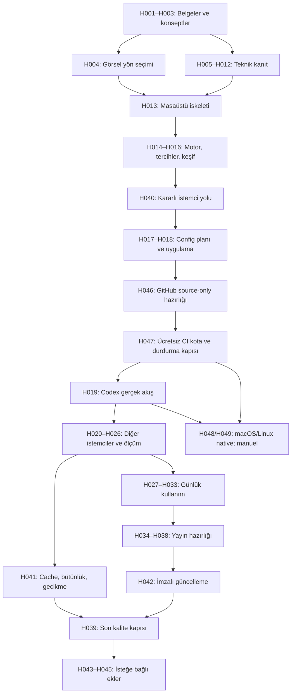

# PennyPinch task list

**19 Kasım güncel öncelik** Windows 10 22H2 x64 yerel kurulum adayı doğrulandı. CircleCI Free ile macOS motor/paket ve Ubuntu pencere derlemesi çalıştırıldı. Windows 11 doğrulaması ertelendi. H049 yeniden başlatıldı. İmzalı güncelleme bildirimi Windows 10’da doğrulandı. İlk yayında tek açık GitHub deposu hedefleniyor. [Platform testleri](docs/validation/desktop-platforms.md) · [Güncellemeler](docs/validation/windows-update.md#19-kasım-2026--açılış-bildirimi-ve-tek-depodan-dağıtım)

**Tarih:** 15 Kasım 2026

**Kaynak:** [Ürün spesifikasyonu 0.6](HEADROOM_DESKTOP_SPEC.md)\
**Hedef:** Windows 10 22H2 x64 ve Windows 11 x64; Codex, Claude Code, OpenCode.  
**Durum:** H001–H005, H007–H012, H013–H036, H038–H040, H043 ve **H045–H048 ve H050–H051 tamamlandı: 45/54.** H043’te RTK-OSS 1.1.0 için uygun bir entegrasyon yolu çıkmadı. H044 yeni aday bekliyor. H042’nin Windows 10 yerel güncelleme/kurtarma ve hata kabulü geçti. Windows 11 ile üretim yayın kaynağı/anahtarı açık. H041’in yerel Windows 10 kabulü geçti, canlı API-key ve Windows 11 kanıtı bekliyor. H037’nin temiz Windows ve yayın kontrolleri açık. H048 macOS 15.8.2 Apple Silicon geliştirme kabulü tamamlandı; Intel, diğer macOS sürümleri, canlı hesap/sağlayıcı ve üretim yayını doğrulanmadı. H049 Linux, kullanıcının 13 Kasım kararıyla kalan yaklaşık $0.10 Actions kotası nedeniyle ertelendi; tamamlanmış sayılmaz. H050 hesap bağlantıları Windows 10 yerel geliştirme kapsamında tamamlandı; yeni gerçek giriş ve diğer OS hesap adapter’ları doğrulanmadı. H051 sohbet metadata/açma akışı Windows 10 yerel geliştirme kapsamında tamamlandı; H049 ertelenmiş durumda. Actions'ta elle Ubuntu kaynak kontrolü ile macOS ARM64 derleme, motor, gerçek paketli pencere ve kontrollü Desktop trafiği doğrulandı. Her yeni CI koşusu öncesi ücretsiz kota ve harcama sınırı kontrol edilir. Açık sohbetlerin yerel kabulü H051'de; geri bildirim ve isteğe bağlı kullanım paylaşımı H052–H054 Cloudflare hesabı hazır olana kadar ertelendi.\

**Tarihsel işaretleme denetimi (21 Ekim, önceki 45 görev/12 kabul anlık görüntüsü):** O listedeki görev adedi ve tamamlanan görev listesi güncel değildir; H018 daha sonra kabul edildi ve H046–H049 eklendi. Güncel yetkili toplam yukarıdaki durum satırında tutulur. Tamamlanan alt dilimler kendi satırlarında `[x]` işaretlidir; ana görevin ilk kutusu bütün kabul koşulları karşılanana kadar açık kalır. [Kaynak karşılaştırması](docs/research/desktop-comparison-2026-10-20.md) sonrası H040–H045 eklendi; H040–H042 ilk sürüm kapıları, H043–H045 ilk kullanılabilir sürüm sonrası isteğe bağlı kapsam. O tarihte H041–H045 başlamamıştı.

## Geliştirme araçları ve çalışma düzeni

**5–6 Kasım tarihsel öncelik değişikliği:** Kullanıcının isteğiyle UX001 tasarım yenilemesi tamamlandığında H029 henüz başlamamıştı. UX001 mevcut özelliklerin sunumunu yeniler, o tarihteki27/51 işlevsel kabul sayısını değiştirmez; güncel ürün sayısı üstteki satırdadır.

### UX001 — Headroom görsel dilinin yenilenmesi
- [x] Projeye sabitlenmiş tasarım rehberi, ortak hiyerarşi ve dört native ekran yenilenmiş; gerçek kontrol/ölçüm/erişilebilirlik akışları korunmuş.
- **Kabul:** [DESIGN.md](DESIGN.md) içindeki boş/gerçek/örnek veri ayrımı, tema/dil/ölçek/klavye, native render ve son yerel kalite kapısı. Ana ajan art direction/uygulama/inceleme sahibi; H029 başlamaz. Sahte tasarruf veya hesap/sohbet işlevi eklenmez.
- **Durum:**6 Kasım tamamlandı. Emil design engineering yalnız projeye, immutable commit/MIT lisansıyla kuruldu; diğer üç kaynak incelendi.138 frontend/349 Rust PASS,6 opt-in ignored; aynı152 girdili derleme/test blokları ve gerçek native kontroller PASS. [Kanıt](docs/proofs/ui-taste.md), [inceleme](docs/reviews/UX001.md). Yerel Windows10; örnek veriler gerçek tasarruf değildir. Görev sonunda durulur.

Bu geliştirme işleri ürün görev sayımına eklenmez. DEV001/DEV002, H028–H036 ve H038 kabul edildi. Ortak H011 güvenlik ön koşulu kapandı. H037’nin dış kabulü açık.

### DEV001 — CodeGraph, Ponytail ve açık kabul sözleşmesi
- [x] CodeGraph'ın sabit runtime/MCP kaydı ve kapsamı kontrol edilmiş; yeni skill klasörü indeksten dışlanmış.
- [x] Ponytail kodlama/audit/review becerileri yalnız projeye, sabit kaynak ve lisans/hash kaydıyla kurulmuş.
- [x] Ana ajan/tek çalışan kullanımı, gerçek kontrol komutları ve görev bitiş kabulü belgelenmiş; kurulum ve belge incelemesi geçmiş.
- **Kabul:** [Ortak akış](docs/development/WORKFLOW.md) ile yerel araçlar tutarlı; global ayar yazımı yok; ürün görev sayımı değişmez. Kurulu talimat, otomatik skill keşfi ve gerçek davranış doğrulaması ayrı belirtilir.
- **Kanıt:** `work/proofs/dev-tools/`; kısa kalıcı özet `docs/proofs/dev-tools.md`. Yeni ürün gate'i gerektirmeyen araç/belge kapsamı.
- **Durum:** Tamamlandı; [kabul kanıtı](docs/proofs/dev-tools.md). DEV002 ayrı denetim görevi olarak tamamlandı.

### DEV002 — Mevcut kodun ilk Ponytail denetimi
- [x] Config/Apply/Undo ve sahiplik, runtime/proxy, UI bağlantı yolları önceliklendirilerek eski kod raporlanmış.
- **Kabul:** Her gerçek bulgu koşul, dosya/satır, kullanıcı etkisi, en küçük çözüm ve doğrulama önerisi içerir. Bulgular ilgili açık göreve veya gerekli küçük düzeltmeye bağlanır; kapsam dışı alanlar yazılır. Rapor üretmek düzeltmelerin yapıldığı anlamına gelmez.
- **Doğrulama:** CodeGraph ile keşfedilen yollar gerçek kaynakta okunur; mevcut kanıt fingerprint'leri değerlendirilir. Yeni koşul olmadan aynı başarılı ürün testleri tekrarlanmaz.
- **Dosyalar:** `docs/reviews/ponytail-baseline.md`, gerekirse ilgili görev notları.
- **Durum:** Tamamlandı; [denetim raporu](docs/reviews/ponytail-baseline.md). Bir düşük öncelikli belge bulgusu DEV002-D01, H022’ye bağlandı. İncelenen öncelikli akışlarda kesin yeni ürün hatası doğrulanmadı; kapsam dışı alanlar raporda. Ürün kodu değiştirilmedi.

**18 Kasım Astra incelemesinin takip maddeleri** (ana görev sayısına eklenmez). Sürüm geri dönüşü ve SSE sayaçları H041 altında ele alınır. Aşağıdaki mevcut ekran regresyonları ayrı sırayla doğrulanır.
- [x] **H024/H025/H027 · Yerel gün başlangıcı.** Genel Bakış ve Etkinlik atlanan gece yarısında ilk geçerli yerel anı kullanıyor. Santiago geçişini temsil eden SQLite fixture’ı Bugün, Son 7 gün ve günlük grafiği doğruladı. 30 dakika 1 saniyelik geçiş ve tüm günün atlanması da geçti. [Kanıt](docs/proofs/metrics-store.md#19-kasım-2026--atlanan-yerel-gece-yarısı).
- [x] **H024/H025 · Uzun oturum grafiği.** 90 günlük saklama ayarıyla 65 ölçüm günü 64 grafik noktasına sığdı. Genel Bakış tüm kayıtları toplamda gösteriyor. Birleşen günlerin aralığı Türkçe ve İngilizce grafikte doğrulandı. [Kanıt](docs/proofs/metrics-store.md#19-kasım-2026--uzun-oturum-grafiği).
- [x] **H025/H030 · Tepside panel sorgusu.** Windows 10 testinde yaklaşık 12 saniyede otomatik Genel Bakış sorgusu 2’den 0’a indi. Tepsiden açılınca tek sorgu geldi ve düzenli yenileme döndü. Arka plan toplayıcısı pencere gizliyken yeni ölçüm aldı. [Kanıt](docs/proofs/tray-lifecycle.md#19-kasım-2026--tepside-genel-bakış-yenilemesi).

## Çalışma kuralları

**Ortak bitiş kabulü:** Görevin kendi kabul maddeleri ile [WORKFLOW.md içindeki beş koşul](docs/development/WORKFLOW.md#bir-görevin-bitiş-kabulü) birlikte sağlanır. Davranış, ilgili hata/kapsam senaryoları, ana ajan incelemesi, geçerli son kanıt ve kayıt/durma adımı eksikse ana kutu açık kalır.

**25 Ekim geliştirme aracı notu:** Kullanıcı isteğiyle CodeGraph 1.6.2 yalnız bu projeye kuruldu; CLI ve proje MCP sorgusu doğrulandı. Telemetry kapalı, global ayarlar değişmedi; sorgu ve süreç kapanışı PASS. [Kullanım/kanıt sınırları](docs/development/codegraph.md). Bu geliştirme aracı ana görevlere eklenmez; **18/51** ve sıradaki **H022** değişmedi.

**20 Ekim geliştirme aracı notu:** Kullanıcı isteğiyle Open Computer Use ayrı Codex MCP/skill olarak kuruldu; Windows10'da Notepad ve Headroom gerçek screenshot/fare denemesi geçti. [Kurulum ve sınırlar](docs/research/computer-use-2026-10-20.md). Bu20 Ekim notu tarihseldir; araç kurulumu ürün kabulüne eklenmez. Güncel görev sayımı üstteki durum satırındadır.

- `[x]` yalnız belirtilen çıktısı tamamlanan işi gösterir. Tasarım önizlemesi gerçek motor veya istemci doğrulamasının kanıtı değildir.
- Görevler bağımlılık sırasıyla alınır. Her uygulama dilimi S/M boyutunda tek davranış ve birlikte doğrulanabilir kabul ölçütleriyle sınırlanır. Yaklaşık 1–5 dosya devir rehberidir; dosya sayısı zorunlu bölme eşiği değildir. Bağımsız amaçlar aynı ana görev altında sırayla ayrılır.
- Kullanıcı tercihi: etkin ana görev tamamlanmadan sonraki ana göreve geçilmez; bu dosya ilerledikçe güncellenir. Her ana görev tamamlanınca kullanıcıya bildirilir ve çalışma durur; sonraki ana görev için kullanıcının devam mesajı beklenir. Alt dilim kabulü ayrıca belirtilir.
- Her görevde kabul koşulu ve kanıt bulunur. Kanıtta komut, kaynak/config ve araç zinciri fingerprint'i ile sonuç birlikte kaydedilir; sırlar ve ham hata çıktıları kalıcı tutulmaz.
- Uygulama sırasında odaklı kontroller kullanılır. İnceleme/düzeltme bitince son adayın tam kalite kapısı bir kez çalıştırılır. Geçerli PASS gerekçesiz tekrarlanmaz.
- Gerçek model testleri normal otomatik test paketine karışmaz. Küçük ve ayrı yürütülür; mevcut doğal trafik mümkünse kullanılır.
- Model, reasoning seviyesi, ajan sayısı, izin ve giriş yöntemi sessizce değiştirilmez. Bu ürün çalışan ajanları yönetmez; uygun model trafiğini yönlendirir.
- Kullanıcı kararı: Bir istemci/bağlantı bağlanınca desteklenen bütün modeller, ana ajan ve aynı doğrulanmış yolları kullanan bütün alt ajanlar varsayılan kapsamdır; model/alt ajan başına tekrar seçim/kurulum yoktur. Ayrı provider/süreç/bulut yolunun kapsamı ayrıca kanıtlanır; arayüz tam kapsama uydurmaz.
- Kontrol noktaları kanıt incelemesidir. Açık ürün kararını, eldeki yetkiyle çözülebilen rutin uygulama kararından ayır.
- H013 scaffold'u ve kayıtlı `pnpm` scriptleri mevcut. Sonraki görevlerde anılan, henüz eklenmemiş scriptler planlanan sözleşmedir; başarılı çalışmış gibi raporlanmaz.
- Kimlikler geçmiş kanıtları korur; uygulama sırası numaralardan değil bağımlılıklardan okunur. Windows ürün yolu H016 → H040 → H017 → H018 → H019'dur; bu planın GitHub hazırlığı H018 → H046 → H047 → H019 bağımlılığını ekler. H048/H049, H019 Windows ilk çalışan dilimi ve H047 ücretsiz kota incelemesine bağlıdır; H048 tamamlandı, H049 kullanıcı kararıyla ertelendi. H049'a bağlı olmayan H050 sıradaki adaydır; bu plan bakımı H050'yi başlatmaz. H041 ölçüm temeli H023'ten sonra, H042 installer/kaldırmadan sonra ve H039'dan önce. Opsiyonel H043–H045 ilk kullanılabilir sürümden sonradır.

## Aşamalar ve bağımlılık sırası

| Aşama | Görevler | Çıktı |
| --- | --- | --- |
| Hazırlık | H001–H004 | Kapsam, görev listesi, üç konsept, tasarım seçimi |
| Teknik kanıt | H005–H012 | Paketleme ve üç istemci için doğrulanmış uygulanabilirlik |
| İlk çalışan dilim | H013–H019 | Gerçek motor durumu ve Codex bağlantısı olan masaüstü uygulaması |
| Kararlı istemci yolu | H040; H016 sonrası/H017 öncesi | Kalıcı endpoint, sahiplik ve kanıtlı arıza yolu |
| İstemci ve ölçüm | H020–H026 | Claude/OpenCode, doğru metrikler ve gerçek dashboard |
| Ölçüm ve fayda kapısı | H041; H023 sonrası | Cache, bütünlük ve gecikme regresyonu |
| Günlük kullanım | H027–H033 | Etkinlik, güvenli duraklatma, tepsi, ayarlar ve dışa aktarma |
| Yayın adayı | H034–H039 ve H042 | Erişilebilirlik, Windows testleri, paket, imzalı güncelleme ve son kalite kapısı |
| Sonraki isteğe bağlı sürüm | H043–H045 | Kanıtlı RTK entegrasyonu ve içeriksiz yerel öneriler |
| Hesaplar ve sohbetler | H050–H051 | Resmî hesap bağlantısı ve güvenilir açık/çalışan sohbet metadata görünümü |
| Kaynak deposu ve ücretsiz CI hazırlığı | H046–H047 | Private, source-only GitHub importu; kota ve masraf durdurma kanıtı |
| Ek platformlar | H048–H049 | macOS/Linux native port ve kabul; Windows ilk dilimi ve H047 sonrasında |

## Hazırlık

### H001 — Ürün kapsamı
- [x] Spesifikasyon oluşturuldu; Windows 10/11, otomatik keşif, bir defalık bağlantı, subagent ve model kapsamı işlendi.
- **Kabul:** Uygulama davranışı ile motor kabiliyeti ayrılmış; ölçüm sınırları ve geri alma tanımlı.
- **Doğrulama:** `HEADROOM_DESKTOP_SPEC.md` içerik ve Markdown yapısı kontrolü.
- **Bağımlılık / boyut:** Yok / S.
- **Dosyalar:** `HEADROOM_DESKTOP_SPEC.md`.

### H002 — Uygulanabilir görev listesi
- [x] Bağımlılıkları, kabul koşulları ve kontrol noktaları olan bu liste hazırlandı.
- **Kabul:** Bütün H kimlikleri tekil; bağımlılıklar mevcut ve döngüsüz; üretim işleri tamamlanmış işaretlenmemiş.
- **Doğrulama:** Kimlik/bağımlılık denetimi ve spesifikasyon kapsamıyla karşılaştırma.
- **Bağımlılık / boyut:** H001 / S.
- **Dosyalar:** `TASKS.md`.

### H003 — Üç etkileşimli UI konsepti
- [x] Graphite, Ivory ve Signal; genel bakış, uygulamalar, etkinlik ve ayarlar önizlemeleri hazırlandı.
- **Kabul:** Üç farklı yerleşim; örnek veri etiketi; çalışan gezinme, durum seçimi, bağlantı diyaloğu ve başlat/duraklat gösterimi.
- **Doğrulama:** Yerel tarayıcıda üç konseptin etkileşim ve taşma kontrolleri; ekran görüntüleri. Kanıt: `work/ui-review/validation-summary.json`.
- **Bağımlılık / boyut:** H001 / M; yalnız tasarım çıktısı.
- **Dosyalar:** `UI_CONCEPTS.md`, `outputs/ui-concepts/`.

### H004 — Görsel yönün seçilmesi
- [x] Kullanıcı Graphite'ı seçti; aynı düzenin açık/koyu tema token yaklaşımı karar kaydına işlendi.
- **Kabul:** Seçilen düzen ve her iki tema için token yaklaşımı kayıtlı; örnek UI ile üretim kapsamı ayrımı korunmuş.
- **Doğrulama:** Konsept karşılaştırması üzerinden kullanıcı seçimi; tasarım karar kaydı.
- **Bağımlılık / boyut:** H003 / S.
- **Dosyalar:** `UI_CONCEPTS.md`, `docs/decisions/001-ui-direction.md`.

## Teknik kanıt — önce en riskli yollar

### H005 — İzole motor deneyi
- [x] `headroom-ai[proxy]==0.41.0`, proje içi Python 3.13.13 ve uygulamaya ait loopback portunda çalıştırıldı; readiness/sahiplik, meşgul/yanlış listener ve kontrollü kapanış kanıtlandı.
- **Kabul:** Readiness ve sahiplik doğrulanır; başka proxy sahiplenilmez; deney istemci ayarlarını kalıcı değiştirmez.
- **Doğrulama:** Boş/meşgul port, hatalı süreç ve kontrollü kapanış deneyi; küçük yapılandırma özeti.
- **Bağımlılık / boyut:** H001 / M.
- **Dosyalar:** `work/proofs/engine/`, `docs/proofs/engine.md`.
- **Sonuç / sınır:** 4 odaklı test ve gerçek runtime proof PASS; fingerprint'ler [kanıtta](docs/proofs/engine.md), koordinatör incelemesi [H005 incelemesinde](docs/reviews/H005.md). Windows 10 22H2 host/konsol bağlamına aittir; Windows 11, temiz paket ve konsolsuz GUI yaşam döngüsü henüz doğrulanmadı.

### H006 — Windows paketleme kanıtı
- [ ] Python/native bağımlılıklarıyla motorun taşınabilir çalışma biçimi iki hedef Windows'ta sınanır.
- **Temiz ortam için test paketi hazır.** Önceki native kontrolden geçen ayrı kimlikli uygulama ve motor, Başlat → Hazır → Durdur → Çıkış yönergesiyle 197.348.721 baytlık taşınabilir ZIP'e alındı. 22.335 dosyanın hash'i ve ZIP'in Windows'ta okunması doğrulandı. Test için WebView2 Runtime gerekir. İki temiz ortamın sonuçları bekleniyor. [Paket kaydı](docs/proofs/windows-engine-clean-test-package.json).
- [x] **H006-d başlangıçta sahip kaybı — 15 Kasım.** Gerçek paketli controller, üretimdeki spawn ile Job ataması arasındaki test kontrol noktasında sınandı. Sahip kapanınca 147 ms içinde çıktı. Yazma ucu bir saniye tutulunca bekledi, uç kapatıldıktan sonra 8 ms içinde çıktı. İki kolda exit 2, protokol çıktısı 0, yeni helper/motor ve kalan süreç 0. 22.334 paket girdisi eşleşti. Odaklı test, 462 Rust testi, biçim ve gömülü derleme geçti. 222 uygulama testi ve frontend derlemesi eşleşen girdilerle yeniden kullanıldı. [Kanıt](docs/proofs/windows-engine-startup-crash.json) · [İnceleme](docs/reviews/H006-d.md).
- [x] **H006-c gerçek GUI çökmesi — 15 Kasım:** Paketli release Tauri penceresinden başlatılan üç motor süreci, yalnız GUI Child handle'ı zorla sonlandırıldığında 57,429ms'de bitti; motor/sabit ingress portları 58,299ms'de kapandı. Dış gözlemci Job'ı bu sırada açık, yabancı listener sağlam kaldı. Aynı kimlik/profil Stopped açıldı, sabit endpoint korundu ve Başlat/Ready/Durdur/normal Çıkış geçti. 22.689 girdi önce/sonra aynı, sağlayıcı model isteği 0. İlk test yardımcısının yanlış TCP tablo sabiti düzeltildi; başarısız koşu ve test state'i korundu. Ana H006 ve 45/54 değişmez. [Kanıt](docs/proofs/windows-gui-crash.json), [açıklama](docs/proofs/windows-gui-crash.md), [inceleme](docs/reviews/H006-c.md).
- [x] **H006-b yerel çökme kabulü — 14 Kasım:** Güncel paket ve üretimdeki Rust controller başlatma yolunda zorla sahip süreç kaybı doğrulandı. Kontrol borusu açıkken üç çekirdek süreç 53ms'de sonlandı, portun kapanışı 357ms'de gözlendi. Ek Job handle'ı en az 1000ms açık tutulunca motor yaşadı; son handle kapanışında 54ms / port 370ms gözlendi. İki kolda yabancı listener korundu. 22.333 paket dosyası aynı; 441 Rust/18 ignored, fmt/build ve parmak izi eşleşen 221 Node/frontend kanıtı kabul edildi. Ana ajan süreç/test/inceleme sahibi; temiz OS, Windows 11, gerçek GUI çökmesi ve yayın kapsamı değildir. [Kanıt](docs/proofs/windows-engine-crash.json), [açıklama](docs/proofs/windows-engine.md#h006-b--ani-sahip-süreç-kaybı-14-kasım-2026), [inceleme](docs/reviews/H006-b.md).
- [x] **Yerel alt dilim H006-a kabul:** Windows 10 hostunda konsolsuz üst süreç → gizli helper → motor zinciri, stdio stop ve graceful kapanış kanıtlandı. İki odaklı kontrol PASS; kaynak/paket fingerprint'leri incelendi. [Kanıt](docs/proofs/windows-engine.md), [inceleme](docs/reviews/H006-a.md).
- **Yerel çıktı / açık kapsam:** H014 gerçek Tauri motor bağını, H006-b hazır controller sahibinin Job temizliğini, H006-c paketli GUI kaybını ve yeniden açılışı, H006-d Job ataması öncesinde controller'ın kapanışını doğrular. Ana kabul iki ayrı temiz Windows 10 ve Windows 11 x64 ortamını bekliyor. Mevcut standart Actions imajları hedeflenen masaüstü x64 kabulünü karşılamıyor. **45/54.** [Windows test ortamı](docs/validation/windows-install.md#açık-kabul).
- **Kabul:** Geliştirme araçları bulunmayan Windows 10 22H2 ve 11 x64 ortamında motor başlar; indirme, runtime boyutu ve olası eksikler kayıtlıdır.
- **Doğrulama:** İki ayrı temiz ortamın readiness/kapanış kanıtı; başarısız ortam başarılı sayılmaz.
- **Bağımlılık / boyut:** H005 / M.
- **Dosyalar:** `scripts/package-engine.*`, `docs/proofs/windows-engine.md`.

### H007 — Streaming ve retrieval sözleşmesi
- [x] Kontrollü yerel HTTP örnekleriyle istek, SSE event bütünlüğü, hata ve CCR davranışı kanıtlandı.
- **Sonuç:** A: opaque bloklar/explicit cache marker, model/reasoning/auth, tool-fragment ve 429 aktarımı. B: gerçek sıkıştırma → aynı runtime public retrieval eşitliği, TTL7200. C: son gözlemdeki 60.900 bayt kaynak ve açık tool korumasıyla 59.219 bayt sayısal çıktı birebir. [Kanıt](docs/proofs/protocol.md), [inceleme](docs/reviews/H007.md).
- **Sınır:** Windows 10 hostunda, yerel fixture ve sentetik credential. Opaque düzeltmesi source guard içeren startup uyarlamasıdır; H014/H037 üretime taşıyacak. Sayısal koruma araç/şekil kapsamındadır; genel otomatik sayı tanıma değildir. 153.599 → 106 bayt sonucu token tasarrufu ölçümü değildir. Artımlı SSE/gerçek istemci döngüsü H008–H010'da; diğer OS/temiz ortam/native paket kanıtı H006/H037'de açık kalır.
- **Kabul:** Desteklenen Responses/Anthropic yollarında araç çağrısı yapısı korunur; sıkıştırılmış örneğin aslı aynı runtime'dan alınır; bilinmeyen bloklar korunur.
- **Doğrulama:** Yerel fixture sunucusu; sıkıştırma/retrieval eşitliği ve stream sırası kontrolleri. Ücretli çağrı şart değildir.
- **Bağımlılık / boyut:** H005 / M.
- **Dosyalar:** `work/proofs/protocol/`, `tests/fixtures/protocol/`, `docs/proofs/protocol.md`.

**Kontrol noktası K1 — H005–H007:** Runtime yaklaşımı ve protokol kanıtı incelenir. Paketleme veya retrieval engeli gizlenerek üretim UI'sına geçilmez.

### H008 — Codex masaüstü ve CLI kanıtı
- **4 Kasım ana görev kabulü:** Kullanıcı ChatGPT kanıtıyla kapanışı ve canlı API-key testinin H041 yayın öncesi kabulünde açık tutulmasını seçti. Windows10'da CLI0.166.0 ana/tek alt ajan, aynı/farklı model-efor ve native bekleme; Desktop26.1027.6604.0 gerçek hesap, aynı sohbet ve yeniden açılış rotası doğrulandı. Kontrollü MCP çağrısı istemcinin izin politikasıyla engellendi; genel araç sağlığı iddia edilmez. [Kapanış ve sınırlar](docs/proofs/codex-native-wait.md#h008-kapsam-kararı-ve-kapanış), [sürüm kataloğu](compatibility/clients.json).
- **4 Kasım native bekleme dilimi:** Yeni gerçek CLI koşusunda ana/alt ajan spawn ve wait tamamlandı; eşleşen JSON dönüşü timed_out=false, completed runtime olayı ve iki ayrı Responses giriş kimliği doğrulandı. Kontrollü MCP çağrısı `approval_policy=never` nedeniyle istemcide engellendi; kapı isteği 0 ve durum environment_blocked. İzin politikası değiştirilmedi, reddedilen çağrı tekrarlanmadı. QA relay resetlerinin yönü ve terminalle zaman ilişkisi bilinmiyor; sayaç TCP kapanışını ölçüyor. Ayrı model çağrısız app-server fixture kontrolü ve 3 odaklı test PASS. [Kanıt](docs/proofs/codex-native-wait.md).
- **4 Kasım gerçek Desktop dilimi tamamlandı:** Ayrı resmî ChatGPT profiliyle Desktop 26.1027.6604.0, Headroom üzerinden iki kısa yanıtı tamamladı. Sohbetten çıkıp aynı sohbeti açma ve aynı native kimlik doğrulandı. Motor 5 yerel istek/0 failure bildirdi; istek amaçları ayrı sayılmadı. Pencere/portlar kapandı, normal config korundu. Güncel kurulu dosyalarla 2 opt-in keşif/pin ve izole Apply/Undo PASS. Açık süreç yeni ayarı o turda kullanmadı; tam yeniden açılış sonrası aynı sohbetin Headroom rotası ayrıca geçti. Canlı API-key ve geniş auth/transport kapsamı açık. [Kanıt](docs/proofs/codex-desktop-live.md).
- **Güncel farklı model/efor kanıtı:** CLI 0.166.0 ve mevcut ChatGPT girişiyle ana Astra max ve test alt ajanı Sol medium tamamlandı. Headroom girişinde iki sohbet kimliği ayrı eşleşti. Bu tarihsel koşuda wait dispatch öncesi iptaldi; yeni 4 Kasım native bekleme kanıtı yukarıdadır. [Kanıt](docs/proofs/codex-current-diagnostics.md).
- **3 Kasım Desktop izole kabulü:** Kurulu Desktop uygulaması ayrı profildeki kayıtlı yerel uç noktayı kullandı. WebSocket isteği Headroom üzerinden sahte sağlayıcıya ulaştı ve tamamlanan yanıt arayüzde görüldü. Gerçek hesap ve mevcut sohbet yönlendirmesi açık. [Kanıt](docs/proofs/codex-current-diagnostics.md).
- **3 Kasım tanı ve güncel CLI rol kanıtı:** Eski `mcp` yapılandırma uyarısı model çağrısı olmadan üretildi. Sahipliği doğrulanan iki kapanış exit 0 verdi. Kota yenilenince CLI 0.166.0 ve mevcut ChatGPT hesabıyla ana ve tek varsayılan alt ajan tamamlandı. İki rolün aynı modeldeki kimlikleri Headroom girişinde ayrı eşleşti. Açık Desktop yönlendirmesi, farklı model/efor kombinasyonu ve diğer auth/transport kapsamı açık. [Kanıt](docs/proofs/codex-current-diagnostics.md).
- **3 Kasım yerel kullanım düzeltmesi kabulü (ana görev değil):** Geçerli OpenAI imzası + bounded sürüm sorgusu + dosya pin'i, yerel standalone junction çözümü, kayıtlı Windows paket API'si, gerçek GUI executable seçimi ve uzun PATH önceliği uygulandı. CLI0.166.0, backend0.166.0-alpha.5.1 ve Desktop26.1027.3384.0 tanınıyor. İki yüzey gerçek keşif→plan→atomik Apply/Undo testini izole config üzerinde geçti. Verifier workspace'i app-state'e taşındı; CodeGraph proje config'i kullanıcı ayarına dokunmadan testin dışında kalır. UI→native verifier→owned runtime→normal mevcut ChatGPT hesabı CLI yanıtı doğrulandı. Bu koşudaki iki bildirim sonraki tanıda kullanıcı ayarından gelen yapılandırma uyarıları olarak sınıflandırıldı. [Kanıt](docs/proofs/codex-current.md), [karar011](docs/decisions/011-current-codex.md), [inceleme](docs/reviews/H008-current.md).289 Rust/98 frontend PASS; fmt ve embedded build PASS. Bu ilk dilimde canlı Desktop, alt ajan ve genel auth kabulü ayrı bırakıldı.
- **H019 sonrası açık protokol takibi —23 Ekim:** Normal `.11.2` CLI gerçek yanıtı tamamlıyor, fakat2 ek JSONL error bildiriminin kaynağı bilinmiyor. Ürün yanıt rotası kanıtını bu hatalardan ayrı gösterir; genel protokol/araç sağlığı veya hataların çözümü kabul edilmez. İzole failing-MCP testi bu error olaylarını üretmedi; MCP/transport nedeni varsayılmaz. [Son kanıt](docs/proofs/codex-product-verification.md). Bu tarihsel adımda H008 ana kutusu açık tutuldu; güncel bildirim tanısı yukarıdadır.
- [x] Kurulu Codex yüzeylerinin gerçek yönlendirme yolu belirlenir; küçük gerçek trafikle doğrulanır. Kabul kapsamı Windows10'da yukarıdaki ChatGPT CLI/Desktop sürümleridir.
- **Yerel ara kanıt:** A2 mesaj-only turu/exit0 geçti; `update_plan` ilan edilmedi. A3 farklı salt okunur `get_goal` çağrısında doğru callback/call_id, iki POST, upstream terminalinden önce mesaj item'ı, son marker/turn.completed/exit0 görüldü; tool sonucu unclassified text olduğundan semantik başarı sayılmaz. [Kanıt](docs/proofs/codex.md), [inceleme](docs/reviews/H008.md).
- **Tarihsel kısıt:** PowerShell ile dosya okuma başlatılmasını otomatik review `blocked by policy` ile reddetti; aynı eylem tekrar denenmez. API-fixture gerçek model/ChatGPT auth/desktop/ana-alt ajan desteği yerine geçmez. H008'in ChatGPT kabulü sonraki gerçek trafik kanıtlarına dayanır; canlı API-key kabulü H041'de açık tutulur.
- **Kabul:** Giriş, upstream model ve reasoning korunur; ana ve tek subagent yolu ayrı kontrol edilir; proje config'inin yok sayılan anahtarlarına güvenilmez.
- **Karşılaştırma ek kabulü — 4 Kasım kullanıcı kapsam kararı:** ChatGPT gateway gerçek CLI/Desktop trafiği H008 kabulüdür; canlı API-key sağlayıcı testi H041 yayın öncesi kapısına taşınmıştır ve henüz not_tested'dır. HTTP/SSE fixture ile canlı WebSocket ayrı işaretlenir. Mevcut sohbet DB'sinin topluca provider retag edilmesi varsayılan entegrasyon yöntemi değildir. Rakip adapter kodu araştırma girdisidir, bizim canlı destek kanıtımız sayılmaz.
- **Model/alt ajan kabulü:** Ana ve mevcut tek alt ajanın farklı model/eforuyla gerçek yol ayrı gözlenir; aynı modelle iki rol ve aynı yolda sonradan açılan alt ajan fixture'ı kapsanır. Bu geliştirme sohbetinde yeni test ajanları açmak/model/ajan sayısı değiştirmek için gerekçe değildir. Ayrı provider veya cloud yolu gözlenmiyorsa kapsam kısmi/bilinmiyor kalır.
- **Doğrulama:** Ana istek + tek subagent isteği için içeriksiz, ayrı proxy kanıtı; her auth/yüzey kombinasyonuna doğru durum.
- **Bağımlılık / boyut:** H007 / M.
- **Dosyalar:** `work/proofs/codex/`, `docs/proofs/codex.md`.

### H009 — Claude Code CLI kanıtı
- **H009 tamamlandı — 15 Kasım, Windows 10 yerel teknik kabulü.** H009-a/b, native H020 ve H022 kanıtları ana kabul/K2 ile uzlaştırıldı. Sentetik auth/CLI kapsamında ayar/model/efor koruması, streaming, araç/CCR, scoped Apply/Undo ve ilk kullanım/hatırlanan proje tamam. Native UI tools-off ile ayrı araçlı CLI profili birbirine karıştırılmaz. Canlı hesap/sağlayıcı, Claude alt ajan/eklenti ve diğer OS birleşimleri deneysel/not_tested kalır; tam ajan kapsamı veya gerçek token/fatura kazancı iddia edilmez. [Ana kabul](docs/proofs/claude-acceptance.md), [JSON](docs/proofs/claude-acceptance.json), [inceleme](docs/reviews/H009.md).
- [x] Etkin ayar kapsamı ve Anthropic yolu küçük gerçek trafikle doğrulanır.
- [x] **H009-b yerel araç/CCR kabulü — 14 Kasım:** Gerçek pinned 2.1.158 CLI → izinli tek MCP fixture aracı → motor → yerel Anthropic döngüsü geçti. 3 native istek/4 upstream mesajında iki gerçek araç çağrısı, call_id/model/efor/thinking/sentetik auth, final/exit0 ve graceful motor kapanışı doğrulandı. 14.999 bayt log 103 bayta indi; CCR JSON zarfından özgün içerik aynı hash ve baytlarla geldi. Dört odaklı hata/sınır kontrolü geçti; değişmeyen Rust/Node/build kanıtı ilgili fingerprint'lerle yeniden kullanıldı. Token/fatura tasarrufu ölçülmedi. Büyük MCP çıktısının CLI tarafından dosyaya taşınması ayrı gözlendi; bu yola Headroom kazancı atanmaz. Ana ajan test/protokol/inceleme sahibi; canlı sağlayıcı/OAuth/alt ajan/GUI/diğer OS ve ana H009 açık, toplam 42/54. [Kanıt](docs/proofs/claude-tools.json), [açıklama](docs/proofs/claude.md#h009-b--gerçek-cli-araç-ve-ccr-döngüsü), [inceleme](docs/reviews/H009-b.md).
- [x] **H009-a kabul:** Kurulu 2.1.158 CLI, transient bare/API-sentinel/tools-kapalı profilinde tek POST, terminalden önce gerçek partial text, final success/exit0 ve direct usage12/4 geçti. 5 odaklı test PASS; kaynak hash'leri incelendi. [Kanıt](docs/proofs/claude.md), [inceleme](docs/reviews/H009-a.md). Force fallback/kapalı port kanıtı GUI graceful kapanışı değildir. Mevcut OAuth/tool/retrieval/extension kabulü yerine geçmez; reddedilen Codex/PowerShell eylemi tekrar edilmedi.
- **Kabul:** Mevcut giriş ve seçili model korunur; streaming/araç/retrieval çalışır; CLI sonucu eklenti desteği sayılmaz.
- **Model/alt ajan kabulü:** Varsayılan kapsam ana ve desteklenen alt ajan yollarını birlikte içerir; alt ajan için ayrı bağlama veya model allowlist'i gerekmez. Ayrı endpoint/provider ayarı olan rolün geçtiği yol ayrıca doğrulanır; eksik yol tam kapsama sayılmaz.
- **Doğrulama:** Bağlantı ve geri alma deneyi; yetki veya hesap bulunmazsa sınır kayıtlıdır.
- **Bağımlılık / boyut:** H007 / M.
- **Dosyalar:** `work/proofs/claude/`, `docs/proofs/claude.md`.

### H010 — OpenCode CLI/TUI kanıtı
- **H010 tamamlandı — 15 Kasım, Windows 10 yerel teknik kabulü.** OpenCode 1.19.3 ve 2.3.0 için uygun OpenAI Chat/Responses yolları, model/auth alanlarının korunması, JSON/JSONC, streaming, araç/CCR ve ana/alt ajan rotaları doğrulandı. V2 normal servis/TUI ve CLI ayarıyla paketli Desktop ayrıca geçti. K2 gereği erişilemeyen birleşimler deneysel kalır. [Ana kabul](docs/proofs/opencode-acceptance.md), [JSON](docs/proofs/opencode-acceptance.json), [inceleme](docs/reviews/H010.md).
- [x] **H010-j Windows 10 OpenCode Desktop — 15 Kasım.** Resmî 2.3.0 NSIS payload'ı proje içinde, ayrı profilde çalıştı. Headroom CLI kurulumu ile bağlanan kullanıcı JSONC'sini paketli servis kullandı. Gerçek GUI gönderimi → dört Responses isteği → üç MCP çağrısı → görünür final ve SQLite eşleşti. Log 14.999 → 103 bayt, birebir CCR. Ana süreç normal quit/exit 0; ayrı servis stop, port/süreç temizliği, protokol kaydının sahipli temizliği ve özgün config'e Kaldır geçti. 22.818 native girdi eşleşti. 222 Node/462 Rust PASS, 19 ignored, fmt/build PASS. Ana H010 açık, toplam 42/54. [Kanıt](docs/proofs/opencode-v2-desktop.md), [JSON](docs/proofs/opencode-v2-desktop.json), [inceleme](docs/reviews/H010-j.md).
- [x] **H010-i Windows 10 OpenCode V2 alt ajan — 15 Kasım.** Aynı kayıtlı 2.3.0 servisi iki CLI turunu tamamladı. Bir alt ajan ana Chat modelini miras aldı. İkincisi Responses ana ajanına bağlı ayrı bir Chat modeli kullandı. Dört oturumun gerçek kimliği, `parent_id`, model rotası, alt ajanın tamamlanma bildirimi ve log/CCR geçti. Her örnek 14.999 → 103 bayt ve birebir geri çağırma. Native Kaldır ve normal servis duruşu doğrulandı. 22.714 girdi eşleşti. Ana H010 açık, toplam 42/54. [Kanıt](docs/proofs/opencode-v2-subagents.md), [JSON](docs/proofs/opencode-v2-subagents.json), [inceleme](docs/reviews/H010-i.md).
- [x] **H010-h Windows 10 OpenCode V2 normal servis ve tam TUI — 15 Kasım.** Native Uygula sonrasında başlayan kayıtlı 2.3.0 servisini normal CLI (Chat) ve tam TUI (Responses) kullandı. İki ayrı kök oturum aynı servis veritabanında başarılı, üç araç ve dört model isteği her kolda doğrulandı. Örnek log 14.999 → 103 bayt ve birebir geri çağırma. TUI `/exit`, normal servis durdurma, açık port/süreç kalmaması ve UI Kaldır ile özgün JSONC geçti. 22.705 native girdi eşleşti. Katalog ve son yerel kapı güncel. Ana H010 açık, toplam 42/54. [Kanıt](docs/proofs/opencode-v2-service.md), [JSON](docs/proofs/opencode-v2-service.json), [inceleme](docs/reviews/H010-h.md).
- [x] **H010-g Windows 10 V2 CLI bağlantısı — 15 Kasım.** Sabit 2.3.0 baseline için gerçek Headroom penceresinde Önizle, Uygula, yeniden açılış ve Kaldır geçti. V2 şema etiketi ortak sahiplik kaydında saklanır. Ayar değişikliği mevcut sağlayıcı uç noktalarını ve MCP köprüsünü aynı işlemde bağlar. Model, kimlik doğrulama, efor ve izinler korunur. Chat ve Responses turlarında 14.999 → 103 baytlık log, özgün baytlarıyla geri çağrıldı. Çatışmalı Undo ayarı ve sahipliği korudu. Normal Undo özgün JSONC'yi geri yükledi. 222 Node ve 462 Rust PASS, 19 ignored, ayrıca 1 gerçek dosya testi PASS. Ana H010 ve V2 Desktop/TUI, paylaşılan servis, alt ajan, canlı hesap ve diğer işletim sistemleri açık. Toplam 42/54. [Kanıt](docs/proofs/opencode-v2-binding.md), [JSON](docs/proofs/opencode-v2-binding.json), [inceleme](docs/reviews/H010-g.md).
- [x] **H010-f Windows 10 V2 sürüm tanıma — 14 Kasım:** Resmî pinned 2.3.0 x64 baseline exe, çalıştırılmadan hash/boyut/identity ile PATH/manual/user-local keşifte tanındı; rescan, read pin ve yanlış sürüm/yazma açılışı reddi gerçek dosyayla geçti. V1 binary tanınması korundu. Gerçek discovery → PlanManager → Apply, V2 planını blocked tuttu; fixture JSONC aynı ve ownership dizini yok. Account/login gate kapalı. Katalog geçmiş CLI preflight'ını partial olarak gösterir; eşleştirme kapsamı genişlemedi. Tam kapı 222 Node/450 Rust PASS (19 ignored), fmt/frontend/embedded build PASS; ayrıca 1 opt-in gerçek dosya testi/341 girdi eşleşti. Eski 645 girdili protokol kanıtı değişmediği için tekrarlanmadı. Native pencere/file-picker yeniden sınanmadı; V2 writer/MCP/alt ajan/Desktop/canlı auth ve ana H010 açık, toplam 42/54. [Kanıt](docs/proofs/opencode-v2-discovery.json), [açıklama](docs/proofs/opencode-v2-discovery.md), [inceleme](docs/reviews/H010-f.md).
- [x] Etkin sağlayıcı ve model korunarak OpenCode yolu doğrulanır. 1.19.3 CLI/TUI ve 2.3.0 CLI'de ayrı model/protokol ve ana/alt ajan yolları gerçek istemciyle geçti; aynı V1 ana oturumda model değişimi doğrulandı. Canlı sağlayıcı/auth ve diğer OS kapsamı deneysel.
- [x] **H010-b yerel ürün araç/CCR kabulü — 14 Kasım:** İlk endpoint-only Chat/Responses koşuları retrieval bildirimi eksikliği nedeniyle başarısız olarak korunur. H010-b3 ile Windows ürün akışı gerekli MCP köprüsünü kurar; gerçek native UI → kaydedilmiş JSONC → pinned OpenCode 1.19.3 → sahipli motor → yerel sağlayıcı döngüsü iki protokolde geçti. Chat gerçek MCP retrieval, Responses server-side retrieval kullandı. Bu yerel kabul canlı sağlayıcı, gerçek alt ajan veya ana H010 kabulü değildir; toplam 42/54.
- [x] **H010-b2 koşullu yerel teknik kanıt:** İzole profile açıkça eklenen dar loopback MCP köprüsüyle gerçek 1.19.3 CLI, Chat'te 4 native/4 upstream mesajı ve native retrieval; Responses'ta 3 native/4 upstream mesajı ve server-side retrieval tamamladı. İki kolda özgün 14.999→103 bayt ve birebir CCR, selector/wire model, sentetik auth/call_id, final ve graceful CLI/motor exit0/port kapanışı doğru. Beş fixture + üç sınır kontrolü geçti; değişmeyen ürün kapıları fingerprint eşleşerek yeniden kullanıldı. Test köprüsü ürün paketine/normal client ayarına kurulmadı; token/fatura kazancı ölçülmedi. [Kanıt](docs/proofs/opencode-tools.json), [açıklama](docs/proofs/opencode.md#h010-b--araç-ve-ccr-yolları), [inceleme](docs/reviews/H010-b.md).
- [x] **H010-b3 Windows 10 ürün retrieval köprüsü:** Önizle → atomik Uygula → çatışmayı koruyan Kaldır native arayüzden doğrulandı. Kullanıcıya ait mevcut MCP kaydı engellenir; model/efor/auth/ajan seçimi korunur. Paketli köprü yalnız geçerli hash ve aynı kullanıcıya ait doğrulanmış Headroom soketine erişir. İki protokolde 14.999→103 bayt blok ve birebir geri alma/final/exit0; duraklatma, tam durdurma, aynı endpoint ile yeniden açılış, iptal/çatışma ve byte-exact Undo geçti. Release kaldırma girişinde açık köprü kilidi, çatışmada exit10/değişiklik yok ve normal exit0/geri alma geçti. 222 Node, 448 Rust (18 ignored), 7 Python köprü testi, fmt/frontend/embedded build başarılı; 332 ürün girdisi eşleşti. Tam installer/güncelleme veya token/fatura kazancı iddiası yok. [Kanıt](docs/proofs/opencode-retrieval.json), [açıklama](docs/proofs/opencode-retrieval.md), [inceleme](docs/reviews/H010-b3.md).
- **H010 kapsam sınırları.** Desktop-only keşif/kurulum, V2 TUI/Desktop içinden alt ajan, aynı alt oturumda model değişimi, nested ajan, açık servisin ayarı anında benimsemesi, canlı sağlayıcı/auth ve diğer işletim sistemi birleşimleri not_tested/deneysel. Karar 009 ve K2 bu sınırlı kapsamı temsil eder. Birleşimler doğrulanmadan genel destek iddiası kurulmaz. Ücretsiz kullanım sınırı geçerli.
- [x] **H010-c yerel native alt ajan kabulü — 14 Kasım:** Aynı Chat modelini miras alan gerçek child; aynı parent session'da açık model değişimi ve yeni child; Responses parent + farklı Chat modeli kullanan child geçti. Gerçek `task` metadata'sı ile child export'unun parentID/agent/selector alanları eşleşti; üç farklı child, en fazla bir eşzamanlı foreground child. İki rolün veri/CCR/tanık/final yolu, model/sentetik auth, değişmeyen bağlantı ve exit0 doğru. Altı blokta 14.999→103 bayt ve birebir geri alma; normal GUI çıkışı/kapalı listener, aynı native keep-state Undo ile byte-exact JSONC/released owner geçti. Dokuz odaklı test başarılı; 332 değişmeyen ürün girdisi ve araçlar eşleşerek önceki 222 Node/448 Rust/fmt/build kanıtı yeniden kullanıldı. Canlı model veya token/fatura kabulü değildir; ana H010 ve toplam 42/54 açık. [Plan](docs/decisions/009-opencode-provider-routes.md#h010-c--yerel-alt-ajan-kabulü), [kanıt](docs/proofs/opencode-subagents.json), [açıklama](docs/proofs/opencode-subagents.md), [inceleme](docs/reviews/H010-c.md).
- [x] **H010-d Windows 10 tam TUI kabulü — 14 Kasım:** Gerçek PTY'de varsayılan tam TUI, terminalden metin/Enter ve `/exit` ile üç senaryoyu tamamladı: aynı model/child, aynı parent session'da menüden model değişimi/yeni child, Responses parent/Chat child. İki rolün araç/CCR/tanık/final ve gerçek export metadata'sı geçti; üç terminal exit0/force yok, config/owner aynı. Normal GUI çıkışı, kapalı listener, native keep-state Undo ve byte-exact config/fixture settings geri dönüşü doğru. 19 odaklı kontrol/363 native girdi eşleşti; aynı 332 ürün girdisi ve araçlarla eski kapılar yeniden kullanıldı. Önceki modelin resume sırasında CLI ipucunun önüne geçtiği deneme başarısız korunur; kabul açık TUI model menüsü seçimini kapsar. Canlı model/token/fatura, V2/Desktop ve diğer OS kabulü değildir; ana H010/42–54 açık. [Plan](docs/decisions/009-opencode-provider-routes.md#h010-d--tam-tui-kabulü), [kanıt](docs/proofs/opencode-tui.json), [açıklama](docs/proofs/opencode-tui.md), [inceleme](docs/reviews/H010-d.md).
- [x] **H010-e Windows 10 V2 ön kontrolü — 14 Kasım:** Resmî 2.3.0 x64 baseline paketinin release digest/SHA256SUMS/yerel hash'i eşleşti. Gerçek CLI `--standalone`, izole global config/state ve Headroom motoruyla Chat/Responses yollarında iki tek turluk fixture çağrısını tamamladı; model/sentetik auth, SSE final/step, exit0/stderr0, config/ortam eşitliği ve normal sunucu/motor/port temizliği doğru. Altı odaklı test, 645 runtime girdisi ve 34 sabit kaynak doğrulandı; değişmeyen 332 ürün girdisi/araçlar için eski tam kapı yeniden kullanıldı. V2 provider ile kendi integration izni birlikte gerekir; ilk no-route kaydı korundu. Desktop'ın ayrı Electron paketi/bundled CLI sınırı yalnız kaynakla kayıtlı, installer çalıştırılmadı. V2 ürün engeli kaldırılmadı; native Apply/Undo, MCP/CCR/alt ajan ve canlı auth, ana H010 açık; toplam 42/54. [Kanıt](docs/proofs/opencode-v2.json), [açıklama](docs/proofs/opencode-v2.md), [inceleme](docs/reviews/H010-e.md).
- [x] **H010-a kabul:** Proje içi resmî V1.19.3 binary, geçici config/auth/workspace ve tools-kapalı API-fixture. Tek POST, fixture model/sentinel, terminal text/usage12/4/exit0 ve nested CCR TTL7200 geçti; 4 odaklı test PASS, hash'ler eşleştirildi. [Kanıt](docs/proofs/opencode.md), [inceleme](docs/reviews/H010-a.md). First-token latency veya reasoning iddiası yok; force fallback GUI graceful sayılmaz. V2/TUI/live auth desteği ayrı açık kalır.
- **Kabul:** Wrapper varsayılanı modeli değiştirmez; JSON/JSONC ve auth kapsamı kayıtlı; streaming/araç/retrieval korunur.
- **Model/alt ajan kabulü:** Birden fazla provider/model kullanan ana/alt ajan yolları ayrı fixture ile doğrulanır. Kullanıcı model değiştirdiğinde aynı doğrulanmış provider/protokolde yeniden bağlanma gerekmez; başka rota desteklenmiyorsa açık bildirilir.
- **Doğrulama:** Model kimliğinin öncesi/sonrası, küçük gerçek istek ve geri alma; ayrı yüzeyler için ayrı sonuç.
- **Bağımlılık / boyut:** H007 / M.
- **Dosyalar:** `work/proofs/opencode/`, `docs/proofs/opencode.md`.

**Kontrol noktası K2 — H008–H010:** Hangi yüzey/sürüm/auth kombinasyonunun gerçekten desteklendiği belirlenir. Eksik erişim nedeniyle test edilemeyen kombinasyon deneysel kalır.

### H011 — Duraklatma güvenliği kanıtı
- [x] Aktif stream ve sıkıştırılmış geçmiş varken mod geçişleri sınanır.
- [x] **H011-a tarihsel kaynak değerlendirmesi:** [Kaynak kaydı](docs/proofs/pause.md) bypass/kill-switch/runtime-env/restart ayrımını korur.5 Kasım H028 ile gerçek request/frame kontrolü ve prefix/CCR/aktif SSE/WS kanıtı tamamlandı; eski not_implemented kaydı güncel durum değildir.
- **Ortak H028 kabulü:** [Kanıt](docs/proofs/safe-pause.md): aynı konuşmada eski prefix/CCR, tek upstream POST/WS bağlantısı, resume sonrası yeni sıkıştırma; gerçek UI/iki manager izolasyonu ve ayrı graceful stop/backend unavailable etkisi. Yerel Windows10 kabulüdür; canlı sağlayıcı/diğer OS/genel model desteği yükseltilmedi.
- **Kabul:** Önceden gönderilmiş prefix ve CCR erişimi korunur; devam eden istek kesilmez; motor tamamen durdurulduğunda etki doğru raporlanır.
- **Doğrulama:** Yerel çok turlu replay; başlat → sıkıştır → duraklat → retrieval → devam sırası.
- **Bağımlılık / boyut:** H007, H008, H009, H010 / M.
- **Dosyalar:** `work/proofs/pause/`, `docs/proofs/pause.md`.

### H012 — Mimari ve uyumluluk sözleşmesi
- **H012 tamamlandı — 15 Kasım.** Mimari ve arayüz sözleşmesi mevcut kaynakla uzlaştırıldı. 39 IPC komutu, V1/V2 şema/ownership ayrımı, gerçek metrik DTO alanları, 14 istemci/1 kabiliyet/3 ortam kapısı ve bilinmeyen durumların temsili doğrulandı. Ürün/katalog/araç/OS fingerprint'i son 222 Node/462 Rust ve derleme kapısıyla eşleşti. Dış sağlayıcı/OS/yayın kabulü kendi destek durumunda sürer. [Kabul](docs/proofs/architecture-acceptance.md), [JSON](docs/proofs/architecture-acceptance.json), [inceleme](docs/reviews/H012.md).
- [x] Teknik kanıta göre kabuk, motor paketleme, adaptör arayüzü ve ölçüm şeması kesinleştirilir. Güncel kaynak ve K3 kapsamı [runtime kararında](docs/decisions/002-runtime.md) ve [yerel sözleşmede](docs/contracts.md) kayıtlıdır.
- [x] **H012-b yerel sözleşme kabulü — 14 Kasım:** Mimari karar ve sözleşme gerçek Rust/TS akışlarıyla uzlaştırıldı. 39 kayıtlı IPC komutu eksiksiz/tekrarsız eşleşti; katalogdaki 13 istemci + 1 kabiliyet + 3 ortam kaydının durum/kimlik/kanıt referansları geçti. H050/H051 zarf/hesap/sohbet/atama sınırları, dar Codex sürüm sorgusu, gerçek pause/shim/paketleme ve update/export request farkları belgelendi. Ürün/katalog/araç fingerprint'leri değişmedi; mevcut 441 Rust/221 Node/build kanıtı eşleşerek yeniden kullanıldı. Ana ajan inceleme/kabul sahibi; yeni hesap/CI/yayın veya destek durumu yükseltmesi yok. Ana H012 ve toplam 42/54 dış kabul nedeniyle açık kalır. [Kanıt](docs/proofs/architecture-contracts.json), [inceleme](docs/reviews/H012-b.md).
- [x] **H012-a temel kabul:** [Runtime kararı](docs/decisions/002-runtime.md), [yerel sözleşme](docs/contracts.md), [uyumluluk kataloğu](compatibility/clients.json) incelendi; JSON/status/11 unique ID/referans kontrolü PASS. [İnceleme](docs/reviews/H012-a.md). Bu temel, H013-a readonly snapshot/boş kabuk gelişimini açar; H012'nin ürün kabulü ve açık H006/H008–H011/release kabiliyetleri tamamlandı sayılmaz.
- **Kabul:** Seçilen sürümler ve sınırlamalar kayıtlı; protokol/istemci/auth destek kataloğu başlangıç verisi hazır; bilinmeyen durumlar şemada temsil ediliyor.
- **Ek kabul — katman kapsamı:** Headroom istemci/protokol rotası ile istemciye özel terminal filtresi ve bunların ölçüm temelleri ayrı uyumluluk kayıtlarıdır. Bir shell hook/CLI başarısı PowerShell, yerel Read/Grep, Codex Desktop veya başka istemci yüzeyine taşınmaz; bilinmeyen yüzey not_tested kalır. [Kaynak/hedef eşlemesi](docs/research/optimization-targets-2026-11-04.md).
- **Sürüm kabulü:** Doğrulanmış yayıncı imzası veya güvenilir kaynaktan sabitlenen hash dosya kökenini, gerçek config/protokol/özellik deneyi uyumluluğu doğrular. Salt sürüm numarası değişimi genel uyumsuzluk iddiası üretmez; bilinen kırılmalar ve güvenlik sınırları korunur.
- **Doğrulama:** Teknik karar kaydı ile H005–H011 kanıtlarının tutarlılık incelemesi.
- **Bağımlılık / boyut:** H006, H008, H009, H010, H011 / M.
- **Dosyalar:** `docs/decisions/002-runtime.md`, `docs/contracts.md`, `compatibility/clients.json`.

**Kontrol noktası K3 — H011–H012:** Destek sözü ve mimari somut kanıta dayanır. Bu noktada ana uygulama iskeleti için kullanılan seçimler netleşir.

## İlk çalışan masaüstü dilimi

### H013 — Masaüstü iskeleti
- [x] Graphite dört ekran, tipli readonly Rust snapshot, boş miktar/yüzde, unknown durumlar ve oturumluk TR/EN/tema temeli oluşturuldu.
- **Sonuç:** Native Tauri pencere/IPC erişilebilirlik gözlemi ve focused test/typecheck/build/Cargo check PASS; son static build UI'sı 32 yerleşimde, klavye odağı/system-theme/taşma/JS/dış istek kontrolünde PASS. [Kanıt](docs/proofs/desktop-shell.md), [inceleme](docs/reviews/H013.md). Native görsel/gezinme ve dış OS/yayın kabiliyetleri ayrı açık; motor/bağlantı eylemleri H014–H021'e kadar disabled, demo başarı yok.
- **Kabul:** Geliştirme penceresi açılır; yerel yönetici bağlantısı tanımlı; gerçek veri olmadığında boş durum görünür.
- **Doğrulama:** Kayıtlı typecheck/build/focused testler, native readonly IPC gözlemi ve sunucusuz static artifact UI kontrolü. Sonraki native kontroller embedded dist içeren standalone build üzerinden yapılır; reddedilmiş Vite başlatması tekrarlanmaz.
- **Bağımlılık / boyut:** H004, H012 / M; scaffold ile ilgili dosyalar tek dilimde sınırlandırılır.
- **Dosyalar:** `package.json`, `src/main.tsx`, `src/App.tsx`, `src/styles.css`, `src/runtime/snapshot.ts`, `src-tauri/tauri.conf.json`, `src-tauri/src/main.rs`.

### H014 — Motor durumunu arayüzden yönetme
- [x] Runtime sahiplik/port/readiness kontrolüne dayalı gerçek durum ve hata kodları Genel bakış ekranına bağlandı; başlatma/durdurma çalışıyor.
- [x] **H014-a kabul:** Protocol1 production controller/hidden helper, sabit profil ve guarded shim, bounded deadline/cleanup; 8 focused test ve gerçek consoleless ready→stdio graceful stop/exit0/kapalı owned-port smoke PASS. [Kanıt](docs/proofs/desktop-runtime.md), [inceleme](docs/reviews/H014-a.md). H006 payload'ı değişmedi.
- [x] **H014-b kabul:** Rust backend yöneticisi, dar lifecycle komutları ve exit gate; son adayda fmt/check temiz, 14 test ve gerçek manager smoke20,07s PASS. 6s ready, stale stop reddi, idempotent start, graceful stop/owned listener absent ve ayrı test-owned servisin canlı kalması doğrulandı. [Kanıt](docs/proofs/desktop-manager.md), [inceleme](docs/reviews/H014-b.md).
- [x] **H014-c kabul:** Son 9 frontend testi/typecheck/build/embedded build ve root32 layout/3 fixture UI kontrolü PASS. Gerçek native snapshot okundu. Kullanıcı başlat→hazır→durdur→başlat→hazır→pencereyi kapat akışının çalıştığını bildirdi; root bağımsız olarak native exit0 ve Headroom/runtime süreçlerinin kalmadığını doğruladı. [Kanıt](docs/proofs/desktop-controls.md), [inceleme](docs/reviews/H014.md). Native düğmeler otomasyonla tıklanamadı; manuel akış ile otomatik backend/metadata kanıtı ayrı kaydedildi.
- **Kabul sınırı:** Mevcut Windows10 hostunda geliştirme binary'si. Installer/Win11/temiz ortam, client bağlantısı, pause ve gerçek tasarruf kabulü değildir. Vite başlatma reddi farklı launcher ile tekrarlanmadı.
- **Kabul:** Gerçek süreç hazır olmadan yeşil durum yok; çakışan portta yabancı süreç kapanmaz; tekrar başlatma çift motor üretmez.
- **Doğrulama:** Odaklı runtime testleri, readiness senaryoları, UI hata/boş durumları.
- **Bağımlılık / boyut:** H013 / M.
- **Dosyalar:** `src-tauri/src/runtime/manager.rs`, `src-tauri/src/runtime/manager_tests.rs`, `src/features/overview/EngineStatus.tsx`, `src/lib/runtime.ts`.

### H015 — Yerel ayarların hatırlanması
- [x] Kullanıcı tercihleri ve sırsız pinned runtime manifest referansı uygulama veri köküne dayanıklı yazılır.
- [x] **H015-a kabul:** Sürümlü dil/tema deposu ve sırsız pinned manifest referansı; atomik yazım, bozuk kayıt koruması, revision+SHA256 çakışma, güvenli tamsayı sınırı ve yalnız kendi temp dosyası temizliği. 9 Rust testi/fmt/check PASS; gerçek tercih dosyasına yazılmadı. [Kanıt](docs/proofs/preferences-store.md), [inceleme](docs/reviews/H015-a.md).
- [x] **H015-b kabul:** Typed native yükle/kaydet bağı, ack/rollback/fresh-read retry ve system tema. 6 frontend testi/typecheck/build/embedded build; root32 layout/6 açıkça mocked UI akışı PASS. Kullanıcı gerçek UI'da kaydetti/kapattı; root allowlisted kayıtta en/dark, ilk exit0, yeni native pencerede İngilizce yüklenme ve klavyeyle kapatmada ikinci exit0 doğruladı. Native renk ekran görüntüsü/otomatik mouse testi iddia edilmez. [Kanıt](docs/proofs/preferences-ui.md), [inceleme](docs/reviews/H015-b.md).
- **Kabul:** Yeniden açılış tercihleri korur; bozuk kayıt güvenli hata verir; sırlı auth verisi bu depoya kopyalanmaz.
- **Doğrulama:** Kesintili/bozuk yazım fixture'ları ve yeniden açma deneyi.
- **Bağımlılık / boyut:** H014 / M.
- **Dosyalar:** `src-tauri/src/state/{mod.rs,store.rs,store_tests.rs}`, `src-tauri/src/main.rs`, `src/lib/preferences.ts`, `src/App.tsx`, `tests/app/preferences.test.mjs`, `package.json`.

### H016 — Otomatik keşif ekranı
- [x] Üç istemci türü bilinen konumlarda algılanır ve Uygulamalar ekranında gösterilir. Fixture kapsamı ve gerçek native yerel kapsam [son kabul kaydında](docs/proofs/discovery-desktop.md) ayrıdır.
- [x] **H016-a:** Bounded salt okunur backend keşfi; PATH/bilinen konum, yüzey/sürüm ve opaque kurulum kimliği; program/config/auth çalıştırma veya değiştirme yok. Altı fixture testi/fmt/check ve root incelemesi kabul; [kanıt](docs/proofs/discovery-backend.md), [inceleme](docs/reviews/H016-a.md).
- [x] **H016-b:** Gerçek Applications UI tarama/yeniden tarama bağı; found/not_found/partial/error, sürüm/yüzey ve bağlantı doğrulanmadı ayrımı. Dokuz focused test/typecheck/build; root32 layout/5 memory-fixture akışı ve görsel inceleme kabul. [Kanıt](docs/proofs/discovery-ui.md), [inceleme](docs/reviews/H016-b.md). Gerçek native IPC kabulü c'de.
- [x] **H016-c kabul:** c1/c2 ve son tanı adayı15 Rust test/1 ignored,14 UI test/typecheck/build, root32 layout/9 fixture akışı ve embedded build PASS. Kullanıcı+root native AT ve metadata'da manuel aday iki ardışık rescan'de korundu; son normal kapanış exit0/süreç yok, tercihler aynı, test dosyası temizlendi. [Son kanıt](docs/proofs/discovery-desktop.md), [inceleme](docs/reviews/H016-c2.md). Önceki aday kaybının kök nedeni açıklanmadı; trace kapalı paketlenmiş tekrar H039 yayın kapısına taşındı. İstemciyi bağlama/çalıştırma yapılmadı.
- **Kabul:** Tarama ayar değiştirmez; sürüm/yüzey ayrımı görünür; bulunamayan istemci dosya seçimiyle eklenebilir.
- **Doğrulama:** Eksik/çoklu kurulum, PATH ve boşluklu yol fixture'ları; yeniden tara eylemi.
- **Bağımlılık / boyut:** H015 / M.
- **Dosyalar:** `src-tauri/src/integrations/discovery.rs`, `src-tauri/src/integrations/discovery_tests.rs`, `src/features/integrations/Applications.tsx`, `src/lib/integrations.ts`.

### H017 — Değişiklik planı ve önizleme
- [x] Bağlan eylemi config yazmadan önce kapsam ve planı üretir.
- **Tamamlandı:** Salt okunur planner → typed masaüstü bağı → Graphite önizleme → inceleme/son kalite kapısı kabul. H018 yazımı bu görevde uygulanmadı. [Son kanıt](docs/proofs/connection-plan.md), [inceleme](docs/reviews/H017.md).
- [x] **H017-a:** Saf TOML/JSON/JSONC planlayıcı, redaksiyon/duplicate/depth/route kontrolleri; ilk13 odaklı testten sonra presence/identity regresyonlarıyla genişletildi.
- [x] **H017-b:** Keşif/kalıcı ingress kimliğine bağlı, sınırlı salt okunur config okuması ve strict typed masaüstü komutu kabul.
- **B2 alt kabul:** Missing/present, kaynak dosya kimliği, JSON↔JSONC drift, Windows writer/rename/junction kontrolleri kabul. [Tarihsel dilim kanıtı](work/proofs/connection-plan/planner-b2.md); son komut/UI bağı C'de doğrulandı.
- [x] **H017-c:** Graphite önizleme; TR/EN, koyu/açık32 temel+8 dialog düzeni, odak/refresh/stale response akışları; gerçek native üç istemci önizlemesi, değişmeyen fixture/tercih hash'leri ve normal exit0. Son107 Rust/38 Node testi PASS;2 opt-in ignored; frontend ve embedded build PASS.
- **Kabul:** Yalnız gerekli alanlar planda; etkin auth/model/efor karşılaştırması var; yeniden başlatma ihtiyacı ve çakışma açık.
- **Ek kabul:** İstemci config'i, varsa hook/shell alanı ve etkin kapsam birlikte önizlenir. H040'ın doğrulanmış kalıcı adresi kullanılır; mevcut sohbet DB'si plan dışında değiştirilmez. Bir kurulumun bulunması o istemcinin bütün oturumlarını değiştirme izni değildir.
- **Doğrulama:** TOML/JSON/JSONC fixture'larından salt okunur plan; dosya hash'leri değişmez.
- **Bağımlılık / boyut:** H016, H040 / M.
- **Dosyalar:** `src-tauri/src/integrations/plan.rs`, `src-tauri/src/integrations/plan_tests.rs`, `src/features/integrations/ConnectDialog.tsx`, `src/lib/contracts.ts`.

### H018 — Atomik config işlemi ve geri alma
- [x] Uygulamaya ait alanlar sahiplik kaydıyla yazılır ve geri alınabilir.
- **Tamamlandı —22 Ekim yerel kabul:** A/B/C/D kabul.160 Rust PASS/3 ignored,49 Node PASS; typecheck/build ve embedded masaüstü build PASS.32+8 statik yerleşim/7 akış; gerçek native üç config biçiminde Apply/Undo, restart sahipliği, normal editor save ve managed-field conflict koruması PASS. Kullanıcı config/auth/DB değişmedi. Yalnız Win10/aynı yerel NTFS volume; canlı trafik/Win11/yayın kabulü değil. H019 başlamadı; ana görev sonrası duruldu. [Karar005](docs/decisions/005-config-transaction.md), [kanıt](docs/proofs/config-transaction.md).
- [x] **H018-a alt kabul:** Dosya yayınlama primitive'i ve gerçek Windows yarış/kesinti fixture kanıtı; ürün/native UI ve ikinci OS kabulü değil.
- [x] **H018-a1 alt kabul:** Fixture-only native KTM/TxF feasibility; normal yetki/NTFS, eşzamanlı dış işlem, iki dosya commit ve child crash/rollback kanıtı. Ürün entegrasyonu veya Win11 kabulü değil.
- [x] **H018-a2 alt kabul:** Rust KTM/TxF primitive'i;11 focused PASS/1 child helper ignored (parent tarafından çalıştırıldı), fmt/check PASS. İşlem kimliğine bağlı token, sealed/poisoned commit reddi, dış writer/replace/delete, absent-slot ve dosya sınırları kabul. Yalnız aynı yerel NTFS volume; daha zayıf replace fallback yok. [Kanıt](work/proofs/config-transaction/writer-a2.md).
- [x] **H018-b alt kabul:** TOML/JSON/JSONC tek alan patch/undo ve sırsız sahiplik/kurtarma kaydı; C/D ile gerçek ürün komutuna bağlandı.
- [x] **H018-b1 alt kabul:** Bellekte parser span'leriyle tek alan patch/undo;9 odaklı test/fmt/check PASS. Missing Codex/Claude, JSONC yorum/virgül, byte-exact roundtrip ve sonraki kullanıcı düzenlemeleri korunur; gerçek disk yazımı değil.
- [x] **H018-b2 alt kabul:** Bounded3 fixed-slot ownership schema/codec/store;16 focused PASS, scoped fmt/check PASS. Lazy pinned parent create, nested separator normalization, invalid schema/record, hardlink/junction, commit/reload/rollback kabul. Tam Rust format C2'de, son gate D'de kapandı. [Kanıt](work/proofs/config-transaction/ownership-b2.md).
- [x] **H018-c alt kabul:** Güncel plan/kimlik/fingerprint kontrolleri, apply/undo komutları ve Graphite eylemleri; native son kabul D'de tamamlandı.
- [x] **H018-c1 alt kabul:** Mevcut PlanManager apply/undo/passive snapshot;14 action+16 ownership focused PASS. Root/source/identity/scan/endpoint/expiry/no-op/rollback korumaları incelendi. Tauri/UI bağı C2/C3'te tamamlandı. [Kanıt](work/proofs/config-transaction/actions-c1.md).
- [x] **H018-c2 alt kabul:** Dar3 Tauri komutu/aynı Arc manager, passive debug/release locator, strict TS request/response bridge.11 Node/typecheck/fmt/offline check PASS; tüm Rust format fingerprint'i kaydedildi. [Kanıt](work/proofs/config-transaction/typed-actions-c2.md).
- [x] **H018-c3 alt kabul:** Graphite gerçek uygula/geri al/yeniden oku, pending mutasyon kilidi, belirsiz sonuç recovery ve kurulum olmadan Undo.49 Node/build,32+8 statik yerleşim/7 akış PASS; native IPC kanıtı değildir.
- [x] **H018-d:** Toplu inceleme/son yerel kalite kapısı/native fixture kabulü. OCU gerçek fare-klavye,12 bağımsız metadata kontrolü, iki normal exit0/tercihler unchanged; üç kayıt released, süreç0/port51778 listener0. [Son inceleme](docs/reviews/H018.md).
- **Kabul:** Yazım öncesi fingerprint kontrolü; kesintide bozuk config yok; sonraki kullanıcı değişikliği sessiz ezilmez.
- **Ek kabul:** Hook/shell alanı gerekiyorsa aynı sahiplik ve çatışma kuralları uygulanır; sadece bütün yedeği geri yükleyerek sonraki kullanıcı düzenlemeleri kaybedilmez. Aktif Codex thread veritabanına toplu yazım yok.
- **Doğrulama:** Yazım hatası, paralel kullanıcı düzenlemesi ve çakışmasız/çakışmalı geri alma testleri.
- **Bağımlılık / boyut:** H017 / M.
- **Dosyalar:** `src-tauri/src/integrations/transaction.rs`, `src-tauri/src/integrations/transaction_tests.rs`, `src-tauri/src/state/ownership.rs`.

### H019 — Codex'i gerçek akışta bağlama
- [x] Codex için keşif → plan → uygulama → ilk gerçek yanıt rotası doğrulaması arayüzden tamamlanır.
- **Tamamlandı —23 Ekim:** İlk Windows10 CLI dilimi kabul. Güncel `.11.2` exact pin/keşif/plan ve UI→strict IPC→manager→sahipli runtime→normal CLI yolu çalışıyor. [Son ürün kanıtı](docs/proofs/codex-product-verification.md), [karar007](docs/decisions/007-codex-live-connection.md), [inceleme](docs/reviews/H019.md).
- [x] Durum paneli sahiplik, disk ayarı, ingress/motor ve canlı kapsamı ayırır; yeni süreç/hesap kullanım notu görünür. `[passed]` yalnız hatasız sonuçtur; gerçek kabulde yanıt rotası doğrulandı ve2 ek, sınıflandırılmamış CLI hatası ayrı amber sonuçla gösterildi. Genel protokol/araç sağlığı bilinmiyor; bu hatalar çözülmüş sayılmadı ve H008'e izlendi.
- [x] Native izole Preview/Apply→normal kapat→yeniden aç→aktif kayıt/adres eşleşmesi→UI Undo; başlangıç config byte'ları, keyfi model/yüksek efor/sentinel ve tercihler korundu. Gerçek normal profilde config Apply/auth kopyası yok; Verify yalnız açtığı yeni sürecin endpoint'ini değiştirir.
- [x] Gerçek CLI yanıtı: exact nonce1 + terminal1 + exit0 + owned CLI/ingress peer + değişmeyen seçim/config/runtime. Ek CLI hatasından sonra fatal/araç/malformed/eksik veya çoklu marker/terminal başarıya dönüşemez. Update status eski sonucu temizler; Stop→Stopped/normal exit0/tercihler aynı/sahipli süreç-dinleyici0.
- [x] Elle OpenCode picker Cancel/Add empty opencode.cmd/Scan again retention native kabulü. Dosya çalıştırılmadı; manual seçim bellekte yalnız uygulama kapanana kadar kalır.
- [x] Son aday201 Rust PASS/3 ignored,73 Node PASS, fmt/TypeScript/frontend/embedded build PASS. Kaynak ve artefakt fingerprint'leri native kontrolden sonra aynı. Gerçek yanıt satırında yerel tasarruf0 token/0%;0-output warmup ve actor/session toplamı hariç.
- [x] Ayrı ana/alt ajan kanıtı: [kullanıcı CLI testi](docs/proofs/codex-user-manual-test.md) ve [D5 native child UUID→wire thread_id](docs/proofs/codex-agent-native-route.md). Değişmeyen transport/engine/CLI kapsamında reuse; ürün Verify yeni ana süreçle sınırlıdır, alt ajan/genel auth/saved-setting adoption PASS'i uydurulmaz. [Elle test başlatıcısı](docs/testing-codex-manually.md) mevcut.
- **Kabul sınırı:** Windows10 Pro22H2 x64, ölçülen CLI `.11.2` ve normal cached profil. Desktop, gelecek CLI, diğer auth/provider/model/ajan yolları, Win11, macOS/Linux native ve temiz kurulum/yayın kapsamları bu görevde not_tested. Tarihsel unnamed Rust failure/kısa exporter/header-tanı bilinmeyenleri eski kanıtlarda korunur.
- **Ek kabul:** Doğrulama mevcut bir konuşmayı gizlice başka provider'a taşımaz. Yeni süreç/oturum kapsamı ve yeniden başlatma gereği açık; ChatGPT ile API-key rotaları aynı destek satırına indirgenmez.
- **Kapsam kabulü:** Bağlanan Codex kapsamındaki desteklenen modeller ve ana/alt ajan yolları tek bağlantıya dahildir; per-model/per-agent kurulum yok. Kısmi/bilinmeyen alt ajan yolu arayüzde görünür; H008 kanıtından daha geniş destek iddia edilmez.
- **Model bağımsızlığı kabulü —23 Ekim netleştirmesi:** Geliştirici çalışanının model tercihi ürünün zorunlu modeli değildir. Ana ajan modelA/alt ajan modelB, istemcide A→C model değişimi ve aynı protokolde yeni model adı için rota/`model`/reasoning korunması sınanır. Model adına göre bağlantı filtresi, yeniden kurulum veya sessiz model/efor değişimi olmaz. Fixture matrisi keyfi model adlarıyla çalışır; canlı denemelerde kullanıcının seçili modelleri kullanılır ve yalnız ölçülen kombinasyon kabul edilir. Tek bir model çiftinin PASS'i tüm modellerin/ajan yollarının kanıtı sayılmaz.
- **Bağımlılık / boyut:** H018 / M. H019 kapanış anında H020/H048/H049 başlamamıştı; güncel sıra üstteki durum satırındadır.
- **Dosyalar:** `src-tauri/src/integrations/config_io/codex_verify.rs`, `src-tauri/src/integrations/discovery.rs`, `src-tauri/src/integrations/plan.rs`, `src-tauri/src/main.rs`, `src-tauri/src/runtime/ingress.rs`, `src/features/integrations/ConnectionStatus.tsx`, `src/lib/codexStatus.ts`.

**Kontrol noktası K4 — H013–H019:** Kullanıcı Codex'i masaüstü panelinden bağlayabilir; gerçek runtime, model koruması ve geri alma çalışır. Demo sayacı üretim sayacı olarak kullanılamaz.

## Diğer istemciler ve doğru tasarruf ekranı

### H020 — Claude Code'u bağlama
- [x] H009 kanıtındaki sınırlı CLI/yerel fixture kapsamı ortak üretim adaptörüne taşındı; native kabul tamamlandı.
- **Tamamlandı —24 Ekim:** Ortak user/project-local Preview→Apply→Undo, native picker ve katman metadata; gerçek CLI2.1.158→owned engine0.41.0→yerel Anthropic SSE fixture PASS.90 Node+224 Rust PASS/3 ignored; fmt/frontend/embedded build PASS. Reopen/reselect/Undo ve byte-exact restore, cleanup0/0. [Kanıt](docs/proofs/claude-product.md), [inceleme](docs/reviews/H020.md). Canlı auth/bütün model/alt ajan/diğer OS desteği değildir.
- **Sıralı dilimler:** a) native CLI sürümünü salt okunur pinle tanı; b) seçili bağlam/etkin ayar katmanı ve rota korumaları; c) dar proje kapsamını ortak sahiplik/Apply/Undo boyunca tutarlı bağla; d) native UI→config→CLI→motor fixture kontrolü ve uyumluluk kaydı. Alt dilim kabulü ana görev tamamlandı anlamına gelmez. [Karar008](docs/decisions/008-claude-connection.md).
- [x] **H020-a —24 Ekim:** Native Claude Code2.1.158 yalnız236.306.080 bayt+ölçülen SHA256 eşleşmesinde PATH/bilinen dizin/elle seçimde tanınır; bilinmeyen dosya sürümü bilinmiyor kalır.22 odaklı discovery testi PASS/1 ignored, fmt PASS. Ana inceleme kabul; gerçek CLI çalıştırılmadı, auth/config okunmadı. `work/proofs/claude-product/discovery-a.json`.
- [x] **H020-b/c/d:** Seçili bağlam, gözlenen ayar katmanları/rota guard, ortak UI/native kabul ve katalog tamamlandı. Runtime effective/remote policy/diğer oturum bilgisi bilinmiyor kalır.
- [x] **H020-b1 —24 Ekim:** `project_local_config` yalnız Claude plan/patch çekirdeğinde kabul; Codex/OpenCode reddi ve endpoint dışındaki alanlar/byte-exact Undo korundu.18 plan+10 transaction focused PASS; root kaynak incelemesi kabul. Henüz proje hedefi/IO/üretim UI'sı değil. [İnceleme](docs/reviews/H020.md).
- [x] **H020-b2 —24 Ekim:** Claude scoped ownership v1/legacy user_config round-trip, Released scope koruması ve aktif scope/path conflict;18 focused ownership PASS, root incelemesi kabul. Üretim action henüz bağlanmadı.
- [x] **H020-b3 —24 Ekim:** PlanManager'da strict, bellekte scope/project seçimi; native picker closure'ı dışında raw yol yok, Cancel/hata seçimi korur, değişiklik eski lease'leri temizler, canonical fixed-volume/reparse korumaları.21 focused config-IO PASS; root incelemesi kabul. Native picker/Tauri/UI henüz bağlanmadı; project preview şu aşamada kapalı.
- [x] **H020-b4 —24 Ekim:** Seçili project target→lease→atomic Apply/Undo/scoped ownership bağlandı; başka proje kaydı çatışma ve reopen/reselect/Undo geçti. Root'un bulduğu aynı yolda normal klasör değişimi RED ile üretildi; bellekte volume/file-index doğrulamasıyla düzeltildi. Son action19/IO21 focused PASS, root incelemesi kabul; `context-b4-identity-fix.json`. Mevcut güvenli `.claude` ebeveyni gerekir; native UI/E2E henüz değil.
- [x] **H020-b5 —24 Ekim:** Bounded user/shared/local/sabit yerel managed gözlemi ve yalnız route ortam allowlist'i; hassas değer yerine layer/declaration metadata. Non-target pin/fingerprint ve preview sonrası layer/env değişiminde Apply conflict; Undo bağımsız. RED shared gateway drift üretildi, son Claude focused29 PASS; root kaynak incelemesi kabul. Dosya gözlemi runtime/gerçek CLI önceliği PASS'i değildir; remote/başka süreç unknown. B5 kısa fingerprint kaydı çalışan tarafından tamamlanıyor.
- [x] **H020-c1 —24 Ekim:** Ana pencereye ait native klasör seçici, strict Tauri scope/settings komutları ve TS istemci bağlandı. Root incelemesi sonrası çelişkili layer toplamı ve kontrol karakterli yol reddi eklendi;13 focused Node PASS, typecheck PASS. Native compile/fmt PASS; interaktif picker kabulü henüz değil. `context-c1-aggregate-fix.json`.
- [x] **H020-c2 —24 Ekim:** Ortak plan/action TS sözleşmesi Claude proje kapsamını ve zorunlu scoped ownership yanıtlarını doğrular; yanlış istemci/kapsam/Apply/Undo eşleşmesi reddedilir.8 plan+12 action focused PASS, typecheck PASS; root kaynak incelemesi kabul. `scope-c2.json`.
- [x] **H020-c3 —24 Ekim:** Ortak Graphite/TR/EN ekranında Claude kapsam/picker/katman metadata, seri IPC ve mutasyon korumaları. Root review düzeltmesiyle released kayıt yeni kapsamı engellemez; başarılı seçim eski önizlemeyi temizler, Cancel korur.4 focused view testi/typecheck PASS; kaynak incelemesi kabul. `ui-c3.json`.
- [x] **H020-d —24 Ekim:** Son aday tam kapısı ve gerçek native UI→user/project config→CLI→owned motor→fixture akışı kabul. İlk test launcher parametre hatası istek öncesi giderildi; uygulama kaynağı değişmedi, kapı tekrarlanmadı. Unicode proje, Cancel, user Undo→project Apply, reopen/reselect/project Undo, prefs/workspace restore ve süreç/port0 kanıtlı; katalog güncellendi. Kullanıcı giriş yapmadı; canlı sağlayıcı/ajan yolları not_tested.
- **Kabul:** Etkin ayar katmanı doğru; mevcut auth/model korunur; bağlantı ve kaldırma ortak akıştan çalışır.
- **Kapsam kabulü:** Claude ana/alt ajan ve farklı model seçimleri H009'da doğrulanan yollar için tek bağlantıda kapsanır. Ayrı provider/süreç/eklenti/bulut yolu sessizce dahil sayılmaz.
- **Doğrulama:** Claude fixture'ları ve desteklenen yüzeyde küçük gerçek uçtan uca kontrol.
- **Bağımlılık / boyut:** H019 / M.
- **Dosyalar:** Mevcut ortak `src-tauri/src/integrations/{discovery,plan,config_io,connection_actions}.rs`, Claude kapsamı için gerekli sınırlı modüller/testler, ortak bağlantı arayüzü ve `compatibility/clients.json`. Ayrı config yazıcısı oluşturulmaz.

### H021 — OpenCode'u bağlama
- [x] H010 kanıtındaki model koruması ve config davranışı üretim adaptörüne taşınır.
- **Tamamlandı —24 Ekim:** [Karar009](docs/decisions/009-opencode-provider-routes.md); tek planla uygun provider alias yolları, açık kısmi kapsam ve ortak atomik yazım/Undo. H010 custom-compatible ile builtin OpenAI Responses aynı protokol sayılmaz.
- [x] **H021-a1:** Exact native1.19.3 size/SHA pin PATH/manual/user-native keşfe bağlandı;24 discovery PASS/1 ignored ve scoped fmt. Root incelemesi kabul; CLI çalıştırılmadı, route desteği iddiası yok. `work/proofs/opencode-product/discovery-a1.json`.
- [x] **H021-b1:** Bounded private sağlayıcı/protokol analizi kabul;9 focused PASS, nested override/depth/model ID ve açık custom base korumaları. Plan/yazma/UI sonraki kabul edilen dilimlerde bağlandı.
- [x] **H021-b2:** Native-private çoklu rota planı ve redakte kapsam özeti;21 plan +1 resolver PASS. Codex/Claude sözleşmesi korundu.
- [x] **H021-b3:** Ortak AST çoklu patch/Undo ve schema1 legacy receipt kabul;13 transaction,4 receipt,19 ownership,2 codec PASS (+1 son assertion). Kullanıcı değişikliği/çatışma ve sahiplenilmeyen rota korunur.
- [x] **H021-b/c:** Provider envanteri/ortak plan/çoklu patch/legacy receipt Undo ve native süreç-env lease guard kabul.21 config-IO +28 action +1 env PASS; son çatışmalı Undo kontrolü1 PASS. UI/gerçek CLI kabulü aşağıda ayrıca tamamlandı.
- [x] **H021-d1:** Strict redakte kapsam/Apply sözleşmesi;9 plan +13 action Node PASS, minimal native istek.
- [x] **H021-d/e:** Strict istemci/kısa scope + Advanced UI, son kalite kapısı92 Node/252 Rust PASS (3 ignored), embedded build ve iki protokolde3 gerçek native CLI fixture kabulü. Reopen/byte-exact Undo ve owned cleanup PASS; katalog güncellendi.
- **Sonuç:** [Kanıt](docs/proofs/opencode-product.md), [inceleme](docs/reviews/H021.md). Win10/exact native1.19.3/user JSONC,3 uygun +1 excluded rota; model/selector/wire/auth korunur. Diğer OS/live provider/actual subagent kapsamı not_tested. Son owned süreç/port0; sonraki ana görev başlamadı.
- **Kabul:** Model varsayılanla değişmez; JSONC yorumları/kullanıcı alanları korunur; sağlayıcı takma adı ile gerçek model ayrılır.
- **Kapsam kabulü:** OpenCode ana/alt ajanlarının desteklenen çoklu provider/model yolları tek bağlantı planında gösterilir; yalnız bir provider'ı bağlamak bütün provider'ları doğrulanmış yapmaz.
- **Doğrulama:** JSON/JSONC fixture'ları ve desteklenen yüzeyde küçük gerçek kontrol.
- **Bağımlılık / boyut:** H020 / M.
- **Dosyalar:** Ortak discovery/plan/transaction/config_io/connection_actions ve state/ownership yolları; `opencode_routes`/`config_io/opencode_environment`, strict frontend sözleşmesi/ConnectDialog, ilgili focused testler ve `compatibility/clients.json`. Ayrı config yazıcısı yok.

### H022 — İlk açılış ve hatırlanan bağlantılar
- **Durum:** Tamamlandı —27 Ekim 2026. (a) Güvenli Claude ebeveyni; (b) doğrulanan seçimlerin kalıcılığı; (c) sade bağlantı akışı; (d) inceleme, son tam kapı ve gerçek yeniden açılış kabul edildi. [Son kanıt](docs/proofs/onboarding.md), [inceleme](docs/reviews/H022.md).
- **DEV002-D01 belge takibi:** README Current state özeti TASKS/checkpoint ile güncellenir; H019’un amber sınırı korunur. `test:app` için sabit “six” sayısı yerine komutun gerçek kapsamı anlatılır; tarihsel ilk CI sonucu değiştirilmez.
- [x] Otomatik tarama ve bir defalık Bağlan akışı sadeleştirildi.
- [x] **Alt dilim H022-a1:** Eksik `.claude` ile salt okunur Preview/katman gözlemi; üç regresyon, 12 odaklı PASS. `work/proofs/onboarding/a1-preview.json`. Apply/Undo ve kalıcılık henüz tamamlanmadı.
- [x] **Alt dilim H022-a3:** TxF oluşturma/abort/Drop → gerçek Apply/ownership/Undo yolu incelendi; `claude_` ara adayında 38 odaklı PASS. Son validator/import düzeltmeleri final 273 Rust PASS/3 ignored kapısına dahil. Geri alma Headroom yönlendirmesini kaldırır, kullanıcı eklerini korur; boş ayar dosyası/klasörü kalabilir. Kullanılmayan dizin silme API'si çıkarıldı; şema değişmedi. `work/proofs/onboarding/a3-actions.json`.
- [x] **Alt dilim H022-b1:** İstemci başına sınırlı seçimler, Claude kapsamı, pasif okuma ve atomik güncelleme deposu. Root boundary write-order bulgusu regresyonla düzeltildi; 5 odaklı PASS. `work/proofs/onboarding/choices-b1-reviewfix.json`. Keşif/proje yöneticilerine b2a/b2b dilimlerinde bağlandı.
- [x] **Alt dilim H022-b2a:** Native keşif, açık tercih kaydı, fresh tarama UUID'sine path/identity eşleştirme ve app-local factory bağlandı. Discovery 27 PASS/1 ignored; son iki test değişikliği ayrı PASS. `work/proofs/onboarding/choices-b2a.json`. Client ayarı/model doğrulaması otomatik çalışmaz. Raw constructor reparse düzeltmesi için yeni exact test 1 PASS; `work/proofs/onboarding/reparse-boundary.json`, eski B1 hash'i bunun yerine kullanılmadı.
- [x] **Alt dilim H022-b2b:** Aynı depoyla Claude scope/proje hatırlama, yol+dizin kimliği doğrulama, iptal/kayıt hatasında koruma ve native SetFolder. 41 odaklı PASS; güvenli başlangıç yoksa MRU'ya düşmeyi engelleyen son picker düzeltmesinde offline cargo check/fmt/diff PASS. `work/proofs/onboarding/claude-choice-b2b.json` iki aday fingerprint'ini ayırır; native GUI son kabulde doğrulandı.
- [x] **Alt dilim H022-b2c:** Strict TS seçim istemcisi; request/client/status/generation/ID doğrulaması, native olmayan modda IPC yok ve sessiz kurulum değiştirmeyen çözücü. Son adayda 5 odaklı PASS; `work/proofs/onboarding/choices-b2c.json`. UI c1/c2 ile bağlandı.
- [x] **Alt dilim H022-c1:** Üç istemcide remember → Ready/Start → fresh Preview → Apply tek açık Bağlan eylemi; seçim/context stale guard ve native sahiplik korunur. Katman/metadata/kapsam sayıları Gelişmiş'te; kısa etki ve kritik uyarılar görünür. Son aday typecheck/diff PASS; `work/proofs/onboarding/ui-c1.json`. Native kabul tamamlandı.
- [x] **Alt dilim H022-c2 kaynak kabulü:** Sade istemci kartları, açılış taraması, salt okunur sıralı sahiplik gözlemi, lazy Advanced ve Genel bakış erişimi/kurtarma açıklamaları incelendi. Son aday typecheck/scoped diff PASS; `work/proofs/onboarding/ui-c2.json`. Son tam yerel kapı ve native kabul tamamlandı.
- [x] **H022-d son kabul:** Frozen adayda 97 Node, 273 Rust PASS/3 ignored; fmt, frontend ve custom-protocol build PASS. Win10 native üç normal kapanış; iptal, Unicode proje, otomatik motor başlatan açık Bağlan, seçimlerin yeniden açılışı, yanlış projede Undo çatışması, kullanıcı eklerini koruyan Undo ve yeni istemcide rescan kabul. Tercihler/fixture ayarları geri yüklendi; sahip olunan süreç/listener yok. `work/proofs/onboarding/acceptance.json`.
- **H020 takibi:** Yeni Claude projesinde `.claude` ayar klasörü yoksa güvenli, sahipliği belli oluşturma akışı tasarlanıp doğrulanır. H020 ilk proje kapsamı mevcut güvenli ebeveynle sınırlı; transaction dışı gizli klasör yaratılmaz. Proje seçimini yeniden açılışta hatırlama ve yanlış projede Undo'yu önleyen kapsam açıklaması burada tamamlanır.
- **Kabul:** Önceki seçimler hatırlanır; sonradan bulunan istemci kendiliğinden bağlanmaz; her açılışta ücretli doğrulama yoktur.
- **24 Ekim sade arayüz kabulü:** Normal görünüm kısa etki/kapsam/target ve Bağlan/Geri al; ayar katmanları ve tanı metadata Gelişmiş altında. İlk klasör seçicide geçersiz shell başlangıç konumu gözlendi; güvenli başlangıç/fallback ayrıca doğrulanır. Teknik detaylar ana eylemleri uzun kart listelerinin arkasına itmez.
- **Ek kabul:** Bulundu/config uygulandı/gerçek trafik görüldü ayrı adımlardır. Eksik runtime, disk alanı, indirmenin kesilmesi ve tekrar deneme anlaşılır; temel motor/isteğe bağlı ağır araçlar ayrı gösterilir. Hazır engine ama trafik yok durumu başarı diye kapatılmaz. Yeni hesap/abonelik zorunluluğu eklenmez.
- **Kurtarma sınırı:** H022 mevcut runtime hata kodları için paket/disk/izin kontrolü, durumu yeniden okuma ve Başlat ile yeniden denemeyi açıklar; eksik bileşeni indirdiğini veya kesilen aktarımı sürdürdüğünü iddia etmez. Gerçek indirme/devam/onarım uygulaması ve kesinti kanıtı H037/H042'de kalır.
- **Kapsam kabulü:** Sihirbaz varsayılanı “desteklenen modeller + ana ve alt ajanlar”dır; kullanıcıdan zorunlu model/ajan listesi seçimi istenmez. Bilinen ayrı yollar ve yeniden başlatma gereği aynı bağlantı önizlemesinde açıklanır.
- **Somut kabul senaryoları:** (1) Temiz durum → açılış/tarama → keşif görülür, kullanıcı Bağlan demeden ayar yazılmaz. (2) Seçim/bağlantı → kapat/aç → doğru istemci/proje hatırlanır; Geri al kendi kapsamını gösterir, başka proje/drift varsa işlemi engeller. (3) Yeni istemci veya geçersiz klasör → tekrar tarama/seçici iptali → kendiliğinden bağlantı/ücretli doğrulama yapılmaz; güvenli başlangıç ve anlaşılır hata vardır. Yeni `.claude` klasörünün sahiplik/geri alma koşulları ilgili transaction senaryosuyla kanıtlanır.
- **Doğrulama:** Bu senaryoların UI → native → dosya/işlem sonucu kaydedilir; yeniden açılış gerçek uygulama süreciyle yapılır. Odaklı testler ve son adayın ortak yerel kapısı geçer.
- **Bağımlılık / boyut:** H019, H020, H021 / M.
- **Dosyalar:** `src/App.tsx`, `src/features/integrations/{Applications,ConnectDialog,ClaudeScopeSection}.tsx`, `src/lib/installationChoices.ts`, `src/styles.css`; native discovery/picker/connection actions/transaction ve `state/choices.rs`, ilgili testler ile `package.json`. Ayrı sihirbaz/bağımlılık eklenmedi.

### H023 — Sayaç normalizasyonu
- **Durum:** Tamamlandı —3 Kasım 2026. Uygulayıcı ana ajan; H012-a ve pinned kaynak notu temelinde saf API/içeriksiz0.41.0 adaptörü kabul edildi. [Karar010](docs/decisions/010-metrics-normalization.md), [kanıt](docs/proofs/metrics-normalization.md), [inceleme](docs/reviews/H023.md). H012 dış kabiliyetleri tamamlanmış sayılmaz.
- **Plan/kapsam:** İçeriksiz, sınırlı normalizasyon ve 0.41.0 snapshot adaptörü. Kalıcı kayıt/dönem sorgusu H024, ekran H025; auth/model/rota/aktif süreçler değişmez.
- **Kritik karar:** Açık tokenizer kimliği olmayan eski çiftler gözlem olarak korunur, karşılaştırılabilir sayılmaz. Katman/sağlayıcı/aggregate değerlerinden ana girdi farkı türetilmez.
- **Üç senaryo:** (1) Kanıtlı aynı temel: 120.000→75.000, sıfır, B=0 ve artış doğru. (2) Eksik/uyumsuz temel ve H021 2306/12 örneği: bilinmiyor; payload/tags dışarı çıkmaz. (3) Aynı kökenin proxy/MCP tekrarı tek, çatışma görünür, farklı runtime nesilleri ayrı; polling pencere kapsamı tam trafik sayılmaz.
- [x] Motor metadata kaynakları tek, açık normalizasyon sözleşmesine çevrildi; temeli belirsiz legacy çiftler miktar/yüzde üretmez.
- **Ön inceleme:** Pinned 0.41.0 kaynaklarında wire/novel/new-input/active oranları farklı temellere dayanıyor; alan eşlemesi, tamlık ve içeriksiz adaptör gereklilikleri [metrik kaynak notunda](docs/research/metrics-0.41.0.md). Ana kartın öncesi/sonrası çifti aynı tokenizer temelinden alınır; raw `/stats` yüzdesi doğrudan kopyalanmaz.
- **H021 somut regresyon:** Gerçek CLI/yerel fixture Chat satırlarında original2306 ve provider kullanımından optimized12 birlikte görünürken saved0/%0 döndü. Farklı temellerden tasarruf türetilmez; H021 `traffic.json`/kanıtı normalizasyon için regresyon girdisidir. Sentetik12/4 kullanım gerçek kazanç değildir.
- **Katman kabulü:** RTK/Headroom/cache/output değerleri temelleri ve aynı olay/kapsam bağları kanıtlanmadan toplanmaz; input azalması output tahminiyle karışmaz. Evrensel cache indirimi veya negatifleri sıfıra kırpan yardımcı ana metriğe uygulanmaz. Tahmini maliyet için model/fiyat/kapsama kaynağı gerekir.
- **Kabul:** Proxy/MCP çift sayımı yok; bilinmeyen sıfır olmaz; artış, restart ve farklı tokenizer temelleri korunur. Token farkı ve **yüzdelik girdi token azalması** aynı ölçülebilir öncesi/sonrası çiftinden hesaplanır: `100 × (B − A) / B`. `B=0` veya eksik/birbiriyle karşılaştırılamayan ölçümde yüzde bilinmiyor kalır; gerçek sıfır tasarruf `%0` olarak ayırt edilir.
- **Doğrulama:** Boş, eksik, sıfır taban, gerçek sıfır tasarruf, negatif fark, yinelenen event ve runtime restart fixture'ları; `120.000 → 75.000` girdide `45.000 token / %37,5` örneği.
- **Son doğrulama:**12 odaklı PASS; inceleme regresyonu önce red, düzeltmede green. Final285 Rust PASS/3 ignored, fmt/custom-protocol build PASS; H022 frontend97/build fingerprint eşleştiği için tekrarlanmadı. `work/proofs/metrics-normalization/acceptance.json`.
- **Sınır:** Canlı karşılaştırılabilir toplayıcı, polling/upsert/gap ve UI burada açılmadı.0.41.0 tokenizer/bileşen kimliği taşımadığı için raw saved/% güvenilir sayılmaz. Fixture %37,5 gerçek kullanım kazancı değildir.
- **Bağımlılık / boyut:** H019, H012 / M.
- **Dosyalar:** `src-tauri/src/metrics/{mod,normalize,normalize_tests}.rs`, `tests/fixtures/metrics/`, `src-tauri/src/main.rs`, `src-tauri/Cargo.toml`; mevcut time parsing özelliği, lock aynı.

### H024 — Oturum ve dönem kaydı
- **Durum:** Tamamlandı —4 Kasım. Ana ajan kalıcı kayıt/ölçüm/native uygulama ve inceleme sahibi; tek Luna yalnız bağımsız sorgu testlerini yazdı.36 odaklı/313 tam Rust PASS,5 opt-in ignored; fmt/offline embedded build ve iki gerçek native açılışta sorgu/exit0 PASS. Değişmeyen98 frontend/build kanıtı fingerprint ile yeniden kullanıldı. [Kanıt](docs/proofs/metrics-store.md), [inceleme](docs/reviews/H024.md).
- **Uygulama planı (kabul öncesi):** Ana ajan kalıcı kayıt/kapsam ve native sorgu uygulamasını üstlendi; mevcut tek Luna yalnız sabitlenmiş toplam sözleşmesinin bağımsız test dosyasını yazdı. SQLite event_id upsert,30 gün metadata saklama, yerel bugün/7 gün ve izleme oturumu sözleşmesi [karar012](docs/decisions/012-metrics-store.md) içindedir. Canlı collector ve ekran bağlantısı H025'te kalır; güncel kabul yukarıdadır.
- **H023 devir sözleşmesi:** schema1 `event_id` upsert, `origin_id` istek grubu, `main_metric_eligible` + aynı temel/bileşen filtresi korunur. Legacy rolling snapshot ve aggregate kayıtları tam trafik/ölçülmüş tasarruf sayılmaz; eksik provenance kendiliğinden yükseltilmez. Canlı kıyaslanabilir toplayıcı kanıtı henüz yoktur.
- [x] Normalize event'ler tekrar sayılmadan yerelde saklanır ve dönem toplamları hesaplanır. SQLite event_id upsert/çatışma, izleme oturumu, yerel bugün/7 gün,30 gün retention ve kapsam DTO'su kabul edildi. Canlı toplayıcı ve ekran H025'in ayrı kabulüdür.
- **Kabul:** Oturum/bugün/7 gün kapsamları ayrı; yerel saat ve yeniden açılış doğru; saklama süresi görünür. Seçili kapsamın tasarruf yüzdesi `100 × (ΣB − ΣA) / ΣB` ile hesaplanır; istek yüzdeleri ortalanmaz. Eksik kayıtlar için ölçüm kapsamı gösterilir; ölçülebilen alt toplam bütün trafikmiş gibi sunulmaz.
- **Doğrulama:** Zaman sınırı, tekrar event ve yeniden başlatma odaklı testleri; ağırlıklı yüzde hesabı (`1.000 → 500` ve `9.000 → 8.100` toplamında `%14`); kısmi ölçüm kapsamı.
- **Bağımlılık / boyut:** H023 / M.
- **Dosyalar:** `src-tauri/src/metrics/{store,store_tests,query,query_tests,normalize,mod}.rs`, `src-tauri/src/main.rs`, `src-tauri/Cargo.{toml,lock}`; sözleşme/karar012 ve yerel `work/proofs/metrics-store/` kanıtları.

### H025 — Gerçek Genel bakış ekranı
- **Durum:** Tamamlandı —5 Kasım 2026;23/51. Owned collector → H023/H024 kayıt/sorgu → Graphite → gerçek native kabul. Ana ajan runtime/ölçüm/bağlantı güveni ve kapanış sahibi; tek Luna sunum ve frontend sözleşme testlerinde çalıştı, sonra completed/durdurulmuş olarak devralındı. [Plan013](docs/decisions/013-live-overview.md), [kanıt](docs/proofs/live-overview.md), [inceleme](docs/reviews/H025.md).
- **H024 entegrasyon devri:** İlk dilim owned runtime'dan bounded metadata toplayıcısını ve H023→H024 kayıt girişini gerçek kaynağa bağlar; yalnız depo sorgusunu ekrana bağlamak canlı dashboard kabulü değildir. Polling/gap ve nesil değişimi ayrı doğrulanır;0.41.0'ın bilinmeyen sayaç temeli yükseltilmez. Motor dururken yerel geçmiş okunabilmelidir. H024'te canlı polling başlamaz.
- **3 Kasım UI/UX kabulü:** [İnceleme](docs/reviews/UX-2026-11-03.md). Graphite korunur; ilk kullanımda kısa etki özetiyle Bağla ve başlat, sonraki kullanımda hatırlanan bağlantıyla Başlat. Aynı etkin ayar kapsamı ve desteklenen rota kanıtlı CLI/Desktop adayları tek mantıksal uygulama satırıdır; farklı profil/proje/çatışmada anlamlı seçim korunur. H022'nin tarihsel kabulü bu yeni hedefin tamamlandığı anlamına gelmez.
- [x] Normal ekranda teknik ikili/sürüm seçimi gerekmez; gerçek kayıt/trafik durumları ve tek sonraki eylem görünür. Salt Gelişmiş okuması tarama/bağlantıyı kilitlemez; gerçek işlemin eşzamanlılık koruması sürer. Tek boş durum, okunur metin, erişilir gezinme ve klavye/ölçekleme kabulü uygulanır. Aynı native planlı adaylar geçici bir hedef olur; farklı/stale/unavailable hedef anlamlı seçimi korur.125/150 gerçek WebView ölçeği doğrulandı; OS DPI sonucu değildir.
- **24 Ekim ürün yönü:** Varsayılan görünüm platform → model satırlarında kullanılan token, tasarruf token/% ve kaynağı varsa maliyet. Resmî harcama/tahmin ayrı; abonelik kotasından tutar uydurulmaz. Teknik yönlendirme ayrıntıları Gelişmiş altında; hesap ve sohbet durumları H050/H051 ile kısa özetlenir.
- [x] Graphite Genel bakış ekranında **tasarruf yüzdesi ve tasarruf edilen token miktarı birlikte** yerel kayıt üzerinden gösterilir; grafik aynı kapsamı kullanır. Gerçek legacy temel belirsizse yüzde üretilmez;37,5/45.000,0, artış ve karma temel UI örnekleri izole fixture kanıtıdır.
- **Kabul:** Dönem filtresi gerçek sorgu; veri kaynağı/zamanı ve ölçüm kapsamı görünür. Örneğin `%37,5 · 45.000 token` yanında sıkıştırma öncesi/sonrası değerler ayrıntıda görülebilir; yüzde Türkçe/İngilizce locale'e uygun biçimlenir. Veri yoksa `— / Veri bekleniyor` gösterilir; artış varsa oran gizlenmez ve “token artışı” olarak anlatılır. Bu oran Headroom'un girdi azalmasıdır; abonelik kotası/fatura indirimi sayılmaz.
- **Ek kabul:** Aktif motor, gözlenen trafik ve ölçülebilir fayda ayrı sinyaldir; hazır motorla sıfır trafik veya eksik kapsama uydurma kazanç üretmez. Yaklaşık%50 veya2x ürün vaadi örnek projeden taşınmaz.
- **Katman kabulü:** H044 kapsamında isteğe bağlı bir filtre etkinse Headroom, RTK ve birleşik sonuçlar yalnız aynı olay/kapsam ve karşılaştırılabilir temelde ayrı gösterilir; katman yüzdeleri toplanmaz. Komut baytı tahmini, toplam girdi token farkı ve ölçülen/tahmini maliyet ayrı alanlardır.
- **Doğrulama:** Odaklı metrik/UI testleri; Playwright ile dönem değişince miktar ve yüzdenin birlikte yenilenmesi, sıfır/eksik/negatif durumlar, yuvarlama ve TR/EN biçimi; konsol/taşma kontrolü.
- **Bağımlılık / boyut:** H024, H022 / M.
- **Son kapı:**120 frontend/327 Rust PASS,5 mevcut opt-in ignored; fmt/build ve native source/stop/restart/period/zoom PASS.123 kaynak/config fingerprint'i eşleşti; model isteği0. Yeni model/ajan desteği veya canlı kullanıcı tasarrufu ölçülmedi. Ana görev sonunda duruldu; H026 başlamadı.
- **Dosyalar:** `src/features/overview/`, `src/lib/metrics.ts`, `src/lib/metricsSession.ts`, `src-tauri/src/metrics/collector.rs`, `src-tauri/src/runtime/metrics_read.rs`, `tests/app/metrics*.test.mjs`.

### H026 — Model ve ajan kapsamının gösterimi
- **Durum:** Tamamlandı —5 Kasım 2026;24/51. Ana ajan provenance/kimlik, eski payload uyumu ve sorgu/kabul sahibi; tek Luna yalnız Coverage sunumunu yazdı, completed/durdurulmuş olarak devralındı. [Plan014](docs/decisions/014-attribution.md), [kanıt](docs/proofs/attribution.md), [inceleme](docs/reviews/H026.md). Pinned model/provider etiketleri gözlenir; modelden istemci/ajan çıkarılmaz, native istek-rotası witness'ı olmayan alanlar unknown kalır. H025 toplamı ve gerçek sayaç temeli korunur.
- **24 Ekim ürün yönü:** Platform/model/sohbet/ajan ilişkisinde yalnız kanıtlı atama kullanılır; atanamayan trafik ayrı kalır. H051 sohbet listesiyle ortak metadata sözleşmesi gerekir; yalnız aynı model adı kimlik kanıtı değildir.
- [x] İstemci/model kırılımı ve mevcutsa ajan kimliği gösterilir. Aynı model/ayrı ajan ve upstream kimliği korunur; bilinmeyen ayrı kalır. Eski payload/replay, origin katman birleştirmesi ve64 grup + açık Diğer toplamı kabul edildi. Schema1 additive metadata alanı SQL şemasını değiştirmedi.
- **Kabul:** Modelden ajan kimliği türetilmez; ayrı bulut/sağlayıcı yolu kapsanmış sayılmaz; bilinmeyen atama ayrı görünür.
- **Ek kabul:** Ana/alt ajan kapsamı doğrulandı/kısmi/bilinmiyor olarak, gerçek route kanıtıyla gösterilir. Proxy toplamı vardır ama rol metadata'sı yoksa ajan bazlı tam kapsama iddiası üretilmez. Bu alanlar optimizasyonu yalnız ana ajanla sınırlayan filtreye dönüşmez.
- **Doğrulama:** Aynı modeli kullanan iki ajan, eksik metadata ve farklı upstream fixture'ları.
- **Son kapı:**125 frontend/335 Rust PASS,5 mevcut opt-in ignored; fmt/build ve gerçek owned collector/dönem DTO'su PASS. Kimlikli/iki ajanlı UI senaryoları izole fixture, canlı kaynak0 istek; gerçek tüm-ajan veya sağlayıcı başarısı iddia edilmedi.128 kaynak/config fingerprint'i eşleşti; native125/150/100 zoom ve ayarlar değişmeden kapanış PASS. Ana görev sonunda duruldu; H027 başlamadı.
- **Bağımlılık / boyut:** H025 / M.
- **Dosyalar:** `src-tauri/src/metrics/attribution.rs`, `src-tauri/src/metrics/attribution_tests.rs`, `src/features/overview/Coverage.tsx`.

**Kontrol noktası K5 — H020–H026:** Üç istemci adaptörü ve tek kaynaklı, doğru kapsamlı tasarruf ekranı çalışır. Her bağlantının destek düzeyi kendi kanıtına dayanır.

## Günlük kullanım

### H027 — İçeriksiz etkinlik ayrıntıları
- **5 Kasım başladı:** Ana ajan metadata/süre/sonuç semantiği, kalıcı uyum ve sorgu sahibi; [plan015](docs/decisions/015-activity.md). H033 dosya dışa aktarma başlamaz; bu görev export-safe metadata DTO'sunu kurar. Süre ve hata bilgisi yoksa tahmin edilmez.
- [x] İstemci, model, süre, sonuç ve ölçüm bazında etkinlik listesi oluşturulur.
- **5 Kasım tamamlandı:** [Kabul](docs/proofs/activity.md), [inceleme](docs/reviews/H027.md). Ortak dönem/store → içeriksiz list/detail IPC → strict client/session → Graphite UI tamamlandı. Filtre100 sınırından önce; ayrıntı32 + omitted. Raw error/transform/body yok, tokenizer opaque;0/unknown ve ayrı metadata conflict korunur. H033 dosya dışa aktarma başlamadı; JSON projeksiyonu canary ile temiz.
- **Son kapı:**133 frontend/344 Rust PASS,5 mevcut opt-in ignored; fmt/build PASS.142 kaynak/config ve native artefakt fingerprint'leri eşleşti. Gerçek owned source/list/period/error ve native125/150/100 zoom PASS; kaynak0 istek, dolu/ajanlı satırlar izole fixture. Kullanıcı ayarları ve kapanış korundu; ana görev sonunda duruldu. H028 başlamadı.
- **Kabul:** Filtre/ayrıntı çalışır; ham konuşma yok; gizli alanlar listede ve dışa aktarmada bulunmaz.
- **Ek kabul:** Kanıt varsa süre/ilk token gecikmesi, aktif optimizasyon katmanı ve cache/ölçüm kapsamı ayrıntıda gösterilir. Süre verisi yoksa tahmin edilmez; provider hata gövdesi/komut çıktısı tanı adı altında saklanmaz.
- **Doğrulama:** Metadata fixture'ları, klavye ile ayrıntı açma ve hassas alan denetimi.
- **Bağımlılık / boyut:** H026 / M.
- **Dosyalar:** `src/features/activity/`, `src/lib/activity*.ts`, `src-tauri/src/metrics/activity*.rs`, `request_metadata.rs`, `tests/app/activity*.test.mjs`.

### H028 — Güvenli Başlat/Duraklat
- **5 Kasım tamamlandı:** Ana ajan motor/private kontrol/native/inceleme sahibi; tek Luna yalnız sunum, sınırlı test ve izole fixture yazdı. [Plan016](docs/decisions/016-safe-pause.md), [kabul](docs/proofs/safe-pause.md), [inceleme](docs/reviews/H028.md).
- **Son kapı:**138 frontend/349 Rust PASS,6 opt-in ignored; ayrıca11 embedded Python kontrol testi, gerçek iki-manager opt-in, controller suite ve native düğme/pending/error/klavye/zoom kabulü PASS.151 kaynak/config ve native/replay fingerprint'leri kabul kaydında eşleşti. Mevcut ayarlar aynı; ücretli model çağrısı0, geliştirme tasarrufu ölçülmedi.
- **3 Kasım UI/UX kabulü:** Günlük ana kontrol duruma göre Başlat veya Duraklat/Devam et olur; motor kapanışı ve bağlantıyı kaldırma farklı etkilerle yönetilir. Uygulanmamış eylem çalışıyormuş gibi sunulmaz; hazır motor tek başına bağlı istemci/tasarruf anlamına gelmez.
- [x] H011'de kanıtlanan davranış gerçek UI ve runtime'a bağlanır.
- **Kabul:** Eylem bitmeden durum başarı sayılmaz; stream ve CCR sürer; başka motor grubunun ayarı değişmez.
- **Ek kabul:** Pause otomatik client config kaldırma veya Codex thread provider retag işlemi değildir. Aynı konuşmada pause→CCR→resume ve cached-prefix korunumu sınanır; stream ortasında yeniden POST/düz iletime geçiş yapılmaz.
- **Doğrulama:** Etkin istek sırasında duraklatma/devam ve başarısız kontrol komutu senaryoları.
- **Bağımlılık / boyut:** H025, H011 / M.
- **Dosyalar:** `runtime/optimization_control.py`, `src-tauri/src/runtime/control.rs` (testler dahil), runtime manager/controller, `src/features/overview/OptimizationControl.tsx`, `tests/runtime/pause_replay.py`.

### H029 — Bağlantıyı kaldırma akışı
- **Durum:**6 Kasım tamamlandı; [plan017](docs/decisions/017-safe-disconnect.md), [kanıt](docs/proofs/safe-disconnect.md), [inceleme](docs/reviews/H029.md). Ana ajan sahiplik/stream/kabul, tek Luna ilk onay UI dilimi sahibi; devralma sonrası inceleme/düzeltme/native kabul ana ajanda.28/51; H030 başlamadı.
- [x] Kullanıcı UI'dan uygulamaya ait yönlendirmeyi geri alır.
- [x] H040'ın native idle HTTP keep-alive kanıtına ek olarak gerçek pinned-engine aktif gated-SSE sırasında kaldırma/stop; tamamlama, süre aşımı, no-replay ve cleanup sonuçları doğrulanır.
- **Son kabul:**138 frontend/351 Rust PASS,7 opt-in ignored; ayrıca gerçek SSE opt-in ve Python shutdown/cache kontrolleri PASS. Aynı engine neslinde kaldırma, diğer istemcinin korunması, yeni stable-route engeli, eksik SSE'nin başarı sayılmaması ve owned cleanup; native onay/iptal/pending/error/odak/tema/dil/zoom doğrulandı.6 tokenizer asset/7 offline encoding hazır. Windows10 yerel kanıtı; gerçek sağlayıcı/diğer OS/installer/uzun yük kapsamı açık.
- **Kabul:** Sonraki kullanıcı ayarı korunur; mevcut süreç yeniden açılacaksa belirtilir; başka istemci etkilenmez.
- **Doğrulama:** Üç adaptörde sahiplik/çatışma testleri; etkin istek varken kaldırma akışı.
- **Bağımlılık / boyut:** H028, H022 / M.
- **Dosyalar:** `src/features/integrations/DisconnectDialog.tsx`, `src/features/integrations/DisconnectDialog.test.tsx`, `src-tauri/src/integrations/disconnect.rs`.

### H030 — Sistem tepsisi ve kapanış
- **Durum:**7 Kasım tamamlandı; [plan018](docs/decisions/018-tray-lifecycle.md). Ana ajan native yaşam döngüsü/sahiplik/inceleme ve kabul sahibi; tek Luna ilk frontend dilimini tamamladı, root devraldı.29/51; H031 başlamadı, görev sonunda durulur. Önceden kabul edilmiş H047/karar006 ücretsiz kullanım istisnasıyla ücretli Windows11 kanıtı skipped/not_tested kalır; Windows10 kanıtı onun yerine geçmez.
- **3 Kasım UI/UX kabulü:** Pencereyi kapatma, tepside çalışma ve tamamen çıkış günlük dilde açıklanır. Endpoint kayıtlıyken motorun kapanmasının istemciyi etkileyebileceği gizlenmez; otomatik doğrudan bağlantıya dönüş kanıtsız vaat edilmez.
- [x] Pencere kapanışı ile runtime kapanışı ayrılır.
- **Yerel kabul:**146 frontend/356 Rust PASS,7 opt-in ignored; fmt/TS/Vite/native build PASS. Gerçek native aktif SSE sırasında Sky Alt+F4; normal drain/terminal/exit0, stuck/exit1/no replay, owned engine kaybı ve Sky ESC/Tab/Enter PASS.43 programatik kaynak/artifact/ortam bağlama kontrolü; test state'i ve protected ayarlar geri yüklendi. [Kanıt](docs/proofs/tray-lifecycle.md), [inceleme](docs/reviews/H030.md).
- **Son kabul:** Kullanıcı Başlat → X → tepsiden Aç → Duraklat → Devam et adımlarının tümünü yaptığını bildirdi. Ana ajan açık native pencereyi, motor Açık ve Duraklat eylemini bağımsız okudu; kaynak/binary/dist ve araç/OS fingerprint'leri önceki PASS ile aynı. `manual-final.json` ve `closeout.json`; testler yeniden çalıştırılmadı. Menü tıklamaları kullanıcının gerçek denemesidir, ajan tıklaması diye sunulmaz.29/51; H031 başlamaz.
- **Kabul:** Tepsi durum ve temel eylemleri gösterir; aktif bağlantı sessiz kesilmez; yalnız sahip olunan süreçler yönetilir.
- **Ek kabul:** H040'ın istemci giriş noktası/backend nesli ayrımı korunur. Pencere kapatma/çıkış/bypass ve config geri alma farklı eylemlerdir; crash toparlama sınırlıdır, yabancı listener'a müdahale edilmez.
- **Doğrulama:** İki Windows'ta pencere kapatma/açma, tamamen çıkış ve motor hatası.
- **Bağımlılık / boyut:** H029 / M.
- **Dosyalar:** `src-tauri/src/desktop/tray.rs`, `src-tauri/src/desktop/lifecycle.rs`, `src/lib/desktop-events.ts`.

### H031 — Kullanıcı ayarları ve başlangıç tercihi
- **Durum:**7 Kasım tamamlandı; [plan019](docs/decisions/019-operating-preferences.md), [kabul](docs/proofs/operating-preferences.md), [inceleme](docs/reviews/H031.md). Ana ajan kalıcı kayıt/OS sahipliği/retention ve motor kabulü; tek Luna frontend/client testi sahibi, root devraldı.30/51; H032 başlamadı.
- [x] İsteğe bağlı Windows başlangıcı, veri saklama ve çalışma tercihleri uygulanır.
- **Kanıt:**153 frontend/362 Rust PASS,8 opt-in ignored; fmt/TS/Vite/native build, Python ve ek gerçek pinned-engine testi PASS. İki araç/iki generation'da58.800'er bayt sayısal çıktı tam; stats açık/beacon kapalı. Native Sky mouse ile iki yönde save/reopen/onay-ESC/gizle PASS; state geri yüklendi.26 kontrol171 kaynak/config ile son artefact/ortamı bağlar (`work/proofs/settings/acceptance.json`).
- **Sınır:** Startup aç/kapat/foreign/stale/komşu-değer testi gerçek Windows API'siyle izole HKCU anahtarında; gerçek Run değişmedi. Gerçek login/reboot, Windows11/diğer OS ve installer kanıtı değildir; ücretsiz Windows11 istisnası korunur. Geliştirme tasarrufu ölçülmedi.
- **Kabul:** Kullanıcı seçimi olmadan başlangıç görevi yok; yerel stats açık/beacon kapalı doğrulanır; uygulama ayar değişikliğinin etkisini gösterir. Gelişmiş korumalı araç listesi doğrulanmış motor ayarına bağlanır; değişikliğin etkilediği bağlantı/motor grubu bellidir. Sentetik test aracı üretim varsayılanı yapılmaz.
- **Doğrulama:** Aç/kapat/yeniden aç senaryoları ve etkin motor ayarlarıyla karşılaştırma.
- **Bağımlılık / boyut:** H030 / M.
- **Dosyalar:** `src/features/settings/Settings.tsx`, `src-tauri/src/desktop/autostart.rs`, `src/lib/preferences.ts`, `src/lib/operatingSettings.ts`, `tests/app/operating-settings.test.mjs`, `src-tauri/src/runtime/settings_live.rs` ve ilgili store/lifecycle yolları.

### H032 — Açık/koyu tema ve iki dil
- **Durum:**7 Kasım tamamlandı; [plan020](docs/decisions/020-theme-language.md), [kabul](docs/proofs/theme-language.md), [inceleme](docs/reviews/H032.md). Ana ajan kalıcı kayıt eşzamanlılığı, uygulama ve kabul sahibi; tek Luna yalnız dar salt okunur lokalizasyon denetimi yaptı.31/51; H033 başlamadı.
- [x] Seçilen tasarım her iki tema ve Türkçe/İngilizce metinlerle tamamlanır.
- **Kanıt:**48 ekran/durum ×5 genişlik, locale ve system/manual/save-error UI kabulü PASS. Aynı store'un paralel okumalarında görülen açılış busy'si ortak Mutex ile giderildi; cross-process kilit ve CAS korundu.153 frontend/363 Rust PASS,8 opt-in ignored; fmt/TS/Vite/native build PASS. Üç native Sky oturumunda dört birleşim ve manuel/system reopen PASS; state/Run korundu.26 kontrol171 güncel kaynak/config ile son artefact/ortamı bağlar (`work/proofs/appearance/acceptance.json`).
- **Sınır:** Windows10 build19045; ücretli Windows11 istisnası korunur. Gerçek OS tema değişimi yerine headless media değişimi kullanıldı; native mevcut sistem tercihini doğruladı. Diğer OS/installer/OS DPI/canlı sağlayıcı ve uzun yük kanıtı değildir. Geliştirme tasarrufu ölçülmedi.
- **Kabul:** Sistem tercihi ve manuel seçim hatırlanır; tarih/sayı biçimleri locale'e uygun; uzun çeviriler taşmaz.
- **Doğrulama:** Dört tema/dil bileşiminde ana ekranlar ve boş/hata durumları.
- **Bağımlılık / boyut:** H031 / M.
- **Dosyalar:** Mevcut `src/styles.css`, `src/App.tsx`, `src/features/settings/Settings.tsx`, `src/lib/metrics.ts` ve bileşen sözlükleri; `src-tauri/src/state/store.rs`, `src-tauri/src/state/store_tests.rs`. Yeni i18n katmanı/bağımlılığı gerekmedi.

### H033 — İstatistik ve tanı dışa aktarma
- **Durum:**8 Kasım tamamlandı; [plan021](docs/decisions/021-export.md), [kabul](docs/proofs/export.md), [inceleme](docs/reviews/H033.md). Ana ajan ölçüm/dosya güvenliği, entegrasyon ve kabul; mevcut tek Luna frontend/client dilimi sahibi.32/51; H034 başlamadı.
- [x] Kullanıcı dönem özetini JSON/CSV, sorun giderme bilgisini ayıklanmış rapor olarak alır.
- **Kanıt:**161 frontend/371 Rust PASS,8 opt-in ignored; fmt ve aynı aday TS/Vite/native build PASS.20 tema/dil/genişlik birleşimi +6 davranış grubu; gerçek Sky Save As ile JSON/CSV/tanı ve Cancel. Dosyalar tıklamadaki gerçek native capture ile18 kontrolde eşleşti; iptal3 dosyanın baytlarını korudu.16 toplu kontrol180 kaynak/config ve son artefact/ortamı bağlar (`work/proofs/export/acceptance.json`).
- **Sınır:** Dışa aktarma aggregate dönem özetidir; ayrıntılı istek/model listesi veya maliyet tahmini değildir. Windows10 yerel; EN arayüz/client/renderer, native Save As TR. Yardımcı betiğin SQLite kilidinde kalan cleanup'ı ayrı kayıtla tamamlandı; asıl state baytları geri yüklendi, uygulama/port kapalı. Yardımcı hatası nedeniyle native exit code kaydı yoktur; uydurulmadı. Windows11/diğer OS/installer/canlı sağlayıcı/gerçek disk dolması kanıtı değildir.
- **Kabul:** Token miktarıyla birlikte tasarruf yüzdesi, öncesi/sonrası toplamlar ve ölçüm kaynağı/kapsamı dışa aktarılır; ekrandaki aynı dönemle tutarlıdır. Bilinmeyen yüzde sıfıra dönüşmez; auth/içerik/kişisel yollar çıkmaz; dosya adı ve kodlama locale'e uygun.
- **Doğrulama:** Dışa aktarma fixture'ları, formül başlangıçlı CSV alanları ve hassas alan taraması.
- **Bağımlılık / boyut:** H027, H032 / M.
- **Dosyalar:** `src-tauri/src/export/`, `src-tauri/src/integrations/picker.rs`, `src-tauri/src/main.rs`, `src/lib/exportReport.ts`, `src/features/overview/ExportButton.tsx`, `src/features/overview/export-button.css`, `src/features/overview/Overview.tsx`, `tests/app/export-report.test.mjs`.

**Kontrol noktası K6 — H027–H033 tamamlandı:** Başlat, duraklat, tepsi, kaldırma ve ayarlar günlük kullanımda tutarlı; raporlar sınırlı ve içeriksizdir. Yerel kapsamın işletim sistemi/sağlayıcı sınırları kendi kanıtlarında saklıdır.

## Yayın adayı

### H034 — Hata ve toparlama akışları
- **Durum:** 8 Kasım tamamlandı; [plan 022](docs/decisions/022-recovery.md), [kabul](docs/proofs/recovery.md), [inceleme](docs/reviews/H034.md). Ana ajan teşhis, kayıt/süreç sahipliği, entegrasyon ve kabul sahibi; aynı tek Luna strict istemci/yardım bileşeni dilimini tamamladı. 33/51; H035 başlamadı.
- [x] Motor çökmesi, auth hatası, eksik runtime ve config çakışması kullanıcı akışları tamamlanır.
- **Kanıt:** 168 frontend/379 Rust PASS, 8 opt-in ignored; fmt/TS/Vite/custom-protocol build PASS. 20 tema/dil/genişlik birleşimi ve 8 davranış grubu; gerçek Sky tıklamasıyla stopped → hazır motor, ayrı kalıcı giriş, trafik yok ve eski raporun geçersizliği gözlendi. Üç gerçek native yanıt strict istemciyle çözüldü; exit0/kapalı owned portlar/state geri yükleme doğrulandı. 18 kabul kontrolü 187 güncel kaynak/config ile son artefact/ortamı bağlar (`work/proofs/recovery/acceptance.json`).
- **Sınır:** Arıza enjeksiyonu gerçek manager'ın public durumlarını ve gerçek Windows config fixture'larını kullanır; canlı auth arızası veya gerçek motor sürecini zorla çökertme değildir. Bilinmeyen hata katmanı unknown kalır; 401/403/giriş mesajı varsa istemcide oturum açma rehberi verilir. Yeni sağlayıcı çağrısı, auth/config onarımı veya otomatik bypass yok. Kurulum güncelliği metadata kontrolüdür; hash/protokol/sağlayıcı başarı kanıtı değildir. Yerel Windows10; Windows11/diğer OS/installer/uzun yük doğrulanmadı.
- **Kabul:** Sınırlı yeniden deneme; doğru sonraki adım; sahte başarı ve yabancı süreç sonlandırma yok.
- **Ek kabul:** İçeriksiz “Bağlantıyı denetle” raporu engine sağlığı, config kapsamı, kalıcı endpoint ve son gerçek trafik sinyalini ayırır. Otomatik teşhis config/auth yazmaz; onarım gerekirse önizleme/sahiplik kuralları kullanılır. Trafik gözlenmemesi tek başına yönlendirme kaçağı veya tasarruf0 kanıtı değildir.
- **Katmanlı hata kabulü:** Etkin bir hook/filtre varsa hata kaynağı ancak gözlenebildiğinde Headroom rotası, istemci/shell katmanı veya bilinmiyor olarak ayrılır. Çıkış kodu ve hata durumu maskelenmez; tanı ham konuşma/secret saklamaz. Otomatik bypass, model/auth değişimi veya kör tekrar yoktur.
- **Güncelleme sonrası:** Önceki uyumluluk kanıtı stale gösterilir; yeni sürümün gerçek config/protokol/özellik yolu kontrollü biçimde yeniden doğrulanır ve gerekirse istemcinin yeniden açılması söylenir. Bilinmiyor bozuk demek değildir; normal akış kullanıcıdan binary seçmesini istemez.
- **Doğrulama:** Fault injection; stale doğrulama ve konfigürasyon değişimi senaryoları.
- **Bağımlılık / boyut:** H033 / M.
- **Dosyalar:** `src-tauri/src/runtime/recovery.rs`, `src-tauri/src/runtime/recovery_tests.rs`, `src-tauri/src/integrations/config_io/recovery.rs`, `src-tauri/src/integrations/discovery.rs`, `src-tauri/src/main.rs`, `src/lib/recovery.ts`, `src/components/ProblemNotice.tsx`, `src/components/problem-notice.css`, `src/App.tsx`, `src/features/integrations/Applications.tsx`, ilgili testler.

### H035 — Erişilebilirlik ve performans
- **Durum:** 8 Kasım tamamlandı;35/51. [Plan023](docs/decisions/023-accessibility-performance.md), [kanıt](docs/proofs/accessibility-performance.md), [inceleme](docs/reviews/H035.md). Ana ajan native/performance/kabul sahibi; aynı tek Luna'nın salt okunur incelemesi korundu. Kullanıcı tepsiden aç/duraklat/devam et akışını onayladı; committed motor kaydı aynı nesilde iki pause/resume çevrimi gösterdi. H037 başlamadı; görev sonunda durulur.
- [x] Klavye, kontrast, ekran okuyucu adları ve yüksek DPI sonuçları tamamlanır.
- [x] **H035-a erişilebilirlik dilimi:** Skip navigation, filtre hatasında focus/alert ve açık tema kontrastı düzeltildi. Güncel173 frontend/386 Rust/8 ignored ve84 audit/0 ihlal kapısı H036'nın eşleşen kaynak/araç/OS girdileriyle yeniden kullanıldı; ürün testleri tekrarlanmadı. Gerçek ekran okuyucu oturumu veya WCAG sertifikası iddiası yok.
- [x] **H035-b performans ve DPI dilimi:** Güncel EXE'de off/ready60s UI CPU7,54%/9,85%, motor0%/0,26%;10+2 yerel istekte p9535,88ms, sabit bellek eşikleri PASS. Değişen Uygulamalar125%/150% gerçek OS ölçeğinde aç/kapat/yenile ve yatay erişim;96DPI'a geri dönüş PASS. İki güncel koşu normal exit0/state/Run/owned port korumasıyla bitti.46 teknik kontrol + belge kapanış kaydı; [ölçüm](docs/validation/performance.md). Eski başarısız/zorla kapanan koşular PASS sayılmadı; destek Windows10 debug/kısa yerel yükle sınırlı.
- **Kabul:** Kritik erişilebilirlik hatası yok; 1024×720/%125/%150'de eylemler erişilebilir; UI/motor kaynağı ayrı ölçülür.
- **Doğrulama:** Playwright/erişilebilirlik denetimi + gerçek Windows DPI/tray kontrolü; referans donanım kaydı.
- **Bağımlılık / boyut:** H034 / M; düzeltme listesi 5 dosyayı aşarsa bölünür.
- **Dosyalar:** `tests/e2e/accessibility.spec.ts`, `docs/validation/performance.md`, ilgili UI dilimi.

### H036 — Uyum kataloğu ve güncelleme davranışı
- **Durum:** 8 Kasım tamamlandı; kullanıcının açık isteğiyle H035'in manuel tepsi kabulü beklerken yalnız bu görev için sıra istisnası uygulandı. H036 kapanışında34/51 idi; H035 kabulüyle güncel toplam35/51. [Plan024](docs/decisions/024-compatibility-catalog.md), [kanıt](docs/proofs/compatibility.md), [inceleme](docs/reviews/H036.md). Ana ajan uygulama/kanıt/sürüm güveni ve kabul sahibi; aynı tek Luna salt okunur kanıt eşlemesi yaptı, limit sonrası root devraldı. H037 başlamadı; görev sonunda durulur.
- [x] Sürüm/auth/yüzey destek kayıtları arayüze bağlanır; istemci değişikliği yeniden doğrulamayı işaretler.
- **Kanıt:**173 frontend/386 Rust PASS,8 opt-in ignored; fmt/TS/Vite/custom-protocol build ve84 audit/0 ihlal. Gerçek Sky native stopped/ready okuma, tarama sırasında/sonrasında eski sonucu gizleme, yenileme ve klavye PASS. Motor aynı nesil/0.41.0; normal exit0, state/Run/owned port koruması.28 toplu kontrol güncel kaynak/artefakt/ortamı bağlar (`work/proofs/compatibility/acceptance.json`).
- **Kabul:** Doğrulandı/deneysel/desteklenmiyor ayrımı; aktif oturumda zorla motor güncellemesi yok; sürüm geçişi geri alınabilir.
- **Ek kabul:** README, destek kataloğu, etkin engine/adapter ve yayın kanalı tutarlı tutulur. Eski sürüme ait vendor düzeltmesi kaynak/sürüm guard'ı olmadan taşınmaz. Gerçek installer güncellemesi H042'nin ayrı kabulüdür.
- **Sınır:** Kanal development; yeni indirme veya kurulu sürüm geçişi sunulmaz. Bu görev yanlış pinin reddini/orijinal pine dönüşü sınadı; uygulanabilir installer güncelleme/rollback H042'de açık. Yeni canlı sağlayıcı/model/ajan, diğer OS, temiz kurulum ve uzun yük kanıtı değildir; model çağrısı0. Geliştirme tasarrufu ölçülmedi.
- **Doğrulama:** Sürüm ve config fingerprint değişimi fixture'ları; katalogdaki her doğrulanmış satırın kanıt kontrolü.
- **Bağımlılık / boyut:** H035 / M.
- **Dosyalar:** `compatibility/clients.json`, `src-tauri/src/compatibility/catalog.rs`, `src/features/integrations/Compatibility.tsx`, `src-tauri/src/compatibility/catalog_tests.rs`.

### H037 — Windows installer ve temiz kurulum
- **Durum:** 9 Kasım, dış kabul bekliyor. Yerel kurulum, onarım, tepsi, bileşen envanteri, kesilen aktarım ve lisansları içeren önizleme ZIP’i doğrulandı. Kullanıcı temiz masaüstü ve yayın kontrolleri açıkken H038’e geçişi onayladı. [Plan025](docs/decisions/025-windows-installer.md).
- [ ] Uygulama ve motor birlikte paketlenir; WebView2 ön koşulu yönetilir.
- [x] **19 Kasım Windows 10 güncel yerel kurulum.** Tam NSIS paketi, kaynak envanteri, 0.44.0 motor, bir yerel trafik isteği ve normal çıkış doğrulandı. [Platform testleri](docs/validation/desktop-platforms.md#windows-10-kurulumu).
- [x] **H037-a1 yerel bundle dilimi:** Ayrı pinned Windows manifesti, Unicode state/sabit resources ayrımı, atomik tam envanterli staging ve bozuk/kaçış/reparse/forged receipt testleri;20 Python +2 Rust odaklı test PASS. Rust manager üzerinden gerçek packaged start/ready/stop ve22.333 resource dosyasının önce/sonra hash eşitliği `bundle-native-2.json` ile geçti. Installer/temiz OS sonucu değildir; ana kutu açık. [Kanıt](docs/validation/windows-install.md).
- [x] **H037-a2 yerel installer dilimi:** Gerçek NSIS üretimi; uzun yolun exit2 ile reddi, kısa boşluk/Unicode hedefte22.333resource dosyası tam eşitliği, kısıtlı PATH ile kurulu uygulama→motor0.41.0→yerel HTTP200, Sky Duraklat/Devam/normal çıkış ve state/Run/port koruyan temizlik.21Python/173frontend/388Rust PASS,9ignored; son aday25/25 kontrolle bağlandı. Önceki aynı-disk izole Codex Bağlan/Geri al kanıtı değişmeyen çekirdek kaynaklarıyla sınırlı yeniden kullanıldı. [Doğrulama](docs/validation/windows-install.md), [artefakt kaydı](docs/proofs/windows-installer.json), [inceleme](docs/reviews/H037.md). Canlı sağlayıcı/temiz OS/tepsi sonucu değildir.
- [x] **H037-a3 yerel onarım dilimi.** Sonundan 64 KiB eksiltilen test paketi kurulumdan önce reddedildi. Değiştirilmiş motor dosyası başlatmayı engelledi. Aynı sürümün yeniden kurulmasıyla 22.333 dosya doğrulandı, test ayarları korundu ve motor yerel isteğe HTTP 200 döndü. Kontrollü WebView2 kurucu hatası paket kopyalamayı durdurdu. [Onarım doğrulaması](docs/validation/windows-install.md#yerel-onarım-ve-webview2-ön-koşulu), [artefakt kaydı](docs/proofs/windows-installer-repair.json).
- [x] **H037-a4 kurulu sürümün tepsi menüsü.** Kullanıcı X ile tepsiye alma, tepsiden yeniden açma, Duraklat ve Devam et adımlarını doğruladı. Motor kaydı aynı nesilde Açık → Duraklatıldı → Açık geçişlerini gösterdi. Normal çıkış, portların kapanması ve izole kurulumun kaldırılması doğrulandı. [Tepsi kanıtı](docs/proofs/windows-installer-tray.json).
- [x] **H037-a5 bileşen ve lisans kaydı.** Adaya ait 96 Python dağıtımı, 215 Windows Rust normal bağımlılığı ve üretim çıktısındaki 6 ön yüz bileşeni kaydedildi. 597 girdili lisans arşivi, özgün metinler ve kaynak kimlikleriyle doğrulandı. Microsoft WebView2 kurucu girdisinin imzası geçerli. [Envanter](docs/proofs/windows-installer-components.json), [lisans arşivi kaydı](docs/proofs/windows-installer-notices.json).
- [x] **H037-a6 yerel indirme devamı.** Gerçek 0.1.0 kurulum dosyasının aktarımı 8 MiB'de kesildi. HTTP 206 ile kalan 122.647.386 bayt alındı ve son SHA-256 eşleşti. Sunucu temsil değişikliğinde curl devamı reddetti ve kısmi dosya korundu. [Doğrulama](docs/validation/windows-install.md#bileşenler-lisanslar-ve-kesilen-indirme).
- [x] **H037-a7 yerel önizleme paketi.** Aynı kurulum dosyası, 597 lisans girdisi, iki dilli kurulum notu ve SHA-256 listesi tek ZIP’te. Windows'ta boşluklu ve Unicode yola çıkarılan 600 dosya sayıldı. Listelenen 599 hash eşleşti ve 10 paketleme testi geçti. [Teslim kanıtı](docs/proofs/windows-installer-delivery.json).
- [ ] **Açık ana kabul.** Temiz Windows 10 ve ayrı Windows 11 x64, WebView2 bulunmayan gerçek ortam, yayın uç noktasında indirme devamı ve lisans bildirimlerinin yayın paketinde teslimi. Mevcut erişim GitHub Actions standart runner kapsamıyla sınırlı. [Ortam sınırı](docs/validation/windows-install.md#açık-kabul).
- **Kabul:** Windows 10/11'de terminal/SDK gerektirmeyen kurulum; boşluklu/Unicode yol desteği; sürüm/lisans kayıtları doğru.
- **Ek kabul:** Temel motor ile isteğe bağlı ML/MCP/RTK boyutları ayrıdır; kaldığı yerden devam/onarım ve bozuk indirme güvenli ele alınır. Bileşenler sürüm/hash ve varsa imza ile doğrulanır. Kaynak aktarılırsa sabit commit/dosya/değişiklik ve copyright/lisans bildirimleri NOTICE kaydına girer; özel hesap backend'i bağımlılık olmaz.
- **Doğrulama:** İki ayrı temiz Windows ortamında kur → bağlan → küçük gerçek trafik → tepsi akışı.
- **Bağımlılık / boyut:** H036, H006 / M.
- **Dosyalar:** `src-tauri/installer.conf.json`, `src-tauri/windows-hooks.nsh`, `scripts/package-windows.py`, `scripts/package-windows-delivery.py`, `scripts/build-windows.ps1`, `runtime/manifest.windows.json`, `runtime/windows-payload.json`, `NOTICE.md`, `docs/validation/windows-install.md`.

### H038 — Kaldırma ve veri tercihleri
- **Durum:** 9 Kasım tamamlandı, 36/51. H037’nin dış kabulü açıkken kullanıcı bu görev için sıra istisnasını onayladı. Windows 10 x64 QA adayının 40 kabul kontrolü geçti. [Plan026](docs/decisions/026-windows-uninstall.md), [kanıt](docs/proofs/uninstall.json), [inceleme](docs/reviews/H038.md).
- [x] Uninstaller ve ürün içi bağlantı kaldırma birlikte doğrulanır.
- [x] **H038-a1 yerel güvenlik kontrolleri.** Dört odaklı Rust testi geçti. Açık uygulama/kaldırıcı karşılıklı dışlanır. Kilitli veri temizliği hata verir ve yeniden denenebilir. Üç istemcide kullanıcı düzenlemeleri korunur ve kilitli istemci için yeniden deneme tamamlanır. [Doğrulama](docs/validation/uninstall.md).
- [x] **H038-a2 kurulu aday.** Gerçek NSIS ve arayüzde Codex Bağlan → bağlantıyı kaldır → yeniden bağlan geçti. Açık uygulama, kilitli config, endpoint çatışması ve kilitli geçmiş dosyasında kod 2 ile kurulum korundu. Geçmişi saklama ve kilit sonrası silme tekrarı kod 0 ile tamamlandı. Ayrı klasörlerdeki üç istemci config’i korundu. Altı komutlu son yerel kapı, 173 arayüz ve 392 Rust testi başarılı, 9 opt-in test ignored. [Doğrulama](docs/validation/uninstall.md).
- **Sınır.** Bu kabul Windows 10 build 19045’te ayrı uygulama kimliğiyle kurulan yerel aday içindir. Temiz Windows/Windows 11 ve üretim teslimi H037’de, güncelleme yolu H042’de açık kalır.
- **Kabul:** Yalnız uygulamanın sahip olduğu yönlendirme geri alınır; kullanıcı config değişikliği korunur; geçmişi sakla/sil seçimi açıktır.
- **Doğrulama:** Bağlı istemci, kullanıcı düzenlemesi, kilitli dosya ve başarısız geri alma senaryoları.
- **Bağımlılık / boyut:** H037 / M.
- **Dosyalar:** `src-tauri/src/desktop/uninstall.rs`, `src-tauri/src/desktop/uninstall_tests.rs`, `src-tauri/windows-hooks.nsh`, `src-tauri/windows-installer.nsi`, `docs/validation/uninstall.md`.

### H039 — Son inceleme ve yerel kalite kapısı
- **Durum:** 10 Kasım, yerel kabul tamamlandı; 37/51. Kullanıcının ücretli Windows 11 kullanmadan devam seçimiyle H041/H042 dış kabulleri açık tutuldu. Ana ajan paket/native/ölçüm kabulünü, aynı tek Luna xhigh yalnız kılavuz dilimini üstlendi. Windows 11 `not_tested`; kamuya dağıtım ve temiz OS kabulü tamamlanmadı. [Doğrulama](docs/validation/release-candidate.md), [kanıt](docs/proofs/release-candidate.json), [inceleme](docs/reviews/H039.md).
- [x] Son aday incelendi. Windows console türü hatası GUI niteliği ve gerçek PE/x64 guard’ıyla düzeltildi; kılavuz/README tamamlandı. Son kapıda 18 Python ve 413 Rust testi, fmt ve custom-protocol build geçti; 15 opt-in Rust testi ignored. Değişmeyen 179 frontend testi/build 112 eşleşen girdiyle korundu; 232 son kaynak girdisi aynı kaldı.
- [x] Debug trace kapalı gerçek NSIS/release adayında dosyadan ekle → üç tamamlanmış yeniden tarama → Etkinlik’e git ve dön akışı geçti. Kullanıcı dosya seçicisinde bir kez Open onayı verdi; sonraki kontroller native erişilebilirlik API’siyle ana ajan tarafından yapıldı. Manuel kaynak satırı kaybolmadı, hata/stale bandı yoktu. Çıkıştan vazgeçme ve normal kod 0 ile çıkış geçti; QA kurulum/state/registry temizlendi.
- **Kabul:** Kabul koşullarının kanıtı mevcut; iki Windows sonucu ayrı; destek ve ölçüm iddiaları gerçek sonuçla tutarlı.
- **İnceleme:** `ponytail-review` ile son değişiklik ve bağlı akışlar mevcut kalite incelemesine dahil edilir; kabulü bozan somut bulgular kapanır. Bütün depo denetimi yalnız yeni risk veya açık kapsam gerektiriyorsa tekrarlanır.
- **Doğrulama:** Son adayda gerçekten mevcut [yerel kapı komutları](docs/development/WORKFLOW.md#bugün-çalışabilen-yerel-ürün-kapısı), gerekli native/UI senaryoları ve H038'de tanımlanan paket/release derlemesi çalıştırılır; sonuçlar son aday fingerprint'iyle kaydedilir. `lint`, `test`, `test:e2e` scriptleri bugün mevcut değildir; eklendikleri görevde kapıya alınır. Eksik veya çalıştırılmamış komut PASS sayılmaz.
- **Bağımlılık / boyut:** H038, H040, H041, H042 / M; yeni kapsam çıkarsa ayrı düzeltme dilimi. Sonraki sürümün opsiyonel H043–H045 işleri ilk sürüm kabulünü tamamlanmış saydırmaz veya zorunlu kurulum parçası olmaz.
- **Dosyalar:** `docs/validation/release-candidate.md`, `docs/USER_GUIDE.md`, `TASKS.md`.

**Kontrol noktası K7 — H034–H039:** Yerel yayın adayı hazırdır. Kamuya dağıtım, imzalama sertifikası ve mağaza yayını tamamlanmış sayılmaz; bunlar seçilen yayın kanalına göre ayrıca ele alınır.

## Karşılaştırma sonrası ilk sürüm ek kapıları

20 Ekim2026 [incelemesinin](docs/research/desktop-comparison-2026-10-20.md) çıktılarıdır. Kimlikler eski kayıtları korumak için sona eklendi; aşağıdaki bağımlılık sırası geçerlidir. Henüz kaynak uygulaması veya PASS yok.

### H040 — Kararlı istemci adresi ve güvenli arıza yolu
- [x] İstemci adresi motor yeniden başlatmalarında geçici portta kalmaz; seçilen yaklaşım gerçek runtime yoluna bağlandı. Windows10 yerel kabul; canlı istemci uyumluluğu/yayın kabulü değildir.
- [x] **H040-a:** Kalıcı Rust giriş/ayrı backend kararı ve yerel protokol/ownership/arızalanma deneyi. Seçim: opak Rust TCP girişi + dinamik, sahipliği doğrulanmış backend; [karar 003](docs/decisions/003-connection-ingress.md).
- [x] **H040-a1:** Exclusive loopback bind, değişmez endpoint kaydı ve exact TCP peer PID temeli. Windows10'da 8 odaklı test + rustfmt PASS; kaynak incelemesi kabul. Bu, relay veya gerçek motor yolu kabulü değildir. [Kanıt](docs/proofs/connection-ingress.md), [inceleme](docs/reviews/H040.md).
- [x] **H040-a2:** Nesle sabitlenen opak aktarım, bağlantı/kaynak sınırları, half-close ve bounded drain; Windows10'da 21 odaklı endpoint/relay testi ve fmt PASS. Yerel sentetik auth/protokol/SSE kanıtı; gerçek manager/motor kabulü değildir.
- [x] **H040-b:** Üretim yöneticisi actor'ı stable ingress ve held process handle/job/generation lease'i yönetir; ayrı `get_ingress_snapshot` dar komutu endpoint/backend ayrımını korur. Endpoint/engine observation ayrı; stale ve kayıp listener ready sayılmaz.
- [x] **H040-c:** Gerçek pinned motorun iki neslinde aynı adres/ID, `/readyz`, kapalı rota/0bayt, owned cleanup ve aynı portu yeniden açma PASS. Son tam Rust gate68 PASS/2 opt-in ignored, fmt/check reuse, uyarısız embedded build. Native gerçek fareyle Start→Ready→Stop→Stopped→Start→Ready, idle keep-alive stop, iki normal exit0 ve yeni uygulama sürecinde aynı endpoint PASS. [Kanıt](docs/proofs/connection-ingress.md), [inceleme](docs/reviews/H040.md), [arıza matrisi](docs/validation/ingress-failure-matrix.md).
- **Kabul sınırı:** H040'ın auth/model/reasoning/SSE byte korunumu sentetik relay kanıtıdır; canlı sağlayıcı/istemci/alt ajan kanıtı değildir. Gerçek pinned-engine aktif gated-SSE stop daha sonra H029'da yerel loopback fixture'ıyla kabul edildi; uygulama kapanışı/tray H030'da yerel Windows10 kapsamında kabul edildi, uzun kernel backpressure/perf ayrı kapıdır. Bütün direct upstream fail-open yolları kapalıdır.
- **Kabul:** Aynı model/reasoning/auth/upstream korunur; API-key ve ChatGPT gateway birbirine karışmaz. Yabancı listener'a istemci payload/auth aktarımı, sahiplenme veya sonlandırma yok; exact peer kontrolü TCP connect sonrası olduğundan sıfır SYN garantisi değildir. Upstream gönderimi başladıktan sonra kör retry/ikinci POST yok; belirsiz yol veya CCR geçmişi açık hata/uyarı verir. Bağlantı/pause/çıkış sözleşmesi ve kaynak sınırları kayıtlı.
- **Doğrulama:** Sentetik auth'lu yerel Responses/Anthropic fixture ve sahip olunan runtime; backend nesli değişirken sabit client adresi, fail-open capability matrisi, yarım stream, timeout ve yabancı listener senaryoları. Gerçek auth/model çağrısı ayrı uyumluluk kapısına tabidir.
- **Bağımlılık / boyut:** H014, H016, H007 / M; a/b/c ayrı1–5 dosyalık dilimler. H017'den önce tamamlanır.
- **Dosyalar:** `src-tauri/src/runtime/ingress.rs`, `src-tauri/src/runtime/ingress_relay.rs`, `src-tauri/src/runtime/manager.rs` ve testleri, `src-tauri/src/main.rs`, `docs/decisions/003-connection-ingress.md`, `docs/proofs/connection-ingress.md`, `work/proofs/connection-ingress/`. Pinned engine/manifest/controller değiştirilmedi.

### H041 — Cache, bütünlük ve gecikme/fayda regresyonu
- **19 Kasım kullanıcı kararı.** H041’in 6 doğrulama ve 3 isteğe bağlı Ar-Ge kabulü açık. Kullanıcı sıradaki yapılabilir göreve geçmeyi seçti. H042’nin güncel yerel paket doğrulaması tamamlandı. [Açık kabuller](docs/validation/optimization-benefit.md#h041-açık-kabulleri).

- **18 Kasım kapanış görünümü.** Gerçek Codex MCP okumasından seçici korumaya ve izinli native dosya okumasından birebir geri alıma giden yerel yollar doğrulandı. Kısıtlı Codex dosya profili uygun sandbox ortamı bekliyor. Zorunlu geri okumalı canlı kıyas tam bayt eşitliğiyle tamamlandı. Sorgu ve tam okuma 34.750 yerine 45.579 token kullandı. ChatGPT Responses WebSocket canlı kaydı ve gerçek yerel modelin Chat Completions SSE kullanımı eşleşti. Ücret, uzak sağlayıcı ve API-key kabulleri ile Windows 11 ve yeni macOS ARM64 pini açık. Serena’nın Rust ve TypeScript pilotu tamamlandı. Learn’in ilk canlı kıyası tamamlandı. Geniş Learn kabulü ve dondurulan kurallar açık. [Güncel devir](docs/IMPLEMENTATION_STATUS.md#sıradaki-yerel-dilim)
- **Durum:** 10 Kasım, yerel Windows 10 kabulü geçti. Canlı API-key ve Windows 11 kabulü açık. Ana ajan ölçüm semantiği ve motor değişikliğini üstlendi. Kontrol ve Headroom kolları, fixture’lar ve eşikler koşudan önce tanımlandı. [Plan](docs/decisions/027-optimization-regression.md), [güncel kanıt](docs/proofs/optimization-local-acceptance.json).
- [ ] Optimizasyon faydası, içerik bütünlüğü ve maliyeti tekrarlanabilir senaryolarla birlikte ölçülür.
- [x] **H041-a1 yerel motor karşılaştırması.** Üç yeni süreçte 72 Responses HTTP/SSE isteği ve altı 429 yanıtı geçti. Kaynak, sayısal veri, araç, prefix ve CCR kontrolleri başarılı. Güncel ısınmış ek p95 72,45 ms. Sentetik logun yerel tam JSON token azalması %98,15–98,23. Diğer üç fixture %0.
- [x] **H041-a2 relay backpressure.** Aynı 4 MiB veri, 2048 bayt alım tamponu ve 30 saniye okumayan istemcide gerçek relay yazıcısının WouldBlock sayacı son iki pencerede arttı. İki kolda veri eksiksiz geldi. Relay kolu test derlemesinde CPU tek çekirdeğin %0,156’sı, gözlenen özel bellek artışı 0. Okumaya başlama ve EOF arasında doğrudan 174,97 ms, relay üzerinden 143,71 ms ölçüldü.
- [x] **H041-a3 diğer yüzeyler ve süreli yük.** Anthropic, Chat ve Responses WebSocket A/B’nin 216 isteği geçti. İlk süreli yükte 128 MiB sınırı aşıldı. Kompress arka plan yüklemesi kapatıldı. Model indirmeleri kapalı son yerel koşuda aynı planla 300 çift, 24,12 MiB bellek artışı ve 47,04 ms ek p95 ölçüldü. Gerçek motor yeniden başlatması dahil yedi yerel kontrol geçti. [Ölçüm kapsamı](docs/validation/optimization-benefit.md).
  - [x] **Headroom 0.44.0 süreli yük.** Windows 10’da önceki 300 saniye planı ve sabit eşiklerle 300 çift, 600 ölçüm isteği ve 249 birebir CCR geri alımı geçti. Ek p95 46,14 ms, ısınma sonrası tepe bellek artışı 22,96 MiB. Motor normal kapandı. [Güncel ölçüm](docs/validation/optimization-benefit.md#headroom-0440-ile-süreli-yük).
  - Kısa Anthropic örneğindeki 100 ek yerel tokenın tamamı `headroom_retrieve` araç tanımından geldi. İstek gövdesinin geri kalanı birebir aynı. [Alan bazında ölçüm](docs/proofs/anthropic-request-overhead.json).
- [x] **H041-b ihtiyaç anında CCR aracı ve önbellek dengesi.** İki eşlenmiş tekrarda 36 yerel istek ve 8 birebir CCR geri alımı geçti. `lazy` üç kısa turda toplam 300 yerel token düşürdü. Geç sıkıştırılan log iki ayarda eşit küçüldü. Araç listesi `lazy` ile ilk sıkıştırmada bir kez değişti. Canlı cache ve görev kalitesi ölçümüne kadar `eager` korunur. [Ölçüm](docs/proofs/anthropic-ccr-policy.json).
- [x] **H041-c Anthropic kullanım kapsamı.** Gerçek 0.41.0 motoruyla 3 izole oturum, 12 istemci isteği ve 15 upstream isteği sınandı. CCR sonrası son yanıt ve motor satırı ilk çağrının kullanımını içermedi. Eksik alan ve 429 dönen devam isteğinde istek toplamı bilinmiyor kaldı. [Kanıt](docs/proofs/anthropic-usage-coverage.json).
- [ ] **H041-d tüm çağrılar için güvenilir kullanım ölçümü.** Birincil istek, CCR devam çağrıları ve yeniden denemelerin doğrulanabilir kullanım alanlarını aynı isteğe bağla. Eksik kapsamı, gerçek sıfırı ve başarısız çağrıyı koru. Anthropic ilk doğrulama yüzeyi, diğer sağlayıcılar kendi protokolünde kabul edilir. Temel giriş farkı ve sağlayıcı kullanımını ayrı tut.
  - [x] **SSE sayaçlarında olay sınırı · 18 Kasım.** Masaüstünün ölçüm tamponu Anthropic, Responses ve Chat Completions olaylarını 128 KiB sınırıyla işler. 24 Python testi, 5 Rust manifest kontrolü ve güncel 0.44.0 motorunda altı yerel gzip akışı geçti. Birleşik geçerli olaylar sayaçları korudu. Tek olay sınırı aşınca yanıt eksiksiz iletildi ve kullanım bilinmiyor kaldı. [Kanıt](docs/proofs/sse-usage-event-limit.json).
  - [x] **Anthropic Messages motor kaydı.** 15 yerel istemci isteğinde 19 upstream gönderim izlenerek CCR, yeniden deneme, eşzamanlı SSE ve motor nesli ayrımı doğrulandı. Kullanım motorun mevcut gizli anahtarıyla korunan uçta bulunur. [Kanıt](docs/proofs/desktop-anthropic-usage.json).
  - [x] **Anthropic masaüstü ölçüm bağlantısı.** Sahipli motor nesli ve tam istek kimliğiyle korunan kullanım kaydı istek ayrıntısına ulaştı. İki model gönderimi, 2.400 girdi, 29 çıktı, 2.000 önbellek okuma ve 100 yazma doğrulandı. Eksik, çelişkili ve eski kayıtlarla uyumluluk geçti. [Kanıt](docs/proofs/anthropic-usage-desktop-detail.json).
  - [ ] **Diğer protokollerin kullanım ölçümü.** Responses HTTP/SSE, WebSocket ve Chat Completions yerel kabulü tamamlandı. ChatGPT Responses ve AI Horde Chat Completions üzerinden canlı sayaç kaydı doğrulandı. Canlı Anthropic ve OpenAI API-key kendi kabulünü bekliyor.
    - [x] **Responses HTTP/SSE, ChatGPT canlı kullanım kapsamı.** Windows 10, pinli 0.44.0/CLI 0.169.0-alpha.11.1 ve seçili ayrı hesap/model/eforda son kontrol kolunun beş tamamlanmış isteği kullanım kaydıyla eşleşti. Giriş/çıkış/cache sayaçları tam; sınırda reddedilen ve eksik kullanım bilinmiyor kaldı. Bu kabul API-key, WS, Chat veya diğer hesap/model/OS kapsamına genellenmez. [Kanıt](docs/proofs/rules-json-live-pilot.json).
    - [x] **Responses WebSocket, ChatGPT canlı kullanım kapsamı.** Windows 10, pinli 0.44.0 ve CLI 0.169.0-alpha.11.1 ile izole Free profilde tek WebSocket üretimi tamamlandı. CLI ile motor kaydında 9.784 girdi, sıfır önbellek okuması ve 8 çıktı birebir eşleşti. Hazırlığın 2 girdi tokenı ayrı kayıtta kaldı. Dokuz odaklı test ve yerel prova geçti. [Kanıt](docs/proofs/websocket-usage-desktop.json).
    - [x] **Chat Completions, gerçek yerel model.** Windows 10 ve Headroom 0.44.0 ile llama.cpp üzerinden tek SmolLM2 SSE isteği tamamlandı. Beklenen kısıtlı JSON ve 44 girdi, 15 çıktı motorun kullanım kaydıyla eşleşti. Önbellek okuması sıfır, yazma bilinmiyor. Beş odaklı test geçti. [Kanıt](docs/proofs/chat-completions-usage.json).
    - [x] **Uzak Chat Completions sayaç kaydı.** Windows 10 ve 0.44.0’da ücretsiz anonim AI Horde JSON ve SSE isteklerinin her birinde 49 giriş ve 2 çıkış tokenı aynı motor istek kaydıyla eşleşti. Önbellek alanları bilinmiyor. SSE tek hane çıktı kontrolü geçti. JSON yanıtının tek hane biçimi doğrulanmadı. [Kanıt](docs/proofs/chat-completions-usage.json).
    - [x] **Anthropic Messages, gerçek yerel model.** Windows 10 ve 0.44.0 ile yerel SmolLM2’nin normal JSON ve SSE yanıtları doğru sonucu verdi. İki sağlayıcı gönderiminin sayaçları kendi motor kayıtlarıyla eşleşti. SSE 33 cache okuma tokenı bildirdi. Cache yazma ve tam toplam iki çağrıda da bilinmiyor. [Yerel kanıt](docs/proofs/desktop-anthropic-usage.json).
    - [ ] **Canlı Anthropic Messages.** Ayrı yetkili erişimle kullanım kaydı doğrulanacak. OpenAI API-key kapsamı H008’den taşınan kabulde açık.
    - [x] **Responses HTTP/SSE.** Yedi parser/taşıma testi, sekiz gerçek motor senaryosu ve native okuyucu → SQLite → istek ayrıntısı geçti. Cache dahil girdi, CCR/tekrarlar, eksik/sıfır sayaçlar ve eşzamanlı istekler doğrulandı. Başarısız CCR devamı HTTP 502 ve bilinmeyen toplam üretir. Anthropic'in altı senaryosu da geçti. [Kanıt](docs/proofs/responses-usage-desktop.json). Erken SSE kapanışında doğrulanmış sayaçlar korunur. [Ek kabul](docs/proofs/responses-terminal-usage.json).
    - [x] **Responses WebSocket.** Windows 10’da 12 gerçek motor kontrolü geçti: yanıt kimliğiyle ardışık/iç içe turlar, paralel bağlantılar, model/efor değişimi, sıfır/eksik sayaç, kopuş, bağlantı tekrarı, HTTP geri dönüşü, CCR ve native istek ayrıntısı. Belirsiz kapsam bilinmiyor kalır. İstemcinin CCR devamı yeni wire isteğidir. [Kanıt](docs/proofs/websocket-usage-desktop.json).
    - [x] **Chat Completions JSON/SSE.** 11 yerel senaryo ve 14 gönderim geçti. CCR, yeniden deneme, sıfır/eksik kullanım, paralel akış, yerel cevap önbelleği ve native istek ayrıntısı doğrulandı. Kesik akışın özel kaydında toplam bilinmiyor. [Kanıt](docs/proofs/chat-completions-usage.json).
- [ ] **Sonraki optimizasyon dilimleri.** Kullanım ölçümünden sonra yeni ve birebir tekrar eden araç çıktısı için deney, ardından tam özgün çıktısı saklanan log/test görünümü. Yapısal kod sıkıştırması ve dosyaya aktarılan istemci çıktıları kalite ve kaynak bütçesi kanıtından sonra. [Uygulama sırası](docs/decisions/027-optimization-regression.md#başarılı-görev-başına-net-tasarruf).
  - [x] **Birebir tekrar eden araç çıktısı deneyi.** Windows 10’da 168 yerel gönderim. 0.44.0 `coding` profilinde filtre zaten açık. Responses kısa tekrarında tam istek 405 → 306 yerel token. Chat ve Anthropic örneklerinde fark yok. Belirsiz Responses referansı ve iki Anthropic kolunda hareket eden cache işareti kaydedildi. [Kanıt](docs/proofs/duplicate-tool-results.json).
  - [x] **Responses tekrar referansının doğruluğu.** Windows 10 ve sabit 0.44.0 motorunda HTTP/SSE ile WebSocket kabulü geçti. Yeni tam çıktı aynı araç ve argümanlarla gönderilmiş tek ham kaynağa bağlanır. Belirsizlikte veya sonraki çağrı kimliği çakışmasında özgün sonuç kalır. Model, auth, çağrı kimliği, kaynak/sayı, hata, CCR ve geçerli prefix korundu. [Karar](docs/decisions/027-optimization-regression.md#responses-tekrar-referansının-doğruluğu), [yerel kanıt](docs/proofs/responses-repeat-safety.json).
  - [x] **Anthropic otomatik cache işareti.** Sabit 0.44.0 motorla Windows 10'da 24 eşlenmiş yerel istek. 19/20 blok sınırı ve açık önceki işaret ayrı doğrulandı. İstemcinin üst düzey cache talimatı veya dört dolu işareti varken ek Headroom işareti bastırılır. Gönderilen içerik ve fixture yanıtından gelen okuma/yazma sayaçları korundu. Canlı cache ve fatura kabulü açık. [Karar](docs/decisions/027-optimization-regression.md#anthropic-otomatik-cache-işareti), [yerel kanıt](docs/proofs/anthropic-cache-markers.json).
  - [x] **Context Diet / Context Mode yerel pilotu.** 14 çıktı × 3 tekrar, 132 gerçek motor isteği, 49 Diet testi ve 838 fingerprint doğrulandı. Hedefli JSON sorgusu 36.000 → 41 yerel metin tokenı; genel tasarruf oranı değildir. Diet tekrar/kaynak kaybı ve Mode stderr/çıkış/arşiv sınırları nedeniyle genel otomatik entegrasyon kabul edilmedi. Billion Context kapsam dışında. [Sonuç](docs/proofs/context-tools-pilot.md).
  - **17 Kasım ROI sırası:** Kullanıcının değerlendirmeyi ana ajana bıraktığı yeni isteğiyle e3 opsiyonel Ar-Ge kolu donduruldu; mevcut güvenli hedefli sorgu hazırlığı sırada. Learn/Serena/deneysel kabul, çekirdek rota/paket/OS/yayın kanıtının yerine geçmez. H039 yerel kabulü yeniden açılmaz; macOS yeni pin, Windows 11 ve erişimsiz API kabulleri açık kalır.
  - [ ] **Güvenli hedefli sorgu adayı.** Varsayılan bütçede özgün geri okuma ve eşlenmiş prova tamamlandı. Kaynak/sayısal tam Read geçişi, özgün bayt arşivi, stdout/stderr/exit/araç kimliği ve istemci izinleri korunmalı; aynı model/eforla görev başarısı ve toplam maliyet ayrı kabul edilmeli. İki paket doğrudan varsayılan yapılmaz. [Karar](docs/decisions/027-optimization-regression.md#context-mode--context-diet-pilotu).
    - [x] Windows 10 yerel prototip. Üç eşlenmiş koşuda 27 gerçek motor gönderimi. Yetkili geçici arşivden tam JSONL kaydı ve sayı, stderr/exit ve kaynak/sayısal Read birebir geçti. [Yerel kanıt](docs/proofs/targeted-query-pilot.json), [karar](docs/decisions/027-optimization-regression.md#güvenli-hedefli-sorgu-prototipi).
    - [x] **Gerçek CLI MCP oturum/araç önkontrolü.** Windows 10, CLI 0.169.0-alpha.11.1 ve motor 0.44.0 üzerinde sabit sentetik raporla altı test ve son adayda 11 yerel gönderim geçti. Tam kayıt/sayı ve özgün zarf korundu; yabancı CLI referansı ve kapalı Read reddedildi. Tam okuma yalnız izole testte 65.536 çıktı bütçesi ve mevcut Read korumasıyla doğrulandı. Canlı model çağrısı sıfır; genel dosya/alt ajan izni ve tasarruf kabulü değildir. [Kanıt](docs/proofs/targeted-query-client.json).
    - [x] **Varsayılan bütçede özgün geri okuma.** Windows 10’da gerçek, izole Codex CLI ve 0.44.0 motoruyla 107.498 bayt 18 stdout parçası ve boş stderr kaydıyla birebir geri geldi. Başarısız raporun çıktı/hata/çıkış kodu korundu, yabancı oturum ve kapalı Read reddedildi. 10 odaklı test ve 34 yerel istek/kullanım kaydı eşleşti. Büyük raporun tam akışı 22 istek gerektirdi. Canlı fayda ayrı kabulde açık. [Kanıt](docs/proofs/targeted-query-default-budget.json).
    - [x] **Eşlenmiş CLI provası.** Sabit 48 kayıtlık raporla tam okuma üç, sorgudan sonra tam okuma dört yerel istekte tamamlandı. Yedi kullanım satırı eşleşti. Aynı model/efor, varsayılan araç bütçesi ve en çok sekiz canlı istek kuralı önceden kaydedildi. [Kanıt](docs/proofs/targeted-query-comparison.json).
    - [x] **Canlı Codex CLI tam rapor okuması.** İzole ChatGPT Free koşusunda açık araç adıyla rapor yakalama ve 5.926 baytlık tam okuma CLI’de birebir tamamlandı. Tanı artık doğrudan araçları ve Responses Lite içindeki `functions.exec` taşımasını tanıyor. 14 odaklı kontrol, yedi yerel istek ve bir katalog provası geçti. [Kanıt](docs/proofs/targeted-query-comparison.json).
    - [x] **Kod kipinde istek bütçesi.** Gerçek Codex CLI ve 0.44.0 ile yerelde tam okuma ve hedefli sorgu üçer, sorgudan sonra tam okuma dört istek kullandı. Kod kipi çıktısının CCR işaretine dönüştüğü sınır yeniden üretildi. Kıyasın iki izole kolunda çıktı korundu. [Kanıt](docs/proofs/targeted-query-comparison.json).
    - [x] **Canlı sentetik rapor kıyası.** Aynı model ve eforla iki kol dörder sağlayıcı isteğinde kesin yanıt verdi. Giriş ve çıkış toplamı 45.069 → 41.710 token oldu. Bu görevde fark 3.359 token (%7,45). [Ölçüm](docs/proofs/targeted-query-comparison.json).
    - [x] **Codex dosya ve alt ajan sınırı.** Gerçek CLI ve tek izinli sentetik dosyayla, MCP paylaşımı kapalıyken iki ajan kendi arşivini okudu ve yabancı arşiv iki yönde reddedildi. Modelin gönderdiği yol kaynağı değiştirmedi. Paylaşım açıkken alt ajan ana arşivi okuyabildi. İki yerel koşuda toplam 16 istek var. [İzin kanıtı](docs/proofs/targeted-query-comparison.json).
    - [x] **Headroom üzerinden paylaşımlı MCP ajan kapsamı.** 0.44.0 motorunda Codex’in MCP thread bilgisi ile motor girişi eşleşti. Paylaşılan tek bağlantıda thread başına ayrı arşiv iki çapraz okumayı reddetti ve izinli 66 baytlık sonuçlar korundu. Bağlantıya göre sahiplik kontrolünde aynı ayrım geçmedi. Üç yerel koşu toplam 26 istek kullandı. [Motor kanıtı](docs/proofs/targeted-query-comparison.json).
    - [x] **Uzun kod kipi çıktısında seçici motor koruması.** 0.44.0 yerel koşusunda izinli sahip ve çağrıyla eşleşen 5.926 bayt birebir korundu. Aynı istekteki diğer çıktı sıkıştırıldı ve özgün metin geri alındı. Farklı thread veya çağrı kimliği koruma almadı. Üç motor isteği, 18 odaklı test ve 10 istekli gerçek Codex kapsam regresyonu geçti. [Kanıt](docs/proofs/targeted-query-comparison.json).
    - [x] **Gerçek Codex MCP okumasından seçici koruma.** Paylaşılan tek MCP bağlantısında tamamlanan iki başarılı okuma, çağrı ve thread’iyle 0.44.0 motorunda eşleşti. İki 5.926 baytlık çıktı birebir ulaştı ve çapraz okumalar reddedildi. Aynı istekteki diğer çıktı CCR ile sıkıştırıldı ve özgün metni geri alındı. Gerçek CLI ile 10 yerel istek, 10 kullanım satırı ve 19 odaklı test doğrulandı. [Kanıt](docs/proofs/targeted-query-comparison.json).
    - [x] **Native izinli okuma ve Windows dosya reddi.** Gerçek Codex sandbox’ının izinli dosyadan okuduğu 5.926 bayt arşive bağlandı. 48 kayıt içinden kesin sorgu ve birebir tam geri alım geçti. Ayrı Windows ACL kontrolü erişim reddini doğruladı ve test ACL’si geri yüklendi. [Kanıt](docs/proofs/targeted-query-comparison.json).
    - [ ] **Codex kısıtlı native Windows dosya profili.** Windows 10’da legacy unelevated ve elevated arka uçları komut başlamadan dar profili reddetti. Bu profil için desteklenen Windows sandbox ortamında izinli okuma ve açık erişim reddi birlikte doğrulanacak. [Koşular](docs/proofs/targeted-query-comparison.json).
      - [x] **WSL2 dosya sınırı.** Aynı adlandırılmış profilde izinli dosya okundu, kural konunca ikinci dosya erişim reddi verdi ve temiz kontrolde tekrar açıldı. Arşivde 5.926 bayt ve 48 kayıt birebir eşleşti. [Doğrulama](docs/validation/optimization-benefit.md#19-kasım--kısıtlı-codex-dosya-profili).
    - [ ] **Canlı ücret kabulü.** Zorunlu geri okumanın canlı token kıyası tamamlandı. Bu ücretsiz hesap koşusunda istek bazında fatura tutarı ölçülemedi. [Kanıt](docs/proofs/targeted-query-comparison.json).
    - [x] **Zorunlu geri okumada canlı token kıyası.** İki doğru yanıt, iki motor girişinde ve sağlayıcı isteğinde tam 5.926 bayt, 7/7 kullanım kaydı ve sıfır ilk cache isabeti doğrulandı. Üç istekte doğrudan okuma 34.750, dört istekte sorgu ve tam okuma 45.579 token kullandı. Aday farkı 10.829 token (%31,16 artış). [Kanıt](docs/proofs/targeted-query-comparison.json).
  - [x] **Headroom 0.44.0 aday karşılaştırması.** Windows 10’da iki kolda 24’er loopback istekle akış, kopuş sonrası yeniden kullanım, duraklatma, sıcak prefix, korumalı veri ve CCR geçti. Ana isteklerde yerel token sayısı eşit. Yeni kayıpsız uçta dosya listesi ve arama çıktısı birebir geri açıldı. Anthropic kullanım kaydı, native istek ayrıntısı ve Learn de geçti. [Kanıt](docs/proofs/headroom-044-candidate.json).
  - [ ] **Headroom 0.44.0 pin geçişi.** Windows yerel kabulü tamam. CircleCI Free macOS ARM64 motor ve paket adımları geçti. Native pencere ve istemci trafiği kabulü açık. [Platform testleri](docs/validation/desktop-platforms.md).
    - [x] **Windows 10 eşlenmiş yerel model kıyası.** Chat Completions SSE’de aynı log görevi doğrudan ve Headroom 0.44.0 üzerinden doğru sonuçlandı. Model her iki kolda 6.647 girdi, 10 çıktı ve sıfır cache okuması bildirdi. Bu örnekte %0 tasarruf ölçüldü. [Kanıt](docs/validation/optimization-benefit.md#19-kasım--gerçek-yerel-modelde-eşlenmiş-chat-completions-kıyası).
    - [x] **Upstream benchmarklarının Windows 10 tekrarı.** Paketli 0.44.0 ile 33 SDK senaryosu çalıştı. Ana altı örnekte SDK sayımı %56,28 azaldı. Aynı tam istekler loopback proxy’sinde %43,60, SDK’da %43,64 azaldı. HTML çıkarımı 181 sayfada F1 0,9168 verdi. Kod ve sentetik hata alanları korundu. Ücretli SQuAD doğrulaması ayrı. [Kanıt](docs/proofs/upstream-benchmarks-044.json).
    - [x] **Windows 10 paket ve uygulama.** 19.475 dosyalık paket, gerçek pencere ve SSE, Başlat/Duraklat/Devam/Durdur, Learn, eski tercihlerin geri alma uyumu ve native kullanım kaydı geçti. Yeni NSIS kurucusu üretildi. [Kanıt](docs/proofs/headroom-044-upgrade.json).
    - [x] **macOS kaynak hazırlığı.** Sürüm, lock ve manifest pinleri güncellendi. 45 portable testin 35’i geçti, 10 native/symlink kontrolü Windows’ta atlandı. Kilitli bağımlılık dışa aktarımı geçti.
    - [ ] **macOS ARM64 native geçiş kabulü.** 6531cc4 sürümü için 230 kaynak girdili yerel iş akışı ön kontrolü geçti. Ücretsiz kota ve sıfır ücret sınırı doğrulanınca paketli 0.44.0 açılışı, sahipli kapanış, trafik ve ölçüm kendi ortamında sınanır. GitHub iş limiti 15 dakika. GitHub CLI erişimi doğrulandı. Kullanıcının bildirdiği 0,10 USD yaklaşık bir Mac dakikası sağlar. [Başlatma koşulu](docs/validation/optimization-benefit.md#19-kasım--kalan-kabullerin-başlatma-koşulları).
  - [x] **Learn isteğe bağlı yerel önizleme.** Windows 10’da Ayarlar → Learn ile seçilen Codex ve Claude Code JSONL dosyaları yerelde analiz edildi. Öneri, hata sayısı, ilk örneğin satırı ve aynı çağrının sonraki başarısı gösterildi. Normal test tekrarları, kapsam değişimi ve iptal kabulü geçti. [Kanıt](docs/proofs/learn-preview.json).
  - [ ] **Learn öneri faydası pilotu.** Gerçek görevlerde önerileri mevcut proje yönergeleri ve kaynak değişiklikleriyle karşılaştır. Görev kalitesine ve token kullanımına etkisini eşlenmiş deneyle ölç. Sağlayıcıya veri gönderimi veya talimat yazımı için kapsam ayrıca belirlenir. [Learn değerlendirmesi](docs/research/headroom-serena-2026-11-15.md#learn-ne-yapar).
    - [x] Yerel öneri pilotu. Sabit 0.44.0 ile 8 gerçek fixture komutu ve 8 Codex/Claude önizlemesi. Görünen düzenlemeler gerekli tekrarları ayırdı. Eksik düzenleme olaylarıyla oluşan öneri ve mevcut proje kuralıyla örtüşen dizin önerisi kaydedildi. [Kanıt](docs/proofs/learn-merit-pilot.json).
    - [x] **İlk canlı eşlenmiş kıyas.** ChatGPT Free ve aynı model/eforda iki kol da paket raporunu okuyup doğru yanıtı verdi. Learn kolu bir ek yol kontrolü yaptı. Tekrar ve yanlış okuma iki kolda da sıfırdı. Yedi isteğin tamamı eşleşti. Toplam token 30.548 → 41.255 (%35,05 artış). [Kanıt](docs/proofs/learn-merit-pilot.json).
    - [ ] **Geniş canlı kabul.** Gerçek görevlerde aynı model ve eforla düzeltme, öneri taşıma maliyeti ve önlenen tekrarları birlikte ölç. İlk çift fayda göstermedi. Yeniden ölçüm için somut tekrar örüntüsü ve sınırlı deney gerekir.
  - [ ] **H041-e isteğe bağlı deneysel kurallar (ModHarness yaklaşımı).** Varsayılan kapalı; Learn ve motor tercihinden bağımsız. İlgili protokolün H041-d kanıtından sonra öneri → yerel deneme → kapsamı belli etkinleştirme/geri alma; model eğitimi ve otomatik talimat/kod yazımı yok. Learn faydası pilotuyla ortak kanıt kullanılabilir; sorgu kuralları güvenli hedefli sorgu kabulüne bağlı. [Plan ve bitiş kabulü](docs/decisions/027-optimization-regression.md#h041-e-deneysel-kurallar).
    - [x] **H041-e1 kapalı varsayılan ve önizleme.** Windows 10'da ayrı kalıcı tercih, eski kayıt geçişi, revision/fingerprint çakışması ve normal yeniden açılış geçti. Gerçek Tauri seçicisiyle Codex/Claude dosyası, iptal, hata, boş sonuç ve seçim sürerken kapatma doğrulandı. Mevcut Learn, motor ve diğer tercihler bağımsız. [Kanıt](docs/proofs/experimental-rules-preview.json).
      - [x] **Önceki sürümün ortak tercih dosyasını okuması · 18 Kasım.** Geçerli inline seçim açılışta taşınır. Son kayıtta eski v1 dosyası okunur, önizleme ayrı saklanır. Windows 10’da 17 tercih testi, güncel 0.44.0 motoru ve `8206da4` kaynaklı eski 0.41.0 motoruyla koruma listesi ve birebir çıktılar doğrulandı. Kayıt kesintisi ve bozuk ayrı kayıt sınandı. [Kanıt](docs/proofs/preferences-rollback.json).
    - [x] **H041-e2 korumalı yerel kural/replay.** Windows 10'da aynı özgün snapshot ile yerel log tekrarı kuralı ve birebir ters dönüşüm geçti. 16 MiB/15 dakika kapsamlı bellek kaydı, çağrı/kanal/hata/kaynak koruması; 6 Learn ve 17 native kontrol doğrulandı. 224 frontend, 469 Rust testi, iki derleme ve iki sıfır ihlalli erişilebilirlik taraması geçti. Canlı kalite/token kabulü e3'te açık. [Kanıt](docs/proofs/experimental-rules-replay.json).
    - [ ] **H041-e3 gerçek görev fayda kapısı.** İsteğe bağlı Ar-Ge kolu donduruldu; genel kabul açık. Gerçek CLI önkontrolünde 9/9 birleşik çıktı korundu; 15 yerel eşleşmede genel ek kazanç eşiği geçilmedi. CCR gerekmeyen örnek 586 → 752, bir devam gereken örnek 2.808 → 1.061 yerel giriş tokenı taşıdı. [Önkontrol](docs/proofs/rules-client-applicability.json) · [Yerel karşılaştırma](docs/proofs/rules-producer-comparison.json).
      - [x] **Canlı pilot ön kabulü.** Ayrı test hesabında aynı `gpt-6-luna` / `medium` ile iki kesin doğru yanıt; 8/8 gönderim ve kullanım kaydı. Araç sırası, sahip sunucu, tamamlanma ve hata kontrolleri canlıda geçti. Kontrol 40.720, sıkıştırılmış kol 40.452 toplam token kullandı; tek çiftte 268 token / %0,6582 azalma. Bir geri çağrı ve ek turlar dahil; cache okumaları 19.072 / 28.800, gözlenen yazma sıfır. İki motor normal kapandı; önce/sonra fingerprint’ler aynı. Genel kazanç ve kaynak kapısı bu pilotla kapanmaz. [Pilot kabulü](docs/proofs/rules-live-pilot-acceptance.json).
      - [x] **Bağımsız görev verisi ve ölçüm planı.** Önceki tasarım örneklerinden ayrı üç sabit görev: derleme günlüğü özeti, başarısız süreç ve hassas kaynak okuması. Oracellar ve yerel uygunluk doğrulandı: log birebir geri açılıyor; hata ve kaynak korunuyor. Üç tekrar × iki başlangıç cache durumu, dönüşümlü kol sırası ve kazanç/gecikme/CPU/RAM eşikleri önceden sabitlendi. Bu, kontrollü veri hazırlığıdır; gerçek proje derlemesi veya canlı bağımsız görev kabulü değildir. Plan otomatik canlı çağrı başlatmaz. [Plan](bench/optimization/rules-heldout-plan.json).
      - [x] **Bağımsız koşucu yerel kabulü.** Üç görev, ayrı şema/yanıt, dönüşümlü kol sırası ve kaynak/başlangıç cache kaydı mevcut CLI → sabit MCP üretici → sahipli motora bağlandı. 18 koşucu/pilot ve 4 özet testi geçti. Dört yerel çiftte 22/22 kullanım kaydı; ters sıra ve sentetik cold/warm ayrı doğrulandı. Cache uyuşmazlığı üç istekte ikinci kolu açmadan durdu, kısmi kullanım korundu. Zaman aşımı ve eksik sayaçlar kabul üretmiyor. [Koşucu kanıtı](docs/proofs/rules-heldout-runner.json).
      - [x] **Çoklu tekrar özet denetimi.** Bütün eşleşen denemeleri okur; eksik/yinelenen/başarısız veya parmak izi değişmiş kayıt, bilinmeyen sayaç/cache/kaynak verisi PASS üretemez. Tam 18 çift olmadan genel yüzde hesaplanmaz; p95 ve %5 kazanç eşikleri değişmedi. Başarısız süreç yerel provasındaki 2.734,375 ms CPU ve 2.453 ms süre farkı sayısal eşikleri aştı; performans kabulü verilmedi. Ürün kaynakları değişmedi; bu dilimde canlı çağrı sıfır.
      - [x] **İlk bağımsız canlı test ve ret kaydı.** `build_manifest_v1`, aynı seçili test hesabı/model/eforla 8/8 kullanım kaydı ve iki doğrulanmış cold başlangıçta tamamlandı. Kontrol doğru; kural kolunun `compile_ok` ve `warnings` sayımları yanlış, artifact/digest ve türler doğru. Kontrol 40.245, kural 40.154 toplam token kullandı; kalite reddi nedeniyle tasarruf kabulü yok. Motorlar normal kapandı, fingerprint’ler aynı. Yerel ters dönüşüm birebir; model sayım kodu saklanmadığından kesin hata nedeni bilinmiyor. `repeated_log_lines_v1` bu kapsamda canlı etkinleştirme için reddedildi; kalan 17 çift otomatik başlatılmadı. [Kanıt](docs/proofs/rules-heldout-first-live.json).
      - [x] **Açık JSON gösterimi yerel prototipi.** Satır ve tekrar sayısını ayrı alanlarla taşıyan, satır sonlarını birebir koruyan alternatifte üç test geçti. Geçersiz/şişen çerçeve reddedilir; gelişigüzel metin veya kod çalıştırılmaz. Prototip ürün/runtime yoluna bağlı değil, canlı model çağrısı yok. Mevcut örnek bu aday için geliştirme verisidir; yeni bağımsız görevler gerekir.
      - [x] **JSON adayı korumaları ve yeni veri.** Mevcut yerel uygunluk kontrolü, tek beklenen sahip/call_id ve başarılı stdout ile sınırlandı. stderr/exit/Read/sayısal ve kanalı belirsiz sonuçlar, açık hata bayrakları korunur; metadata ve bütün çıktı ters dönüşümü eşleşmeli. Belirsiz/çakışan sahiplik reddedilir, büyüyen çerçeve yerine özgün çıktı kullanılır. Yedi test ve tasarımdan sonra sabitlenen üç yeni görevde yerel veri/uygunluk kontrolü geçti. Eski başarısız kural/veri/eşikler değişmedi. Canlı çağrı sıfır. [Kanıt](docs/proofs/rules-json-guard.json) · [Ayrı plan](bench/optimization/rules-json-heldout-plan.json).
      - [x] **JSON CLI adaptörü yerel kabulü.** Yeni aday/veri ayrı `explicit_runs_json_v1` kimliğiyle mevcut izole CLI/motor koşucusuna bağlandı. 35 test, dört yerel çiftte 22 kullanım kaydı, altı istekli zorunlu özgün geri çağrı ve üç istekli cache durma kontrolü geçti. Son adayda 31 yerel upstream gönderimi; bu dilimde gerçek model çağrısı sıfır. Şema/model/efor, ters sıra, metadata, stdout/stderr/exit ve eski ret kaydının ayrımı korundu. [Kabul](docs/proofs/rules-json-cli-adapter.json).
      - [x] **İlk kola yüklenen test kurulum maliyeti düzeltildi.** İş parçacığı tanısı, sahte sağlayıcının SSE renderer importunda yaklaşık 3.438 ms CPU gösterdi. Kurulum iki koldan önce yapılır; CPU/süresi ayrı raporlanır, model ısıtma çağrısı yok. Son adayın kısa yerel çiftleri sabit sayısal sınırlar içindeydi; kaynak/veri/eşikler değişmedi. Eski aşım ve tanı kayıtları korunur. Genel canlı performans kabulü değildir.
      - [x] **Sınırlı JSON canlı koşusu ve durma kaydı.** Sonuçtan önce kaydedilen kalite/%5 ilk sinyal/sekiz gönderim bütçesi uygulandı. Kontrol beş gönderimde doğru tamamlandı ve 51.895 toplam token ölçüldü. Aday üç gönderimden sonra sınırda son turu tamamlayamadı; görünür kayıtta iki inspect_result tamamlanması var. Reddedilen ek ingress kaydı korunur; aday toplamı ve çiftin cold koşulu bilinmiyor. Yüzde/kalite kabulü yok, yeni tekrar veya üçüncü aday başlatılmadı. [Kanıt](docs/proofs/rules-json-live-pilot.json).
      - [ ] **Deneysel kuralların genel kabulü — donduruldu.** Tam bağımsız matris/kalite/net fayda kanıtı yok; e3 tamamlandı sayılmaz. Varsayılan kapalı tercih ve e4 kapısı korunur. Güvenli hedefli sorguda özgün geri okuma ve sabit canlı kıyas kaydedildi. Yeni e3 çalışması ayrı gerekçe ve önceden sabitlenen kapsam gerektirir. [ROI değerlendirmesi](docs/research/optimization-roi-review-2026-11-17.md).
    - [ ] **H041-e4 etkinleştir/kapat/geri al.** Kural sürümü ve bağlantı/proje kapsamıyla gerçek UI → yönetici → motor/istemci yolu; yeni oturumda sürüm sabitleme, alt ajan/model değişimi ve drift kontrolü; kapatma/yeniden açılışta stream ve eski CCR erişimi korunur.
  - [x] **Serena proje pilotu.** Ücretsiz LSP araçları Rust ve TypeScript’te aynı kaynak kopyası üzerinde CodeGraph ile karşılaştırıldı. Referans doğruluğu, tanım, dosya özeti, bağlam, şema, açılış ve bellek ölçüldü. [Serena değerlendirmesi](docs/research/headroom-serena-2026-11-15.md#serena).
    - [x] **TypeScript referans karşılaştırması.** Aynı kaynak kopyasında üç eşlenmiş koşu. Serena beş çağrının tamamını, CodeGraph’ın tek sorgusu birini gösterdi. İlk sonuç 5.597 ve 17.588 bayt, süreçten ilk sonuca ortanca süre 3,75 ve 2,05 saniye. Şema, özel bellek ve aynı oturum tekrarı da kaydedildi. [Kanıt](docs/proofs/serena-codegraph-pilot.json).
    - [x] **Rust referansları ve iki dilde sembol sorguları.** Üç süreç çiftinde Serena Rust referanslarında 4/4, CodeGraph’ın tek sorgusu 2/4 verdi. İki araçta da seçilen tanımlar, altı Rust sembolü ve iki TypeScript dışa aktarımı doğrulandı. 30 yerel araç sorgusunun bayt, süre ve bellek ölçümleri kaydedildi. [Kanıt](docs/proofs/serena-codegraph-pilot.json).
- [ ] **H008'den taşınan canlı API-key kabulü (4 Kasım kullanıcı kararı):** Yetkilendirilmiş gerçek API-key erişimi sağlanırsa Codex sağlayıcı rotası, mevcut auth/model/reasoning korunarak küçük gerçek trafikle doğrulanır; HTTP/SSE ve varsa WebSocket ayrı kaydedilir. Erişim yoksa bu madde açık/not_tested kalır ve genel API-key desteği doğrulandı denmez. Yeni ücretli kaynak veya anahtar satın alma yetkisi verilmiş değildir.
- [x] H040 delayed-reader testinin gözleyemediği gerçek relay backpressure H041-a2’de ölçüldü. CPU, aktarım süresi ve veri eşitliği kaydedildi. Bu kabul tek bağlantılı 30 saniyelik test varyantını kapsar.
- **Kabul:** Kaynak/sayısal veri, araç/call_id, CCR ve çok turlu prefix/cache korunumu için ayrı sonuçlar. Soğuk/sıcak koşullar, ilk token ve toplam gecikme, CPU/RAM ile ölçüm temeli kaydedilir; kanıtsız kalite/hız garantisi yok. Negatif fayda ve ölçülemeyen değer korunur. Gerçek yanıt kalitesi ölçülmediyse byte-exact test bu etiketle sunulmaz.
- **İlk sürüm tabanı:** H041 aynı fixture/yük ve yüzeyde kontrol (katman yok) ile Headroom kollarını kıyaslar. Model, auth, reasoning ve ajan ayarları sabit tutulur; soğuk/sıcak cache kolları ayrılır.
- **Doğrulama:** Ağ/model çağrısı yapmayan yerel replay ile önce-sonra/fixture regresyonu; makine ve sürüm fingerprint'i, önceden belirlenen eşikler. Koşudan önce tekrar sayısı, yük/süre, ölçüm temeli ve fayda/gecikme eşikleri kaydedilir. Her kolda hata, exit code, stderr durumu, kaynak/sayısal/araç/JSON bütünlüğü, ilk yanıt ve toplam gecikme, CPU/RAM raporlanır; ham içerik rapora alınmaz. Gerçek sağlayıcılı kalite/A-B deneyi erişim ve ayrı açık kapsam olmadan otomatik başlamaz. Windows10/11 sonuçları ayrı; kısmi sonuç tam kabul değildir.
- **Bağımlılık / boyut:** H007, H023, H040 / M; bütünlük/cache ve performans alt dilimleri ayrılır. H039 öncesi.
- **Dosyalar:** `bench/optimization/`, `tests/fixtures/optimization/`, `docs/validation/optimization-benefit.md`, `docs/USER_GUIDE.md` (planlanan).

### H042 — Signed application updates and recovery

- **Status.** On 10 November, the Windows 10 local checks passed for signatures, downloads, installation, rollback and the documented failure cases. The lead agent verified signing, versioning, release source, engine and storage trust. H042 remains open for Windows 11 and production distribution. [Trust contract](docs/decisions/028-update-trust.md)
- [ ] Connect update checks, verified downloads, safe installation and rollback to the last working release to the actual app flow.
- [x] **H042-a Local signatures and integrity.** Verify the signed manifest, SemVer, stable or preview channel, app identifier and target, and pinned engine. Stream the installer size and SHA-256 checks. Four real Tauri fixture signatures and eight focused Rust tests passed. [Validation](docs/validation/windows-update.md) · [Evidence](docs/proofs/windows-update-trust.json)
- [x] **H042-b Updates screen and secure download.** Settings lets the user choose a channel and displays the verified version, notes and size. It stages the signed package in a temporary file. On Windows 10 x64 an active stream completed, and the package became ready after the engine stopped. 13 focused Rust tests, 177 app tests and 8 native checks passed. [Validation](docs/validation/windows-update.md) · [Evidence](docs/proofs/windows-update-flow.json)
- [ ] **H042-c Failure scenarios and installed upgrade.** Verify interruption, bad signature, disk full and migration failure. Exercise update, startup and rollback on both Windows targets.
  - [x] **H042-c1 Signed application package.** An isolated NSIS package stages the application executable for the same engine and data format. Windows 10 tested the real package and Settings flow, a wrong output digest and an incompatible data format. [Evidence](docs/proofs/windows-update-package.json)
  - [ ] **H042-c2 Installed transition and recovery.** The Windows 10 local slice passed real NSIS install, update, rollback, crash recovery and old-record cleanup. Verified disk-full injection after a partial write, process termination on both sides of the file replacement API, rollback after the signed executable failed early in startup, and the 32-record limit. 413 Rust tests passed. The 179 frontend tests and build results were reused with 123 matching inputs. Windows 11 x64 and the production source and key remain open. [Evidence](docs/proofs/windows-update-faults.json) · [Handoff](docs/IMPLEMENTATION_STATUS.md)
- [x] **H042-d Local release preparation.** A single command produces the NSIS package and signed manifest. The Rust verifier, extracted executable digest and probe, and before-and-after source and tool digests must match before any ready output. Stable and preview passed using real tools in 7 Python and 9 Rust tests. The command rejected an incorrect signing key, an equal version and an existing output directory. Temporary fixture private keys were removed. Production signing, hosting and publishing were tracked separately. [Evidence](docs/proofs/windows-update-release-preparation.json) · [Usage](docs/validation/windows-update.md#h042-d--local-release-preparation-command)
- [x] **H042-d2 Local preparation with the real application.** Release mode used unchanged Headroom source, an isolated QA identifier and a temporary public key. H042-d passed signing, hashes, extraction and the real executable probe. An incorrect version, identifier or key produced no output. All 236 build inputs matched. The 7 Python and 9 Rust tests were reused with 231 matching inputs. The private test key was deleted and no QA data folder was created. QA LTO was disabled. Production source and key and Windows 11 acceptance remain open. [Evidence](docs/proofs/windows-update-real-application.json)
- [x] **19 November, current 0.44.0 local QA package.** The Windows 10 release executable, signed NSIS package and extracted app passed using commit `6702b64`. An incorrect version, identifier and key were rejected. Windows 11 x64 and production delivery remain open. [Evidence](docs/proofs/windows-update-044-qa.json)
- [x] **H042-e Startup notification.** The app displays a verified release from the installed version's channel. A real Windows 10 window showed the update and opened Settings. The signed manifest was read with no automatic download. The single-repository production Pages check remains open. [Validation](docs/validation/windows-update.md#19-november-2026--startup-notification-and-single-repository-distribution)
- [x] **H042-f Pre-release Git history review.** The `fadf83a` candidate and reachable refs were checked across 266 commits. All 28 Gitleaks matches were traced to their source. They were 23 digests, 1 public test signing-key identifier and 4 test values. Zero findings remained open. [Evidence](docs/proofs/repository-history-review.json)
- [x] **H042-g Windows 10 delivery ZIP and third-party notices.** The verified 0.44.0 installer was bound to 674 notice entries. Extraction confirmed 677 files and 676 listed SHA-256 digests. Eight source archives and 19 packaging tests passed. Production delivery and Windows 11 require separate checks. [Evidence](docs/proofs/windows-installer-044-delivery.json)
- [x] **H042-h Build-bound HTTPS update source.** Release preparation verifies the embedded HTTPS URL and public key before signing and after extracting the executable. Windows 10 verified the signed package at the expected URL, rejected an incorrect URL, HTTP and an incorrect key, and passed 478 Rust tests. The test private key was removed. Live Pages delivery remains open. [Evidence](docs/proofs/windows-update-release-source.json)
- [x] **H042-i Engine-resource compatibility for executable-only updates.** Production manifest v3 binds the digest of eight Windows resource inputs. The Windows 10 signed package passed with identical resources. A signed sample with the same Headroom 0.44.0 pin and a changed helper digest was rejected. Local v1 and v2 and the rollback path remained available. 479 Rust tests and the packaging gate passed. [Evidence](docs/proofs/windows-update-runtime-resources.json)
- [x] **H042-j PennyPinch product name.** The UI, tray, Windows installer and guide use PennyPinch. The About screen, README and license bundle credit the Headroom engine. The Windows 10 legacy installation key matched. 227 frontend tests, 480 Rust tests, 22 packaging tests, 60 browser accessibility audits and the real NSIS build passed. [Evidence](docs/proofs/pennypinch-application-brand.json)
- [ ] **H042-k English repository documentation.** Prepare the English-first repository for the public launch. Translate first-party documentation and contributor-facing prose. Preserve localization, test fixtures, historical receipts, license terms and documented acceptance.
  - [x] **H042-k1 Public documentation.** The README, user guide and release instructions explain installation, supported routes, measured savings, compatibility and privacy in English. [User guide](docs/USER_GUIDE.md) · [Windows update instructions](docs/validation/windows-update.md)
  - [ ] **H042-k2 Product and contributor documentation.** Translate the specification, roadmap, development rules, design and decisions. Preserve requirements, task IDs, checkbox state, examples and existing working changes.
  - [x] **H042-k2a Windows installer and update decisions.** The English documents preserve packaging and trust requirements, historical proof and local references. [Windows installer](docs/decisions/025-windows-installer.md) and [update trust](docs/decisions/028-update-trust.md).
  - [ ] **H042-k3 Validation and repository coverage.** Translate historical narrative, check Markdown references, headings and technical tokens, and verify any tooling that reads translated prose. Record intentional Turkish localization and test data separately from untranslated prose.
- [x] **H042-l Supplied PennyPinch artwork and display labels.** The original artwork appears in About and README. Its icon is used in the sidebar, favicon, Windows app, tray and installer. Report filenames use PennyPinch. The Windows 10 x64 application and NSIS installer contain the generated icon and PennyPinch product metadata. 227 frontend tests, 480 Rust tests and 60 browser accessibility audits passed. [Evidence](docs/proofs/pennypinch-logo.json)
- **Acceptance.** Reject any signature or hash mismatch. Require explicit stable or preview channel selection. Keep the engine pinned, active streams intact and current user config and state intact through rollback. Verify the source and keep secrets out of diagnostic exports.
- **Verification.** Exercise local signed fixtures, wrong keys and hashes, interrupted downloads, disk-full and migration failures. Record real installer update and rollback separately on Windows 10 and 11. Production distribution requires its own trust key.
- **Dependencies and size.** H036, H037 and H038. Medium task with separately scoped a, b and c slices of about 1–5 files. Precedes H039.
- **Files.** `src-tauri/src/desktop/update.rs`, `src-tauri/src/desktop/update_source.rs`, `src-tauri/windows-update.nsi`, `src/features/settings/Updates.tsx`, `docs/validation/windows-update.md`.

## İlk kullanılabilir sürüm sonrası isteğe bağlı ekler

Bu üç görev ilk sürümün zorunlu kurulumunu genişletmez; varsayılanları kapalıdır. Kendi uygulama görevleri ve tamamlanma bildirimleri vardır.

### H043 — RTK teknik ve istemci kapsamı kanıtı
- [x] Sabit sürüm RTK uygulamaya ait depoda, izole komut/istemci fixture'larıyla değerlendirilir.
- **Sonuç, 10 Kasım:** RTK-OSS 1.1.0 ile 72 komut olayı ve 288 eşlenmiş loopback isteği tamamlandı. 72 bypass ve 54 Headroom CCR geri alma kontrolü geçti. Sekiz RTK örneğinin tamamı çıktı koruması, özgün akışların geri alınması veya asgari fayda şartında elendi. Windows PowerShell açık komutu ile izole Codex/Claude hook ve OpenCode plugin fixture’ları ayrı kayıtlı. Gerçek istemci entegrasyonu `not_tested`. [Kabul](docs/proofs/rtk.md), [ölçüm](docs/proofs/rtk.json), [yüzeyler](docs/proofs/rtk-surfaces.md).
- **Kaynak/lisans sınırı:** 4 Kasım kaynak notundaki RTK-OSS Apache-2.0 terminal filtreleri yalnız isteğe bağlı tamamlayıcı adaydır. RTK engine ve ayrı proxy BUSL-1.1 bileşenleri bu görevle pakete eklenmiş veya dağıtım kararı verilmiş sayılmaz; ayrı açık lisans/dağıtım kararı gerekir. Sabitlenmiş dosya/commit ve lisans H043 kanıtına yazılır. [Kaynak/hedef eşlemesi](docs/research/optimization-targets-2026-11-04.md).
- **Yüzey kabulü:** Hook/wrapper yalnız gerçekten yakaladığı komut ve istemcide değerlendirilir. Bash hook kanıtı Windows PowerShell, Codex Desktop veya yerel Read/Grep aracı kapsamı değildir; proxy belgesindeki rtk claude çağrısı Codex/OpenCode desteğine taşınmaz.
- **Kabul:** İstemci/araç/işletim sistemi kapsamı kanıtlı; Claude hook başarısı Codex/OpenCode desteği sayılmaz. Test sonucu, stderr, exitcode, kaynak ve kesin sayısal çıktıda bilgi kaybı/hata maskelemesi yok. Geri kazanılabilir özgün içerik ve doğrulanmış bypass yolu belirli. Kullanıcının mevcut hook/shell/model/auth/ajan ayarı değiştirilmez.
- **Kıyas kabulü:** H041'de kabul edilen kontrol ve Headroom tabanı aynı fingerprint ile yeniden kullanılabiliyorsa tekrarlanmaz; H043 RTK ve RTK→Headroom kollarını ekleyerek dört kollu kıyası tamamlar. RTK'nın bytes/4 kazancı tahmin olarak etiketlenir, gerçek/sağlayıcı token ölçümü diye sunulmaz. Fayda yoksa, veri/çıkış doğruluğu bozuluyorsa veya önceden belirlenen gecikme eşiği aşılırsa filtre destek kapsamına girmez.
- **Doğrulama:** Yeni proje içi UUID fixture'da git/test/build/JSON ve hata çıktıları; RTK açık/kapalı ve Headroom ile ardışık sonuç. Token sayacı temeli, cache etkisi ve gecikme ayrı kaydedilir. Aynı kapsam/olay bağı yoksa RTK ve Headroom tasarrufu toplanmaz; desteklenmeyen yol açık kalır.
- **Bağımlılık / boyut:** H039, H041 / M; motor ve istemci alt kanıtları ayrılır.
- **Dosyalar:** `bench/rtk/`, `work/proofs/rtk/`, `docs/proofs/rtk.md`. Uygun entegrasyon çıkmadığı için `compatibility/clients.json` RTK kaydı içermiyor.

### H044 — İsteğe bağlı RTK kurulum ve yönetimi
- [ ] Yalnız H043'te doğrulanan kapsam için Ayarlar'dan kur/etkinleştir/devre dışı bırak/kaldır akışı sunulur.
- **Durum:** Beklemede. RTK-OSS 1.1.0 H043 kabulünde elendi. 15 Kasım'da kararlı 1.2.0 da özgün çıktı koruması, geri alma ve asgari bayt faydası ön elemesinde sekiz örneğin tamamında elendi. Sekiz bypass birebir sonuç verdi. Uygun aday aynı ölçütlerle doğrulandığında kurulum kapsamı açılır. [1.2.0 ön eleme kanıtı](docs/proofs/rtk-1.2.0-preflight.json).
- **Kabul:** Ek araç sürümü/lisansı/boyutu/etkilediği client kapsamı önizlenir; varsayılan kapalıdır. İndirme hash/imzası ve sadece uygulamaya ait süreç/dosyalar yönetilir. Hook/wrapper gerekiyorsa H018 sahipliği ve conflict/rollback kuralları uygulanır; sessiz global PATH/hook değişikliği yok. Katman sayaçları ayrı; ölçülmemiş kazanç gösterilmez.
- **Dağıtım sınırı:** H043'te kanıtlanan Apache-2.0 filtre bileşeni dışında RTK engine veya ayrı BUSL-1.1 proxy otomatik indirilmez, paketlenmez veya dağıtılmış sayılmaz; bunlar için ayrı açık karar gerekir.
- **Doğrulama:** Kurulum hatası/iptal, yeniden açılış, mevcut hook çatışması ve sonraki kullanıcı düzenlemesini koruyan kaldırma; desteklenen istemcide UI→adapter→gerçek araç yolu. Genel eklenti marketi veya diğer araçların otomatik kurulumu kapsam dışı.
- **Bağımlılık / boyut:** H043, H018, H026, H031 / M; kurulum ve UI ayrı dilim.
- **Dosyalar:** `src-tauri/src/addons/rtk.rs`, `src-tauri/src/addons/rtk_tests.rs`, `src/features/settings/OptionalOptimization.tsx`, `src/lib/addons.ts` (planlanan).

### H045 — İçeriksiz yerel sağlık ve tasarruf önerileri
- [x] Yerel metadata'dan açıklanabilir, kapatılabilir öneriler üretilir; ek LLM çağrısı yapılmaz.
- **Sonuç, 10 Kasım:** Windows 10 yerel kabulü geçti. Ayarlar’dan açma/kapatma, yeniden açılış ve yeni ölçümle önerinin kalkması gerçek QA uygulamasında doğrulandı. 181 frontend ve 417 Rust testi, 88 erişilebilirlik denetimi ve iki normal native kapanış geçti. [Sinyal sözleşmesi](docs/decisions/029-local-recommendations.md), [kabul](docs/proofs/recommendations.md), [kanıt kaydı](docs/proofs/recommendations.json).
- **Kabul:** Öneri ölçüm temeli/kapsam/zamanını gösterir; düşük kapsama veya trafik yokluğu kesin tasarruf/kaçak diye sunulmaz. Cache düşüşü, yüksek yerel gecikme ve eski doğrulama için yalnız kanıtlı sinyal kullanılır. Öneri model/reasoning/profil/config'i kendiliğinden değiştirmez; ham içerik/uzak analytics/memory/learn/talimat yazımı yok. Aynı öneri bildirim spam'i üretmez.
- **Doğrulama:** Boş/kısmi/eski ve olumsuz faydalı kayıtlar için deterministik kural fixture'ları; öneriyi kapatma, güncel ölçümle kaybolma ve TR/EN erişilebilirlik kontrolü.
- **Bağımlılık / boyut:** H039, H024, H026, H034, H041 / M.
- **Dosyalar:** `src-tauri/src/insights/rules.rs`, `src-tauri/src/insights/rules_tests.rs`, `src/features/overview/Recommendations.tsx`, `src/lib/insights.ts`.

## GitHub hazırlığı ve ücretsiz platform kapıları

### H046 — GitHub kaynak deposu hazırlığı
- [x] Proje, GitHub Desktop üzerinden private ve ilk yüklemesi yalnız kaynak olan depoya taşındı.
- **Tamamlandı —22 Ekim:** [Protocol272/headroom-desktop](https://github.com/Protocol272/headroom-desktop) yayınlandı; browser Private etiketi ve ilk357fbd2 commit'i, Desktop push complete ve HEAD=origin/main doğrulandı. İlk143 dosya/1.770.104B source importu; aday/staged credential-pattern ve16 ignore/10 retained kontrolü PASS. [Kabul](docs/proofs/repository-import.md). Ürün testleri geçerli source fingerprint ile reuse edildi; CI/billing ayarı yok. H046 kabulü sonrası duruldu; sonraki kullanıcı devamıyla H047 de tamamlandı.
- **Kabul:** `.gitignore` yerel `/work/`, `/outputs/`, derleme çıktısı ve credential/key artefaktlarını dışarıda tutar; kaynaklar, testler, runtime scriptleri, manifest ve lockfile'lar hariç tutulmaz. `README.md` H018'in gerçek sınırlarını ve payload'ın kaynak deposunda olmadığını açıklar. İlk importta yerel proof/payload/build veya sır bulunmaz.
- **Doğrulama:** Desktop'ta private repo ve source-only ilk importun gözle kontrolü; ignore kapsamı için temsilî yerel artefaktlar ile kaynak/lockfile karşılaştırması. Bu görev CI kurmaz veya çalıştırmaz.
- **Bağımlılık / boyut:** H018 / S. Bu hazırlık bitmeden H047 başlatılmaz.
- **Dosyalar:** `.gitignore`, `README.md`, `docs/decisions/006-free-ci.md`, GitHub Desktop'taki private repo.

### H047 — Ücretsiz CI kotası, kaynak tekrarlanabilirliği ve workflow
- [x] Herhangi bir otomatik workflow öncesinde hesabın planı, kullanılabilir ücretsiz kota ve fazla kullanımın duracağı koşullar doğrulanır.
- **Sıralı alt dilimler:** H047-a gerçek plan/quota/free allowance ve no-charge hard stop; H047-b temiz source clone için en küçük güvenli pinned bootstrap/test helper kaynakları ve `/work/` bağımlılıklarının sınırı; H047-c kısa source checks ile yalnız doğrulanmış ücretsiz standard GitHub-hosted runner'lar için elle başlatılan `workflow_dispatch`.
- [x] **H047-a alt kabul —22 Ekim:** GitHub Free, Actions0/2000 dakika ve0/0,5GB; mevcut Actions account bütçesi0USD/stop checked/paid usage blocked. Browser read-only/Cancel; ayar değiştirilmedi. [Kanıt](docs/proofs/free-ci.md).
- [x] **H047-b alt kabul —22 Ekim:** Pinned Node25.2.1/pnpm11.25.0;146 dosyalık temiz Git kaynak arşivinde frozen install, altı dosyalı test:app (49 test tanımı) ve frontend build PASS. Takip edilen girdiler değişmedi; engine/Python/native kapsamı hariç. [Kanıt](docs/proofs/free-ci.md).
- [x] **H047-c alt kabul —22 Ekim:** Manuel/salt okunur/10dk standard Ubuntu workflow; YAML/Bash ve25 source-input fingerprint kontrolü PASS. [İlk gerçek koşu](https://github.com/Protocol272/headroom-desktop/actions/runs/39759872053) başarılı:49 test/build PASS; iş21s/toplam29s. Son panel1/2000 ücretsiz dakika,0GB/0,5GB ve faturalandırılabilir0USD; mevcut0USD/paid usage blocked korunuyor.
- **Tamamlandı —22 Ekim:** A/B/C kabul; source-only private depo Desktop ile gönderildi. [Kanıt](docs/proofs/free-ci.md). Native macOS/Linux ve ücretli Win11x64 doğrulanmadı. Ana görev sonrası duruldu; sıradaki H019 başlamadı.
- **Kabul:** H047-a/b tamamlanmadan H047-c workflow eklenmez veya çalıştırılmaz. Doğrulanmış standart runner kotası ve masrafsız durdurma koşulu varsa standard GitHub-hosted macOS/Linux job'ları workflow_dispatch ile elle çalıştırılabilir; yerel Mac/Linux şartı yoktur. Kota/hard-stop charge-free yolu kanıtlamazsa bu job'lar blocked/not_tested kalır. Actions metered cache, paid/larger runner ve ücretli aşım kullanılmaz. Artefaktlar zorunlu olmadıkça üretilmez, gerektiğinde en kısa desteklenen retention kullanılır. Ücretli Windows 11 x64 testi atlanır ve `not_tested` olarak raporlanır. H047-b, H006 paketleyicisi ve tarihsel fixture helper'larının `/work/` içi gizli girdilerini en küçük güvenli takip edilen kaynak/komutlara taşır veya temiz clone kapsamını açıkça sınırlar; büyük runtime payload'ı yine repo dışında kalır.
- **Doğrulama:** GitHub hesabının gerçek billing/plan/kota/durdurma ekranı ve repo visibility'si; takip edilen bootstrap/test helper'larıyla temiz kaynak-clone repro; H047-c workflow kanıtı yalnız önceki alt dilimler olumlu olduğunda. CI'nin konfigürasyon ve koşu kanıtı ayrı tutulur.
- **Bağımlılık / boyut:** H046 / M; a→b→c sıralı, her uygulama alt dilimi 1–5 kaynak dosyası. H019'den önce tamamlanır; H048/H049 bu incelemeyi ve H019 Windows ilk çalışan dilimini bekler.
- **Dosyalar:** `docs/proofs/free-ci.md`, `docs/validation/source-checks.md`, `.node-version`, `package.json`, `.github/workflows/source-checks.yml`.

### H048 — macOS portu, paketleme ve native kabul
- [x] Tauri/Rust uygulaması ve pinned runtime macOS 15.8.2 Apple Silicon'da port edildi; yerel paket ve gerçek native yaşam döngüsü doğrulandı.
- **H048 tamamlandı — geliştirme kabulü.** ARM64 derleme, sabit motor, uygulama yöneticisi, atomik ayar/geri alma, gerçek paketli pencere/motor yaşam döngüsü, dosya seçici ve rapor dışa aktarma geçti. Sabit Codex Desktop sürümüyle kontrollü GUI/Headroom trafiği ve ürün bağlantı/Undo yolu doğrulandı. Son kapıda 211 frontend/420 Rust testi, fmt, frontend ve custom-protocol derlemesi geçti; 15 opt-in Rust testi ignored. 338 kaynak/araç girdisi aynı kaldı. Intel, diğer macOS sürümleri, canlı sağlayıcı/hesap ve üretim imzası/yayını bu kabulün dışındadır. [Son kabul](docs/proofs/macos-acceptance.json) · [Kapsam](docs/validation/macos.md). Toplam 40/54; görev sonunda duruldu.
- **H048-b3 geçti.** Rust kontrol/metrik bağlantısının macOS 15.8.2 ARM64 üzerinde 9 native testi, uygulama derlemesi ve mimari kontrolü geçti. Windows'ta 40 odaklı test geçti, 3 opt-in test ignored. Motor oturumu/relay entegrasyonu ayrı açık dilimdir. [Kanıt](docs/proofs/macos-unix-transport.json).
- **H048-b4 geçti.** macOS 15.8.2 ARM64 üzerinde derlemeye gömülü manifest/payload doğrulaması, doğrudan çocuk süreç, private UDS kontrol/metrik yolu, pause/resume, stop/restart, state çatışması ve parent kaybında gerçek süreç çıkışı geçti. 18 Python kontrolünde 1 skipped; 9 Unix ve 3 yönetilen oturum Rust testi başarılı. İlk native hatadaki CLI re-exec nedeni düzeltildi; kabul gevşetilmedi. UI/relay ve istemci ayar işlemleri ayrıca açık. [Kanıt](docs/proofs/macos-managed-session.json).
- [x] **H048-b5a.** macOS 15.8.2 ARM64 üzerinde kayıtlı loopback portu, private kayıt/kilit, yabancı listener çatışması, PID doğrulamalı Unix aktarımı, terminal öncesi delta ve drain/half-close doğrulandı. 18 native protokol/ingress/relay ve 3 gerçek motor oturumu testi, Windows'ta 30 odaklı test geçti. [Kanıt](docs/proofs/macos-stable-ingress.json).
- [x] **H048-b5b.** macOS 15.8.2 ARM64 üzerinde gerçek motor, aynı RuntimeManager üzerinden kaydedilmiş tercihle açıldı. Sabit girişten readiness, aynı nesilden metrikler, duraklat/devam et, eski revizyon ve yanlış neslin reddi, temiz durdurma/yeniden başlatma ve yabancı port sahibinin korunması geçti. 35 native Rust ve 69 odaklı Windows testi başarılı. [Kanıt](docs/proofs/macos-application-manager.json).
- [x] **H048-b6a.** Apple Silicon APFS deneyinde ikinci işbirlikli kilit reddedildi. Ayrı sürecin yazma, replace ve unlink işlemleri çalıştı. Exclusive yayın mevcut hedefi korudu. Swap yarışan sürümü ve onun açık tanıtıcıdan gelen sonraki yazımını korudu. Süreç kesintisinde yeni config ve eski sahiplik kaydı gözlendi. [Kanıt](docs/proofs/macos-config-transaction-probe.json).
- [x] **H048-b6b kurtarma prototipi.** Apple Silicon APFS üzerinde dört kurtarma testi geçti. Gerçek ayar yaması ve sahiplik kaydıyla kesintiden sonra eşleşen kayıt tamamlandı. Eski dosyaya geç yazım ve aynı içerikli farklı inode çatışma verdi. Geri alma sonradan eklenen ayarı korudu. [Kanıt](docs/proofs/macos-config-recovery.json).
- [x] **H048-b6b okuma alt kabulü.** Gerçek config okuyucusunda macOS HOME, APFS/UID/izin/link denetimleri ve dosya/dizin kimliği doğrulandı. Aynı içerikli dosya değişimi, yerinde düzenleme, parent değişimi ve sonradan dosya oluşturma önizleme pin'ini geçersiz kıldı. Uygulama veri kökü keşifte oluşturulmadı. Native 12 test ve ARM64 derleme geçti; 1 çocuk süreç yardımcısı doğrudan ignored, ilgili kurtarma testlerinde çağrıldı. Windows'taki 91 testin girdileri macOS'a özel değişiklikler dışında eşleşti. [Kanıt](docs/proofs/macos-config-reader.json).
- [x] **H048-b6b yazım alt kabulü.** Mevcut APFS istemci dizinlerinde ortak FileTransaction ve OwnershipStore üzerinden gerçek PlanManager Apply→reopen→Undo yolu üç adapter fixture'ında doğrulandı. ACL/xattr/0644 izin, ilgisiz düzenleme, süreç kesintisinden sonra açık eylemle sahiplik kurtarma, geç descriptor yazımı ve aynı baytlı inode değişimi testleri geçti. Dış reverse-swap başarılı commit sayılmadı. Son macOS koşusunda 19 test, frontend ve ARM64 derleme başarılı; 2 çocuk süreç yardımcısı doğrudan ignored, ilgili testlerde ayrı süreçte çağrıldı. Windows 129 odaklı test geçti, 2 opt-in ignored. [Kanıt](docs/proofs/macos-config-apply.json).
- [x] **H048-b6b eksik Claude proje dizini alt kabulü.** Proje seçimi/önizleme/create/seal görünür `.claude` oluşturmadı. Yeni 0700 dizin ve 0600 settings.local.json commit'te exclusive yayımlandı. Gerçek manager yeniden açılışı ve Undo kullanıcı JSON alanlarını/yan dosyayı korudu. Rakip dizin, değişmiş proje kimliği ve farklı transaction token'ı reddedildi. Ayrı süreçte dizin yayını sonrası exit 42, açık işlemle yalnız sahiplik tamamlanarak kurtarıldı; yayımlanmamış eski plan replay edilmedi. Native RED'de eski 19 test geçti ve yeni altı test desteklenmeyen yolda durdu. Son macOS adayında 25 test ve ARM64 derleme geçti, 3 çocuk süreç yardımcısı doğrudan ignored ve ilgili testlerde çağrıldı. Windows 129 odaklı test başarılı, 2 opt-in ignored. [Kanıt](docs/proofs/macos-claude-project-directory.json).
- [x] **H048-b6b korunan sürümler alt kabulü.** İnceleme ve açık “Mevcut ayarla devam et” gerçek IPC/PlanManager yoluna bağlandı. Mevcut ayar ve eski config inode'ları silinmeden metadata arşivlenir. Native macOS 15.8.2 ARM64 koşusunda 34 test, frontend ve kilitli Tauri derlemesi geçti; 4 çocuk süreç yardımcısı doğrudan ignored, ilgili testlerde çağrıldı. 64 aktif kayıt sonrası arşivleyip yeni Apply/Undo, 64 arşiv grubunda reddetme, stale config/metadata/kopya reddi ve manifestin iki yanında ayrı süreç kesintisi geçti. Üç adapter manager inceleme→arşiv→reopen→Undo yolu doğrulandı. 275 kaynak girdisi eşleşti. Windows config/ownership kontrolleri, 210 frontend testi ve beş izole Edge testi başarılı. [Kanıt](docs/proofs/macos-retained-versions.json) · [İnceleme](docs/reviews/H048.md).
- [x] **H048-c1 kurulu CLI keşfi.** macOS 15.8.2 ARM64 üzerinde resmî Codex CLI 0.163.0-alpha.11.1, Claude Code 2.1.158 ve OpenCode V1 1.19.3 ikilileri gerçek taramayla bulundu. PATH, kullanıcı kurulum dizinleri, tekrarların birleştirilmesi, aynı boyuttaki farklı içeriğin sürümünün bilinmiyor kalması ve eski tarama kimliğinin reddi doğrulandı. Dört macOS testi ve kilitli ARM64 derlemesi geçti. Windows'ta 30 keşif testi başarılı, 2 opt-in test atlandı. [Kanıt](docs/proofs/macos-cli-discovery.json).
- [x] **H048-c2 kurulum seçiminin kalıcılığı.** Üç açık CLI seçimi macOS uygulama verisine yazıldı ve yeni yöneticiyle taze taramaya bağlandı. İstemci değişimi, bozuk kayıt, kayıt çakışması, yayın öncesi ve sonrası süreç kesintisi doğrulandı. macOS 15.8.2 ARM64'te 15 test ve kilitli derleme, Windows'ta 107 odaklı test geçti. [Kabul](docs/validation/macos.md#h048-c2--kurulum-seçiminin-kalıcılığı) · [Kanıt](docs/proofs/macos-selection-store.json).
- [x] **H048-c3 Codex Desktop keşfi.** Resmî ChatGPT.app 26.1106.51428 paketi Codex masaüstü kaydı olarak bulundu. Kullanıcı ve yönetici grubuna yazılabilir sistem Applications yerleşimi, sürüm/imza kontrolü, açık seçimi taze taramaya bağlama ve değiştirilmiş metadata reddi geçti. Son macOS 15.8.2 ARM64 koşusunda 17 test ve kilitli derleme başarılı. Windows'ta 61 Rust ve 29 frontend testi geçti. [Kabul](docs/validation/macos.md#h048-c3--codex-desktop-keşfi) · [Kanıt](docs/proofs/macos-desktop-discovery.json).
- [x] **H048-c4 yerel dosya ve klasör seçici.** macOS 15.8.2 ARM64'te gerçek panelden resmî uzantısız Codex dosyası ve Claude proje klasörü seçildi. İki panelin iptali, ana iş parçacığına geçiş, hatalı seçim, taze tarama ve gerçek panel sonuçlarının yöneticilerde kaydedilip yeniden açılması geçti. 17 native test ve kilitli ARM64 derleme başarılı. Windows'ta 46 odaklı test geçti. [Kabul](docs/validation/macos.md#h048-c4--yerel-dosya-ve-klasör-seçici) · [Kanıt](docs/proofs/macos-file-picker.json).
- [x] **H048-c5 paketlenmiş pencere ve motor yaşam döngüsü.** macOS 15.8.2 ARM64 üzerinde gerçek `.app` penceresinden Başlat → Durdur → tekrar Başlat → onaylı çıkış ve yeniden açılış geçti. İki uygulama açılışı, üç farklı motor süreci, aynı kayıtlı port ve serbest kalan kilitler doğrulandı. 16.640 dosyalı paket çalışma öncesi/sonrası eşleşti; ad-hoc imza doğrulandı. Native Python kontrollerinde 28 geçti, 1 atlandı; Windows odaklı kontrollerinde 8 geçti, 3 atlandı. QA release LTO kapalı/16 codegen units kullanır; canlı sağlayıcı ve üretim imzası kapsam dışıdır. [Kabul](docs/validation/macos.md#h048-c5--paketlenmiş-pencere-ve-motor-yaşam-döngüsü) · [Kanıt](docs/proofs/macos-package-lifecycle.json).
- [x] **H048-c6 macOS rapor dışa aktarma.** Gerçek pencerede iptal ve üç Unicode adlı istatistik JSON/CSV ve tanı JSON kaydı geçti; dosya biçimi, 0600 izin ve staging artığı olmaması doğrulandı. APFS writer mevcut/rakip dosyayı korudu. 11 native Rust rapor ve 8 odaklı Windows testi geçti; native Python 28 geçti/1 atlandı. Raporlardan sonra iki açılış/üç motor süreci ve temiz kapanış da geçti. [Kabul](docs/validation/macos.md#h048-c6--macos-rapor-dışa-aktarma) · [Kanıt](docs/proofs/macos-report-export.json).
- [x] **H048-c7 gerçek macOS Desktop bağlantısı ve trafik.** Yalnız imzalı Desktop 26.1106.51428 için Mac config kontratı açıldı. 20729e7 adayı macOS native koşusunda 15 Rust testi, 44 Python kontrolü (1 skipped), frontend ve ARM64 derlemesini geçti. Gerçek keşif → PlanManager Preview/Apply → yeni yöneticide Undo, bütün ilgisiz TOML/auth ayarlarının ve yeni Desktop tercihinin korunması doğrulandı. Stale Apply ve endpoint drift'li Undo dosyayı/sahipliği koruyarak reddedildi; bilinmeyen Desktop sürümleri kapalı kaldı. Gerçek payload pin'iyle katalog okuması geçti. Resmî sürümlü ZIP önceki üç kritik bundle girdisiyle aynı; imza/hash/boyut ve kaynak önce/sonra fingerprint'leri doğrulandı. c7b GUI trafiği kendi kapsamıyla ayrı kanıttır. Diğer modeller/gerçek alt ajan kimliği ve canlı sağlayıcı bu kabulden çıkarılmaz. [Kanıt](docs/proofs/macos-desktop-connection.json).
- [x] **H048-c7a model çağrısız Desktop ön kontrolü — dar kapsam.** macOS 15.8.2 ARM64 üzerinde resmî Desktop 26.1106.51428 tam imzası, ayrı bundled CLI 0.167.0-alpha.4.1 config/boş hesap okuması, gerçek pencere ve normal çıkış geçti. 13 gözlenen sahipli çocuk kapandı; özel core profiller ve yeni vendor state temizlendi. Vendor alanının amacı/tam uygulama yalıtımı bilinmiyor. 3 yerel koruma testi ve 31 native Python testi geçti, 1 atlandı. GUI config benimsenmesi ve Headroom/model trafiği bu ön kontrolle kanıtlanmadı; c7 açık. [Kanıt](docs/proofs/macos-desktop-preflight.json).
- [x] **H048-c7b kontrollü gerçek GUI trafiği.** macOS 15.8.2 ARM64 üzerinde resmî Codex GUI → paketli Headroom → yerel WebSocket fixture akışı geçti. Koşuya özel istek, model/efor/sentetik auth eşleşti; terminal öncesi kısmi ve tam yanıt render edildi. Gerçek collector model eşleşmesini kaydetti. Yalnız yeni Desktop tercih tablosu eklendi, diğer bütün TOML alanları aynı; tam dosya byte eşitliği iddia edilmez. Codex'in gözlenen 11 çocuğu ve Headroom motoru normal kapandı, sahipli port/kilitler bırakıldı. 45 native Python testinden 44'ü geçti, 1'i atlandı; CI/paket girdileri eşleşti. Canlı sağlayıcı/diğer model-alt ajan kimlikleri ve ürün Desktop bağlantı engeli ayrı açık kalır. [Kabul](docs/proofs/macos-desktop-traffic.json).
- **c7b tanı geçmişi:** ilk koşunun strict config byte kapısı başarısız kaydı [korundu](docs/proofs/macos-desktop-traffic-attempt.json). Ayrı [direct-fixture tanısı](docs/proofs/macos-desktop-config-transition.json) yalnız yeni Desktop tablosunu belirledi; bu tanı kendi başına Headroom rota kabulü sayılmadı.
- [x] **H048-c8 son kabul ve görev kapanışı.** Son 20729e7 adayının tam yerel kalite kapısı geçti: 211 frontend/420 Rust testi, fmt ve iki derleme; 15 opt-in test ignored. 338 girdi ve araç zinciri önce/sonra eşleşti. Son paket/rapor native adayından sonraki yalnız iki üretim modülü yeni 15-test macOS koşusuyla karşılandı; değişmeyen UI/runtime/paketleme kanıtı kendi kapsamıyla korundu. 22 native kanıt ve dış uyumluluk/yayın sınırları birlikte incelendi. Son Actions gözleminde billable $0, ücretsiz compute $11.90/$12. [Makine kabulü](docs/proofs/macos-acceptance.json) · [İnceleme](docs/reviews/H048.md#h048-c8-son-kabul).
- **H048 sonucu.** a/b/c ve c8 tamamlandı; ana görev kapandı, toplam 40/54. Sonraki ana görev başlatılmadı.
- **Alt dilimler:** H048-a port/build; H048-b pinned engine ve config-transaction uyarlaması; H048-c native paket ve gerçek yaşam döngüsü kabulü. Her dilim 1–5 kaynak dosyasıyla başlar; ana görev üç dilim de bitene kadar açık kalır.
- **Kabul:** Kaynak/derleme/paket/runtime/istemci sınırları ayrı raporlanır; Windows kanıtı macOS desteği sayılmaz. Native job, yalnız H047'nin doğruladığı ücretsiz standard GitHub-hosted macOS runner kotası/hard-stop altında elle (`workflow_dispatch`) başlatılabilir. Paid/larger runner, kota üstü aşım ve ayrı cloud-Mac aboneliği yok; masrafsız yol doğrulanamazsa blocked/not_tested.
- **Doğrulama:** Elle başlatılan ücretsiz standard hosted macOS job'da typecheck/build/native start-stop/clean state; release/payload imzalama ve platform config transaction ayrıca doğrulanır. Cross-platform portable engine iddiası yalnız ölçülen mimari için yapılır.
- **Bağımlılık / boyut:** H019, H047 / L; Windows ilk çalışan diliminden sonra.
- **Dosyalar:** Platforma özgü runtime/packaging/test ve `docs/validation/macos.md` (planlanan).

### H049 — Linux portu, paketleme ve native kabul
- [ ] Tauri/Rust uygulaması ve pinned runtime Linux'ta port edilir; yerel paket ve gerçek native yaşam döngüsü doğrulanır.
- **Durum — yeniden başlatıldı (19 Kasım kullanıcı kararı).** CircleCI Free, GitHub Actions kotasından bağımsız Ubuntu 24.04 x64 koşusu sağladı. Derleme ve Xvfb pencere kontrolü geçti. 81 Rust testi başarısız. Sıradaki dilim Linux yapılandırma ve dosya sahipliği işlemleri. [Platform testleri](docs/validation/desktop-platforms.md).
- **Alt dilimler:** H049-a port/build; H049-b pinned engine ve config-transaction uyarlaması; H049-c native paket ve gerçek yaşam döngüsü kabulü. Her dilim 1–5 kaynak dosyasıyla başlar; ana görev üç dilim de bitene kadar açık kalır.
- **Kabul:** Dağıtım biçimi, display/session ve filesystem ownership sınırları Linux üzerinde kanıtlanır. Native job ücretsiz CircleCI veya H047’nin doğruladığı ücretsiz standart GitHub runner üzerinde elle başlatılır.
- **Doğrulama:** Elle başlatılan ücretsiz standard hosted Linux job'da typecheck/build/native start-stop/clean local state; platforma özel atomic config transaction, network binding ve shutdown doğrulanır. Sadece compile etmek native kabul değildir.
- **Bağımlılık / boyut:** H019, H047 / L; Windows ilk çalışan diliminden sonra.
- **Dosyalar:** Platforma özgü runtime/packaging/test ve `docs/validation/linux.md` (planlanan).

## Hesaplar ve sohbetler — 24 Ekim kullanıcı isteği

### H050 — Hesap bağlantıları ve resmî giriş akışı
- [x] Codex, Claude Code ve OpenCode için desteklenen hesap/provider bağlantıları sade biçimde listelenir; kullanıcı eylemiyle resmî giriş akışı açılır.
- [x] **H050-a — 13 Kasım:** Sabit CLI/help/kaynak ve izole vendor deneyiyle pasif okuma ayrıldı. Codex status sınırlı resmî komut; Claude status ayar yazdığı için bilinmiyor; OpenCode V1 auth-list DB oluşturduğu için yalnız yerel provider metadata'sı. Auth sırları/kimlikler DTO'ya geçmez. [Karar 030](docs/decisions/030-account-connections.md).
- [x] **H050-b:** Taze keşif/gerçek exe pin'i → AccountManager → ortak strict IPC; açık kapsam onayıyla resmî konsol, yalnız sahip olunan kök, süre sınırı, iptal ve tekrar durdurma. Yeniden açılış akışı iptal etmez; kayıp başlangıç yanıtı yenilemeyle bulunur. 12 odaklı hesap/süreç testi geçti; eski discovery pin regresyonu aynı kaynakla korunuyor.
- [x] **H050-c:** Graphite TR/EN hesap satırları, var/yok/bilinmiyor, sürüm/yüzey sınırı, şifre/kod toplamayan onay ve klavye akışı. 216 frontend, 432 Rust ve derleme kapısı geçti; 7 izole Edge UI senaryosu başarılı. Eski katalog testindeki sabit 12 beklentisi güncel kataloğun tümünü sayacak şekilde düzeltildi. Canlı hesap giriş kabulü değildir.
- [x] **H050 son kabul — 13 Kasım:** Ayrı release kimliğiyle gerçek Windows 10 pencere/IPC, Codex 0.167.0-alpha.4.1 mevcut CLI ChatGPT kaydı, sentetik OpenCode V1 kaydı, Claude bilinmiyor ayrımı, kapsam onayından vazgeçme, ekrandan çıkıp dönme ve normal kod 0 ile çıkış geçti. 317 girdi eşleşti; kontrol edilen gerçek auth/ayar metadata’sı değişmedi. 216 frontend, 432 Rust/16 ignored, 7 UI senaryosu/100 audit; sıfır ihlal. [Kanıt](docs/proofs/accounts.md) · [Makine kanıtı](docs/proofs/accounts.json) · [İnceleme](docs/reviews/H050.md). Yeni giriş, model isteği veya CI başlatılmadı. Ana görev sonunda durulur.
- **Kabul:** Kurulu istemci, hesaba giriş, Headroom yönlendirmesi ve doğrulanmış trafik ayrı durumlar. Desteklenen sürüm/yüzeyde güvenilir salt okunur auth metadata kullanılır; desteklenmiyorsa bilinmiyor. Şifre/kod Headroom'da toplanmaz, mevcut token/auth dosyaları kopyalanmaz; otomatik yeni giriş/abonelik veya ücretli model çağrısı yok. İstemcinin yönetmediği provider hesapları bağlıymış gibi gösterilmez.
- **Doğrulama:** Sürüme bağlı resmî kaynak incelemesi; giriş var/yok/bilinmiyor, iptal/başarısızlık ve yeniden açılış. Kullanıcının giriş yapmama tercihi korunur; fixture ile canlı hesap kanıtı ayrıdır.
- **Bağımlılık / boyut:** H022 / M; auth capability araştırması, dar adapter ve sade UI sıralı dilimler.
- **Dosyalar:** `src-tauri/src/integrations/` içindeki sürümlü account adapter'ları, ortak tip sözleşmesi, `src/features/integrations/Accounts.tsx`, odaklı testler (planlanan).

### H051 — Açık sohbetler ve çalışan görevler
- [x] Hesap bağlantılarından ayrı, desteklenen istemcilerde sohbet metadata'sı ve güvenilir etkinlik durumu listelenir; resmî aç/resume yolu varsa kullanıcı eylemiyle açılır.
- **Tamamlandı — 13 Kasım, Windows 10 yerel geliştirme.** Oturumlar → Sohbetler/Hesaplar, metadata manager/strict IPC ve açık onaylı resmî açma kabul edildi. 221 Node, 441 Rust / 17 opt-in ignored, fmt/build; 13 browser senaryosu, 122 erişilebilirlik denetimi, 0 ihlal; gezinme p95 16.9 ms / eşik 250 ms. Kilit açıldıktan sonra gerçek Headroom UI → IPC → manager → Codex yolunda 3 boş sohbet/2 aynı model, hesap-sohbet ayrımı, Vazgeç ile istemci başlatmama, onayla doğru sunucuya açma ve normal Headroom çıkışından sonra resmî istemcinin yaşaması doğrulandı (`work/proofs/s51/12e3ea28/result.json`). Model/provider/reasoning ve config korundu; inference 0. Boş test sohbetlerinin sahibi bağlantı UI bitene kadar tutularak fixture yaşam döngüsü düzeltildi; üretim kodu değişmedi. Başarısız kilit/boş-fixture koşuları korundu; eski geçerli kapılar ilgili fingerprint'lerle tekrar edilmedi. [Kanıt](docs/proofs/sessions.md), [JSON](docs/proofs/sessions.json), [inceleme](docs/reviews/H051.md), [karar 031](docs/decisions/031-session-metadata.md). Toplam **42/54**. Claude/OpenCode metadata ve başka OS/sürüm/profil kapsamı bilinmiyor; motor/model desteğiyle karıştırılmaz. CI yok.
- **Kabul:** Açık/çalışıyor/son trafik/sona erdi/bilinmiyor ayrı; süreç veya kayıt dosyası tek başına çalışan sohbet sayılmaz. İçerik toplama yok; gerekli en az kimlik/platform/proje/zaman/durum metadata'sı. Platform/model kullanım ve tasarrufu yalnız aynı istek/sohbet bağı kanıtlıysa bağlanır; bilinmeyen atama ve proxy dışı kullanım kapsamı açık. Model/reasoning/provider sessiz değişmez, eski konuşma gizlice taşınmaz; gizli resume/otomatik mesaj gönderimi yok.
- **Doğrulama:** Birden çok sohbet, aynı modeli kullanan iki sohbet, ana/alt ajan, sessiz ama açık sohbet, kapanmış süreç, stale metadata ve desteklenmeyen istemci fixture'ları; desteklenen yüzeyde gerçek aç/resume ve lifecycle kontrolü.
- **Bağımlılık / boyut:** H050, H026 / M; metadata kabiliyeti, yaşam döngüsü/atama, liste/açma ayrı dilimler.
- **Dosyalar:** `src-tauri/src/integrations/sessions*.rs`, `src/lib/sessions.ts`, `src/features/integrations/Sessions.tsx`, `SessionList.tsx`, `sessions.css`, App/IPC bağlantısı ve odaklı testler.

## Geri bildirim ve isteğe bağlı kullanım paylaşımı — 11 Kasım kullanıcı kararı

### H052 — Özel rapor API'si, depolama ve yönetim paneli
- [ ] Cloudflare Workers rapor API'si, hesabımıza ait özel D1 veritabanı ve yalnız yetkili yönetimin okuyabildiği panel hazırlanır.
- **Ertelendi — 13 Kasım.** Cloudflare hesabı henüz yok; kullanıcı yerel hazırlık yerine erteleyebileceğimizi belirtti. Ürün koduna veya alternatif/simüle servise başlanmadı. Yalnız mevcut ölçüm sözleşmesi ve resmî ücretsiz plan/araç sınırları araştırıldı (`work/research/h052/cloudflare/`). Hesap, kurulum, uzak kaynak, deploy veya CI işlemi yok. Hesap hazır olduğunda gerçek plan/kota/erişim/bölge ve desteklenen doğrulama ortamı kontrol edilerek devam edilir; araştırma ürün kabulü değildir.
- **Alt dilimler:** Rapor sözleşmesi ve yerel API/depolama; kimlik doğrulamalı yönetim paneli; yetkili ücretsiz dağıtım ve gerçek kota/saklama kabulü. Veri bölgesi, erişim ve saklama kararı dağıtımdan önce belgelenir.
- **Kabul:** Geri bildirim ve günlük kullanım özetleri ayrı tutulur. İstemciye veritabanı/yönetim sırları verilmez. Şema/ölçüm temeli ve boyut doğrulaması, hız/kota sınırı, batch tekilleştirme ve sınırlandırılmış sorgular uygulanır. Rastgele kurulum kimliği takma kimlikli veri olarak tanımlanır; kişi sayısı yerine katkı veren kurulum sayısı gösterilir. IP ve altyapı logları ayrıca ele alınır; içerik ve sır loglanmaz.
- **Ölçüm/saklama:** Yalnız aynı ölçüm temeli içinde ağırlıklı net token azalması ve kurulum medyanı, sıfır/negatif sonuç ve karşılaştırılamayan istek sayılarıyla gösterilir. Platform/model/sürüm ataması kanıtlıysa kullanılır. Katılım ve ölçüm kapsamı görünür. Günlük kurulum özetleri 30 gün sonra kaldırılır; uzun vadeli özet kurulum kimliğini ve günlük ayrıntıyı içermez. Geri bildirim metninin saklama ve silme politikası ayrıca görünürdür.
- **Doğrulama:** Yerel ve yetkili pilot ortamda geçerli/geçersiz/aşırı büyük rapor, tekrar gönderim, yetkisiz okuma, hız/kota aşımı, 30 günlük temizlik ve farklı ölçüm temelleri. Free plan sınırı ve gerçek hesap durumu doğrulanmadan dağıtım başarılı sayılmaz; görev satırı yeni hesap, yayın veya ücretli kaynak yetkisi değildir.
- **Bağımlılık / boyut:** H024, H025 / L; yalnız ücretsiz sınırlar. Mevcut H048 bu görev planlandığı için kapanmaz.
- **Dosyalar:** API, D1 schema/migration, yönetim paneli ve ilgili dağıtım/kanıt yolları uygulanacak dilimde belirlenir.

### H053 — Kullanıcı geri bildirim formu
- [ ] Kullanıcı hata/önerisini yazar, gönderilecek veriyi önizler ve kendi eylemiyle rapor API'sine gönderir.
- **Ertelendi — 13 Kasım.** H052'nin gerçek rapor servisi hazır olana kadar başlanmaz; yerel taslak gönderim ekranı veya sahte teslim kabulü yapılmadı.
- **Kabul:** Serbest metin ve isteğe bağlı, sınırlandırılmış tanı metadata'sı görünürdür. Otomatik konuşma/kod/istemci auth dosyası eki yoktur. Kullanım paylaşım tercihi ile manuel geri bildirim eylemi bağımsızdır. Kullanıcı iptal edebilir; tekrar tıklama/timeout aynı raporu çoğaltmaz. Kota/bağlantı hatası motor veya model isteğini engellemez.
- **Doğrulama:** Önizle/gönder/iptal, boş ve boyut aşan içerik, secret fixture'ında tanı alanlarının korunması, çevrimdışı/timeout/tekrar gönderim ve API'de gerçek yetkili teslim makbuzu. Manuel metin paylaşımının kapsamı kullanıcıya açık gösterilir.
- **Bağımlılık / boyut:** H052, H032 / M; mevcut tasarım dili ve TR/EN.
- **Dosyalar:** Ayarlar/yardım geri bildirim ekranı, backend rapor istemcisi ve odaklı testler (planlanan).

### H054 — Günlük tasarruf özetleri ve paylaşım tercihi
- [ ] İlk açılışta paylaşılacak özet gösterilir; kullanıcı tek seferlik açık seçim yaptıktan sonra günlük gönderimler otomatik yürür.
- **Ertelendi — 13 Kasım.** H052'nin gerçek rapor servisi hazır olana kadar başlanmaz; paylaşım veya arka plan gönderimi etkinleştirilmedi.
- **Kabul:** İlk tercihten önce uzak gönderim yoktur; paylaşım ayarlardan kapanabilir ve bekleyen raporlar temizlenir. Eski kullanıcıya güncellemede sessizce etkinleşmez. Yerel ölçüm ile uzağa gönderme ayrı tercihlerdir. Payload yalnız izinli uygulama/motor sürümü, OS ailesi, kanıtlı istemci/model sınıfı, aynı temelde önce/sonra sayaçlar, istek/ölçülemeyen/hata sayıları ve tekilleştirme için gereken en az kimliği taşır. Özel model adları ve serbest etiketler uzak şemaya doğrudan taşınmaz. Konuşma/kod, proje/dosya yolu, anahtar/token ve hesap/sohbet kimliği gönderilmez.
- **Kuyruk/ölçüm:** 24 saatlik özet ve sınırlı yeniden deneme; yerel kuyruk boyutu/TTL uygulanacak dilimde sabitlenir. Bilinmeyen ölçüm tasarrufa yükseltilmez; negatif net fark korunur. API kesintisi, kota veya kapanışta telemetri model trafiğinin kritik yoluna girmez. Özet ve son gönderim zamanı kullanıcıya görünür. Uzak veriyi silme ve kurulum kimliği sıfırlama akışı saklama politikasıyla birlikte doğrulanır.
- **Doğrulama:** İlk açılış, eski tercih migration'ı, kabul/ret/sonradan kapatma, kuyruk temizliği, offline/retry/dedup, karışık/bilinmeyen temel, farklı platform/model ve 30 günlük saklama. Kullanıcı raporları katılım gösteren kurulumların ölçümüdür; kontrollü benchmark ve sağlayıcı faturası kabulünün yerine geçmez.
- **Bağımlılık / boyut:** H052, H015, H024, H026 / M; paylaşım durumu ve güvenli kuyruk, ardından günlük collector ve native UI/API kabulü.
- **Dosyalar:** Tercih/izin durumu, günlük collector/kuyruk, API istemcisi, Ayarlar önizleme/durum ve odaklı testler (planlanan).

## İlk sürüm sonrasına bırakılanlar

- İçerik türüne göre ayrıntılı kazanç görünümü ve sağlayıcıya gitmeyen yerel önizleme.
- Güvenilir metadata varsa proje/sohbet kırılımları.
- Cursor/Copilot ve ayrı IDE eklentisi adaptörleri.
- macOS/Linux paketleri; ARM/32-bit ayrı kanıt gerektirir.
- İsteğe bağlı çıktı yönlendirme veya bellek/öğrenme. Bunlar model kalitesini değiştirmeden otomatik açılmış kabul edilmez.

## Başlıca riskler

| Risk | İlk ele alındığı yer |
| --- | --- |
| Paketlenmiş Python/native motorun Windows farkları | H006 |
| Açık masaüstü oturumunda yönlendirmenin uygulanmaması | H008 |
| OpenCode wrapper'ının modeli değiştirmesi | H010 |
| Duraklatmanın prefix/retrieval sürekliliğini bozması | H011 |
| Kullanıcının sonraki config değişikliğinin ezilmesi | H018 |
| Proxy/MCP/subagent kaynaklarında çift sayım | H023–H026 |
| Motor kapalıyken bağlı istemcinin erişememesi | H014, H030, H034 |

## Güncel devir

Güncel ana görev ve toplam üstteki durum satırındadır. Son doğrulanmış dilim ve açık dış kabuller [devir kaydında](docs/IMPLEMENTATION_STATUS.md) bulunur.
